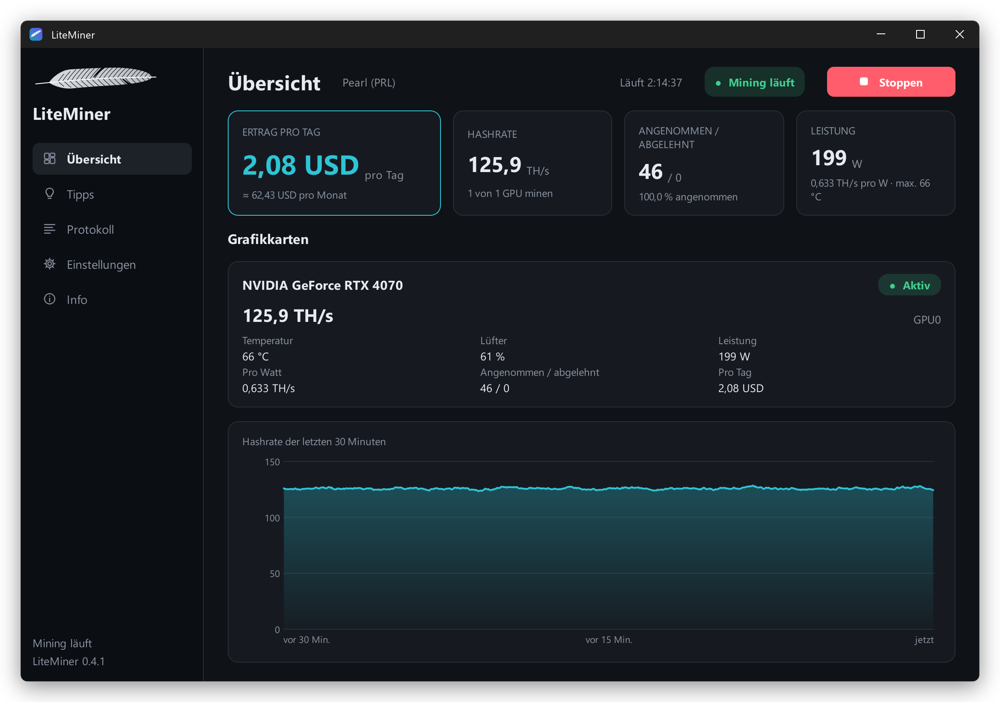
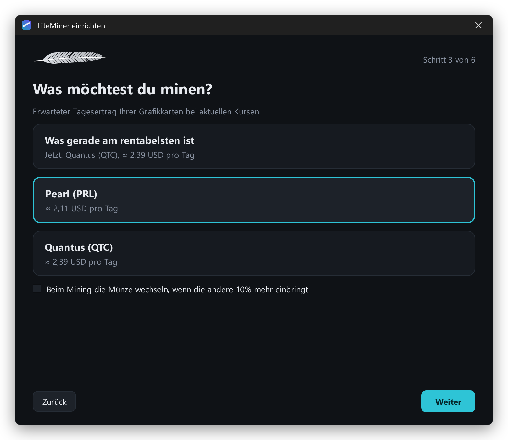
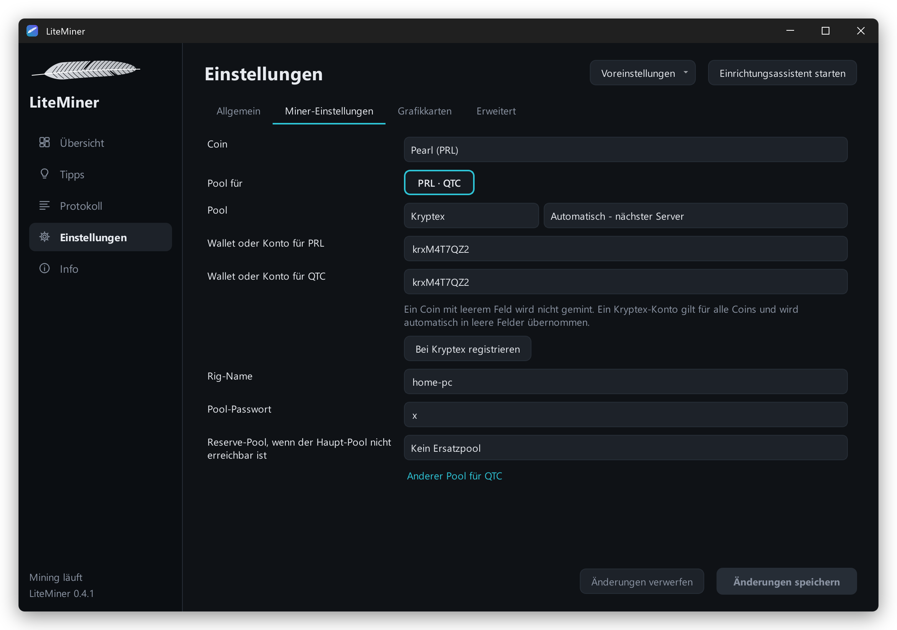

<p align="center"><a href="README.md">English</a> · <a href="README.zh-CN.md">简体中文</a> · <a href="README.es.md">Español</a> · <a href="README.pt-BR.md">Português</a> · <b>Deutsch</b> · <a href="README.fr.md">Français</a> · <a href="README.ja.md">日本語</a> · <a href="README.ko.md">한국어</a> · <a href="README.ru.md">Русский</a> · <a href="README.tr.md">Türkçe</a> · <a href="README.vi.md">Tiếng Việt</a></p>

<p align="center"></p>

<p align="center"><b>Der einfache Weg, Pearl (PRL) und Quantus (QTC) auf NVIDIA- und AMD-GPUs zu minen.</b></p>

<p align="center">
<a href="https://github.com/liteminergpu/liteminer/releases/latest"></a>
<a href="https://github.com/liteminergpu/liteminer/releases/latest"></a>
<a href="https://hub.docker.com/r/liteminer/liteminer"></a>
<a href="#schnellstart"></a>
<a href="#gpus-und-hashrate"></a>
<a href="#münzen-algorithmen-und-entwicklergebühr"></a>
<a href="#münzen-algorithmen-und-entwicklergebühr"></a>
<a href="https://www.virustotal.com/gui/file/bc30431c6269a0bc9a03dfb6e8125042bf01467bad59d4153e3432957a4097d0"></a>
<a href="#support"></a>
<a href="#lizenz"></a>
</p>

LiteMiner ist der Miner, den Sie sich schon immer gewünscht haben: aktuelle Algorithmen, abgestimmt auf jede GPU-Architektur, eine komfortable Desktop-App (GUI) oder ein Terminal-Miner (CLI), automatische Münzwahl, Reserve-Pools, praktische Tipps und ein gut lesbares Log. Er läuft mit voller Geschwindigkeit auf einem Rig oder arbeitet leise im Hintergrund Ihres Alltags-PCs und überlässt die GPU Spielen und anderen Programmen. Für Windows, Linux und HiveOS.

## Inhalt

- [Screenshots](#screenshots)
- [Das Wichtigste](#das-wichtigste)
- [Schnellstart](#schnellstart): [Windows](#windows) · [Linux](#linux) · [HiveOS](#hiveos) · [Docker und GPU-Miete](#docker-und-gpu-miete-vastai-cloreai-runpod-und-andere-gpu-clouds)
- [Downloads und Prüfsummen](#downloads-und-prüfsummen)
- [Münzen, Algorithmen und Entwicklergebühr](#münzen-algorithmen-und-entwicklergebühr)
- [Unterstützte Pools](#unterstützte-pools)
- [CLI-Optionen](#cli-optionen)
- [Statistik und Logs](#statistik-und-logs)
- [GPUs und Hashrate](#gpus-und-hashrate)
- [Wo LiteMiner seine Dateien ablegt](#wo-liteminer-seine-dateien-ablegt)
- [Fehlerbehebung](#fehlerbehebung)
- [Support](#support)
- [Lizenz](#lizenz)

## Screenshots

<p align="center"><br><sub>Grafische Oberfläche (GUI)</sub></p>

<p align="center"><br><sub>Miner in der Konsole (CLI)</sub></p>

<details>
<summary><b>Weitere Screenshots: Einrichtungsassistent und Einstellungen</b></summary>
<br>
<p align="center"> </p>
</details>

## Das Wichtigste

**1. Mit wenigen Klicks loslegen, statt sich durch Dokumentation zu wühlen.** Archiv entpacken, `LiteMiner-GUI` starten und ein paar einfache Fragen beantworten. Der Einrichtungsassistent erklärt, was eine Wallet und ein Pool sind, wählt den nächstgelegenen Pool-Server, prüft Ihre Adresse und startet das Mining, auch wenn Sie noch nie mit Kryptowährungen zu tun hatten. Die App gibt es in 11 Sprachen. Lieber im Terminal? Dort startet derselbe Miner mit einem einzigen Befehl.

**2. Schnell, mit ehrlichen Zahlen.** Jede GPU-Architektur hat eigene, eingebaute Einstellungen, und bei Pearl kann der Miner sie zusätzlich auf Ihre Karte abstimmen. Nach jeder Änderung messen wir die Geschwindigkeit auf eigenen und gemieteten GPUs neu. Die [Hashrate-Tabelle](#gpus-und-hashrate) zeigt, was LiteMiner auf jeder getesteten Karte tatsächlich erreicht hat: nur echte Messungen, keine Schätzungen und kein Aufrunden.

**3. Die Funktionen, die Ihnen gefehlt haben.** Minen Sie die Münze, die gerade mehr einbringt, und wechseln Sie automatisch, sobald die andere rentabler wird. Der Miner merkt, wenn Sie ein Spiel starten oder die GPU anderweitig nutzen, und senkt seine Last, damit er nie stört. Pause im Akkubetrieb, Ruhezustand nur während des Minings verhindern, Schutz der GPU vor Überhitzung, selbstständige Erholung nach Pool- und Netzwerkausfällen und vieles mehr. Jede dieser Funktionen lässt sich mit einem Klick einstellen.

Und ein paar Dinge, um die Sie sich nie kümmern müssen:

- **Ihre GPU-Einstellungen bleiben Ihre.** LiteMiner ändert niemals Takt, Spannung, Leistungslimit oder Lüfterdrehzahl, sondern liest nur die Sensoren aus. Undervolting oder ein niedrigeres Leistungslimit in Ihrem eigenen Tool beeinträchtigen LiteMiner nicht.
- **Drei Mining-Modi:** *Maximale Geschwindigkeit*; *Automatisch*: volle Geschwindigkeit, solange die GPU frei ist, doch sobald Sie sie brauchen, tritt der Miner zurück; *Nur wenn der Computer nicht benutzt wird*.
- **Ein Prozess pro GPU.** Fällt eine Karte aus oder hängt ihr Treiber, wird nur diese Karte neu gestartet, nicht das ganze Rig.
- **Pools, die weiterlaufen:** TLS mit Zertifikatsprüfung, automatische Wahl des nächstgelegenen Servers, bis zu acht Reserve-Pools, einfaches TCP, wo TLS blockiert ist, SOCKS5-Proxys und DNS over HTTPS.
- **Eine lokale, schreibgeschützte API** für Dashboards und Skripte, auf Wunsch auch Logs im JSON-Format.
- **Jeder Share wird vor dem Senden auf der CPU geprüft**, sodass ein Rechenfehler der GPU nie zu abgelehnten Shares führt.

## Schnellstart

### Windows

1. [Neueste Version herunterladen](https://github.com/liteminergpu/liteminer/releases/download/v0.4.1/LiteMiner-0.4.1-windows-x64-portable.zip) (`LiteMiner-0.4.1-windows-x64-portable.zip`).
2. Das Archiv in einen beliebigen Ordner entpacken.
3. **`LiteMiner-GUI.exe`** starten. Durch den Rest führt Sie der Einrichtungsassistent.

Lieber im Terminal? Tragen Sie Ihre Wallet (und Ihren Pool, falls Sie einen anderen nutzen) oben in `start_LiteMiner_pearl.bat` oder `start_LiteMiner_quantus.bat` ein und starten Sie die Datei, oder starten Sie den Miner direkt:

```bat
LiteMiner.exe -a pearl -o stratum+ssl://prl.kryptex.network:8048 -u YOUR_WALLET -w rig1
LiteMiner.exe -a quantus -o stratum+ssl://qtc.kryptex.network:8049 -u YOUR_WALLET -w rig1 --background
```

Oder mit einem einzigen PowerShell-Befehl herunterladen, entpacken und starten:

```powershell
irm https://github.com/liteminergpu/liteminer/releases/download/v0.4.1/LiteMiner-0.4.1-windows-x64-portable.zip -OutFile LiteMiner.zip; Expand-Archive LiteMiner.zip .; .\LiteMiner-0.4.1-windows-x64\LiteMiner-GUI.exe
```

Voraussetzungen: Windows 10 oder 11 (x64) und ein aktueller Grafiktreiber.

> [!TIP]
> Noch keine Wallet? Ein kostenloses [Kryptex-Konto](https://www.kryptex.com/register?ref=b629c482) funktioniert für beide Münzen: Geben Sie den Benutzernamen (`krxXXXXXX`) als Wallet ein, und Kryptex zahlt nach Ihrer Wahl in BTC oder USDT aus.

### Linux

Der schnellste Weg: Ein Befehl lädt herunter, entpackt und startet das Mining. Ersetzen Sie `YOUR_WALLET` durch Ihre Wallet (und den Pool, falls Sie einen anderen nutzen):

Pearl:

```bash
curl -fsSL https://github.com/liteminergpu/liteminer/releases/download/v0.4.1/LiteMiner-0.4.1-linux-x64-portable.tar.gz | tar -xz && cd LiteMiner-0.4.1-linux-x64 && ./LiteMiner -a pearl -o stratum+ssl://prl.kryptex.network:8048 -u YOUR_WALLET -w rig1
```

Quantus:

```bash
curl -fsSL https://github.com/liteminergpu/liteminer/releases/download/v0.4.1/LiteMiner-0.4.1-linux-x64-portable.tar.gz | tar -xz && cd LiteMiner-0.4.1-linux-x64 && ./LiteMiner -a quantus -o stratum+ssl://qtc.kryptex.network:8049 -u YOUR_WALLET -w rig1
```

Im selben Ordner liegt die Desktop-App: `./LiteMiner-GUI`.

Pakete für verschiedene Distributionen:

```bash
# Debian, Ubuntu, Linux Mint, Pop!_OS
wget https://github.com/liteminergpu/liteminer/releases/download/v0.4.1/liteminer_0.4.1_amd64.deb https://github.com/liteminergpu/liteminer/releases/download/v0.4.1/liteminer-gui_0.4.1_amd64.deb
sudo apt install ./liteminer_0.4.1_amd64.deb ./liteminer-gui_0.4.1_amd64.deb
```

```bash
# Fedora, RHEL, AlmaLinux, Rocky Linux (openSUSE: sudo zypper install ...)
sudo dnf install https://github.com/liteminergpu/liteminer/releases/download/v0.4.1/liteminer-0.4.1-1.x86_64.rpm https://github.com/liteminergpu/liteminer/releases/download/v0.4.1/liteminer-gui-0.4.1-1.x86_64.rpm
```

Das Paket `liteminer` enthält den Terminal-Miner für Server und Rigs; `liteminer-gui` fügt die Desktop-App hinzu. Um den Miner als Dienst zu betreiben, verwenden Sie `sudo systemctl enable --now liteminer@YOUR_USER`; der Dienst liest `~/.local/share/liteminer/miner.json`. Weitere Details: `man liteminer`.

Voraussetzungen: x86-64; glibc 2.28 oder neuer für den Terminal-Miner (Ubuntu 20.04, Debian 10, RHEL 8 oder neuer) und 2.34 oder neuer für die Desktop-App (Ubuntu 22.04, Debian 12, Fedora 35, RHEL 9 oder neuer); X11 oder Wayland. NVIDIA braucht den proprietären Treiber (das CUDA Toolkit ist nicht nötig), AMD einen OpenCL-Treiber wie ROCm. Minimale Systeme und Container benötigen für TLS-Pools außerdem das Paket `ca-certificates`.

### HiveOS

Legen Sie ein Flight Sheet an: **Coin**: Ihre Münze, **Wallet**: Ihre Wallet, **Pool**: *Configure in miner*, **Miner**: *Custom*. Klicken Sie dann auf **Setup Miner Config** und tragen Sie ein:

| Feld | Wert |
|---|---|
| Miner name | `liteminer` (wird aus der URL übernommen) |
| Installation URL | `https://github.com/liteminergpu/liteminer/releases/download/v0.4.1/liteminer-0.4.1.tar.gz` |
| Hash algorithm | `pearl` oder `quantus` |
| Wallet and worker template | `%WAL%.%WORKER_NAME%` |
| Pool URL | `stratum+ssl://prl.kryptex.network:8048` (Pearl) oder `stratum+ssl://qtc.kryptex.network:8049` (Quantus) |
| Pass | `x` |
| Extra config arguments | optional, zum Beispiel `--devices 0,2` oder `--thermal off` |

Wenden Sie das Flight Sheet auf das Rig an. Jede GPU mint als eigener Worker (`<worker>_gpuN` im Pool), Hive zeigt die Hashrate jeder GPU, und das Overclocking bleibt in Ihrem Hive-OC-Profil: LiteMiner rührt es nie an. Log: `/var/log/miner/custom/liteminer.log`; Konsole: `miner` in der Hive-Shell. Nur die erste Pool URL wird verwendet; für TLS-Ports schreiben Sie `stratum+ssl://`.

### Docker und GPU-Miete (Vast.ai, Clore.ai, RunPod und andere GPU-Clouds)

Docker braucht einen Linux-Host (oder Windows mit Docker Desktop und WSL 2) mit dem NVIDIA-Treiber und dem [NVIDIA Container Toolkit](https://docs.nvidia.com/datacenter/cloud-native/container-toolkit/latest/install-guide.html). Der Container unterstützt nur NVIDIA-GPUs.

```bash
docker run -d --name liteminer --gpus all --restart unless-stopped -v liteminer-data:/data \
  liteminer/liteminer:0.4.1 -a pearl -o stratum+ssl://prl.kryptex.network:8048 -u YOUR_WALLET -w rig1
docker logs -f liteminer
```

Statt Optionen nimmt der Container auch die Umgebungsvariablen `LITEMINER_ALGORITHM`, `LITEMINER_POOL`, `LITEMINER_WALLET`, `LITEMINER_WORKER`, `LITEMINER_PASSWORD` und `LITEMINER_DEVICES` an. Behalten Sie das Volume `/data`: Es enthält die Logs und die Abstimmungsergebnisse jeder GPU, sodass nach einem Neustart nicht erneut abgestimmt wird. `docker stop -t 60 liteminer` lässt jede GPU ihre aktuelle Arbeit beenden.

Wählen Sie in einer GPU-Cloud das Image `liteminer/liteminer:0.4.1` und setzen Sie `LITEMINER_ALGORITHM`, `LITEMINER_POOL` und `LITEMINER_WALLET` in den Umgebungsvariablen der Vorlage. Oder nehmen Sie ein beliebiges Ubuntu-Image mit CUDA (zum Beispiel `nvidia/cuda:12.4.1-base-ubuntu22.04`) und verwenden Sie dies als Startskript (on-start script):

```bash
apt-get update && apt-get install -y --no-install-recommends ca-certificates curl
curl -fsSL https://github.com/liteminergpu/liteminer/releases/download/v0.4.1/LiteMiner-0.4.1-linux-x64-portable.tar.gz | tar -xz -C /opt
cd /opt/LiteMiner-0.4.1-linux-x64 && nohup ./LiteMiner -a quantus -o stratum+ssl://qtc.kryptex.network:8049 -u YOUR_WALLET -w cloud1 > /var/log/liteminer.log 2>&1 &
```

Alle GPUs der Instanz minen. Das Log verfolgen Sie mit `tail -f /var/log/liteminer.log`. Gemietete Server laufen oft absichtlich heiß: Wenn der Anbieter die Temperaturen steuert, überlässt `--thermal off` sie ihm.

## Downloads und Prüfsummen

Alle Dateien der Version 0.4.1 finden Sie auf der [Release-Seite](https://github.com/liteminergpu/liteminer/releases/latest). Um einen Download mit `SHA256SUMS.txt` abzugleichen, führen Sie unter Windows `certutil -hashfile DATEI SHA256` oder unter Linux `sha256sum -c --ignore-missing SHA256SUMS.txt` aus.

| Plattform | Datei | Größe | SHA-256 | Prüfung |
|---|---|---:|---|---|
| Windows x64 | [`LiteMiner-0.4.1-windows-x64-portable.zip`](https://github.com/liteminergpu/liteminer/releases/download/v0.4.1/LiteMiner-0.4.1-windows-x64-portable.zip) | 80.5 MB | <sub>`bc30431c6269a0bc9a03dfb6e8125042bf01467bad59d4153e3432957a4097d0`</sub> | [VirusTotal](https://www.virustotal.com/gui/file/bc30431c6269a0bc9a03dfb6e8125042bf01467bad59d4153e3432957a4097d0) |
| Linux x64 | [`LiteMiner-0.4.1-linux-x64-portable.tar.gz`](https://github.com/liteminergpu/liteminer/releases/download/v0.4.1/LiteMiner-0.4.1-linux-x64-portable.tar.gz) | 103.1 MB | <sub>`b2ec6d7f92f95096953ef060056b269703189d732c32f75cf95824b6d83637d1`</sub> | [VirusTotal](https://www.virustotal.com/gui/file/b2ec6d7f92f95096953ef060056b269703189d732c32f75cf95824b6d83637d1) |
| HiveOS | [`liteminer-0.4.1.tar.gz`](https://github.com/liteminergpu/liteminer/releases/download/v0.4.1/liteminer-0.4.1.tar.gz) | 28.9 MB | <sub>`c32315c22ea0fbc5ce3e3752b9270b52d48e93d321cc5e3c29874900af2e6c41`</sub> | [VirusTotal](https://www.virustotal.com/gui/file/c32315c22ea0fbc5ce3e3752b9270b52d48e93d321cc5e3c29874900af2e6c41) |
| Docker (Build-Kontext) | [`LiteMiner-0.4.1-docker.tar.gz`](https://github.com/liteminergpu/liteminer/releases/download/v0.4.1/LiteMiner-0.4.1-docker.tar.gz) | 28.9 MB | <sub>`04f0921d1e2f148543d90f55ae2c6568c434e2d23053d3c6fcf0d06318c62c2d`</sub> | [VirusTotal](https://www.virustotal.com/gui/file/04f0921d1e2f148543d90f55ae2c6568c434e2d23053d3c6fcf0d06318c62c2d) |
| Debian / Ubuntu | [`liteminer_0.4.1_amd64.deb`](https://github.com/liteminergpu/liteminer/releases/download/v0.4.1/liteminer_0.4.1_amd64.deb) | 29.0 MB | <sub>`ac2754a69d8d5eefa2ad6dfbb94db907baa1e2704011d534c0bf62cec65f11af`</sub> | [VirusTotal](https://www.virustotal.com/gui/file/ac2754a69d8d5eefa2ad6dfbb94db907baa1e2704011d534c0bf62cec65f11af) |
| Debian / Ubuntu | [`liteminer-gui_0.4.1_amd64.deb`](https://github.com/liteminergpu/liteminer/releases/download/v0.4.1/liteminer-gui_0.4.1_amd64.deb) | 45.3 MB | <sub>`3940465636d7332f7b33597132c2c8186325aa0031fcb25b829c344669282ad1`</sub> | [VirusTotal](https://www.virustotal.com/gui/file/3940465636d7332f7b33597132c2c8186325aa0031fcb25b829c344669282ad1) |
| Fedora / RHEL / openSUSE | [`liteminer-0.4.1-1.x86_64.rpm`](https://github.com/liteminergpu/liteminer/releases/download/v0.4.1/liteminer-0.4.1-1.x86_64.rpm) | 24.0 MB | <sub>`6b1fd1555f93bca50deb1b9d4a4cbb221f306ae5b2092149d8909f62f1522ca8`</sub> | [VirusTotal](https://www.virustotal.com/gui/file/6b1fd1555f93bca50deb1b9d4a4cbb221f306ae5b2092149d8909f62f1522ca8) |
| Fedora / RHEL / openSUSE | [`liteminer-gui-0.4.1-1.x86_64.rpm`](https://github.com/liteminergpu/liteminer/releases/download/v0.4.1/liteminer-gui-0.4.1-1.x86_64.rpm) | 31.2 MB | <sub>`c9a0f98140a842c9e528cadd46d785d2d3d5be06f2e7455a9b90cb9ff063763e`</sub> | [VirusTotal](https://www.virustotal.com/gui/file/c9a0f98140a842c9e528cadd46d785d2d3d5be06f2e7455a9b90cb9ff063763e) |

> [!IMPORTANT]
> Virenscanner melden fast jeden Miner als „potenziell unerwünschtes Programm“ oder „Coin-Miner“. Das ist eine Kategorie, keine konkrete Bedrohung, deshalb sind die VirusTotal-Berichte oben offen verlinkt. Laden Sie LiteMiner nur von dieser Seite herunter und vergleichen Sie die Prüfsumme. Wenn Windows Defender die Datei entfernt, fügen Sie den LiteMiner-Ordner seinen Ausschlüssen hinzu.

## Münzen, Algorithmen und Entwicklergebühr

| Münze | Algorithmus | NVIDIA (CUDA) | AMD / Intel (OpenCL) | Devfee |
|---|---|---|---|---:|
| [Pearl (PRL)](https://pool.kryptex.com/prl) | Pearl (int8 MatMul PoW), `-a pearl` | Pascal (GTX 10) und neuer | ja (noch nicht gemessen) | 2% |
| [Quantus (QTC)](https://pool.kryptex.com/qtc) | QPoW (Poseidon2), `-a quantus` | Maxwell (GTX 900) und neuer | ja | 2% |

Wir nehmen eine Münze auf, wenn Sie danach fragen oder wenn sich ihr Mining lohnt. Gibt es nichts Neues, das sich lohnt, blähen wir die Liste nicht auf, sondern machen die vorhandenen Algorithmen auf Ihrer GPU schneller.

## Unterstützte Pools

LiteMiner arbeitet mit jedem Pool, der das Stratum-Protokoll der Münze unterstützt, über TLS (`stratum+ssl://`, mit Zertifikatsprüfung) oder einfaches TCP (`stratum+tcp://`). Die Pools unten sind in die App eingebaut: Sie wählt den Server mit der geringsten Latenz, hält eine andere Region als automatische Reserve bereit und prüft, ob Ihr Login das richtige Format für den Pool hat.

| Pool | PRL | QTC | Login | Server |
|---|---|---|---|---:|
| **[Kryptex](https://pool.kryptex.com/prl)**<br><sub>[registrieren](https://www.kryptex.com/register?ref=b629c482)</sub> | `stratum+ssl://prl.kryptex.network:8048`<br><sub>TLS, TCP 7048</sub> | `stratum+ssl://qtc.kryptex.network:8049`<br><sub>TLS, TCP 7049</sub> | Kryptex-Konto oder Wallet | 8 |
| **[PearlFortune](https://pearlfortune.org/)** | `stratum+ssl://global.pearlfortune.org:443`<br><sub>TLS, festes Zertifikat</sub> | - | Wallet-Adresse | 1 |
| **[LuckyPool](https://pearl.luckypool.io/)** | `stratum+ssl://pearl-eu1.luckypool.io:3360`<br><sub>TLS, festes Zertifikat</sub> | `stratum+ssl://eu.lproute.com:5660`<br><sub>TLS, festes Zertifikat</sub> | Wallet-Adresse | 19 |
| **[F2Pool](https://www.f2pool.com/coin/pearl)**<br><sub>[registrieren](https://www.f2pool.com/user/signup)</sub> | `stratum+tcp://pearl.f2pool.com:5500`<br><sub>nur TCP</sub> | `stratum+tcp://qtc.f2pool.com:4500`<br><sub>nur TCP</sub> | Name des Pool-Kontos | 1 |
| **[HeroMiners](https://pearl.herominers.com/)** | `stratum+ssl://de.pearl.herominers.com:1200`<br><sub>TLS</sub> | `stratum+ssl://de.quantus.herominers.com:1155`<br><sub>TLS</sub> | Wallet-Adresse | 15 |
| **[2Miners](https://2miners.com/prl-mining-pool)** | `stratum+ssl://prl.2miners.com:11818`<br><sub>TLS, TCP 1818</sub> | `stratum+ssl://qtc.2miners.com:13636`<br><sub>TLS, TCP 3636</sub> | Wallet-Adresse | 3 |

Der Terminal-Miner bietet dasselbe in seiner Konfigurationsdatei (`LiteMiner --init` legt ein Beispiel an):

```json
{
  "pool_host": "prl.kryptex.network", "pool_port": 8048, "tls": true, "tcp_port": 7048, "tcp_fallback": true,
  "wallet": "YOUR_WALLET", "worker": "rig1", "password": "x",
  "backup_pools": [
    {"pool_host": "prl-eu.kryptex.network", "pool_port": 8048},
    {"pool_host": "de.pearl.herominers.com", "pool_port": 1200, "wallet": "YOUR_PRL_ADDRESS"}
  ],
  "proxy": "socks5://127.0.0.1:9050"
}
```

`backup_pools` fasst bis zu acht Pools; der Miner kehrt von selbst zum Haupt-Pool zurück, sobald dieser wieder funktioniert. `tcp_fallback` nutzt den unverschlüsselten Port nur, wenn TLS überhaupt keine Verbindung herstellen kann. `proxy` leitet die Pool-Verbindung über SOCKS5 (Benutzername und Passwort in `LITEMINER_PROXY_USERNAME` und `LITEMINER_PROXY_PASSWORD`), und `doh_url` löst die Pool-Adresse über DNS over HTTPS auf.

## CLI-Optionen

**In der Desktop-App lässt sich all das per Häkchen einstellen, Sie können diesen Abschnitt also überspringen.** Für das Terminal finden Sie hier alle Optionen des Miners, direkt aus dem Programm dieser Version übernommen:

| Option | Beschreibung |
|---|---|
| `-V`, `--version` | Version und Build anzeigen, dann beenden |
| `-a`, `--algorithm` `ALGORITHM` | `pearl` (Standard), `quantus` / `qpow` / `qtc` |
| `--config` `CONFIG` | JSON-Konfigurationsdatei (Standard: `miner.json` für Pearl, `quantus.json` für Quantus) |
| `-o`, `--pool` `POOL` | Pool-Adresse mit Port: `stratum+ssl://host:port` oder `stratum+tcp://host:port` |
| `-u`, `--wallet` `WALLET` | Wallet-Adresse oder Pool-Konto |
| `-w`, `--worker` `WORKER` | Worker-Name (Standard: `rig1`) |
| `-p`, `--password` `PASSWORD` | Pool-Passwort (Standard: `x`) |
| `--devices` `DEVICES` | `all` (Standard: GPUs mit CUDA oder Metal sowie Nicht-NVIDIA-GPUs mit OpenCL) oder kommagetrennte Nummern / `opencl:N`; jede GPU läuft in einem eigenen, isolierten Prozess |
| `--list-devices` | GPUs und die Münzen, die jede davon minen kann, auflisten und beenden (mit `--log-format json` als JSON) |
| `-B`, `--benchmark` | Benchmark: auf Ihrem Pool und Ihrer Wallet, wenn sie angegeben sind, sonst online mit automatischem Wechsel in den Offline-Modus |
| `--benchmark-seconds` `BENCHMARK_SECONDS` | Dauer des Benchmarks nach der Vorbereitung der GPUs (Standard: 900 Sekunden; `0`: bis zum Stoppen) |
| `--stop-file` `PATH` | sauber anhalten (jede GPU beendet ihre aktuelle Arbeit), sobald diese Datei existiert |
| `--no-autotune` | Recheneinstellungen aus der Konfiguration ohne automatische Abstimmung verwenden; die Anpassung an Last und VRAM bleibt aktiv |
| `--autotune` | Pearl mit voller Geschwindigkeit: beim Start die Recheneinstellungen per Messung wählen (bis zu 4 Min. ohne Mining) statt der eingebauten für die Architektur; das Ergebnis wird für spätere Starts gespeichert |
| `--background` | automatischer Modus: volle Geschwindigkeit, solange die GPU frei ist; macht Spielen und anderen GPU-Programmen Platz und pausiert, solange sie die ganze Karte brauchen |
| `--idle-only` | volle Geschwindigkeit nur, solange niemand den Computer benutzt (keine Tastatur- oder Mauseingabe für `--idle-seconds`); sonst pausiert, die Pool-Verbindung bleibt bestehen; unter Windows macht es wie der automatische Modus auch anderen GPU-Programmen Platz |
| `--idle-seconds` `IDLE_SECONDS` | Sekunden ohne Tastatur- und Mauseingabe, bevor das Mining beginnt (10..86400, Standard: 120); aktiviert `--idle-only` |
| `--no-load-pause` | nicht pausieren, wenn andere Programme die GPU stark auslasten, sondern auf der niedrigsten Stufe weiter minen; aktiviert `--background`, sofern `--idle-only` nicht angegeben ist |
| `--mine-on-battery` | auch im Akkubetrieb weiter minen (Standard: Pause bis zum Netzbetrieb; im Akkubetrieb ist die Hashrate meist deutlich niedriger) |
| `--allow-sleep` | dem Computer erlauben, beim Mining nach dem Leerlauftimer in den Ruhezustand zu gehen (Standard: er bleibt wach, solange eine GPU mint; der Bildschirm kann sich trotzdem abschalten) |
| `--api-port` `API_PORT` | Port der lokalen, schreibgeschützten JSON-API (Standard: 4280) |
| `--api-bind` `API_BIND` | Adresse der API: nur `127.0.0.1` (Standard), `::1` oder `localhost` |
| `--no-api` | lokale JSON-API abschalten (die Desktop-App braucht sie) |
| `--thermal` `{auto,custom,off}` | Temperaturschutz: `auto` (Treibergrenzen, Standard), `custom` (`--thermal-soft/hard/resume`; wird automatisch gewählt, wenn sie angegeben sind) oder `off` |
| `--thermal-gpu` `LABEL=SOFT:HARD:RESUME` | eigene Chip-Grenzen für eine GPU, z. B. `gpu1=80:88:75` (pro GPU wiederholen; nicht zusammen mit `--thermal off`) |
| `--thermal-soft` `THERMAL_SOFT` | eigene Chiptemperatur in °C, ab der gedrosselt wird |
| `--thermal-hard` `THERMAL_HARD` | eigene Chiptemperatur in °C, bei der das Mining pausiert |
| `--thermal-resume` `THERMAL_RESUME` | Chiptemperatur in °C, unter der das Mining fortgesetzt wird |
| `--thermal-memory-soft` `THERMAL_MEMORY_SOFT` | eigene Speichertemperatur in °C, ab der gedrosselt wird |
| `--thermal-memory-hard` `THERMAL_MEMORY_HARD` | eigene Speichertemperatur in °C, bei der das Mining pausiert |
| `--thermal-memory-resume` `THERMAL_MEMORY_RESUME` | Speichertemperatur in °C, unter der das Mining fortgesetzt wird |
| `-v`, `--verbose` | zusätzliche Diagnosemeldungen anzeigen |
| `--no-color` | Konsolenausgabe ohne Farben |
| `--log-file` `LOG_FILE` | Logdatei (Standard: `logs\liteminer.log`; Rotation bei 10 MB, 3 werden behalten) |
| `--no-log-file` | keine Logdatei schreiben |
| `--log-format` `{text,json}` | Konsolenausgabe: `text` (Standard) oder ein JSON-Datensatz pro Zeile (für Skripte) |
| `--no-update-check` | nicht nach einer neuen Version suchen (Standard: einmal täglich wird die öffentliche Release-Seite gelesen; gesendet werden nur Programmname und Version) |
| `--gui` | die Desktop-App öffnen (unter Windows auch `LiteMiner-GUI.exe`) |
| `--init` | die Beispielkonfigurationen `miner.json` und `quantus.json` im aktuellen Ordner anlegen |
| `--runtime-info` | den Ordner mit den entpackten Programmdateien anzeigen |
| `--verify-package` | alle Programmdateien anhand der eingebauten Prüfsummen prüfen |

Häufige Beispiele:

```bash
LiteMiner --list-devices                                # welche GPUs LiteMiner sieht und welche Münzen jede minen kann
LiteMiner -a quantus ... --devices 0,2                  # nur auf GPU 0 und 2 minen (je ein Worker)
LiteMiner -a pearl ... --background                     # automatischer Modus: Spielen und anderen GPU-Programmen Platz machen
LiteMiner -a pearl ... --idle-only --idle-seconds 300   # erst nach 5 Minuten ohne Tastatur- und Mauseingabe minen
LiteMiner -a quantus ... --thermal-gpu gpu1=78:86:72    # eigene Temperaturgrenzen für eine Karte
LiteMiner -B -a pearl --benchmark-seconds 300           # 5-Minuten-Benchmark, keine Wallet nötig
```

## Statistik und Logs

**Konsole.** Alle 30 Sekunden zeigt der Miner eine Tabelle mit Geschwindigkeit, Temperatur, Lüfter, Leistung, Effizienz, angenommenen und abgelehnten Shares und dem Zustand jeder GPU; dazwischen eine Zeile pro Ereignis (neuer Job, Share, Neuverbindung, Temperaturschutz). Mit `--log-format json` gibt die Konsole stattdessen einen JSON-Datensatz pro Zeile aus, bereit für `jq` oder einen Log-Collector.

**Logdatei.** `logs/liteminer.log` neben der Konfiguration. Sie wird bei 10 MB rotiert, drei Dateien werden behalten. `--log-file` verlegt sie, `--no-log-file` schaltet sie ab.

**Lokale API.** Eine kleine, schreibgeschützte JSON-API auf `127.0.0.1:4280`. Die Desktop-App nutzt sie, und Ihre Skripte und Dashboards können das auch:

| Endpunkt | Liefert |
|---|---|
| `GET /api/v1/summary` | Summen des Rigs: Version, Algorithmus, Laufzeit, Zustand, Gesamtgeschwindigkeit und ihre Einheit, Shares (angenommen, abgelehnt, ausstehend), Höchsttemperatur, Leistung, Energie, Pools |
| `GET /api/v1/devices` | dasselbe für jede GPU: Name, Zustand, Geschwindigkeit, Shares, Temperatur, Lüfter, Leistung, Pool |
| `GET /api/v1/health` | `ok`, `starting`, `degraded` oder `down` (HTTP 503 bei `down`), für Watchdog-Skripte |
| `GET /api/v1/history` | die letzte Stunde jeder GPU in 5-Sekunden-Schritten: Geschwindigkeit, Temperatur, Leistung |

```bash
curl -s http://127.0.0.1:4280/api/v1/summary
```

```json
{"api_version":1,"product":"LiteMiner","version":"0.4.1","algorithm":"quantus","uptime_seconds":180.4,
 "health":"ok","devices":1,"device_states":{"mining":1},"rate":518.6,"unit":"MH/s","rate_window_seconds":60,
 "shares":{"accepted":2,"rejected":0,"submitted":2,"lost_unacknowledged":0,"discarded_stale":0,"verification_rejected":0,"pending":0},
 "max_temperature_c":64,"power_w":196.0,"pools":["qtc.kryptex.network:8049"]}
```

Die API lauscht nur auf der Loopback-Schnittstelle (`--api-bind` akzeptiert `127.0.0.1`, `::1` oder `localhost`), prüft den `Host`-Header gegen DNS-Rebinding und gibt niemals eine Wallet, ein Passwort oder einen Konfigurationswert heraus. **Steuerungs-Endpunkte gibt es bewusst nicht:** Nichts im Netzwerk kann Ihren Miner anhalten, umkonfigurieren oder umleiten. Um ihn per Skript anzuhalten, verwenden Sie `--stop-file PFAD` (sobald die Datei existiert, beendet jede GPU ihre aktuelle Arbeit und der Miner schließt sich) oder senden Sie Strg+C / SIGINT.

**HiveOS** erhält die Hashrate jeder GPU (zugeordnet über den PCI-Bus) über die Standardstatistik für Custom-Miner; Temperaturen und Lüfter liest Hive selbst aus.

## GPUs und Hashrate

Echte Ergebnisse von LiteMiner 0.4.1 und seinen jüngsten Builds auf 56 GPU-Modellen. Ein `?` bedeutet, dass wir diese Kombination noch nicht gemessen haben, nicht dass sie nicht funktioniert.

Alle Ergebnisse wurden mit den Werkseinstellungen der Karten gemessen: LiteMiner hat weder Takt noch Spannung, Leistungslimit oder Lüfter verändert. Undervolting oder ein niedrigeres Leistungslimit in Ihrem eigenen Tool wird voll unterstützt: LiteMiner passt sich der Geschwindigkeit an, die die Karte liefert.

#### GeForce und TITAN

| GPU | PRL, TH/s | QTC, MH/s | Letzter Test |
|---|---:|---:|---|
| RTX 5080 | 238.3 | 982.8 | 2026-11 |
| RTX 5070 | 134.2 | 552.7 | 2026-11 |
| RTX 5070 Ti | 204.5 | 840.8 | 2026-11 |
| RTX 5060 | 83.4 | 352.0 | 2026-11 |
| RTX 5060 Ti | 100.0 | 421.7 | 2026-11 |
| RTX 4090 | 332.4 | 1388.9 | 2026-11 |
| RTX 4080 | 210.0 | 851.3 | 2026-11 |
| RTX 4080 SUPER | 215.1 | 875.6 | 2026-11 |
| RTX 4070 | 127.8 | 518.6 | 2026-11 |
| RTX 4070 SUPER | 123.8 | 456.8 | 2026-11 |
| RTX 4060 | 64.3 | 266.8 | 2026-11 |
| RTX 4060 Ti | 95.1 | 379.3 | 2026-11 |
| RTX 3090 | 140.8 | 589.2 | 2026-11 |
| RTX 3090 Ti | 150.2 | 619.6 | 2026-11 |
| RTX 3080 | 120.4 | 505.2 | 2026-11 |
| RTX 3080 Ti | 140.9 | 589.1 | 2026-11 |
| RTX 3070 | 80.9 | 331.7 | 2026-11 |
| RTX 3070 Ti | 95.3 | 389.4 | 2026-11 |
| RTX 3060 | 54.6 | 227.9 | 2026-11 |
| RTX 3060 Ti | 70.8 | 296.0 | 2026-11 |
| RTX 2080 | 64.8 | 303.1 | 2026-10 |
| RTX 2080 Ti | 89.5 | 418.0 | 2026-11 |
| RTX 2070 | 58.1 | 257.1 | 2026-11 |
| RTX 2070 SUPER | 37.8 | 207.5 | 2026-10 |
| RTX 2060 | 39.3 | 170.1 | 2026-10 |
| RTX 2060 SUPER | 52.8 | 234.1 | 2026-11 |
| GTX 1660 SUPER | 8.54 | 162.5 | 2026-11 |
| GTX 1660 Ti | 7.34 | 140.6 | 2026-11 |
| GTX 1080 | 7.95 | 53.5 | 2026-10 |
| GTX 1080 Ti | 13.1 | 119.7 | 2026-11 |
| GTX 1070 | 6.47 | 42.6 | 2026-11 |
| GTX 1070 Ti | 9.21 | 71.6 | 2026-11 |
| GTX 1060 | 5.11 | 43.1 | 2026-11 |
| GTX TITAN X | ? | 33.9 | 2026-10 |
| TITAN RTX | 66.3 | 344.1 | 2026-10 |
| TITAN V | 11.7 | 235.4 | 2026-10 |
| TITAN Xp | 7.59 | 63.1 | 2026-10 |

#### Mining-Karten (CMP, P104)

| GPU | PRL, TH/s | QTC, MH/s | Letzter Test |
|---|---:|---:|---|
| CMP 90HX | 60.0 | 282.8 | 2026-10 |
| CMP 70HX | 19.4 | 188.7 | 2026-11 |
| CMP 50HX | 40.0 | 234.2 | 2026-10 |
| CMP 30HX | 0.87 | 91.6 | 2026-10 |
| P104-100 | 5.63 | 47.3 | 2026-11 |

#### Workstation und Rechenzentrum

| GPU | PRL, TH/s | QTC, MH/s | Letzter Test |
|---|---:|---:|---|
| A10 | 75.7 | 333.9 | 2026-10 |
| A100 PCIe | 194.7 | 404.8 | 2026-10 |
| Quadro P4000 | 5.60 | 44.7 | 2026-10 |
| RTX A2000 | 29.2 | 137.6 | 2026-10 |
| RTX A4000 | 70.6 | 294.3 | 2026-11 |
| RTX A5000 | 75.7 | 323.5 | 2026-10 |
| Tesla P40 | 10.6 | 59.7 | 2026-10 |
| Tesla P100 | ? | 88.8 | 2026-11 |
| Tesla V100 | 41.2 | 486.3 | 2026-11 |
| Tesla V100 SXM2 16 GB | 30.6 | 347.1 | 2026-11 |

#### AMD Radeon

| GPU | PRL, TH/s | QTC, MH/s | Letzter Test |
|---|---:|---:|---|
| RX 9070 XT | 123.6 | 293.2 | 2026-11 |
| RX 9060 XT | 60.4 | 151.9 | 2026-11 |
| RX 7900 XTX | 56.0 | 396.4 | 2026-11 |
| RX 7800 XT | 31.8 | 226.6 | 2026-11 |

Ihre Karte fehlt oder ist langsamer als hier? Führen Sie `LiteMiner -B` aus (standardmäßig 15 Minuten) und schicken Sie uns das Ergebnis an [lmsupp@proton.me](mailto:lmsupp@proton.me).

## Wo LiteMiner seine Dateien ablegt

| Was | Windows | Linux |
|---|---|---|
| Einstellungen der Desktop-App | `%LOCALAPPDATA%\LiteMiner\data` | `~/.local/share/liteminer` |
| Konfiguration des Terminal-Miners | `miner.json` und `quantus.json` im aktuellen Ordner | ebenso; bei den Paketen `~/.local/share/liteminer` |
| Logs | `logs\liteminer.log` | `logs/liteminer.log` |
| Entpackte Programmdateien | `%TEMP%\.liteminer-runtime-v2` (zeigt `--runtime-info` an) | `$TMPDIR` oder `/tmp`, sonst `~/.cache` |

Das Programm ist portabel: Jede EXE enthält alles, was sie braucht, und prüft bei jedem Start ihre eigenen Dateien. Eine neue Version, die in einen anderen Ordner entpackt wird, übernimmt Ihre Einstellungen, und alte entpackte Versionen werden automatisch entfernt.

## Fehlerbehebung

<details>
<summary><b>„No GPU found that LiteMiner can use“ (keine nutzbare GPU gefunden)</b></summary>

Installieren Sie den aktuellen Treiber von [NVIDIA](https://www.nvidia.com/Download/index.aspx) oder [AMD](https://www.amd.com/en/support). Bei NVIDIA braucht Pearl Pascal (GTX 10) oder neuer und Quantus Maxwell (GTX 900) oder neuer. `LiteMiner --list-devices` zeigt, welche GPUs der Miner sieht und welche Münzen jede davon minen kann.
</details>

<details>
<summary><b>Der Virenscanner hat LiteMiner gelöscht</b></summary>

Die meisten Virenscanner melden Miner wegen ihrer Kategorie, nicht wegen einer konkreten Bedrohung. Vergleichen Sie die Datei mit `SHA256SUMS.txt` und dem VirusTotal-Bericht unter [Downloads und Prüfsummen](#downloads-und-prüfsummen) und fügen Sie dann den LiteMiner-Ordner den Ausschlüssen hinzu.
</details>

<details>
<summary><b>„Another LiteMiner is already mining on this GPU“ (Exit-Code 8)</b></summary>

Eine GPU kann immer nur von einer Kopie von LiteMiner genutzt werden. Schließen Sie die andere Kopie (oder die Desktop-App, die ihren eigenen Miner startet), oder geben Sie jeder Kopie mit `--devices` eigene GPUs.
</details>

<details>
<summary><b>TLS-Fehler auf einem minimalen Linux oder in einem Container</b></summary>

Installieren Sie `ca-certificates`: LiteMiner prüft die Zertifikate der Pools gegen den Zertifikatsspeicher des Systems und mint nicht über eine ungeprüfte Verbindung.
</details>

<details>
<summary><b>Spiele ruckeln beim Mining</b></summary>

Wählen Sie in der App den Modus *Automatisch* (`--background` im Terminal): Er überlässt die GPU Spielen und pausiert, solange sie die ganze Karte brauchen. Der Modus *Nur wenn der Computer nicht benutzt wird* (`--idle-only`) mint nur, solange Sie nicht da sind.
</details>

## Support

Fragen, Fehlerberichte und Benchmark-Ergebnisse: [lmsupp@proton.me](mailto:lmsupp@proton.me).

Bevor Sie schreiben, führen Sie `LiteMiner --list-devices` aus und hängen Sie die Ausgabe zusammen mit `logs/liteminer.log` an.

## Lizenz

LiteMiner kann kostenlos heruntergeladen und genutzt werden, mit der oben genannten Entwicklergebühr von 2%. Der Quellcode wird nicht veröffentlicht.

Mining verbraucht Strom: Behalten Sie die Temperaturen, Ihre Stromrechnung und die Gesetze Ihres Landes im Blick. LiteMiner wird ohne Mängelgewähr und ohne jede Garantie bereitgestellt. Das Dekompilieren, Verändern und ähnliche Eingriffe in das Programm sind streng untersagt, ausgenommen die darin enthaltenen Bibliotheken von Drittanbietern. Untersagt ist die Weitergabe von LiteMiner als Teil von Programmen, die Computern schaden können („Viren“), sowie in allen anderen Fällen, die gegen die Gesetze Ihres Landes verstoßen. Untersagt ist die Nutzung von LiteMiner auf Computern, deren Eigentümer Ihnen nicht erlaubt haben, einen Kryptowährungs-Miner zu installieren und/oder zu nutzen.
