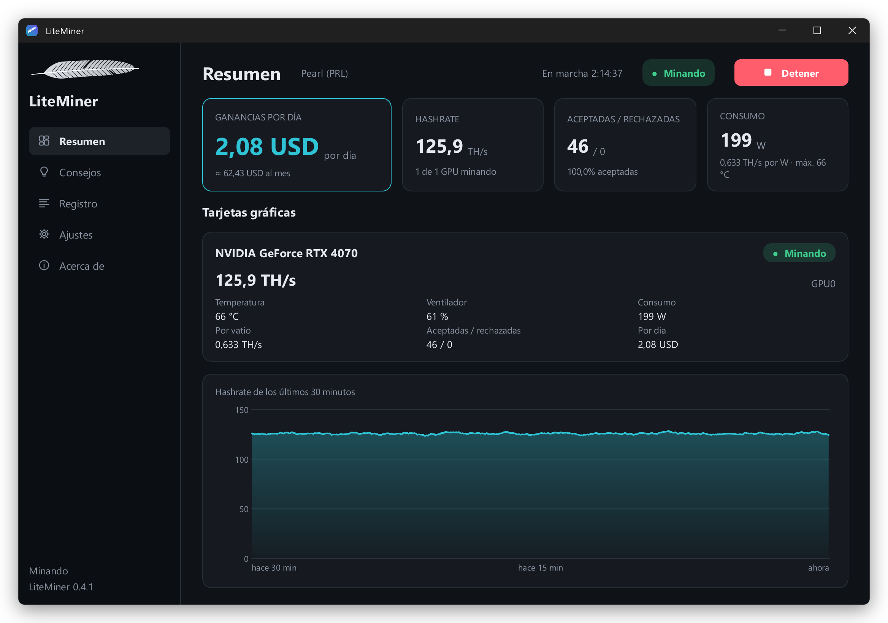
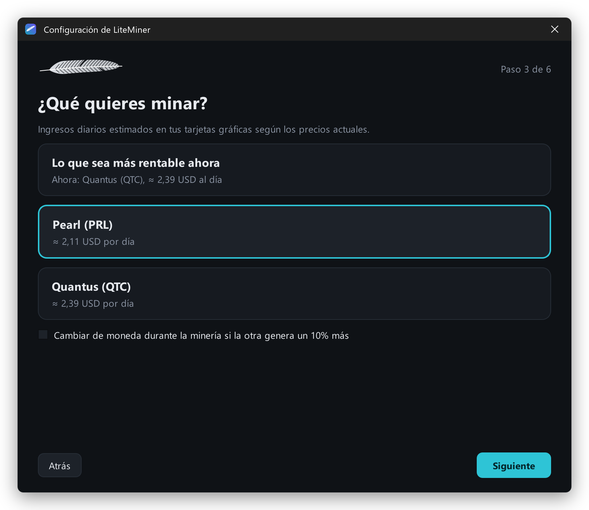
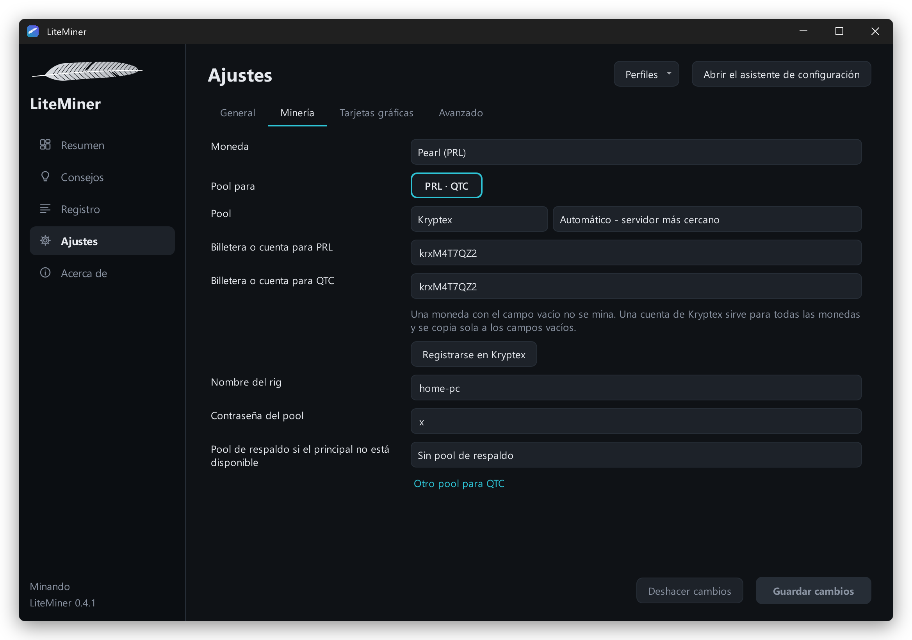

<p align="center"><a href="README.md">English</a> · <a href="README.zh-CN.md">简体中文</a> · <b>Español</b> · <a href="README.pt-BR.md">Português</a> · <a href="README.de.md">Deutsch</a> · <a href="README.fr.md">Français</a> · <a href="README.ja.md">日本語</a> · <a href="README.ko.md">한국어</a> · <a href="README.ru.md">Русский</a> · <a href="README.tr.md">Türkçe</a> · <a href="README.vi.md">Tiếng Việt</a></p>

<p align="center"></p>

<p align="center"><b>La forma sencilla de minar Pearl (PRL) y Quantus (QTC) con GPU NVIDIA y AMD.</b></p>

<p align="center">
<a href="https://github.com/liteminergpu/liteminer/releases/latest"></a>
<a href="https://github.com/liteminergpu/liteminer/releases/latest"></a>
<a href="https://hub.docker.com/r/liteminer/liteminer"></a>
<a href="#inicio-rápido"></a>
<a href="#gpu-y-hashrate"></a>
<a href="#monedas-algoritmos-y-comisión-del-desarrollador"></a>
<a href="#monedas-algoritmos-y-comisión-del-desarrollador"></a>
<a href="https://www.virustotal.com/gui/file/bc30431c6269a0bc9a03dfb6e8125042bf01467bad59d4153e3432957a4097d0"></a>
<a href="#soporte"></a>
<a href="#licencia"></a>
</p>

LiteMiner es el minero que siempre has querido: algoritmos actualizados y ajustados para cada arquitectura de GPU, una cómoda aplicación de escritorio (GUI) o un minero de terminal (CLI), elección automática de la moneda, pools de respaldo, consejos prácticos y un registro fácil de leer. Puede funcionar a toda velocidad en un rig o trabajar en silencio, en segundo plano, en tu PC de todos los días, cediendo la GPU a los juegos y a otros programas. Para Windows, Linux y HiveOS.

## Contenido

- [Capturas de pantalla](#capturas-de-pantalla)
- [Lo más destacado](#lo-más-destacado)
- [Inicio rápido](#inicio-rápido): [Windows](#windows) · [Linux](#linux) · [HiveOS](#hiveos) · [Docker y alquiler de GPU](#docker-y-alquiler-de-gpu-vastai-cloreai-runpod-y-otras-nubes-de-gpu)
- [Descargas y sumas de verificación](#descargas-y-sumas-de-verificación)
- [Monedas, algoritmos y comisión del desarrollador](#monedas-algoritmos-y-comisión-del-desarrollador)
- [Pools compatibles](#pools-compatibles)
- [Opciones de la CLI](#opciones-de-la-cli)
- [Estadísticas y registros](#estadísticas-y-registros)
- [GPU y hashrate](#gpu-y-hashrate)
- [Dónde guarda LiteMiner sus archivos](#dónde-guarda-liteminer-sus-archivos)
- [Solución de problemas](#solución-de-problemas)
- [Soporte](#soporte)
- [Licencia](#licencia)

## Capturas de pantalla

<p align="center"><br><sub>Interfaz gráfica (GUI)</sub></p>

<p align="center"><br><sub>Minero en la consola (CLI)</sub></p>

<details>
<summary><b>Más capturas: asistente de configuración y ajustes</b></summary>
<br>
<p align="center"> </p>
</details>

## Lo más destacado

**1. Empieza a minar en un par de clics, sin rebuscar en la documentación.** Descomprime el archivo, abre `LiteMiner-GUI` y responde a unas pocas preguntas sencillas. El asistente de configuración explica qué son un monedero y un pool, elige el servidor del pool más cercano, comprueba tu dirección y empieza a minar, aunque nunca hayas tenido nada que ver con las criptomonedas. La aplicación está disponible en 11 idiomas. ¿Prefieres la terminal? El mismo minero se inicia allí con un solo comando.

**2. Rápido y con cifras honestas.** Cada arquitectura de GPU tiene sus propios ajustes integrados, y para Pearl el minero puede afinarlos además en tu tarjeta. Después de cada cambio volvemos a medir la velocidad en nuestras GPU y en GPU alquiladas. La [tabla de hashrate](#gpu-y-hashrate) muestra lo que LiteMiner consiguió de verdad en cada tarjeta probada: solo mediciones reales, sin estimaciones y sin redondear al alza.

**3. Las funciones que echabas de menos.** Mina la moneda que más paga ahora mismo y cambia automáticamente cuando otra se vuelva más rentable. El minero detecta cuándo inicias un juego o usas la GPU para otra cosa y reduce su carga para no molestarte. Pausa con batería, evita la suspensión solo mientras mina, protege la GPU del sobrecalentamiento, se recupera solo de los fallos del pool y de la red, y mucho más. Cada una de estas funciones se configura con un solo clic.

Y algunas cosas de las que nunca tendrás que preocuparte:

- **Los ajustes de tu GPU siguen siendo tuyos.** LiteMiner nunca cambia frecuencias, voltajes, límites de potencia ni la velocidad de los ventiladores; solo lee los sensores. Hacer undervolt o bajar el límite de potencia con tu propia herramienta no afecta al funcionamiento de LiteMiner.
- **Tres modos de minería:** *Velocidad máxima*; *Automático*, que va a toda velocidad mientras la GPU está libre y te la cede cuando la necesitas; *Solo cuando el equipo no se usa*.
- **Un proceso por GPU.** Si una tarjeta falla o su controlador se bloquea, solo se reinicia esa tarjeta, no todo el rig.
- **Pools que no fallan:** TLS con verificación de certificados, elección automática del servidor más cercano, hasta ocho pools de respaldo, TCP normal donde TLS está bloqueado, proxies SOCKS5 y DNS sobre HTTPS.
- **Una API local de solo lectura** para paneles y scripts, y registros en JSON si los necesitas.
- **Cada share se verifica en la CPU** antes de enviarlo, así que un error de cálculo de la GPU nunca se convierte en shares rechazados.

## Inicio rápido

### Windows

1. [Descarga la última versión](https://github.com/liteminergpu/liteminer/releases/download/v0.4.1/LiteMiner-0.4.1-windows-x64-portable.zip) (`LiteMiner-0.4.1-windows-x64-portable.zip`).
2. Descomprime el archivo en cualquier carpeta.
3. Abre **`LiteMiner-GUI.exe`**. El asistente de configuración te guiará en el resto.

¿Prefieres la terminal? Escribe tu monedero (y tu pool, si usas otro) al principio de `start_LiteMiner_pearl.bat` o `start_LiteMiner_quantus.bat` y ejecútalo, o inicia el minero directamente:

```bat
LiteMiner.exe -a pearl -o stratum+ssl://prl.kryptex.network:8048 -u YOUR_WALLET -w rig1
LiteMiner.exe -a quantus -o stratum+ssl://qtc.kryptex.network:8049 -u YOUR_WALLET -w rig1 --background
```

O descárgalo, descomprímelo e inícialo con un solo comando de PowerShell:

```powershell
irm https://github.com/liteminergpu/liteminer/releases/download/v0.4.1/LiteMiner-0.4.1-windows-x64-portable.zip -OutFile LiteMiner.zip; Expand-Archive LiteMiner.zip .; .\LiteMiner-0.4.1-windows-x64\LiteMiner-GUI.exe
```

Requisitos: Windows 10 u 11 (x64) y un controlador gráfico actualizado.

> [!TIP]
> ¿Aún no tienes monedero? Una [cuenta de Kryptex](https://www.kryptex.com/register?ref=b629c482) gratuita sirve para las dos monedas: escribe su nombre de usuario (`krxXXXXXX`) como monedero y Kryptex te pagará en BTC o en USDT, como prefieras.

### Linux

La forma más rápida: un solo comando descarga, descomprime y empieza a minar. Sustituye `YOUR_WALLET` por tu monedero (y el pool, si usas otro):

Pearl:

```bash
curl -fsSL https://github.com/liteminergpu/liteminer/releases/download/v0.4.1/LiteMiner-0.4.1-linux-x64-portable.tar.gz | tar -xz && cd LiteMiner-0.4.1-linux-x64 && ./LiteMiner -a pearl -o stratum+ssl://prl.kryptex.network:8048 -u YOUR_WALLET -w rig1
```

Quantus:

```bash
curl -fsSL https://github.com/liteminergpu/liteminer/releases/download/v0.4.1/LiteMiner-0.4.1-linux-x64-portable.tar.gz | tar -xz && cd LiteMiner-0.4.1-linux-x64 && ./LiteMiner -a quantus -o stratum+ssl://qtc.kryptex.network:8049 -u YOUR_WALLET -w rig1
```

En la misma carpeta está la aplicación de escritorio: `./LiteMiner-GUI`.

Paquetes para distintas distribuciones:

```bash
# Debian, Ubuntu, Linux Mint, Pop!_OS
wget https://github.com/liteminergpu/liteminer/releases/download/v0.4.1/liteminer_0.4.1_amd64.deb https://github.com/liteminergpu/liteminer/releases/download/v0.4.1/liteminer-gui_0.4.1_amd64.deb
sudo apt install ./liteminer_0.4.1_amd64.deb ./liteminer-gui_0.4.1_amd64.deb
```

```bash
# Fedora, RHEL, AlmaLinux, Rocky Linux (openSUSE: sudo zypper install ...)
sudo dnf install https://github.com/liteminergpu/liteminer/releases/download/v0.4.1/liteminer-0.4.1-1.x86_64.rpm https://github.com/liteminergpu/liteminer/releases/download/v0.4.1/liteminer-gui-0.4.1-1.x86_64.rpm
```

El paquete `liteminer` contiene el minero de terminal para servidores y rigs; `liteminer-gui` añade la aplicación de escritorio. Para ejecutar el minero como servicio, usa `sudo systemctl enable --now liteminer@YOUR_USER`; el servicio lee `~/.local/share/liteminer/miner.json`. Más detalles: `man liteminer`.

Requisitos: x86-64; glibc 2.28 o posterior para el minero de terminal (Ubuntu 20.04, Debian 10, RHEL 8 o posteriores) y 2.34 o posterior para la aplicación de escritorio (Ubuntu 22.04, Debian 12, Fedora 35, RHEL 9 o posteriores); X11 o Wayland. NVIDIA necesita el controlador propietario (no hace falta el CUDA Toolkit); AMD, un controlador OpenCL como ROCm. Los sistemas mínimos y los contenedores también necesitan el paquete `ca-certificates` para los pools con TLS.

### HiveOS

Crea una Flight Sheet: **Coin**: tu moneda; **Wallet**: tu monedero; **Pool**: *Configure in miner*; **Miner**: *Custom*. Después pulsa **Setup Miner Config** y rellena:

| Campo | Valor |
|---|---|
| Miner name | `liteminer` (se rellena a partir de la URL) |
| Installation URL | `https://github.com/liteminergpu/liteminer/releases/download/v0.4.1/liteminer-0.4.1.tar.gz` |
| Hash algorithm | `pearl` o `quantus` |
| Wallet and worker template | `%WAL%.%WORKER_NAME%` |
| Pool URL | `stratum+ssl://prl.kryptex.network:8048` (Pearl) o `stratum+ssl://qtc.kryptex.network:8049` (Quantus) |
| Pass | `x` |
| Extra config arguments | opcional, por ejemplo `--devices 0,2` o `--thermal off` |

Aplica la Flight Sheet al rig. Cada GPU mina como un worker independiente (`<worker>_gpuN` en el pool), Hive muestra el hashrate de cada GPU y el overclock se queda en tu perfil OC de Hive: LiteMiner nunca lo toca. Registro: `/var/log/miner/custom/liteminer.log`; consola: `miner` en la shell de Hive. Solo se usa la primera Pool URL; para los puertos TLS, escribe `stratum+ssl://`.

### Docker y alquiler de GPU (Vast.ai, Clore.ai, RunPod y otras nubes de GPU)

Docker necesita un host con Linux (o Windows con Docker Desktop y WSL 2) con el controlador de NVIDIA y el [NVIDIA Container Toolkit](https://docs.nvidia.com/datacenter/cloud-native/container-toolkit/latest/install-guide.html). El contenedor solo es compatible con GPU NVIDIA.

```bash
docker run -d --name liteminer --gpus all --restart unless-stopped -v liteminer-data:/data \
  liteminer/liteminer:0.4.1 -a pearl -o stratum+ssl://prl.kryptex.network:8048 -u YOUR_WALLET -w rig1
docker logs -f liteminer
```

En lugar de opciones, el contenedor también acepta las variables de entorno `LITEMINER_ALGORITHM`, `LITEMINER_POOL`, `LITEMINER_WALLET`, `LITEMINER_WORKER`, `LITEMINER_PASSWORD` y `LITEMINER_DEVICES`. Conserva el volumen `/data`: guarda los registros y los resultados del ajuste de cada GPU, así que tras un reinicio no hay que volver a ajustar. `docker stop -t 60 liteminer` deja que cada GPU termine su trabajo actual.

En una nube de GPU, elige la imagen `liteminer/liteminer:0.4.1` y define `LITEMINER_ALGORITHM`, `LITEMINER_POOL` y `LITEMINER_WALLET` en las variables de entorno de la plantilla. O toma cualquier imagen de Ubuntu con CUDA (por ejemplo, `nvidia/cuda:12.4.1-base-ubuntu22.04`) y usa esto como script de inicio (on-start script):

```bash
apt-get update && apt-get install -y --no-install-recommends ca-certificates curl
curl -fsSL https://github.com/liteminergpu/liteminer/releases/download/v0.4.1/LiteMiner-0.4.1-linux-x64-portable.tar.gz | tar -xz -C /opt
cd /opt/LiteMiner-0.4.1-linux-x64 && nohup ./LiteMiner -a quantus -o stratum+ssl://qtc.kryptex.network:8049 -u YOUR_WALLET -w cloud1 > /var/log/liteminer.log 2>&1 &
```

Minarán todas las GPU de la instancia. Sigue el registro con `tail -f /var/log/liteminer.log`. Los servidores alquilados suelen funcionar calientes por diseño: si el proveedor controla las temperaturas, `--thermal off` se las deja a él.

## Descargas y sumas de verificación

Todos los archivos de la versión 0.4.1 están en la [página de versiones](https://github.com/liteminergpu/liteminer/releases/latest). Para comprobar una descarga con `SHA256SUMS.txt`, ejecuta `certutil -hashfile ARCHIVO SHA256` en Windows o `sha256sum -c --ignore-missing SHA256SUMS.txt` en Linux.

| Plataforma | Archivo | Tamaño | SHA-256 | Análisis |
|---|---|---:|---|---|
| Windows x64 | [`LiteMiner-0.4.1-windows-x64-portable.zip`](https://github.com/liteminergpu/liteminer/releases/download/v0.4.1/LiteMiner-0.4.1-windows-x64-portable.zip) | 80.5 MB | <sub>`bc30431c6269a0bc9a03dfb6e8125042bf01467bad59d4153e3432957a4097d0`</sub> | [VirusTotal](https://www.virustotal.com/gui/file/bc30431c6269a0bc9a03dfb6e8125042bf01467bad59d4153e3432957a4097d0) |
| Linux x64 | [`LiteMiner-0.4.1-linux-x64-portable.tar.gz`](https://github.com/liteminergpu/liteminer/releases/download/v0.4.1/LiteMiner-0.4.1-linux-x64-portable.tar.gz) | 103.1 MB | <sub>`b2ec6d7f92f95096953ef060056b269703189d732c32f75cf95824b6d83637d1`</sub> | [VirusTotal](https://www.virustotal.com/gui/file/b2ec6d7f92f95096953ef060056b269703189d732c32f75cf95824b6d83637d1) |
| HiveOS | [`liteminer-0.4.1.tar.gz`](https://github.com/liteminergpu/liteminer/releases/download/v0.4.1/liteminer-0.4.1.tar.gz) | 28.9 MB | <sub>`c32315c22ea0fbc5ce3e3752b9270b52d48e93d321cc5e3c29874900af2e6c41`</sub> | [VirusTotal](https://www.virustotal.com/gui/file/c32315c22ea0fbc5ce3e3752b9270b52d48e93d321cc5e3c29874900af2e6c41) |
| Docker (contexto de compilación) | [`LiteMiner-0.4.1-docker.tar.gz`](https://github.com/liteminergpu/liteminer/releases/download/v0.4.1/LiteMiner-0.4.1-docker.tar.gz) | 28.9 MB | <sub>`04f0921d1e2f148543d90f55ae2c6568c434e2d23053d3c6fcf0d06318c62c2d`</sub> | [VirusTotal](https://www.virustotal.com/gui/file/04f0921d1e2f148543d90f55ae2c6568c434e2d23053d3c6fcf0d06318c62c2d) |
| Debian / Ubuntu | [`liteminer_0.4.1_amd64.deb`](https://github.com/liteminergpu/liteminer/releases/download/v0.4.1/liteminer_0.4.1_amd64.deb) | 29.0 MB | <sub>`ac2754a69d8d5eefa2ad6dfbb94db907baa1e2704011d534c0bf62cec65f11af`</sub> | [VirusTotal](https://www.virustotal.com/gui/file/ac2754a69d8d5eefa2ad6dfbb94db907baa1e2704011d534c0bf62cec65f11af) |
| Debian / Ubuntu | [`liteminer-gui_0.4.1_amd64.deb`](https://github.com/liteminergpu/liteminer/releases/download/v0.4.1/liteminer-gui_0.4.1_amd64.deb) | 45.3 MB | <sub>`3940465636d7332f7b33597132c2c8186325aa0031fcb25b829c344669282ad1`</sub> | [VirusTotal](https://www.virustotal.com/gui/file/3940465636d7332f7b33597132c2c8186325aa0031fcb25b829c344669282ad1) |
| Fedora / RHEL / openSUSE | [`liteminer-0.4.1-1.x86_64.rpm`](https://github.com/liteminergpu/liteminer/releases/download/v0.4.1/liteminer-0.4.1-1.x86_64.rpm) | 24.0 MB | <sub>`6b1fd1555f93bca50deb1b9d4a4cbb221f306ae5b2092149d8909f62f1522ca8`</sub> | [VirusTotal](https://www.virustotal.com/gui/file/6b1fd1555f93bca50deb1b9d4a4cbb221f306ae5b2092149d8909f62f1522ca8) |
| Fedora / RHEL / openSUSE | [`liteminer-gui-0.4.1-1.x86_64.rpm`](https://github.com/liteminergpu/liteminer/releases/download/v0.4.1/liteminer-gui-0.4.1-1.x86_64.rpm) | 31.2 MB | <sub>`c9a0f98140a842c9e528cadd46d785d2d3d5be06f2e7455a9b90cb9ff063763e`</sub> | [VirusTotal](https://www.virustotal.com/gui/file/c9a0f98140a842c9e528cadd46d785d2d3d5be06f2e7455a9b90cb9ff063763e) |

> [!IMPORTANT]
> Los antivirus marcan casi cualquier minero como «programa potencialmente no deseado» o «minero de criptomonedas». Es una categoría, no una amenaza concreta, y por eso arriba enlazamos abiertamente los informes de VirusTotal. Descarga LiteMiner solo desde esta página y comprueba la suma de verificación. Si Windows Defender elimina el archivo, añade la carpeta de LiteMiner a sus exclusiones.

## Monedas, algoritmos y comisión del desarrollador

| Moneda | Algoritmo | NVIDIA (CUDA) | AMD / Intel (OpenCL) | Devfee |
|---|---|---|---|---:|
| [Pearl (PRL)](https://pool.kryptex.com/prl) | Pearl (int8 MatMul PoW), `-a pearl` | Pascal (GTX 10) o posterior | sí (aún sin medir) | 2% |
| [Quantus (QTC)](https://pool.kryptex.com/qtc) | QPoW (Poseidon2), `-a quantus` | Maxwell (GTX 900) o posterior | sí | 2% |

Añadimos una moneda cuando nos la pides o cuando empieza a merecer la pena minarla. Cuando no hay nada nuevo que valga la pena, no inflamos la lista: hacemos más rápidos los algoritmos existentes en tu GPU.

## Pools compatibles

LiteMiner funciona con cualquier pool compatible con el protocolo Stratum de la moneda, por TLS (`stratum+ssl://`, con verificación del certificado) o por TCP normal (`stratum+tcp://`). Los pools de abajo vienen integrados en la aplicación: elige el servidor con menor latencia, mantiene otra región como respaldo automático y comprueba que tu inicio de sesión tenga el formato correcto para ese pool.

| Pool | PRL | QTC | Inicio de sesión | Servidores |
|---|---|---|---|---:|
| **[Kryptex](https://pool.kryptex.com/prl)**<br><sub>[registrarse](https://www.kryptex.com/register?ref=b629c482)</sub> | `stratum+ssl://prl.kryptex.network:8048`<br><sub>TLS, TCP 7048</sub> | `stratum+ssl://qtc.kryptex.network:8049`<br><sub>TLS, TCP 7049</sub> | cuenta de Kryptex o monedero | 8 |
| **[PearlFortune](https://pearlfortune.org/)** | `stratum+ssl://global.pearlfortune.org:443`<br><sub>TLS, certificado fijado</sub> | - | dirección del monedero | 1 |
| **[LuckyPool](https://pearl.luckypool.io/)** | `stratum+ssl://pearl-eu1.luckypool.io:3360`<br><sub>TLS, certificado fijado</sub> | `stratum+ssl://eu.lproute.com:5660`<br><sub>TLS, certificado fijado</sub> | dirección del monedero | 19 |
| **[F2Pool](https://www.f2pool.com/coin/pearl)**<br><sub>[registrarse](https://www.f2pool.com/user/signup)</sub> | `stratum+tcp://pearl.f2pool.com:5500`<br><sub>solo TCP</sub> | `stratum+tcp://qtc.f2pool.com:4500`<br><sub>solo TCP</sub> | nombre de la cuenta del pool | 1 |
| **[HeroMiners](https://pearl.herominers.com/)** | `stratum+ssl://de.pearl.herominers.com:1200`<br><sub>TLS</sub> | `stratum+ssl://de.quantus.herominers.com:1155`<br><sub>TLS</sub> | dirección del monedero | 15 |
| **[2Miners](https://2miners.com/prl-mining-pool)** | `stratum+ssl://prl.2miners.com:11818`<br><sub>TLS, TCP 1818</sub> | `stratum+ssl://qtc.2miners.com:13636`<br><sub>TLS, TCP 3636</sub> | dirección del monedero | 3 |

El minero de terminal ofrece lo mismo en su archivo de configuración (`LiteMiner --init` crea un ejemplo):

```json
{
  "pool_host": "prl.kryptex.network", "pool_port": 8048, "tls": true, "tcp_port": 7048, "tcp_fallback": true,
  "wallet": "YOUR_WALLET", "worker": "rig1", "password": "x",
  "backup_pools": [
    {"pool_host": "prl-eu.kryptex.network", "pool_port": 8048},
    {"pool_host": "de.pearl.herominers.com", "pool_port": 1200, "wallet": "YOUR_PRL_ADDRESS"}
  ],
  "proxy": "socks5://127.0.0.1:9050"
}
```

`backup_pools` admite hasta ocho pools; el minero vuelve solo al pool principal en cuanto este funciona de nuevo. `tcp_fallback` usa el puerto sin cifrar solo cuando TLS no consigue conectar de ninguna manera. `proxy` envía la conexión al pool a través de SOCKS5 (el usuario y la contraseña van en `LITEMINER_PROXY_USERNAME` y `LITEMINER_PROXY_PASSWORD`), y `doh_url` resuelve la dirección del pool mediante DNS sobre HTTPS.

## Opciones de la CLI

**En la aplicación de escritorio todo esto se configura con casillas, así que puedes saltarte esta sección.** Para la terminal, aquí están todas las opciones del minero, tomadas del propio programa de esta versión:

| Opción | Descripción |
|---|---|
| `-V`, `--version` | mostrar la versión y la compilación y salir |
| `-a`, `--algorithm` `ALGORITHM` | `pearl` (predeterminado), `quantus` / `qpow` / `qtc` |
| `--config` `CONFIG` | archivo de configuración JSON (predeterminado: `miner.json` para Pearl, `quantus.json` para Quantus) |
| `-o`, `--pool` `POOL` | dirección del pool con el puerto: `stratum+ssl://host:port` o `stratum+tcp://host:port` |
| `-u`, `--wallet` `WALLET` | dirección del monedero o cuenta del pool |
| `-w`, `--worker` `WORKER` | nombre del worker (predeterminado: `rig1`) |
| `-p`, `--password` `PASSWORD` | contraseña del pool (predeterminada: `x`) |
| `--devices` `DEVICES` | `all` (predeterminado: GPU con CUDA o Metal y GPU no NVIDIA con OpenCL) o números separados por comas / `opencl:N`; cada GPU funciona en su propio proceso aislado |
| `--list-devices` | mostrar las GPU y las monedas que puede minar cada una, y salir (con `--log-format json`, en JSON) |
| `-B`, `--benchmark` | prueba de rendimiento: en tu pool y monedero si están configurados; si no, en línea, con paso automático al modo sin conexión |
| `--benchmark-seconds` `BENCHMARK_SECONDS` | duración de la prueba tras preparar las GPU (predeterminado: 900 segundos; `0`: hasta que se detenga) |
| `--stop-file` `PATH` | detenerse de forma ordenada (cada GPU termina su trabajo actual) en cuanto exista este archivo |
| `--no-autotune` | usar los ajustes de cálculo de la configuración sin ajuste automático; la adaptación a la carga y a la VRAM sigue activa |
| `--autotune` | Pearl a velocidad máxima: al iniciar, medir y elegir los ajustes de cálculo (hasta 4 min sin minar) en lugar de los integrados para la arquitectura; el resultado se guarda para los siguientes inicios |
| `--background` | modo automático: velocidad máxima mientras la GPU está libre; cede el paso a los juegos y a otros programas que usan la GPU y se pausa mientras necesitan toda la tarjeta |
| `--idle-only` | velocidad máxima solo mientras nadie usa el equipo (sin teclado ni ratón durante `--idle-seconds`); el resto del tiempo en pausa, con la conexión al pool abierta; en Windows también cede el paso a otros programas que usan la GPU, como el modo automático |
| `--idle-seconds` `IDLE_SECONDS` | segundos sin teclado ni ratón antes de empezar a minar (10..86400, predeterminado: 120); activa `--idle-only` |
| `--no-load-pause` | no pausar cuando otros programas cargan mucho la GPU, sino seguir minando al nivel más bajo; activa `--background` si no se indica `--idle-only` |
| `--mine-on-battery` | seguir minando con batería (de forma predeterminada se pausa hasta volver a la corriente: con batería el hashrate suele ser mucho menor) |
| `--allow-sleep` | permitir que el equipo entre en suspensión por inactividad mientras mina (de forma predeterminada no se suspende mientras una GPU mina; la pantalla sí puede apagarse) |
| `--api-port` `API_PORT` | puerto de la API JSON local de solo lectura (predeterminado: 4280) |
| `--api-bind` `API_BIND` | dirección de escucha de la API: solo `127.0.0.1` (predeterminada), `::1` o `localhost` |
| `--no-api` | desactivar la API JSON local (la necesita la aplicación de escritorio) |
| `--thermal` `{auto,custom,off}` | protección térmica: `auto` (límites del controlador, predeterminado), `custom` (`--thermal-soft/hard/resume`; se activa sola al indicarlos) u `off` |
| `--thermal-gpu` `LABEL=SOFT:HARD:RESUME` | límites propios del chip para una GPU, por ejemplo `gpu1=80:88:75` (repetir para cada GPU; no junto con `--thermal off`) |
| `--thermal-soft` `THERMAL_SOFT` | temperatura propia del chip (°C) a partir de la cual se reduce la velocidad |
| `--thermal-hard` `THERMAL_HARD` | temperatura propia del chip (°C) a la que se pausa la minería |
| `--thermal-resume` `THERMAL_RESUME` | temperatura del chip (°C) por debajo de la cual se reanuda la minería |
| `--thermal-memory-soft` `THERMAL_MEMORY_SOFT` | temperatura propia de la memoria (°C) a partir de la cual se reduce la velocidad |
| `--thermal-memory-hard` `THERMAL_MEMORY_HARD` | temperatura propia de la memoria (°C) a la que se pausa la minería |
| `--thermal-memory-resume` `THERMAL_MEMORY_RESUME` | temperatura de la memoria (°C) por debajo de la cual se reanuda la minería |
| `-v`, `--verbose` | mostrar más información de diagnóstico |
| `--no-color` | salida de consola sin colores |
| `--log-file` `LOG_FILE` | archivo de registro (predeterminado: `logs\liteminer.log`; rota a los 10 MB y se conservan 3) |
| `--no-log-file` | no escribir un archivo de registro |
| `--log-format` `{text,json}` | salida de consola: `text` (predeterminado) o un registro JSON por línea (para scripts) |
| `--no-update-check` | no buscar nuevas versiones (de forma predeterminada se lee una vez al día la página pública de versiones; solo se envían el nombre y la versión del programa) |
| `--gui` | abrir la aplicación de escritorio (en Windows también `LiteMiner-GUI.exe`) |
| `--init` | crear las configuraciones de ejemplo `miner.json` y `quantus.json` en la carpeta actual |
| `--runtime-info` | mostrar la carpeta con los archivos descomprimidos del programa |
| `--verify-package` | comprobar todos los archivos del programa con sus sumas de verificación integradas |

Ejemplos habituales:

```bash
LiteMiner --list-devices                                # qué GPU ve LiteMiner y qué monedas puede minar cada una
LiteMiner -a quantus ... --devices 0,2                  # minar solo en las GPU 0 y 2 (un worker por GPU)
LiteMiner -a pearl ... --background                     # modo automático: ceder el paso a juegos y a otros programas de GPU
LiteMiner -a pearl ... --idle-only --idle-seconds 300   # minar solo tras 5 minutos sin usar el teclado ni el ratón
LiteMiner -a quantus ... --thermal-gpu gpu1=78:86:72    # límites de temperatura propios para una tarjeta
LiteMiner -B -a pearl --benchmark-seconds 300           # prueba de rendimiento de 5 minutos, sin monedero
```

## Estadísticas y registros

**Consola.** Cada 30 segundos el minero muestra una tabla con la velocidad, la temperatura, el ventilador, la potencia, la eficiencia, los shares aceptados y rechazados y el estado de cada GPU; entre tablas, una línea por evento (trabajo nuevo, share, reconexión, protección térmica). Con `--log-format json`, la consola muestra en su lugar un registro JSON por línea, listo para `jq` o para un recolector de registros.

**Archivo de registro.** `logs/liteminer.log`, junto a la configuración. Rota al llegar a 10 MB y se conservan tres archivos. `--log-file` lo cambia de sitio y `--no-log-file` lo desactiva.

**API local.** Una pequeña API JSON de solo lectura en `127.0.0.1:4280`. La usa la aplicación de escritorio, y también pueden usarla tus scripts y paneles:

| Endpoint | Devuelve |
|---|---|
| `GET /api/v1/summary` | totales del rig: versión, algoritmo, tiempo activo, estado, velocidad total y su unidad, shares (aceptados, rechazados, pendientes), temperatura máxima, potencia, energía, pools |
| `GET /api/v1/devices` | lo mismo para cada GPU: nombre, estado, velocidad, shares, temperatura, ventilador, potencia, pool |
| `GET /api/v1/health` | `ok`, `starting`, `degraded` o `down` (HTTP 503 con `down`), para scripts de vigilancia |
| `GET /api/v1/history` | la última hora de cada GPU en pasos de 5 segundos: velocidad, temperatura, potencia |

```bash
curl -s http://127.0.0.1:4280/api/v1/summary
```

```json
{"api_version":1,"product":"LiteMiner","version":"0.4.1","algorithm":"quantus","uptime_seconds":180.4,
 "health":"ok","devices":1,"device_states":{"mining":1},"rate":518.6,"unit":"MH/s","rate_window_seconds":60,
 "shares":{"accepted":2,"rejected":0,"submitted":2,"lost_unacknowledged":0,"discarded_stale":0,"verification_rejected":0,"pending":0},
 "max_temperature_c":64,"power_w":196.0,"pools":["qtc.kryptex.network:8049"]}
```

La API solo escucha en la interfaz de bucle local (`--api-bind` acepta `127.0.0.1`, `::1` o `localhost`), comprueba la cabecera `Host` para impedir ataques de DNS rebinding y nunca devuelve un monedero, una contraseña ni ningún valor de la configuración. **No tiene endpoints de control, a propósito:** nada en la red puede detener, reconfigurar ni redirigir tu minero. Para detenerlo desde un script, usa `--stop-file RUTA` (en cuanto el archivo existe, cada GPU termina su trabajo actual y el minero se cierra) o envía Ctrl+C / SIGINT.

**HiveOS** recibe el hashrate de cada GPU (asociado por bus PCI) mediante las estadísticas estándar de minero personalizado; las temperaturas y los ventiladores los lee el propio Hive.

## GPU y hashrate

Resultados reales de LiteMiner 0.4.1 y sus compilaciones recientes en 56 modelos de GPU. Un `?` significa que todavía no hemos medido esa combinación, no que no funcione.

Todos los resultados se midieron con los ajustes de fábrica de cada tarjeta: LiteMiner no cambió frecuencias, voltajes, límites de potencia ni ventiladores. El undervolt o un límite de potencia más bajo con tu propia herramienta están totalmente admitidos: LiteMiner se adapta a la velocidad que dé la tarjeta.

#### GeForce y TITAN

| GPU | PRL, TH/s | QTC, MH/s | Última prueba |
|---|---:|---:|---|
| RTX 5080 | 238.3 | 982.8 | 2026-11 |
| RTX 5070 | 134.2 | 552.7 | 2026-11 |
| RTX 5070 Ti | 204.5 | 840.8 | 2026-11 |
| RTX 5060 | 83.4 | 352.0 | 2026-11 |
| RTX 5060 Ti | 100.0 | 421.7 | 2026-11 |
| RTX 4090 | 332.4 | 1388.9 | 2026-11 |
| RTX 4080 | 210.0 | 851.3 | 2026-11 |
| RTX 4080 SUPER | 215.1 | 875.6 | 2026-11 |
| RTX 4070 | 127.8 | 518.6 | 2026-11 |
| RTX 4070 SUPER | 123.8 | 456.8 | 2026-11 |
| RTX 4060 | 64.3 | 266.8 | 2026-11 |
| RTX 4060 Ti | 95.1 | 379.3 | 2026-11 |
| RTX 3090 | 140.8 | 589.2 | 2026-11 |
| RTX 3090 Ti | 150.2 | 619.6 | 2026-11 |
| RTX 3080 | 120.4 | 505.2 | 2026-11 |
| RTX 3080 Ti | 140.9 | 589.1 | 2026-11 |
| RTX 3070 | 80.9 | 331.7 | 2026-11 |
| RTX 3070 Ti | 95.3 | 389.4 | 2026-11 |
| RTX 3060 | 54.6 | 227.9 | 2026-11 |
| RTX 3060 Ti | 70.8 | 296.0 | 2026-11 |
| RTX 2080 | 64.8 | 303.1 | 2026-10 |
| RTX 2080 Ti | 89.5 | 418.0 | 2026-11 |
| RTX 2070 | 58.1 | 257.1 | 2026-11 |
| RTX 2070 SUPER | 37.8 | 207.5 | 2026-10 |
| RTX 2060 | 39.3 | 170.1 | 2026-10 |
| RTX 2060 SUPER | 52.8 | 234.1 | 2026-11 |
| GTX 1660 SUPER | 8.54 | 162.5 | 2026-11 |
| GTX 1660 Ti | 7.34 | 140.6 | 2026-11 |
| GTX 1080 | 7.95 | 53.5 | 2026-10 |
| GTX 1080 Ti | 13.1 | 119.7 | 2026-11 |
| GTX 1070 | 6.47 | 42.6 | 2026-11 |
| GTX 1070 Ti | 9.21 | 71.6 | 2026-11 |
| GTX 1060 | 5.11 | 43.1 | 2026-11 |
| GTX TITAN X | ? | 33.9 | 2026-10 |
| TITAN RTX | 66.3 | 344.1 | 2026-10 |
| TITAN V | 11.7 | 235.4 | 2026-10 |
| TITAN Xp | 7.59 | 63.1 | 2026-10 |

#### Tarjetas de minería (CMP, P104)

| GPU | PRL, TH/s | QTC, MH/s | Última prueba |
|---|---:|---:|---|
| CMP 90HX | 60.0 | 282.8 | 2026-10 |
| CMP 70HX | 19.4 | 188.7 | 2026-11 |
| CMP 50HX | 40.0 | 234.2 | 2026-10 |
| CMP 30HX | 0.87 | 91.6 | 2026-10 |
| P104-100 | 5.63 | 47.3 | 2026-11 |

#### Estaciones de trabajo y centros de datos

| GPU | PRL, TH/s | QTC, MH/s | Última prueba |
|---|---:|---:|---|
| A10 | 75.7 | 333.9 | 2026-10 |
| A100 PCIe | 194.7 | 404.8 | 2026-10 |
| Quadro P4000 | 5.60 | 44.7 | 2026-10 |
| RTX A2000 | 29.2 | 137.6 | 2026-10 |
| RTX A4000 | 70.6 | 294.3 | 2026-11 |
| RTX A5000 | 75.7 | 323.5 | 2026-10 |
| Tesla P40 | 10.6 | 59.7 | 2026-10 |
| Tesla P100 | ? | 88.8 | 2026-11 |
| Tesla V100 | 41.2 | 486.3 | 2026-11 |
| Tesla V100 SXM2 16 GB | 30.6 | 347.1 | 2026-11 |

#### AMD Radeon

| GPU | PRL, TH/s | QTC, MH/s | Última prueba |
|---|---:|---:|---|
| RX 9070 XT | 123.6 | 293.2 | 2026-11 |
| RX 9060 XT | 60.4 | 151.9 | 2026-11 |
| RX 7900 XTX | 56.0 | 396.4 | 2026-11 |
| RX 7800 XT | 31.8 | 226.6 | 2026-11 |

¿Tu tarjeta no aparece o es más lenta que aquí? Ejecuta `LiteMiner -B` (15 minutos de forma predeterminada) y envíanos el resultado a [lmsupp@proton.me](mailto:lmsupp@proton.me).

## Dónde guarda LiteMiner sus archivos

| Qué | Windows | Linux |
|---|---|---|
| Ajustes de la aplicación de escritorio | `%LOCALAPPDATA%\LiteMiner\data` | `~/.local/share/liteminer` |
| Configuración del minero de terminal | `miner.json` y `quantus.json` en la carpeta actual | lo mismo; con los paquetes, `~/.local/share/liteminer` |
| Registros | `logs\liteminer.log` | `logs/liteminer.log` |
| Archivos descomprimidos del programa | `%TEMP%\.liteminer-runtime-v2` (lo muestra `--runtime-info`) | `$TMPDIR` o `/tmp`; si no, `~/.cache` |

El programa es portable: cada EXE contiene todo lo que necesita y comprueba sus propios archivos en cada inicio. Una versión nueva descomprimida en otra carpeta conserva tus ajustes, y las versiones descomprimidas antiguas se eliminan automáticamente.

## Solución de problemas

<details>
<summary><b>«No GPU found that LiteMiner can use» (no se encuentra ninguna GPU utilizable)</b></summary>

Instala el controlador más reciente de [NVIDIA](https://www.nvidia.com/Download/index.aspx) o [AMD](https://www.amd.com/en/support). En NVIDIA, Pearl necesita Pascal (GTX 10) o posterior y Quantus, Maxwell (GTX 900) o posterior. `LiteMiner --list-devices` muestra qué GPU ve el minero y qué monedas puede minar cada una.
</details>

<details>
<summary><b>El antivirus eliminó LiteMiner</b></summary>

La mayoría de los antivirus marcan los mineros por categoría, no por una amenaza concreta. Compara el archivo con `SHA256SUMS.txt` y con el informe de VirusTotal de [Descargas y sumas de verificación](#descargas-y-sumas-de-verificación) y, después, añade la carpeta de LiteMiner a las exclusiones.
</details>

<details>
<summary><b>«Another LiteMiner is already mining on this GPU» (código de salida 8)</b></summary>

Solo una copia de LiteMiner puede usar una GPU a la vez. Cierra la otra copia (o la aplicación de escritorio, que ejecuta su propio minero), o asigna a cada copia sus propias GPU con `--devices`.
</details>

<details>
<summary><b>Errores de TLS en un Linux mínimo o en un contenedor</b></summary>

Instala `ca-certificates`: LiteMiner verifica los certificados de los pools con el almacén del sistema y no mina a través de una conexión sin verificar.
</details>

<details>
<summary><b>Los juegos van a tirones mientras se mina</b></summary>

Elige el modo *Automático* en la aplicación (`--background` en la terminal): cede la GPU a los juegos y se pausa mientras necesitan toda la tarjeta. El modo *Solo cuando el equipo no se usa* (`--idle-only`) mina únicamente mientras no estás.
</details>

## Soporte

Preguntas, informes de errores y resultados de pruebas de rendimiento: [lmsupp@proton.me](mailto:lmsupp@proton.me).

Antes de escribir, ejecuta `LiteMiner --list-devices` y adjunta su salida junto con `logs/liteminer.log`.

## Licencia

LiteMiner se puede descargar y usar gratis, con la comisión del desarrollador del 2% indicada arriba. El código fuente no se publica.

La minería consume electricidad: vigila las temperaturas, tu factura de la luz y las leyes de tu país. LiteMiner se ofrece tal cual, sin ninguna garantía. Quedan totalmente prohibidas la descompilación, la modificación y cualquier otra acción similar sobre el programa, salvo en las bibliotecas de terceros que incluye. Se prohíbe redistribuir LiteMiner como parte de programas que puedan dañar el ordenador («virus»), así como en cualquier otro caso que infrinja las leyes de tu país. Se prohíbe usar LiteMiner en ordenadores cuyos propietarios no te hayan autorizado a instalar y/o usar un minero de criptomonedas.
