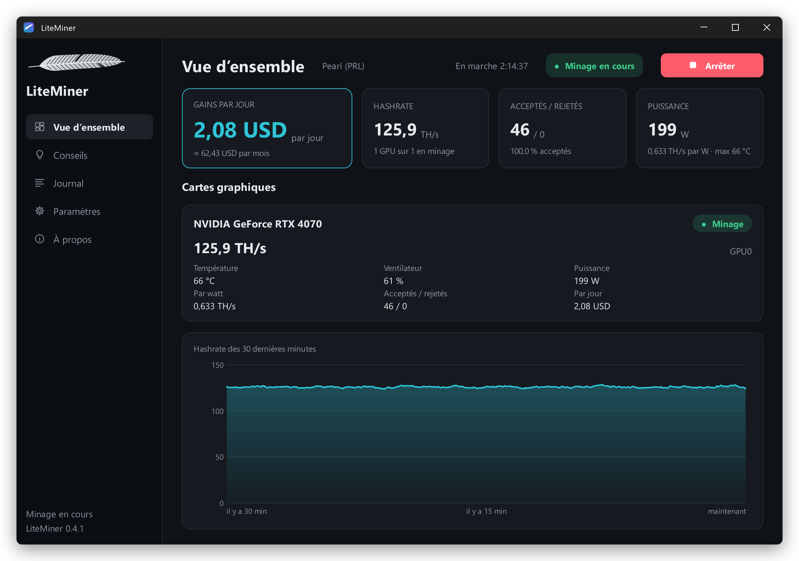
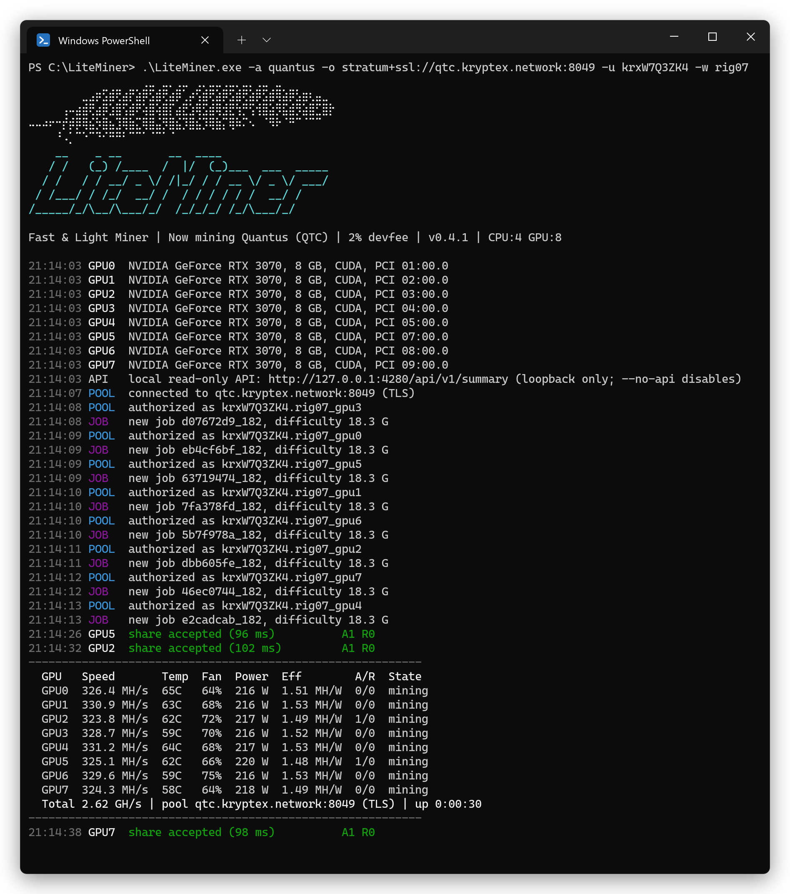
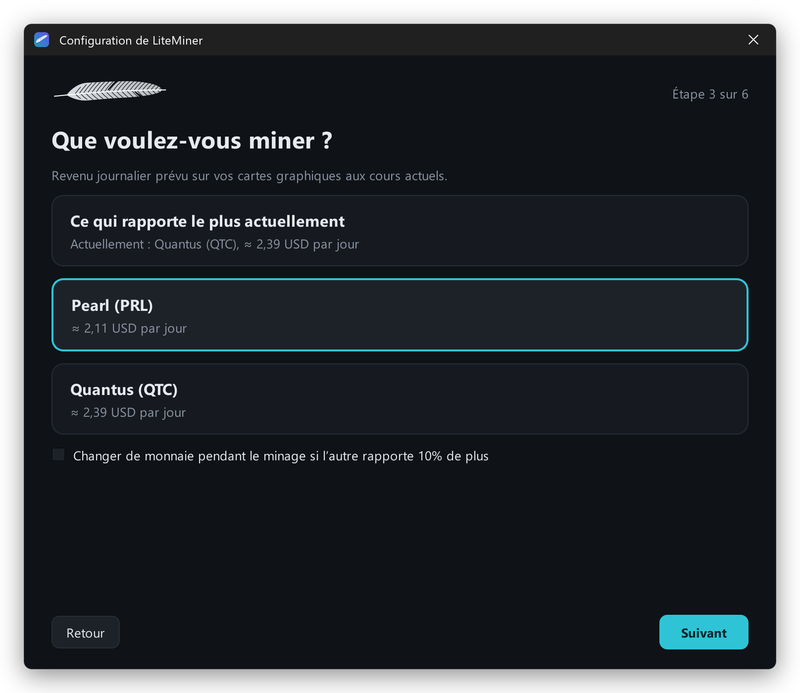
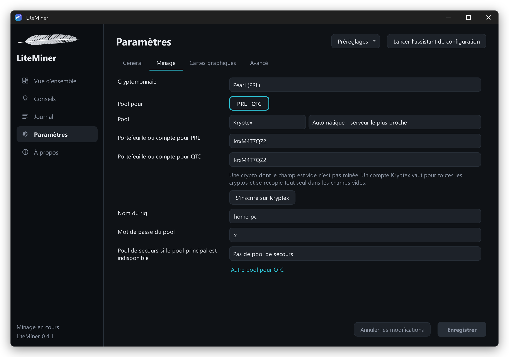

<p align="center"><a href="README.md">English</a> · <a href="README.zh-CN.md">简体中文</a> · <a href="README.es.md">Español</a> · <a href="README.pt-BR.md">Português</a> · <a href="README.de.md">Deutsch</a> · <b>Français</b> · <a href="README.ja.md">日本語</a> · <a href="README.ko.md">한국어</a> · <a href="README.ru.md">Русский</a> · <a href="README.tr.md">Türkçe</a> · <a href="README.vi.md">Tiếng Việt</a></p>

<p align="center"></p>

<p align="center"><b>La façon simple de miner Pearl (PRL) et Quantus (QTC) sur GPU NVIDIA et AMD.</b></p>

<p align="center">
<a href="https://github.com/liteminergpu/liteminer/releases/latest"></a>
<a href="https://github.com/liteminergpu/liteminer/releases/latest"></a>
<a href="https://hub.docker.com/r/liteminer/liteminer"></a>
<a href="#démarrage-rapide"></a>
<a href="#gpu-et-hashrate"></a>
<a href="#monnaies-algorithmes-et-frais-de-développeur"></a>
<a href="#monnaies-algorithmes-et-frais-de-développeur"></a>
<a href="https://www.virustotal.com/gui/file/f495dddb5ba706bedd41426fa79ff91ff9dc1de93fbb1239bd05bb43dc2c94ce"></a>
<a href="#assistance"></a>
<a href="#licence"></a>
</p>

LiteMiner est le mineur que vous avez toujours voulu : des algorithmes à jour, réglés pour chaque architecture de GPU, une application de bureau pratique (GUI) ou un mineur en terminal (CLI), le choix automatique de la monnaie, des pools de secours, des conseils utiles et un journal facile à lire. Il peut tourner à pleine vitesse sur un rig ou travailler discrètement en arrière-plan sur votre PC de tous les jours, en laissant le GPU aux jeux et aux autres programmes. Pour Windows, Linux et HiveOS.

## Sommaire

- [Captures d'écran](#captures-décran)
- [Points forts](#points-forts)
- [Démarrage rapide](#démarrage-rapide): [Windows](#windows) · [Linux](#linux) · [HiveOS](#hiveos) · [Docker et location de GPU](#docker-et-location-de-gpu-vastai-cloreai-runpod-et-autres-clouds-gpu)
- [Téléchargements et sommes de contrôle](#téléchargements-et-sommes-de-contrôle)
- [Monnaies, algorithmes et frais de développeur](#monnaies-algorithmes-et-frais-de-développeur)
- [Pools pris en charge](#pools-pris-en-charge)
- [Options de la CLI](#options-de-la-cli)
- [Statistiques et journaux](#statistiques-et-journaux)
- [GPU et hashrate](#gpu-et-hashrate)
- [Où LiteMiner range ses fichiers](#où-liteminer-range-ses-fichiers)
- [Dépannage](#dépannage)
- [Assistance](#assistance)
- [Licence](#licence)

## Captures d'écran

<p align="center"><br><sub>Interface graphique (GUI)</sub></p>

<p align="center"><br><sub>Mineur en console (CLI)</sub></p>

<details>
<summary><b>Plus de captures : assistant de configuration et paramètres</b></summary>
<br>
<p align="center"> </p>
</details>

## Points forts

**1. Commencez à miner en quelques clics, sans fouiller dans la documentation.** Décompressez l'archive, lancez `LiteMiner-GUI` et répondez à quelques questions simples. L'assistant de configuration explique ce que sont un portefeuille et un pool, choisit le serveur de pool le plus proche, vérifie votre adresse et lance le minage, même si vous n'avez jamais touché aux cryptomonnaies. L'application existe en 11 langues. Vous préférez le terminal ? Le même mineur s'y lance en une seule commande.

**2. Rapide, avec des chiffres honnêtes.** Chaque architecture de GPU a ses propres réglages intégrés, et pour Pearl le mineur peut en plus les affiner sur votre carte. Après chaque changement, nous mesurons de nouveau la vitesse sur nos propres GPU et sur des GPU loués. Le [tableau des hashrates](#gpu-et-hashrate) montre ce que LiteMiner a réellement obtenu sur chaque carte testée : uniquement des mesures réelles, sans estimation ni arrondi flatteur.

**3. Les fonctions qui vous manquaient.** Minez la monnaie qui rapporte le plus en ce moment et changez automatiquement quand l'autre devient plus rentable. Le mineur remarque quand vous lancez un jeu ou utilisez le GPU autrement, et réduit sa charge pour ne jamais vous gêner. Pause sur batterie, mise en veille empêchée seulement pendant le minage, protection du GPU contre la surchauffe, reprise automatique après les pannes du pool et du réseau, et bien plus encore. Chacune de ces fonctions se règle en un clic.

Et quelques points dont vous n'aurez jamais à vous soucier :

- **Les réglages de votre GPU restent les vôtres.** LiteMiner ne modifie jamais les fréquences, les tensions, les limites de puissance ni la vitesse des ventilateurs ; il se contente de lire les capteurs. Un undervolt ou une limite de puissance abaissée dans votre propre outil ne gêne pas le fonctionnement de LiteMiner.
- **Trois modes de minage :** *Vitesse maximale* ; *Automatique*, à pleine vitesse tant que le GPU est libre et qui vous le laisse dès que vous en avez besoin ; *Seulement quand l’ordinateur est inutilisé*.
- **Un processus par GPU.** Si une carte tombe en panne ou que son pilote se bloque, seule cette carte redémarre, pas tout le rig.
- **Des pools qui tiennent :** TLS avec vérification du certificat, choix automatique du serveur le plus proche, jusqu'à huit pools de secours, TCP simple là où TLS est bloqué, proxys SOCKS5 et DNS over HTTPS.
- **Une API locale en lecture seule** pour les tableaux de bord et les scripts, et des journaux en JSON sur demande.
- **Chaque share est vérifié sur le CPU** avant l'envoi : une erreur de calcul du GPU ne se transforme jamais en shares rejetés.

## Démarrage rapide

### Windows

1. [Téléchargez la dernière version](https://github.com/liteminergpu/liteminer/releases/download/v0.4.2/LiteMiner-0.4.2-windows-x64-portable.zip) (`LiteMiner-0.4.2-windows-x64-portable.zip`).
2. Décompressez l'archive dans n'importe quel dossier.
3. Lancez **`LiteMiner-GUI.exe`**. L'assistant de configuration vous guidera pour la suite.

Vous préférez le terminal ? Indiquez votre portefeuille (et votre pool, si vous en utilisez un autre) en haut de `start_LiteMiner_pearl.bat` ou de `start_LiteMiner_quantus.bat` et lancez-le, ou démarrez directement le mineur :

```bat
LiteMiner.exe -a pearl -o stratum+ssl://prl.kryptex.network:8048 -u YOUR_WALLET -w rig1
LiteMiner.exe -a quantus -o stratum+ssl://qtc.kryptex.network:8049 -u YOUR_WALLET -w rig1 --background
```

Ou téléchargez, décompressez et lancez-le avec une seule commande PowerShell :

```powershell
irm https://github.com/liteminergpu/liteminer/releases/download/v0.4.2/LiteMiner-0.4.2-windows-x64-portable.zip -OutFile LiteMiner.zip; Expand-Archive LiteMiner.zip .; .\LiteMiner-0.4.2-windows-x64\LiteMiner-GUI.exe
```

Configuration requise : Windows 10 ou 11 (x64) et un pilote graphique à jour.

> [!TIP]
> Pas encore de portefeuille ? Un [compte Kryptex](https://www.kryptex.com/register?ref=b629c482) gratuit fonctionne pour les deux monnaies : saisissez son nom d'utilisateur (`krxXXXXXX`) comme portefeuille, et Kryptex vous paiera en BTC ou en USDT, au choix.

### Linux

Le plus rapide : une seule commande télécharge, décompresse et lance le minage. Remplacez `YOUR_WALLET` par votre portefeuille (et le pool, si vous en utilisez un autre) :

Pearl:

```bash
curl -fsSL https://github.com/liteminergpu/liteminer/releases/download/v0.4.2/LiteMiner-0.4.2-linux-x64-portable.tar.gz | tar -xz && cd LiteMiner-0.4.2-linux-x64 && ./LiteMiner -a pearl -o stratum+ssl://prl.kryptex.network:8048 -u YOUR_WALLET -w rig1
```

Quantus:

```bash
curl -fsSL https://github.com/liteminergpu/liteminer/releases/download/v0.4.2/LiteMiner-0.4.2-linux-x64-portable.tar.gz | tar -xz && cd LiteMiner-0.4.2-linux-x64 && ./LiteMiner -a quantus -o stratum+ssl://qtc.kryptex.network:8049 -u YOUR_WALLET -w rig1
```

Le même dossier contient l'application de bureau : `./LiteMiner-GUI`.

Paquets pour différentes distributions :

```bash
# Debian, Ubuntu, Linux Mint, Pop!_OS
wget https://github.com/liteminergpu/liteminer/releases/download/v0.4.2/liteminer_0.4.2_amd64.deb https://github.com/liteminergpu/liteminer/releases/download/v0.4.2/liteminer-gui_0.4.2_amd64.deb
sudo apt install ./liteminer_0.4.2_amd64.deb ./liteminer-gui_0.4.2_amd64.deb
```

```bash
# Fedora, RHEL, AlmaLinux, Rocky Linux (openSUSE: sudo zypper install ...)
sudo dnf install https://github.com/liteminergpu/liteminer/releases/download/v0.4.2/liteminer-0.4.2-1.x86_64.rpm https://github.com/liteminergpu/liteminer/releases/download/v0.4.2/liteminer-gui-0.4.2-1.x86_64.rpm
```

Le paquet `liteminer` contient le mineur en terminal pour les serveurs et les rigs ; `liteminer-gui` ajoute l'application de bureau. Pour exécuter le mineur en tant que service, utilisez `sudo systemctl enable --now liteminer@YOUR_USER` ; le service lit `~/.local/share/liteminer/miner.json`. Plus de détails : `man liteminer`.

Configuration requise : x86-64 ; glibc 2.28 ou plus récente pour le mineur en terminal (Ubuntu 20.04, Debian 10, RHEL 8 ou plus récents) et 2.34 ou plus récente pour l'application de bureau (Ubuntu 22.04, Debian 12, Fedora 35, RHEL 9 ou plus récents) ; X11 ou Wayland. NVIDIA nécessite le pilote propriétaire (le CUDA Toolkit n'est pas nécessaire), AMD un pilote OpenCL comme ROCm. Les systèmes minimaux et les conteneurs ont aussi besoin du paquet `ca-certificates` pour les pools en TLS.

### HiveOS

Créez une Flight Sheet : **Coin** : votre monnaie, **Wallet** : votre portefeuille, **Pool** : *Configure in miner*, **Miner** : *Custom*. Cliquez ensuite sur **Setup Miner Config** et remplissez :

| Champ | Valeur |
|---|---|
| Miner name | `liteminer` (rempli à partir de l'URL) |
| Installation URL | `https://github.com/liteminergpu/liteminer/releases/download/v0.4.2/liteminer-0.4.2.tar.gz` |
| Hash algorithm | `pearl` ou `quantus` |
| Wallet and worker template | `%WAL%.%WORKER_NAME%` |
| Pool URL | `stratum+ssl://prl.kryptex.network:8048` (Pearl) ou `stratum+ssl://qtc.kryptex.network:8049` (Quantus) |
| Pass | `x` |
| Extra config arguments | facultatif, par exemple `--devices 0,2` ou `--thermal off` |

Appliquez la Flight Sheet au rig. Chaque GPU mine comme un worker distinct (`<worker>_gpuN` sur le pool), Hive affiche le hashrate de chaque GPU, et l'overclocking reste dans votre profil OC Hive : LiteMiner n'y touche jamais. Journal : `/var/log/miner/custom/liteminer.log` ; console : `miner` dans le shell Hive. Seule la première Pool URL est utilisée ; pour les ports TLS, écrivez `stratum+ssl://`.

### Docker et location de GPU (Vast.ai, Clore.ai, RunPod et autres clouds GPU)

Docker nécessite un hôte Linux (ou Windows avec Docker Desktop et WSL 2) équipé du pilote NVIDIA et du [NVIDIA Container Toolkit](https://docs.nvidia.com/datacenter/cloud-native/container-toolkit/latest/install-guide.html). Le conteneur ne prend en charge que les GPU NVIDIA.

```bash
docker run -d --name liteminer --gpus all --restart unless-stopped -v liteminer-data:/data \
  liteminer/liteminer:0.4.2 -a pearl -o stratum+ssl://prl.kryptex.network:8048 -u YOUR_WALLET -w rig1
docker logs -f liteminer
```

Au lieu des options, le conteneur accepte aussi les variables d'environnement `LITEMINER_ALGORITHM`, `LITEMINER_POOL`, `LITEMINER_WALLET`, `LITEMINER_WORKER`, `LITEMINER_PASSWORD` et `LITEMINER_DEVICES`. Conservez le volume `/data` : il contient les journaux et les résultats du réglage de chaque GPU, si bien qu'un redémarrage ne refait pas le réglage. `docker stop -t 60 liteminer` laisse chaque GPU terminer son travail en cours.

Dans un cloud GPU, choisissez l'image `liteminer/liteminer:0.4.2` et définissez `LITEMINER_ALGORITHM`, `LITEMINER_POOL` et `LITEMINER_WALLET` dans les variables d'environnement du modèle. Ou prenez n'importe quelle image Ubuntu avec CUDA (par exemple `nvidia/cuda:12.4.1-base-ubuntu22.04`) et utilisez ceci comme script de démarrage (on-start script) :

```bash
apt-get update && apt-get install -y --no-install-recommends ca-certificates curl
curl -fsSL https://github.com/liteminergpu/liteminer/releases/download/v0.4.2/LiteMiner-0.4.2-linux-x64-portable.tar.gz | tar -xz -C /opt
cd /opt/LiteMiner-0.4.2-linux-x64 && nohup ./LiteMiner -a quantus -o stratum+ssl://qtc.kryptex.network:8049 -u YOUR_WALLET -w cloud1 > /var/log/liteminer.log 2>&1 &
```

Tous les GPU de l'instance mineront. Suivez le journal avec `tail -f /var/log/liteminer.log`. Les serveurs loués tournent souvent chaud par conception : si le fournisseur gère les températures, `--thermal off` les lui laisse.

## Téléchargements et sommes de contrôle

Tous les fichiers de la version 0.4.2 se trouvent sur la [page des versions](https://github.com/liteminergpu/liteminer/releases/latest). Pour vérifier un téléchargement avec `SHA256SUMS.txt`, exécutez `certutil -hashfile FICHIER SHA256` sous Windows ou `sha256sum -c --ignore-missing SHA256SUMS.txt` sous Linux.

| Plateforme | Fichier | Taille | SHA-256 | Analyse |
|---|---|---:|---|---|
| Windows x64 | [`LiteMiner-0.4.2-windows-x64-portable.zip`](https://github.com/liteminergpu/liteminer/releases/download/v0.4.2/LiteMiner-0.4.2-windows-x64-portable.zip) | 80.8 Mo | <sub>`f495dddb5ba706bedd41426fa79ff91ff9dc1de93fbb1239bd05bb43dc2c94ce`</sub> | [VirusTotal](https://www.virustotal.com/gui/file/f495dddb5ba706bedd41426fa79ff91ff9dc1de93fbb1239bd05bb43dc2c94ce) |
| Linux x64 | [`LiteMiner-0.4.2-linux-x64-portable.tar.gz`](https://github.com/liteminergpu/liteminer/releases/download/v0.4.2/LiteMiner-0.4.2-linux-x64-portable.tar.gz) | 103.3 Mo | <sub>`8968150c50ac470bbcaf40f414dc4c83201883a67b60968c43ec196a7d030007`</sub> | [VirusTotal](https://www.virustotal.com/gui/file/8968150c50ac470bbcaf40f414dc4c83201883a67b60968c43ec196a7d030007) |
| HiveOS | [`liteminer-0.4.2.tar.gz`](https://github.com/liteminergpu/liteminer/releases/download/v0.4.2/liteminer-0.4.2.tar.gz) | 29.0 Mo | <sub>`7ce474cb580e1f3114ef2453f66a36681d996a78c9d7148125a35bda238724bf`</sub> | [VirusTotal](https://www.virustotal.com/gui/file/7ce474cb580e1f3114ef2453f66a36681d996a78c9d7148125a35bda238724bf) |
| Docker (contexte de build) | [`LiteMiner-0.4.2-docker.tar.gz`](https://github.com/liteminergpu/liteminer/releases/download/v0.4.2/LiteMiner-0.4.2-docker.tar.gz) | 29.0 Mo | <sub>`c6c42b3e6d00e0faedca497592b6fe8955a4fd1ea38263829518d29526d6fc34`</sub> | [VirusTotal](https://www.virustotal.com/gui/file/c6c42b3e6d00e0faedca497592b6fe8955a4fd1ea38263829518d29526d6fc34) |
| Debian / Ubuntu | [`liteminer_0.4.2_amd64.deb`](https://github.com/liteminergpu/liteminer/releases/download/v0.4.2/liteminer_0.4.2_amd64.deb) | 29.1 Mo | <sub>`a9213322d7d36732e845aba9f26c382260cfef3986f162bf87c8dc4fce474f7f`</sub> | [VirusTotal](https://www.virustotal.com/gui/file/a9213322d7d36732e845aba9f26c382260cfef3986f162bf87c8dc4fce474f7f) |
| Debian / Ubuntu | [`liteminer-gui_0.4.2_amd64.deb`](https://github.com/liteminergpu/liteminer/releases/download/v0.4.2/liteminer-gui_0.4.2_amd64.deb) | 45.3 Mo | <sub>`bb887052ca8807b846026ba0d4f5ce042b2f202ecb4bbbf71d47206388fe0122`</sub> | [VirusTotal](https://www.virustotal.com/gui/file/bb887052ca8807b846026ba0d4f5ce042b2f202ecb4bbbf71d47206388fe0122) |
| Fedora / RHEL / openSUSE | [`liteminer-0.4.2-1.x86_64.rpm`](https://github.com/liteminergpu/liteminer/releases/download/v0.4.2/liteminer-0.4.2-1.x86_64.rpm) | 24.4 Mo | <sub>`7e0f6c9d748eae775a96338d46958384696aefd3726fd28706b56bc59ad531dc`</sub> | [VirusTotal](https://www.virustotal.com/gui/file/7e0f6c9d748eae775a96338d46958384696aefd3726fd28706b56bc59ad531dc) |
| Fedora / RHEL / openSUSE | [`liteminer-gui-0.4.2-1.x86_64.rpm`](https://github.com/liteminergpu/liteminer/releases/download/v0.4.2/liteminer-gui-0.4.2-1.x86_64.rpm) | 31.2 Mo | <sub>`fbf9a0fc2d4627a3dc490f1f365f36359ca11e04ed78ab9246d2d201543d34eb`</sub> | [VirusTotal](https://www.virustotal.com/gui/file/fbf9a0fc2d4627a3dc490f1f365f36359ca11e04ed78ab9246d2d201543d34eb) |

> [!IMPORTANT]
> Les antivirus signalent presque tous les mineurs comme « programme potentiellement indésirable » ou « mineur de cryptomonnaie ». C'est une catégorie, pas une menace précise, et c'est pourquoi les rapports VirusTotal sont ouvertement liés ci-dessus. Téléchargez LiteMiner uniquement depuis cette page et vérifiez la somme de contrôle. Si Windows Defender supprime le fichier, ajoutez le dossier de LiteMiner à ses exclusions.

## Monnaies, algorithmes et frais de développeur

| Monnaie | Algorithme | NVIDIA (CUDA) | AMD / Intel (OpenCL) | Devfee |
|---|---|---|---|---:|
| [Pearl (PRL)](https://pool.kryptex.com/prl) | Pearl (int8 MatMul PoW), `-a pearl` | Pascal (GTX 10) ou plus récent | oui (pas encore mesuré) | 2% |
| [Quantus (QTC)](https://pool.kryptex.com/qtc) | QPoW (Poseidon2), `-a quantus` | Maxwell (GTX 900) ou plus récent | oui | 2% |

Nous ajoutons une monnaie quand vous la demandez ou quand elle devient intéressante à miner. Quand il n'y a rien de nouveau qui en vaille la peine, nous ne gonflons pas la liste : nous rendons les algorithmes existants plus rapides sur votre GPU.

## Pools pris en charge

LiteMiner fonctionne avec tout pool compatible avec le protocole Stratum de la monnaie, en TLS (`stratum+ssl://`, avec vérification du certificat) ou en TCP simple (`stratum+tcp://`). Les pools ci-dessous sont intégrés à l'application : elle choisit le serveur avec la latence la plus faible, garde une autre région comme secours automatique et vérifie que votre identifiant a le bon format pour ce pool.

| Pool | PRL | QTC | Identifiant | Serveurs |
|---|---|---|---|---:|
| **[Kryptex](https://pool.kryptex.com/prl)**<br><sub>[inscription](https://www.kryptex.com/register?ref=b629c482)</sub> | `stratum+ssl://prl.kryptex.network:8048`<br><sub>TLS, TCP 7048</sub> | `stratum+ssl://qtc.kryptex.network:8049`<br><sub>TLS, TCP 7049</sub> | compte Kryptex ou portefeuille | 8 |
| **[PearlFortune](https://pearlfortune.org/)** | `stratum+ssl://global.pearlfortune.org:443`<br><sub>TLS, certificat épinglé</sub> | - | adresse du portefeuille | 1 |
| **[LuckyPool](https://pearl.luckypool.io/)** | `stratum+ssl://pearl-eu1.luckypool.io:3360`<br><sub>TLS, certificat épinglé</sub> | `stratum+ssl://eu.lproute.com:5660`<br><sub>TLS, certificat épinglé</sub> | adresse du portefeuille | 19 |
| **[F2Pool](https://www.f2pool.com/coin/pearl)**<br><sub>[inscription](https://www.f2pool.com/user/signup)</sub> | `stratum+tcp://pearl.f2pool.com:5500`<br><sub>TCP seulement</sub> | `stratum+tcp://qtc.f2pool.com:4500`<br><sub>TCP seulement</sub> | nom du compte sur le pool | 1 |
| **[HeroMiners](https://pearl.herominers.com/)** | `stratum+ssl://de.pearl.herominers.com:1200`<br><sub>TLS</sub> | `stratum+ssl://de.quantus.herominers.com:1155`<br><sub>TLS</sub> | adresse du portefeuille | 15 |
| **[2Miners](https://2miners.com/prl-mining-pool)** | `stratum+ssl://prl.2miners.com:11818`<br><sub>TLS, TCP 1818</sub> | `stratum+ssl://qtc.2miners.com:13636`<br><sub>TLS, TCP 3636</sub> | adresse du portefeuille | 3 |

Le mineur en terminal offre la même chose dans son fichier de configuration (`LiteMiner --init` crée un exemple) :

```json
{
  "pool_host": "prl.kryptex.network", "pool_port": 8048, "tls": true, "tcp_port": 7048, "tcp_fallback": true,
  "wallet": "YOUR_WALLET", "worker": "rig1", "password": "x",
  "backup_pools": [
    {"pool_host": "prl-eu.kryptex.network", "pool_port": 8048},
    {"pool_host": "de.pearl.herominers.com", "pool_port": 1200, "wallet": "YOUR_PRL_ADDRESS"}
  ],
  "proxy": "socks5://127.0.0.1:9050"
}
```

`backup_pools` accepte jusqu'à huit pools ; le mineur revient de lui-même au pool principal dès qu'il fonctionne de nouveau. `tcp_fallback` n'utilise le port non chiffré que si TLS ne parvient pas du tout à se connecter. `proxy` fait passer la connexion au pool par SOCKS5 (l'identifiant et le mot de passe vont dans `LITEMINER_PROXY_USERNAME` et `LITEMINER_PROXY_PASSWORD`), et `doh_url` résout l'adresse du pool via DNS over HTTPS.

## Options de la CLI

**Dans l'application de bureau, tout cela se règle avec des cases à cocher : vous pouvez sauter cette section.** Pour le terminal, voici toutes les options du mineur, tirées du programme lui-même pour cette version :

| Option | Description |
|---|---|
| `-V`, `--version` | afficher la version et le build, puis quitter |
| `-a`, `--algorithm` `ALGORITHM` | `pearl` (par défaut), `quantus` / `qpow` / `qtc` |
| `--config` `CONFIG` | fichier de configuration JSON (par défaut : `miner.json` pour Pearl, `quantus.json` pour Quantus) |
| `-o`, `--pool` `POOL` | adresse du pool avec le port : `stratum+ssl://host:port` ou `stratum+tcp://host:port` |
| `-u`, `--wallet` `WALLET` | adresse du portefeuille ou compte du pool |
| `-w`, `--worker` `WORKER` | nom du worker (par défaut : `rig1`) |
| `-p`, `--password` `PASSWORD` | mot de passe du pool (par défaut : `x`) |
| `--devices` `DEVICES` | `all` (par défaut : GPU CUDA ou Metal et GPU non NVIDIA OpenCL) ou numéros séparés par des virgules / `opencl:N` ; chaque GPU tourne dans son propre processus isolé |
| `--list-devices` | lister les GPU et les monnaies que chacun peut miner, puis quitter (avec `--log-format json` : en JSON) |
| `-B`, `--benchmark` | benchmark : sur votre pool et votre portefeuille s’ils sont définis, sinon en ligne, avec passage automatique hors ligne |
| `--benchmark-seconds` `BENCHMARK_SECONDS` | durée du benchmark après la préparation des GPU (par défaut : 900 secondes ; `0` : jusqu’à l’arrêt) |
| `--stop-file` `PATH` | s’arrêter proprement (chaque GPU termine son travail en cours) dès que ce fichier existe |
| `--no-autotune` | utiliser les réglages de calcul de la configuration sans réglage automatique ; l’adaptation à la charge et à la VRAM reste active |
| `--autotune` | Pearl à pleine vitesse : au démarrage, mesurer et choisir les réglages de calcul (jusqu’à 4 min sans miner) au lieu de ceux intégrés pour l’architecture ; le résultat est conservé pour les démarrages suivants |
| `--background` | mode automatique : pleine vitesse tant que le GPU est libre ; laisse la place aux jeux et aux autres programmes GPU et se met en pause tant qu’ils ont besoin de toute la carte |
| `--idle-only` | pleine vitesse uniquement quand personne n’utilise l’ordinateur (ni clavier ni souris pendant `--idle-seconds`) ; en pause le reste du temps, la connexion au pool reste ouverte ; sous Windows, laisse aussi la place aux autres programmes GPU, comme le mode automatique |
| `--idle-seconds` `IDLE_SECONDS` | secondes sans clavier ni souris avant de commencer à miner (10..86400, par défaut : 120) ; active `--idle-only` |
| `--no-load-pause` | ne pas se mettre en pause quand d’autres programmes chargent fortement le GPU, mais continuer au niveau le plus bas ; active `--background` si `--idle-only` n’est pas indiqué |
| `--mine-on-battery` | continuer à miner sur batterie (par défaut : pause jusqu’au retour sur secteur ; sur batterie, le hashrate est généralement bien plus faible) |
| `--allow-sleep` | laisser l’ordinateur se mettre en veille selon son minuteur d’inactivité pendant le minage (par défaut, il reste éveillé tant qu’un GPU mine ; l’écran peut quand même s’éteindre) |
| `--api-port` `API_PORT` | port de l’API JSON locale en lecture seule (par défaut : 4280) |
| `--api-bind` `API_BIND` | adresse d’écoute de l’API : uniquement `127.0.0.1` (par défaut), `::1` ou `localhost` |
| `--no-api` | désactiver l’API JSON locale (l’application de bureau en a besoin) |
| `--thermal` `{auto,custom,off}` | protection thermique : `auto` (limites du pilote, par défaut), `custom` (`--thermal-soft/hard/resume` ; choisi automatiquement s’ils sont indiqués) ou `off` |
| `--thermal-gpu` `LABEL=SOFT:HARD:RESUME` | limites de la puce pour un GPU, par exemple `gpu1=80:88:75` (à répéter pour chaque GPU ; pas avec `--thermal off`) |
| `--thermal-soft` `THERMAL_SOFT` | température de la puce (°C) au-delà de laquelle le mineur ralentit |
| `--thermal-hard` `THERMAL_HARD` | température de la puce (°C) à laquelle le minage se met en pause |
| `--thermal-resume` `THERMAL_RESUME` | température de la puce (°C) en dessous de laquelle le minage reprend |
| `--thermal-memory-soft` `THERMAL_MEMORY_SOFT` | température de la mémoire (°C) au-delà de laquelle le mineur ralentit |
| `--thermal-memory-hard` `THERMAL_MEMORY_HARD` | température de la mémoire (°C) à laquelle le minage se met en pause |
| `--thermal-memory-resume` `THERMAL_MEMORY_RESUME` | température de la mémoire (°C) en dessous de laquelle le minage reprend |
| `-v`, `--verbose` | afficher davantage d’informations de diagnostic |
| `--no-color` | sortie console sans couleurs |
| `--log-file` `LOG_FILE` | fichier journal (par défaut : `logs\liteminer.log` ; rotation à 10 Mo, 3 fichiers conservés) |
| `--no-log-file` | ne pas écrire de fichier journal |
| `--log-format` `{text,json}` | sortie console : `text` (par défaut) ou un enregistrement JSON par ligne (pour les scripts) |
| `--no-update-check` | ne pas rechercher de nouvelle version (par défaut, la page publique des versions est lue une fois par jour ; seuls le nom et la version du programme sont envoyés) |
| `--gui` | ouvrir l’application de bureau (sous Windows aussi `LiteMiner-GUI.exe`) |
| `--init` | créer les configurations d’exemple `miner.json` et `quantus.json` dans le dossier courant |
| `--runtime-info` | afficher le dossier des fichiers décompressés du programme |
| `--verify-package` | vérifier tous les fichiers du programme avec leurs sommes de contrôle intégrées |

Exemples courants :

```bash
LiteMiner --list-devices                                # quels GPU LiteMiner voit et quelles monnaies chacun peut miner
LiteMiner -a quantus ... --devices 0,2                  # miner uniquement sur les GPU 0 et 2 (un worker chacun)
LiteMiner -a pearl ... --background                     # mode automatique : laisser la place aux jeux et aux autres programmes GPU
LiteMiner -a pearl ... --idle-only --idle-seconds 300   # miner seulement après 5 minutes sans clavier ni souris
LiteMiner -a quantus ... --thermal-gpu gpu1=78:86:72    # limites de température propres à une carte
LiteMiner -B -a pearl --benchmark-seconds 300           # benchmark de 5 minutes, sans portefeuille
```

## Statistiques et journaux

**Console.** Toutes les 30 secondes, le mineur affiche un tableau avec la vitesse, la température, le ventilateur, la puissance, l'efficacité, les shares acceptés et rejetés et l'état de chaque GPU ; entre deux tableaux, une ligne par événement (nouveau travail, share, reconnexion, protection thermique). Avec `--log-format json`, la console affiche à la place un enregistrement JSON par ligne, prêt pour `jq` ou un collecteur de journaux.

**Fichier journal.** `logs/liteminer.log`, à côté de la configuration. Il tourne à 10 Mo, et trois fichiers sont conservés. `--log-file` le déplace, `--no-log-file` le désactive.

**API locale.** Une petite API JSON en lecture seule sur `127.0.0.1:4280`. L'application de bureau l'utilise, et vos scripts et tableaux de bord le peuvent aussi :

| Point d'accès | Renvoie |
|---|---|
| `GET /api/v1/summary` | totaux du rig : version, algorithme, durée de fonctionnement, état, vitesse totale et son unité, shares (acceptés, rejetés, en attente), température maximale, puissance, énergie, pools |
| `GET /api/v1/devices` | la même chose pour chaque GPU : nom, état, vitesse, shares, température, ventilateur, puissance, pool |
| `GET /api/v1/health` | `ok`, `starting`, `degraded` ou `down` (HTTP 503 si `down`), pour les scripts de surveillance |
| `GET /api/v1/history` | la dernière heure de chaque GPU par pas de 5 secondes : vitesse, température, puissance |

```bash
curl -s http://127.0.0.1:4280/api/v1/summary
```

```json
{"api_version":1,"product":"LiteMiner","version":"0.4.2","algorithm":"quantus","uptime_seconds":180.4,
 "health":"ok","devices":1,"device_states":{"mining":1},"rate":518.6,"unit":"MH/s","rate_window_seconds":60,
 "shares":{"accepted":2,"rejected":0,"submitted":2,"lost_unacknowledged":0,"discarded_stale":0,"verification_rejected":0,"pending":0},
 "max_temperature_c":64,"power_w":196.0,"pools":["qtc.kryptex.network:8049"]}
```

L'API n'écoute que sur l'interface de bouclage (`--api-bind` accepte `127.0.0.1`, `::1` ou `localhost`), vérifie l'en-tête `Host` contre le DNS rebinding et ne renvoie jamais de portefeuille, de mot de passe ni aucune valeur de configuration. **Elle n'a volontairement aucun point d'accès de contrôle :** rien sur le réseau ne peut arrêter, reconfigurer ou rediriger votre mineur. Pour l'arrêter depuis un script, utilisez `--stop-file CHEMIN` (dès que le fichier existe, chaque GPU termine son travail en cours et le mineur se ferme) ou envoyez Ctrl+C / SIGINT.

**HiveOS** reçoit le hashrate de chaque GPU (associé par bus PCI) via les statistiques standard des mineurs personnalisés ; les températures et les ventilateurs sont lus par Hive lui-même.

## GPU et hashrate

Résultats réels de LiteMiner 0.4.2 et de ses builds récents sur 67 modèles de GPU. Un `?` signifie que nous n'avons pas encore mesuré cette combinaison, pas qu'elle ne fonctionne pas.

Tous les résultats ont été mesurés avec les réglages d'origine des cartes : LiteMiner n'a modifié ni les fréquences, ni les tensions, ni les limites de puissance, ni les ventilateurs. Un undervolt ou une limite de puissance abaissée dans votre propre outil est entièrement pris en charge : LiteMiner s'adapte à la vitesse que fournit la carte.

#### GeForce et TITAN

| GPU | PRL, TH/s | QTC, MH/s | Dernier test |
|---|---:|---:|---|
| RTX 5090 | 372.6 | 1524.6 | 2026-11 |
| RTX 5080 | 238.3 | 982.8 | 2026-11 |
| RTX 5070 | 134.2 | 552.7 | 2026-11 |
| RTX 5070 Ti | 204.5 | 840.8 | 2026-11 |
| RTX 5060 | 83.4 | 352.0 | 2026-11 |
| RTX 5060 Ti | 100.0 | 421.7 | 2026-11 |
| RTX 4090 | 332.4 | 1388.9 | 2026-11 |
| RTX 4080 | 210.0 | 851.3 | 2026-11 |
| RTX 4080 SUPER | 215.1 | 875.6 | 2026-11 |
| RTX 4070 | 127.8 | 518.6 | 2026-11 |
| RTX 4070 SUPER | 127.1 | 456.8 | 2026-11 |
| RTX 4070 Ti SUPER | 170.2 | 686.7 | 2026-11 |
| RTX 4060 | 64.3 | 266.8 | 2026-11 |
| RTX 4060 Ti | 95.1 | 379.3 | 2026-11 |
| RTX 3090 | 148.5 | 619.1 | 2026-11 |
| RTX 3090 Ti | 150.2 | 619.6 | 2026-11 |
| RTX 3080 | 120.4 | 505.2 | 2026-11 |
| RTX 3080 Ti | 140.9 | 589.1 | 2026-11 |
| RTX 3070 | 80.9 | 331.7 | 2026-11 |
| RTX 3070 Ti | 95.3 | 389.4 | 2026-11 |
| RTX 3060 | 54.6 | 227.9 | 2026-11 |
| RTX 3060 Ti | 70.8 | 296.0 | 2026-11 |
| RTX 3050 | 36.5 | 154.6 | 2026-11 |
| RTX 3050 Laptop GPU | 29.6 | ? | 2026-11 |
| RTX 2080 | 81.9 | 371.8 | 2026-11 |
| RTX 2080 Ti | 94.5 | 418.0 | 2026-11 |
| RTX 2070 | 58.1 | 257.1 | 2026-11 |
| RTX 2070 SUPER | 57.7 | 273.5 | 2026-11 |
| RTX 2060 | 47.4 | 227.1 | 2026-11 |
| RTX 2060 SUPER | 52.8 | 234.1 | 2026-11 |
| GTX 1660 | 2.50 | 47.4 | 2026-11 |
| GTX 1660 SUPER | 8.54 | 162.5 | 2026-11 |
| GTX 1660 Ti | 8.57 | 178.0 | 2026-11 |
| GTX 1650 | 3.49 | 76.5 | 2026-11 |
| GTX 1080 | 7.95 | 85.1 | 2026-11 |
| GTX 1080 Ti | 13.1 | 119.7 | 2026-11 |
| GTX 1070 | 7.16 | 63.8 | 2026-11 |
| GTX 1070 Ti | 9.21 | 81.0 | 2026-11 |
| GTX 1060 | 5.11 | 46.0 | 2026-11 |
| GTX TITAN X | ? | 33.9 | 2026-10 |
| TITAN RTX | 92.5 | 438.5 | 2026-11 |
| TITAN V | 34.1 | 398.0 | 2026-11 |
| TITAN Xp | 7.59 | 63.1 | 2026-10 |

#### Cartes de minage (CMP, P104)

| GPU | PRL, TH/s | QTC, MH/s | Dernier test |
|---|---:|---:|---|
| CMP 90HX | 60.0 | 282.8 | 2026-11 |
| CMP 70HX | 50.7 | 198.7 | 2026-11 |
| CMP 50HX | 40.0 | 350.4 | 2026-11 |
| CMP 40HX | 50.3 | 236.6 | 2026-11 |
| CMP 30HX | 1.05 | 150.0 | 2026-11 |
| P104-100 | 5.63 | 47.3 | 2026-11 |

#### Stations de travail et centres de données

| GPU | PRL, TH/s | QTC, MH/s | Dernier test |
|---|---:|---:|---|
| A10 | 75.7 | 333.9 | 2026-10 |
| A100 PCIe | 194.7 | 404.8 | 2026-10 |
| Quadro P4000 | 5.60 | 44.7 | 2026-11 |
| RTX A2000 | 29.2 | 137.6 | 2026-10 |
| RTX A4000 | 73.5 | 294.3 | 2026-11 |
| RTX A5000 | 93.2 | 395.3 | 2026-11 |
| RTX A6000 | 131.7 | 557.7 | 2026-11 |
| Tesla P40 | 11.6 | 118.2 | 2026-11 |
| Tesla P100 | ? | 88.8 | 2026-11 |
| Tesla T4 | 35.2 | 170.2 | 2026-11 |
| Tesla V100 | 41.2 | 486.3 | 2026-11 |
| Tesla V100 SXM2 16 GB | 30.6 | 347.1 | 2026-11 |
| Tesla V100S | 18.8 | 248.9 | 2026-11 |

#### AMD Radeon

| GPU | PRL, TH/s | QTC, MH/s | Dernier test |
|---|---:|---:|---|
| RX 9070 XT | 137.7 | 293.2 | 2026-11 |
| RX 9060 XT | 67.9 | 151.9 | 2026-11 |
| RX 7900 XT | 48.0 | 334.3 | 2026-11 |
| RX 7900 XTX | 59.6 | 396.4 | 2026-11 |
| RX 7800 XT | 31.8 | 226.6 | 2026-11 |

Votre carte n'y figure pas, ou elle est plus lente qu'ici ? Lancez `LiteMiner -B` (15 minutes par défaut) et envoyez-nous le résultat à [lmsupp@proton.me](mailto:lmsupp@proton.me).

## Où LiteMiner range ses fichiers

| Quoi | Windows | Linux |
|---|---|---|
| Paramètres de l'application de bureau | `%LOCALAPPDATA%\LiteMiner\data` | `~/.local/share/liteminer` |
| Configuration du mineur en terminal | `miner.json` et `quantus.json` dans le dossier courant | idem ; pour les paquets, `~/.local/share/liteminer` |
| Journaux | `logs\liteminer.log` | `logs/liteminer.log` |

Le programme est portable : chaque EXE contient tout ce dont il a besoin et vérifie ses propres fichiers à chaque démarrage. Une nouvelle version décompressée dans un autre dossier conserve vos paramètres, et les anciennes versions décompressées sont supprimées automatiquement.

## Dépannage

<details>
<summary><b>« No GPU found that LiteMiner can use » (aucun GPU utilisable trouvé)</b></summary>

Installez le pilote le plus récent de [NVIDIA](https://www.nvidia.com/Download/index.aspx) ou d'[AMD](https://www.amd.com/en/support). Chez NVIDIA, Pearl nécessite Pascal (GTX 10) ou plus récent et Quantus Maxwell (GTX 900) ou plus récent. `LiteMiner --list-devices` montre quels GPU le mineur voit et quelles monnaies chacun peut miner.
</details>

<details>
<summary><b>L'antivirus a supprimé LiteMiner</b></summary>

La plupart des antivirus signalent les mineurs par catégorie, et non à cause d'une menace précise. Comparez le fichier avec `SHA256SUMS.txt` et le rapport VirusTotal de la section [Téléchargements et sommes de contrôle](#téléchargements-et-sommes-de-contrôle), puis ajoutez le dossier de LiteMiner aux exclusions.
</details>

<details>
<summary><b>« Another LiteMiner is already mining on this GPU » (code de sortie 8)</b></summary>

Une seule copie de LiteMiner peut utiliser un GPU à la fois. Fermez l'autre copie (ou l'application de bureau, qui lance son propre mineur), ou attribuez à chaque copie ses propres GPU avec `--devices`.
</details>

<details>
<summary><b>Erreurs TLS sur un Linux minimal ou dans un conteneur</b></summary>

Installez `ca-certificates` : LiteMiner vérifie les certificats des pools avec le magasin du système et ne mine pas sur une connexion non vérifiée.
</details>

<details>
<summary><b>Les jeux saccadent pendant le minage</b></summary>

Choisissez le mode *Automatique* dans l'application (`--background` dans le terminal) : il laisse le GPU aux jeux et se met en pause tant qu'ils ont besoin de toute la carte. Le mode *Seulement quand l’ordinateur est inutilisé* (`--idle-only`) ne mine que pendant votre absence.
</details>

## Assistance

Questions, signalements de bugs et résultats de benchmark : [lmsupp@proton.me](mailto:lmsupp@proton.me).

Avant d'écrire, lancez `LiteMiner --list-devices` et joignez sa sortie avec `logs/liteminer.log`.

## Licence

LiteMiner est gratuit à télécharger et à utiliser, avec les frais de développeur de 2% indiqués plus haut. Le code source n'est pas publié.

Le minage consomme de l'électricité : surveillez les températures, votre facture d'électricité et la législation de votre pays. LiteMiner est fourni tel quel, sans aucune garantie. La décompilation, la modification et toute autre opération similaire sur le programme sont strictement interdites, à l'exception des bibliothèques tierces qu'il contient. Il est interdit de redistribuer LiteMiner au sein de programmes susceptibles de nuire à l'ordinateur (« virus »), ainsi que dans tout autre cas contraire à la législation de votre pays. Il est interdit d'utiliser LiteMiner sur des ordinateurs dont les propriétaires ne vous ont pas autorisé à installer et/ou utiliser un mineur de cryptomonnaie.
