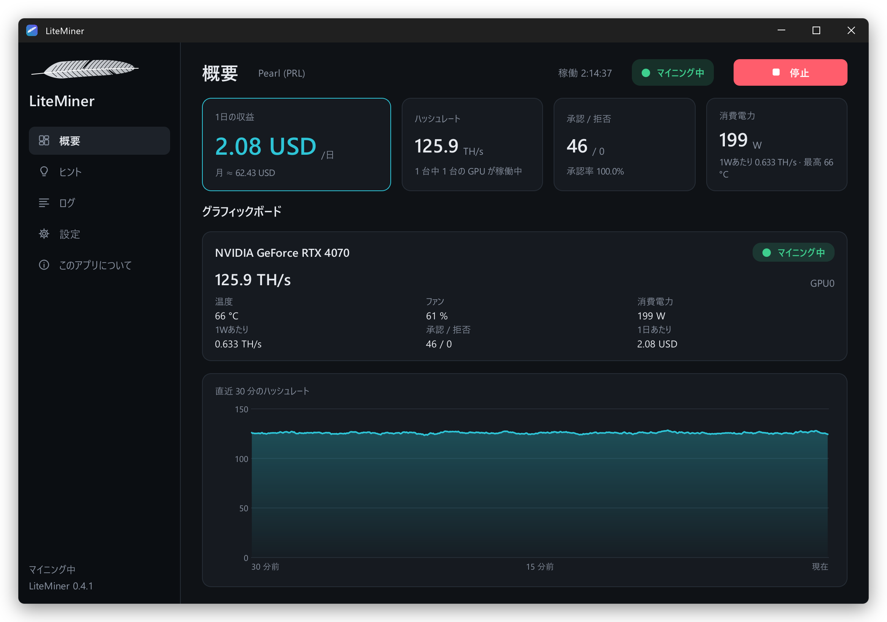
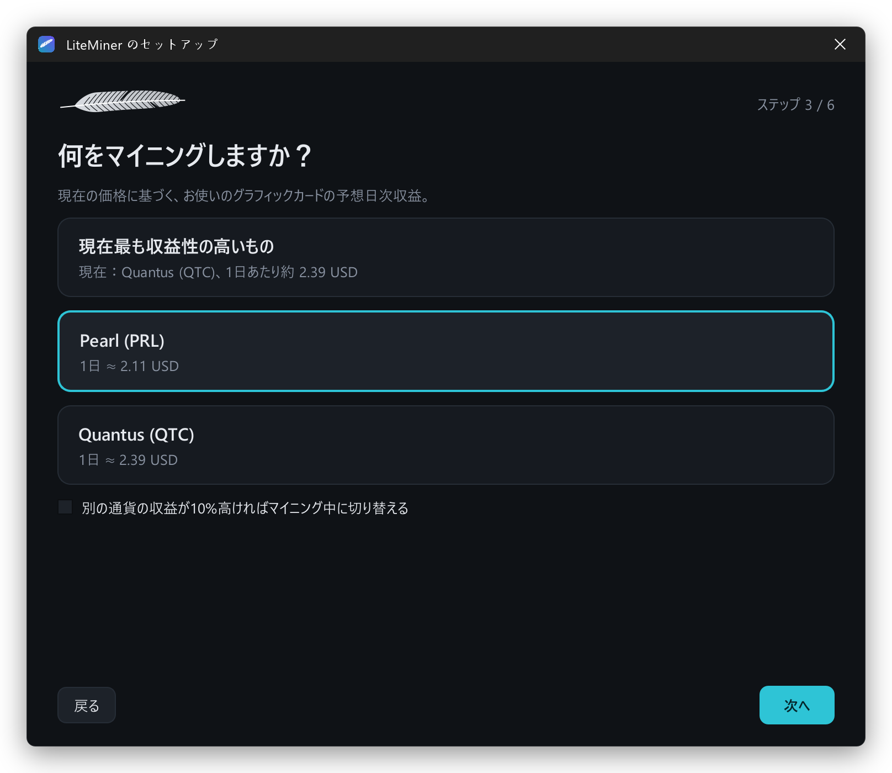
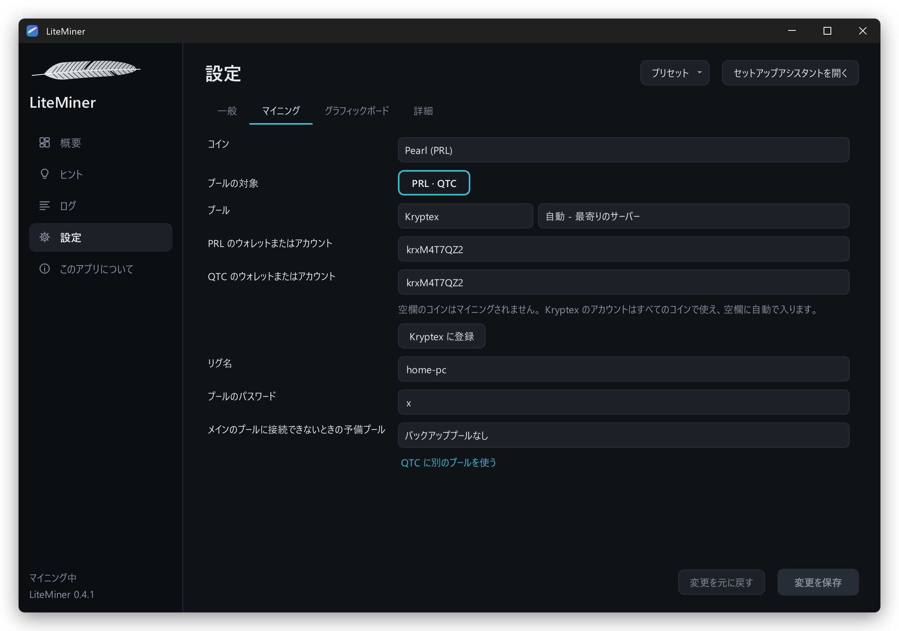

<p align="center"><a href="README.md">English</a> · <a href="README.zh-CN.md">简体中文</a> · <a href="README.es.md">Español</a> · <a href="README.pt-BR.md">Português</a> · <a href="README.de.md">Deutsch</a> · <a href="README.fr.md">Français</a> · <b>日本語</b> · <a href="README.ko.md">한국어</a> · <a href="README.ru.md">Русский</a> · <a href="README.tr.md">Türkçe</a> · <a href="README.vi.md">Tiếng Việt</a></p>

<p align="center"></p>

<p align="center"><b>NVIDIA と AMD の GPU で Pearl（PRL）と Quantus（QTC）を採掘するシンプルな方法。</b></p>

<p align="center">
<a href="https://github.com/liteminergpu/liteminer/releases/latest"></a>
<a href="https://github.com/liteminergpu/liteminer/releases/latest"></a>
<a href="https://hub.docker.com/r/liteminer/liteminer"></a>
<a href="#クイックスタート"></a>
<a href="#gpu-とハッシュレート"></a>
<a href="#通貨アルゴリズム開発者手数料"></a>
<a href="#通貨アルゴリズム開発者手数料"></a>
<a href="https://www.virustotal.com/gui/file/5cecc0f5b6d505474d1881a279007852ee61bf670a7b5deefe0d298844d74180"></a>
<a href="#サポート"></a>
<a href="https://t.me/liteminergpu"></a>
<a href="https://discord.com/users/1572214196995624980"></a>
<a href="#ライセンス"></a>
</p>

LiteMiner は、あなたがずっと求めていたマイナーです。GPU アーキテクチャごとに調整された最新のアルゴリズム、使いやすいデスクトップアプリ（GUI）またはターミナル（CLI）、通貨の自動選択、予備プール、役に立つヒント、読みやすいログを備えています。リグで最大速度で動かすことも、普段使いの PC のバックグラウンドで静かに動かし、ゲームや他のプログラムに GPU を譲ることもできます。Windows、Linux、HiveOS に対応。

## 目次

- [スクリーンショット](#スクリーンショット)
- [特長](#特長)
- [クイックスタート](#クイックスタート): [Windows](#windows) · [Linux](#linux) · [HiveOS](#hiveos) · [Docker と GPU レンタル](#docker-と-gpu-レンタルvastaicloreairunpod-などの-gpu-クラウド)
- [ダウンロードとチェックサム](#ダウンロードとチェックサム)
- [通貨、アルゴリズム、開発者手数料](#通貨アルゴリズム開発者手数料)
- [対応プール](#対応プール)
- [CLI オプション](#cli-オプション)
- [統計とログ](#統計とログ)
- [GPU とハッシュレート](#gpu-とハッシュレート)
- [LiteMiner のファイルの保存場所](#liteminer-のファイルの保存場所)
- [トラブルシューティング](#トラブルシューティング)
- [サポート](#サポート)
- [ライセンス](#ライセンス)

## スクリーンショット

<p align="center"><br><sub>グラフィカルインターフェース（GUI）</sub></p>

<p align="center"><br><sub>コンソール版マイナー（CLI）</sub></p>

<details>
<summary><b>その他のスクリーンショット: セットアップアシスタントと設定</b></summary>
<br>
<p align="center"> </p>
</details>

## 特長

**1. ドキュメントを読み込まなくても、数クリックで採掘を始められます。** アーカイブを展開して `LiteMiner-GUI` を起動し、いくつかの簡単な質問に答えるだけです。セットアップアシスタントがウォレットとプールとは何かを説明し、最寄りのプールサーバーを選び、アドレスを確認して採掘を始めます。暗号資産に触れたことがなくても大丈夫です。アプリは 11 言語に対応しています。ターミナル派の方は、同じマイナーをコマンド 1 つで起動できます。

**2. 速さと、正直な数字。** GPU アーキテクチャごとに専用の設定が組み込まれており、Pearl ではお使いのカードに合わせてさらに微調整することもできます。変更のたびに、自前の GPU とレンタル GPU で速度を測り直しています。[ハッシュレート表](#gpu-とハッシュレート)には、テストした各カードで LiteMiner が実際に出した結果を載せています。実測値のみで、推定値も水増しもありません。

**3. 欲しかった機能がそろっています。** 今いちばん稼げる通貨を採掘し、別の通貨のほうが有利になれば自動で切り替えます。ゲームを起動したり、他の用途で GPU を使い始めたりすると、マイナーがそれを察知して負荷を下げ、作業の邪魔をしません。バッテリー駆動中の一時停止、採掘中だけのスリープ防止、GPU の過熱保護、プールやネットワークの障害からの自動復旧など、ほかにも多くの機能があります。どの機能もワンクリックで設定できます。

さらに、気にする必要のないこともあります。

- **GPU の設定はあなたのもの。** LiteMiner はクロック、電圧、電力制限、ファン速度を一切変更せず、センサーを読み取るだけです。お使いのツールでの低電圧化や電力制限の引き下げも、LiteMiner の動作の妨げにはなりません。
- **3 つの採掘モード:** *最大速度*、*自動*（GPU が空いている間は最大速度で、あなたが使うときは譲る）、*PCを使っていないときだけ*。
- **GPU ごとに 1 プロセス。** カードの障害やドライバーのハングが起きても、再起動するのはそのカードだけで、リグ全体ではありません。
- **止まらないプール接続:** 証明書を検証する TLS、最寄りサーバーの自動選択、最大 8 つの予備プール、TLS が遮断された環境での通常の TCP、SOCKS5 プロキシ、DNS over HTTPS。
- **読み取り専用のローカル API** をダッシュボードやスクリプト向けに用意し、必要に応じて JSON 形式のログも出力します。
- **すべてのシェアを送信前に CPU で検証**するので、GPU の計算ミスがリジェクトされたシェアになることはありません。

## クイックスタート

### Windows

1. [最新リリースをダウンロード](https://github.com/liteminergpu/liteminer/releases/download/v0.5.0/LiteMiner-0.5.0-windows-x64-portable.zip)（`LiteMiner-0.5.0-windows-x64-portable.zip`）します。
2. アーカイブを任意のフォルダーに展開します。
3. **`LiteMiner-GUI.exe`** を起動します。あとはセットアップアシスタントが案内します。

ターミナル派の方は、`start_LiteMiner_pearl.bat` または `start_LiteMiner_quantus.bat` の先頭にウォレット（別のプールを使う場合はプールも）を入力して実行するか、マイナーを直接起動します。

```bat
LiteMiner.exe -a pearl -o stratum+ssl://prl.kryptex.network:8048 -u YOUR_WALLET -w rig1
LiteMiner.exe -a quantus -o stratum+ssl://qtc.kryptex.network:8049 -u YOUR_WALLET -w rig1 --background
```

PowerShell のコマンド 1 つで、ダウンロード、展開、起動まで行うこともできます。

```powershell
irm https://github.com/liteminergpu/liteminer/releases/download/v0.5.0/LiteMiner-0.5.0-windows-x64-portable.zip -OutFile LiteMiner.zip; Expand-Archive LiteMiner.zip .; .\LiteMiner-0.5.0-windows-x64\LiteMiner-GUI.exe
```

動作環境: Windows 10 または 11（x64）と最新のグラフィックスドライバー。デスクトップアプリには Windows 10 バージョン 1809 以降が必要です。ターミナル版マイナー（`LiteMiner.exe` と `.bat` ファイル）はすべての Windows 10 x64 で動作します。

> [!TIP]
> ウォレットをまだお持ちでない場合は、無料の [Kryptex アカウント](https://www.kryptex.com/register?ref=b629c482)を両方の通貨に使えます。ユーザー名（`krxXXXXXX`）をウォレットとして入力すると、Kryptex が BTC または USDT のお好きなほうで支払います。

### Linux

最速の方法: 1 つのコマンドでダウンロード、展開、採掘開始まで行います。`YOUR_WALLET` をご自分のウォレットに置き換えてください（別のプールを使う場合はプールも）。

Pearl:

```bash
curl -fsSL https://github.com/liteminergpu/liteminer/releases/download/v0.5.0/LiteMiner-0.5.0-linux-x64-portable.tar.gz | tar -xz && cd LiteMiner-0.5.0-linux-x64 && ./LiteMiner -a pearl -o stratum+ssl://prl.kryptex.network:8048 -u YOUR_WALLET -w rig1
```

Quantus:

```bash
curl -fsSL https://github.com/liteminergpu/liteminer/releases/download/v0.5.0/LiteMiner-0.5.0-linux-x64-portable.tar.gz | tar -xz && cd LiteMiner-0.5.0-linux-x64 && ./LiteMiner -a quantus -o stratum+ssl://qtc.kryptex.network:8049 -u YOUR_WALLET -w rig1
```

同じフォルダーにデスクトップアプリもあります: `./LiteMiner-GUI`

ディストリビューション別のパッケージ:

```bash
# Debian, Ubuntu, Linux Mint, Pop!_OS
wget https://github.com/liteminergpu/liteminer/releases/download/v0.5.0/liteminer_0.5.0_amd64.deb https://github.com/liteminergpu/liteminer/releases/download/v0.5.0/liteminer-gui_0.5.0_amd64.deb
sudo apt install ./liteminer_0.5.0_amd64.deb ./liteminer-gui_0.5.0_amd64.deb
```

```bash
# Fedora, RHEL, AlmaLinux, Rocky Linux (openSUSE: sudo zypper install ...)
sudo dnf install https://github.com/liteminergpu/liteminer/releases/download/v0.5.0/liteminer-0.5.0-1.x86_64.rpm https://github.com/liteminergpu/liteminer/releases/download/v0.5.0/liteminer-gui-0.5.0-1.x86_64.rpm
```

`liteminer` パッケージにはサーバーやリグ向けのターミナル版マイナーが含まれ、`liteminer-gui` はデスクトップアプリを追加します。マイナーをサービスとして動かすには `sudo systemctl enable --now liteminer@YOUR_USER` を実行します。サービスは `~/.local/share/liteminer/miner.json` を読み込みます。詳しくは `man liteminer` をご覧ください。

動作環境: x86-64。ターミナル版マイナーには glibc 2.28 以降（Ubuntu 20.04、Debian 10、RHEL 8 以降）、デスクトップアプリには 2.34 以降（Ubuntu 22.04、Debian 12、Fedora 35、RHEL 9 以降）が必要です。X11 または Wayland。NVIDIA にはプロプライエタリドライバー（CUDA Toolkit は不要）、AMD には ROCm などの OpenCL ドライバーが必要です。最小構成のシステムやコンテナで TLS のプールに接続するには、`ca-certificates` パッケージも必要です。

### HiveOS

フライトシートを作成します。**Coin** にはあなたの通貨、**Wallet** にはあなたのウォレット、**Pool** には *Configure in miner*、**Miner** には *Custom* を選びます。次に **Setup Miner Config** をクリックし、以下を入力します。

| 項目 | 値 |
|---|---|
| Miner name | `liteminer` (URL から自動入力) |
| Installation URL | `https://github.com/liteminergpu/liteminer/releases/download/v0.5.0/liteminer-0.5.0.tar.gz` |
| Hash algorithm | `pearl` または `quantus` |
| Wallet and worker template | `%WAL%.%WORKER_NAME%` |
| Pool URL | `stratum+ssl://prl.kryptex.network:8048` (Pearl) または `stratum+ssl://qtc.kryptex.network:8049` (Quantus) |
| Pass | `x` |
| Extra config arguments | 任意。例: `--devices 0,2` や `--thermal off` |

フライトシートをリグに適用します。各 GPU は別々のワーカーとして採掘し（プール上では `<worker>_gpuN`）、Hive には GPU ごとのハッシュレートが表示されます。オーバークロック設定は Hive の OC プロファイルに残り、LiteMiner が触れることはありません。ログ: `/var/log/miner/custom/liteminer.log`。コンソール: Hive のシェルで `miner`。使われるのは最初の Pool URL だけです。TLS のポートには `stratum+ssl://` と書いてください。

### Docker と GPU レンタル（Vast.ai、Clore.ai、RunPod などの GPU クラウド）

Docker には、NVIDIA ドライバーと [NVIDIA Container Toolkit](https://docs.nvidia.com/datacenter/cloud-native/container-toolkit/latest/install-guide.html) を導入した Linux ホスト（または Docker Desktop と WSL 2 を導入した Windows）が必要です。コンテナが対応するのは NVIDIA の GPU だけです。

```bash
docker run -d --name liteminer --gpus all --restart unless-stopped -v liteminer-data:/data \
  liteminer/liteminer:0.5.0 -a pearl -o stratum+ssl://prl.kryptex.network:8048 -u YOUR_WALLET -w rig1
docker logs -f liteminer
```

オプションの代わりに、コンテナは環境変数 `LITEMINER_ALGORITHM`、`LITEMINER_POOL`、`LITEMINER_WALLET`、`LITEMINER_WORKER`、`LITEMINER_PASSWORD`、`LITEMINER_DEVICES` も受け付けます。`/data` ボリュームは残しておいてください。ログと GPU ごとのチューニング結果が保存されるので、再起動してもチューニングをやり直さずに済みます。`docker stop -t 60 liteminer` を使うと、各 GPU が現在の作業を終えてから停止します。

GPU クラウドでは、`liteminer/liteminer:0.5.0` イメージを選び、テンプレートの環境変数に `LITEMINER_ALGORITHM`、`LITEMINER_POOL`、`LITEMINER_WALLET` を設定します。または、CUDA 入りの任意の Ubuntu イメージ（例: `nvidia/cuda:12.4.1-base-ubuntu22.04`）を選び、次のスクリプトを起動スクリプト（on-start script）に指定します。

```bash
apt-get update && apt-get install -y --no-install-recommends ca-certificates curl
curl -fsSL https://github.com/liteminergpu/liteminer/releases/download/v0.5.0/LiteMiner-0.5.0-linux-x64-portable.tar.gz | tar -xz -C /opt
cd /opt/LiteMiner-0.5.0-linux-x64 && nohup ./LiteMiner -a quantus -o stratum+ssl://qtc.kryptex.network:8049 -u YOUR_WALLET -w cloud1 > /var/log/liteminer.log 2>&1 &
```

インスタンスのすべての GPU が採掘します。ログは `tail -f /var/log/liteminer.log` で確認できます。レンタルサーバーは高温で動く設計のことがよくあります。温度をプロバイダーが管理している場合は、`--thermal off` で温度管理をプロバイダーに任せられます。

## ダウンロードとチェックサム

リリース 0.5.0 のすべてのファイルは[リリースページ](https://github.com/liteminergpu/liteminer/releases/latest)にあります。ダウンロードしたファイルを `SHA256SUMS.txt` と照合するには、Windows では `certutil -hashfile ファイル SHA256`、Linux では `sha256sum -c --ignore-missing SHA256SUMS.txt` を実行します。

| プラットフォーム | ファイル | サイズ | SHA-256 | スキャン |
|---|---|---:|---|---|
| Windows x64 | [`LiteMiner-0.5.0-windows-x64-portable.zip`](https://github.com/liteminergpu/liteminer/releases/download/v0.5.0/LiteMiner-0.5.0-windows-x64-portable.zip) | 86.4 MB | <sub>`5cecc0f5b6d505474d1881a279007852ee61bf670a7b5deefe0d298844d74180`</sub> | [VirusTotal](https://www.virustotal.com/gui/file/5cecc0f5b6d505474d1881a279007852ee61bf670a7b5deefe0d298844d74180) |
| Linux x64 | [`LiteMiner-0.5.0-linux-x64-portable.tar.gz`](https://github.com/liteminergpu/liteminer/releases/download/v0.5.0/LiteMiner-0.5.0-linux-x64-portable.tar.gz) | 109.3 MB | <sub>`7012cf25d79081b5ae33163734b801453495fa2859ba716dad045621b906f297`</sub> | [VirusTotal](https://www.virustotal.com/gui/file/7012cf25d79081b5ae33163734b801453495fa2859ba716dad045621b906f297) |
| HiveOS | [`liteminer-0.5.0.tar.gz`](https://github.com/liteminergpu/liteminer/releases/download/v0.5.0/liteminer-0.5.0.tar.gz) | 31.7 MB | <sub>`6c481944cac595bc3ae9ea9c75fb4d5fc53356ba899c3cc0f29925e71f2a38e1`</sub> | [VirusTotal](https://www.virustotal.com/gui/file/6c481944cac595bc3ae9ea9c75fb4d5fc53356ba899c3cc0f29925e71f2a38e1) |
| Docker（ビルドコンテキスト） | [`LiteMiner-0.5.0-docker.tar.gz`](https://github.com/liteminergpu/liteminer/releases/download/v0.5.0/LiteMiner-0.5.0-docker.tar.gz) | 31.7 MB | <sub>`f9bb75ecc0e61766fed48b95fc1747d9f7f7b8b8da2665b8bc71a87f0b6a786f`</sub> | [VirusTotal](https://www.virustotal.com/gui/file/f9bb75ecc0e61766fed48b95fc1747d9f7f7b8b8da2665b8bc71a87f0b6a786f) |
| Debian / Ubuntu | [`liteminer_0.5.0_amd64.deb`](https://github.com/liteminergpu/liteminer/releases/download/v0.5.0/liteminer_0.5.0_amd64.deb) | 31.9 MB | <sub>`cbe27b0df79958b9157d1ce2f96ecd2232d8f26b87a65f896a06540d8c7ba4e2`</sub> | [VirusTotal](https://www.virustotal.com/gui/file/cbe27b0df79958b9157d1ce2f96ecd2232d8f26b87a65f896a06540d8c7ba4e2) |
| Debian / Ubuntu | [`liteminer-gui_0.5.0_amd64.deb`](https://github.com/liteminergpu/liteminer/releases/download/v0.5.0/liteminer-gui_0.5.0_amd64.deb) | 45.8 MB | <sub>`a594191023ad6e0d82421c54c0531d40eb8ead8ff145b21e1c5464c71448f7f6`</sub> | [VirusTotal](https://www.virustotal.com/gui/file/a594191023ad6e0d82421c54c0531d40eb8ead8ff145b21e1c5464c71448f7f6) |
| Fedora / RHEL / openSUSE | [`liteminer-0.5.0-1.x86_64.rpm`](https://github.com/liteminergpu/liteminer/releases/download/v0.5.0/liteminer-0.5.0-1.x86_64.rpm) | 26.4 MB | <sub>`02303eedc01ce0827e2be8af725a99411a43d713b9078f95dce4ccd81cb48b87`</sub> | [VirusTotal](https://www.virustotal.com/gui/file/02303eedc01ce0827e2be8af725a99411a43d713b9078f95dce4ccd81cb48b87) |
| Fedora / RHEL / openSUSE | [`liteminer-gui-0.5.0-1.x86_64.rpm`](https://github.com/liteminergpu/liteminer/releases/download/v0.5.0/liteminer-gui-0.5.0-1.x86_64.rpm) | 31.5 MB | <sub>`c91f566035fc4651c1592e78742e0dc1b41dfeb4839a842887113e061d1c9132`</sub> | [VirusTotal](https://www.virustotal.com/gui/file/c91f566035fc4651c1592e78742e0dc1b41dfeb4839a842887113e061d1c9132) |

> [!IMPORTANT]
> ウイルス対策ソフトは、ほとんどのマイナーを「望ましくない可能性のあるプログラム」や「コインマイナー」として検出します。これは特定の脅威ではなくカテゴリによる検出です。そのため、上の表では VirusTotal のレポートを公開しています。LiteMiner はこのページからのみダウンロードし、チェックサムを照合してください。Windows Defender がファイルを削除した場合は、LiteMiner のフォルダーを除外に追加してください。

## 通貨、アルゴリズム、開発者手数料

| 通貨 | アルゴリズム | NVIDIA（CUDA） | AMD / Intel（OpenCL） | Devfee |
|---|---|---|---|---:|
| [Pearl (PRL)](https://pool.kryptex.com/prl) | Pearl (int8 MatMul PoW), `-a pearl` | Pascal (GTX 10) 以降 | 対応（未測定） | 2% |
| [Quantus (QTC)](https://pool.kryptex.com/qtc) | QPoW (Poseidon2), `-a quantus` | Maxwell (GTX 900) 以降 | 対応 | 2% |

ご要望があったときや、採掘する価値が出てきたときに通貨を追加します。追加する価値のある新しい通貨がないときは、リストを水増しせず、既存のアルゴリズムをお使いの GPU でより速くすることに取り組みます。

## 対応プール

LiteMiner は、その通貨の Stratum プロトコルに対応したプールであれば、TLS（`stratum+ssl://`、証明書を検証）でも通常の TCP（`stratum+tcp://`）でも利用できます。下のプールはアプリに組み込まれています。アプリは遅延が最も小さいサーバーを選び、別の地域を自動の予備として確保し、ログイン名の形式がそのプールに合っているかを確認します。

| プール | PRL | QTC | ログイン | サーバー数 |
|---|---|---|---|---:|
| **[Kryptex](https://pool.kryptex.com/prl)**<br><sub>[登録](https://www.kryptex.com/register?ref=b629c482)</sub> | `stratum+ssl://prl.kryptex.network:8048`<br><sub>TLS, TCP 7048</sub> | `stratum+ssl://qtc.kryptex.network:8049`<br><sub>TLS, TCP 7049</sub> | Kryptex アカウントまたはウォレット | 8 |
| **[PearlFortune](https://pearlfortune.org/)** | `stratum+ssl://global.pearlfortune.org:443`<br><sub>TLS、証明書固定</sub> | - | ウォレットアドレス | 1 |
| **[LuckyPool](https://pearl.luckypool.io/)** | `stratum+ssl://pearl-eu1.luckypool.io:3360`<br><sub>TLS、証明書固定</sub> | `stratum+ssl://eu.lproute.com:5660`<br><sub>TLS、証明書固定</sub> | ウォレットアドレス | 19 |
| **[F2Pool](https://www.f2pool.com/coin/pearl)**<br><sub>[登録](https://www.f2pool.com/user/signup)</sub> | `stratum+tcp://pearl.f2pool.com:5500`<br><sub>TCP のみ</sub> | `stratum+tcp://qtc.f2pool.com:4500`<br><sub>TCP のみ</sub> | プールのアカウント名 | 1 |
| **[HeroMiners](https://pearl.herominers.com/)** | `stratum+ssl://de.pearl.herominers.com:1200`<br><sub>TLS</sub> | `stratum+ssl://de.quantus.herominers.com:1155`<br><sub>TLS</sub> | ウォレットアドレス | 15 |
| **[2Miners](https://2miners.com/prl-mining-pool)** | `stratum+ssl://prl.2miners.com:11818`<br><sub>TLS, TCP 1818</sub> | `stratum+ssl://qtc.2miners.com:13636`<br><sub>TLS, TCP 3636</sub> | ウォレットアドレス | 3 |

ターミナル版マイナーでは、設定ファイルで同じことができます（`LiteMiner --init` で例を作成できます）。

```json
{
  "pool_host": "prl.kryptex.network", "pool_port": 8048, "tls": true, "tcp_port": 7048, "tcp_fallback": true,
  "wallet": "YOUR_WALLET", "worker": "rig1", "password": "x",
  "backup_pools": [
    {"pool_host": "prl-eu.kryptex.network", "pool_port": 8048},
    {"pool_host": "de.pearl.herominers.com", "pool_port": 1200, "wallet": "YOUR_PRL_ADDRESS"}
  ],
  "proxy": "socks5://127.0.0.1:9050"
}
```

`backup_pools` には最大 8 つのプールを指定できます。メインのプールが復旧すると、マイナーは自動でそちらに戻ります。`tcp_fallback` は、TLS でまったく接続できないときにだけ暗号化なしのポートを使います。`proxy` はプールへの接続を SOCKS5 経由にし（ログイン名とパスワードは `LITEMINER_PROXY_USERNAME` と `LITEMINER_PROXY_PASSWORD` で指定）、`doh_url` はプールのアドレスを DNS over HTTPS で解決します。

## CLI オプション

**デスクトップアプリでは、これらはすべてチェックボックスで設定できるので、このセクションは読み飛ばしてかまいません**。以下は、このリリースのプログラム自体から取得した、ターミナル版マイナーの全オプションです。

| オプション | 説明 |
|---|---|
| `-V`, `--version` | バージョンとビルドを表示して終了 |
| `-a`, `--algorithm` `ALGORITHM` | `pearl`（既定）、`quantus` / `qpow` / `qtc` |
| `--config` `CONFIG` | JSON 設定ファイル（既定: Pearl は `miner.json`、Quantus は `quantus.json`） |
| `-o`, `--pool` `POOL` | ポート付きのプールアドレス: `stratum+ssl://host:port` または `stratum+tcp://host:port` |
| `-u`, `--wallet` `WALLET` | ウォレットアドレスまたはプールのアカウント |
| `-w`, `--worker` `WORKER` | ワーカー名（既定: `rig1`） |
| `-p`, `--password` `PASSWORD` | プールのパスワード（既定: `x`） |
| `--devices` `DEVICES` | `all`（既定: CUDA または Metal の GPU と、OpenCL 対応の NVIDIA 以外の GPU）、またはカンマ区切りの番号 / `opencl:N`。GPU ごとに独立したプロセスで動作 |
| `--list-devices` | GPU と、それぞれが採掘できる通貨を一覧表示して終了（`--log-format json` で JSON 形式） |
| `-B`, `--benchmark` | ベンチマーク: プールとウォレットが設定されていればそれを使い、なければオンラインで実行し、必要に応じて自動でオフラインに切り替え |
| `--benchmark-seconds` `BENCHMARK_SECONDS` | GPU の準備後のベンチマーク時間（既定: 900 秒。`0` は停止するまで） |
| `--stop-file` `PATH` | このファイルが作成されたら正常に停止（各 GPU は現在の作業を終えてから停止） |
| `--no-autotune` | 設定ファイルの計算設定を自動調整せずに使用。負荷と VRAM への適応は有効のまま |
| `--autotune` | Pearl 最大速度: 起動時にアーキテクチャ組み込みの設定ではなく、計測で計算設定を選ぶ（最大 4 分、その間は採掘しない）。結果は次回以降の起動用に保存 |
| `--background` | 自動モード: GPU が空いている間は最大速度。ゲームや他の GPU プログラムに譲り、それらが GPU 全体を必要とする間は一時停止 |
| `--idle-only` | PC が使われていない間だけ最大速度（`--idle-seconds` 秒間キーボードとマウスの入力がない状態）。それ以外は一時停止し、プールへの接続は維持。Windows では自動モードと同様に他の GPU プログラムにも譲る |
| `--idle-seconds` `IDLE_SECONDS` | 採掘を始めるまでのキーボードとマウスの無入力時間（秒、10..86400、既定 120）。`--idle-only` を有効にする |
| `--no-load-pause` | 他のプログラムが GPU に高い負荷をかけても一時停止せず、最低レベルで採掘を続ける。`--idle-only` がなければ `--background` を有効にする |
| `--mine-on-battery` | バッテリー駆動中も採掘を続ける（既定では電源に接続されるまで一時停止。バッテリー駆動ではハッシュレートが大きく下がるのが普通） |
| `--allow-sleep` | 採掘中でもアイドルタイマーによるスリープを許可（既定では GPU の採掘中はスリープしない。画面の消灯は可能） |
| `--api-port` `API_PORT` | ローカルの読み取り専用 JSON API のポート（既定: 4280） |
| `--api-bind` `API_BIND` | API の待ち受けアドレス: `127.0.0.1`（既定）、`::1`、`localhost` のみ |
| `--no-api` | ローカル JSON API を無効にする（デスクトップアプリはこれを使用） |
| `--thermal` `{auto,custom,off}` | 温度保護: `auto`（既定: どの GPU でもチップが 85 °C を超えると減速、90 °C で一時停止、80 °C を下回ると再開。メモリはドライバーがメモリ温度を報告する場合にその限界値に従う）、`custom`（`--thermal-soft/hard/resume`。指定すると自動で選択）、`off` |
| `--thermal-gpu` `LABEL=SOFT:HARD:RESUME` | 1 枚の GPU のチップ温度の限界値。例: `gpu1=80:88:75`（GPU ごとに繰り返す。`--thermal off` とは併用不可） |
| `--thermal-soft` `THERMAL_SOFT` | 速度を落とすチップ温度（°C） |
| `--thermal-hard` `THERMAL_HARD` | 採掘を一時停止するチップ温度（°C） |
| `--thermal-resume` `THERMAL_RESUME` | 採掘を再開するチップ温度（°C、これを下回ると再開） |
| `--thermal-memory-soft` `THERMAL_MEMORY_SOFT` | 速度を落とすメモリー温度（°C） |
| `--thermal-memory-hard` `THERMAL_MEMORY_HARD` | 採掘を一時停止するメモリー温度（°C） |
| `--thermal-memory-resume` `THERMAL_MEMORY_RESUME` | 採掘を再開するメモリー温度（°C、これを下回ると再開） |
| `-v`, `--verbose` | 動作に関する追加の診断情報を表示 |
| `--no-color` | コンソール出力を色なしにする |
| `--log-file` `LOG_FILE` | ログファイル（既定: `logs\liteminer.log`。10 MB でローテーションし、3 つ保持） |
| `--no-log-file` | ログファイルを書き込まない |
| `--log-format` `{text,json}` | コンソール出力: `text`（既定）または 1 行に 1 件の JSON レコード（スクリプト向け） |
| `--no-update-check` | 新しいバージョンを確認しない（既定では 3〜4 時間ごとに公開リリースページを読み込む。送信されるのはプログラム名とバージョンだけ） |
| `--gui` | デスクトップアプリを開く（Windows では `LiteMiner-GUI.exe` でも可） |
| `--init` | 現在のフォルダーに設定例 `miner.example.json` と `quantus.example.json` を作成 |
| `--runtime-info` | プログラムの展開済みファイルがあるフォルダーを表示 |
| `--verify-package` | 組み込みのチェックサムでプログラムの全ファイルを検証 |

よく使う例:

```bash
LiteMiner --list-devices                                # LiteMiner が認識している GPU と、各 GPU が採掘できる通貨
LiteMiner -a quantus ... --devices 0,2                  # GPU 0 と 2 だけで採掘（GPU ごとに 1 ワーカー）
LiteMiner -a pearl ... --background                     # 自動モード: ゲームや他の GPU プログラムに譲る
LiteMiner -a pearl ... --idle-only --idle-seconds 300   # キーボードとマウスの操作が 5 分間ないときだけ採掘
LiteMiner -a quantus ... --thermal-gpu gpu1=78:86:72    # 1 枚のカードに独自の温度制限を設定
LiteMiner -B -a pearl --benchmark-seconds 300           # 5 分間のベンチマーク（ウォレット不要）
```

## 統計とログ

**コンソール。** 30 秒ごとに、GPU ごとの速度、温度、ファン、消費電力、効率、承認・リジェクトされたシェア、状態の表を表示します。その間はイベントごとに 1 行（新しいジョブ、シェア、再接続、温度保護）を表示します。`--log-format json` を指定すると、代わりに 1 行に 1 件の JSON レコードを出力するので、`jq` やログ収集ツールでそのまま扱えます。

**ログファイル。** 設定ファイルと同じ場所の `logs/liteminer.log` です。10 MB でローテーションし、3 ファイルを保持します。`--log-file` で場所を変更し、`--no-log-file` で無効にできます。

**ローカル API。** `127.0.0.1:4280` で動く、読み取り専用の小さな JSON API です。デスクトップアプリが使っており、あなたのスクリプトやダッシュボードからも利用できます。

| エンドポイント | 返す内容 |
|---|---|
| `GET /api/v1/summary` | リグ全体の集計: バージョン、アルゴリズム、稼働時間、状態、合計速度と単位、シェア（承認、リジェクト、保留）、最高温度、消費電力、電力量、プール |
| `GET /api/v1/devices` | 同じ内容を GPU ごとに: 名前、状態、速度、シェア、温度、ファン、消費電力、プール |
| `GET /api/v1/health` | `ok`、`starting`、`degraded`、`down`（`down` のときは HTTP 503）。監視スクリプト向け |
| `GET /api/v1/history` | GPU ごとの直近 1 時間の 5 秒ごとのデータ: 速度、温度、消費電力 |

```bash
curl -s http://127.0.0.1:4280/api/v1/summary
```

```json
{"api_version":1,"product":"LiteMiner","version":"0.5.0","algorithm":"quantus","uptime_seconds":180.4,
 "health":"ok","devices":1,"device_states":{"mining":1},"rate":518.6,"unit":"MH/s","rate_window_seconds":60,
 "shares":{"accepted":2,"rejected":0,"submitted":2,"lost_unacknowledged":0,"discarded_stale":0,"verification_rejected":0,"pending":0},
 "max_temperature_c":64,"power_w":196.0,"pools":["qtc.kryptex.network:8049"]}
```

API はループバックインターフェースでのみ待ち受け（`--api-bind` には `127.0.0.1`、`::1`、`localhost` を指定可能）、DNS リバインディングを防ぐために `Host` ヘッダーを確認し、ウォレット、パスワード、設定値を返すことはありません。**制御用のエンドポイントは意図的に用意していません。** ネットワーク上の何者も、マイナーを停止、再設定、転送することはできません。スクリプトから停止するには `--stop-file パス` を使うか（ファイルが作成されると、各 GPU が現在の作業を終えてからマイナーが終了）、Ctrl+C / SIGINT を送ります。

**HiveOS** は標準のカスタムマイナー統計を通じて、GPU ごとのハッシュレートを受け取ります（PCI バスで対応付け）。温度とファンの情報は Hive 自身が取得します。

## GPU とハッシュレート

LiteMiner 0.5.0 と最近のビルドによる、73 機種の GPU での実際の結果です。`?` はその組み合わせをまだ測定していないことを示し、動作しないという意味ではありません。

すべての結果はカード本来の設定で測定しています。LiteMiner はクロック、電圧、電力制限、ファンを変更していません。お使いのツールでの低電圧化や電力制限の引き下げにも完全に対応しており、LiteMiner はカードが出せる速度に合わせて動作します。

### ハッシュレートはオーバークロックなし、標準クロックと標準の電力制限 (PL) での値です

#### GeForce と TITAN

| GPU | PRL, TH/s | QTC, MH/s | 最終テスト |
|---|---:|---:|---|
| RTX 5090 | 372.6 | 1524.6 | 2026-11 |
| RTX 5090 Laptop | ? | 508.2 | 2026-11 |
| RTX 5090 Laptop GPU | 142.9 | 512.8 | 2026-11 |
| RTX 5080 | 238.3 | 982.8 | 2026-11 |
| RTX 5070 | 134.2 | 552.7 | 2026-11 |
| RTX 5070 Ti | 204.5 | 840.8 | 2026-11 |
| RTX 5060 | 83.4 | 352.0 | 2026-11 |
| RTX 5060 Ti | 100.0 | 421.7 | 2026-11 |
| RTX 4090 | 332.4 | 1388.9 | 2026-11 |
| RTX 4080 | 210.0 | 851.3 | 2026-11 |
| RTX 4080 SUPER | 215.1 | 875.6 | 2026-11 |
| RTX 4070 | 127.8 | 518.6 | 2026-11 |
| RTX 4070 SUPER | 127.1 | 456.8 | 2026-11 |
| RTX 4070 Ti SUPER | 170.2 | 686.7 | 2026-11 |
| RTX 4060 | 64.3 | 266.8 | 2026-11 |
| RTX 4060 Laptop | ? | 144.8 | 2026-11 |
| RTX 4060 Laptop GPU | 50.7 | 145.5 | 2026-11 |
| RTX 4060 Ti | 95.1 | 379.3 | 2026-11 |
| RTX 3090 | 148.5 | 619.1 | 2026-11 |
| RTX 3090 Ti | 150.2 | 619.6 | 2026-11 |
| RTX 3080 | 120.4 | 505.2 | 2026-11 |
| RTX 3080 Ti | 140.9 | 589.1 | 2026-11 |
| RTX 3070 | 80.9 | 331.7 | 2026-11 |
| RTX 3070 Ti | 95.3 | 389.4 | 2026-11 |
| RTX 3060 | 54.6 | 227.9 | 2026-11 |
| RTX 3060 laptop | 53.0 | 193.2 | 2026-11 |
| RTX 3060 Laptop GPU | 52.7 | 193.6 | 2026-11 |
| RTX 3060 Ti | 70.8 | 296.0 | 2026-11 |
| RTX 3050 | 36.5 | 154.6 | 2026-11 |
| RTX 3050 Laptop | ? | 93.6 | 2026-11 |
| RTX 3050 Laptop GPU | 29.6 | 94.0 | 2026-11 |
| RTX 2080 | 81.9 | 371.8 | 2026-11 |
| RTX 2080 Ti | 94.5 | 418.0 | 2026-11 |
| RTX 2070 | 58.1 | 257.1 | 2026-11 |
| RTX 2070 SUPER | 57.2 | 273.5 | 2026-11 |
| RTX 2060 | 47.4 | 227.1 | 2026-11 |
| RTX 2060 SUPER | 52.8 | 234.1 | 2026-11 |
| GTX 1660 | 2.50 | 47.4 | 2026-11 |
| GTX 1660 SUPER | 8.54 | 162.5 | 2026-11 |
| GTX 1660 Ti | 8.57 | 178.0 | 2026-11 |
| GTX 1650 | 3.49 | 76.5 | 2026-11 |
| GTX 1080 | 7.95 | 85.1 | 2026-11 |
| GTX 1080 Ti | 13.1 | 119.7 | 2026-11 |
| GTX 1070 | 7.16 | 63.8 | 2026-11 |
| GTX 1070 Ti | 9.21 | 81.0 | 2026-11 |
| GTX 1060 | 5.11 | 46.0 | 2026-11 |
| GTX TITAN X | ? | 33.9 | 2026-10 |
| TITAN RTX | 92.5 | 438.5 | 2026-11 |
| TITAN V | 34.1 | 398.0 | 2026-11 |
| TITAN Xp | 7.59 | 63.1 | 2026-10 |

#### マイニング専用カード（CMP、P104）

| GPU | PRL, TH/s | QTC, MH/s | 最終テスト |
|---|---:|---:|---|
| CMP 90HX | 60.0 | 282.8 | 2026-11 |
| CMP 70HX | 50.7 | 198.7 | 2026-11 |
| CMP 50HX | 40.0 | 350.4 | 2026-11 |
| CMP 40HX | 50.3 | 236.6 | 2026-11 |
| CMP 30HX | 1.05 | 150.0 | 2026-11 |
| P104-100 | 5.63 | 47.3 | 2026-11 |

#### ワークステーションとデータセンター

| GPU | PRL, TH/s | QTC, MH/s | 最終テスト |
|---|---:|---:|---|
| A10 | 92.8 | 396.6 | 2026-11 |
| A100 PCIe | 194.7 | 404.8 | 2026-10 |
| Quadro P4000 | 5.60 | 44.7 | 2026-11 |
| RTX A2000 | 29.2 | 137.6 | 2026-10 |
| RTX A4000 | 73.5 | 294.3 | 2026-11 |
| RTX A5000 | 93.2 | 395.3 | 2026-11 |
| RTX A6000 | 131.7 | 557.7 | 2026-11 |
| Tesla P40 | 11.6 | 118.2 | 2026-11 |
| Tesla P100 | ? | 88.8 | 2026-11 |
| Tesla T4 | 35.2 | 170.2 | 2026-11 |
| Tesla V100 | 41.2 | 486.3 | 2026-11 |
| Tesla V100 SXM2 16 GB | 30.6 | 347.1 | 2026-11 |

#### AMD Radeon

| GPU | PRL, TH/s | QTC, MH/s | 最終テスト |
|---|---:|---:|---|
| RX 9070 XT | 137.7 | 293.2 | 2026-11 |
| RX 9060 XT | 70.7 | 160.3 | 2026-11 |
| RX 7900 XT | 48.0 | 334.3 | 2026-11 |
| RX 7900 XTX | 59.6 | 396.4 | 2026-11 |
| RX 7800 XT | 31.8 | 235.2 | 2026-11 |

お使いのカードが表にない、またはここより遅い場合は、`LiteMiner -B`（既定で 15 分）を実行して結果を [lmsupp@proton.me](mailto:lmsupp@proton.me) にお送りください。

## LiteMiner のファイルの保存場所

| 内容 | Windows | Linux |
|---|---|---|
| デスクトップアプリの設定 | `%LOCALAPPDATA%\LiteMiner\data` | `~/.local/share/liteminer` |
| ターミナル版マイナーの設定 | 現在のフォルダーの `miner.json` と `quantus.json` | 同上。パッケージ版は `~/.local/share/liteminer` |
| ログ | `logs\liteminer.log` | `logs/liteminer.log` |

プログラムはポータブルです。各 EXE には必要なものがすべて含まれており、起動のたびに自身のファイルを検証します。新しいバージョンを別のフォルダーに展開しても設定は引き継がれ、古い展開済みバージョンは自動で削除されます。

## トラブルシューティング

<details>
<summary><b>「No GPU found that LiteMiner can use」（LiteMiner が使える GPU が見つからない）</b></summary>

[NVIDIA](https://www.nvidia.com/Download/index.aspx) または [AMD](https://www.amd.com/en/support) から最新のドライバーをインストールしてください。NVIDIA の場合、Pearl には Pascal（GTX 10）以降、Quantus には Maxwell（GTX 900）以降が必要です。`LiteMiner --list-devices` で、マイナーが認識している GPU と、各 GPU が採掘できる通貨を確認できます。
</details>

<details>
<summary><b>ウイルス対策ソフトが LiteMiner を削除した</b></summary>

多くのウイルス対策ソフトは、特定の脅威ではなくカテゴリによってマイナーを検出します。ファイルを `SHA256SUMS.txt` と「[ダウンロードとチェックサム](#ダウンロードとチェックサム)」の VirusTotal レポートで照合してから、LiteMiner のフォルダーを除外に追加してください。LiteMiner はプログラムファイルを EXE と同じフォルダーの `.liteminer-runtime-v2` に展開し、フォルダーが読み取り専用の場合は `%TEMP%` に展開します。それでも起動しない場合は、LiteMiner が試したフォルダーがエラーメッセージに表示されます。それらのフォルダーも除外に追加するか、AppLocker で許可してください。
</details>

<details>
<summary><b>「Another LiteMiner is already mining on this GPU」（終了コード 8）</b></summary>

1 枚の GPU を同時に使える LiteMiner は 1 つだけです。もう一方のコピー（または独自のマイナーを動かすデスクトップアプリ）を閉じるか、`--devices` で各コピーに別々の GPU を割り当ててください。
</details>

<details>
<summary><b>最小構成の Linux やコンテナで TLS エラーが出る</b></summary>

`ca-certificates` をインストールしてください。LiteMiner はシステムの証明書ストアでプールの証明書を検証し、検証できない接続では採掘しません。
</details>

<details>
<summary><b>採掘中にゲームがカクつく</b></summary>

アプリで「自動」モード（ターミナルでは `--background`）を選んでください。ゲームに GPU を譲り、ゲームが GPU 全体を必要とする間は一時停止します。「PCを使っていないときだけ」モード（`--idle-only`）は、あなたが PC から離れている間だけ採掘します。
</details>

## サポート

ご質問、不具合の報告、ベンチマーク結果はこちらへ: [lmsupp@proton.me](mailto:lmsupp@proton.me)

メッセージでも受け付けています: Telegram [@liteminergpu](https://t.me/liteminergpu) · Discord [liteminer.support](https://discord.com/users/1572214196995624980)

お問い合わせの前に `LiteMiner --list-devices` を実行し、その出力を `logs/liteminer.log` と一緒に添付してください。

## ライセンス

LiteMiner は無料でダウンロードして使えます。上記の 2% の開発者手数料がかかります。ソースコードは公開していません。

採掘は電力を消費します。温度、電気代、お住まいの国の法律に注意してください。LiteMiner は現状のまま提供され、いかなる保証もありません。本プログラムの逆コンパイル、改変、その他これに類する行為は、同梱のサードパーティ製ライブラリを除き、一切禁止します。コンピューターに害を及ぼすおそれのあるプログラム（「ウイルス」）に LiteMiner を組み込んで再配布すること、およびお住まいの国の法律に違反するその他の方法で再配布することを禁止します。暗号資産マイナーのインストールや使用をコンピューターの所有者から許可されていない場合、そのコンピューターで LiteMiner を使用することを禁止します。
