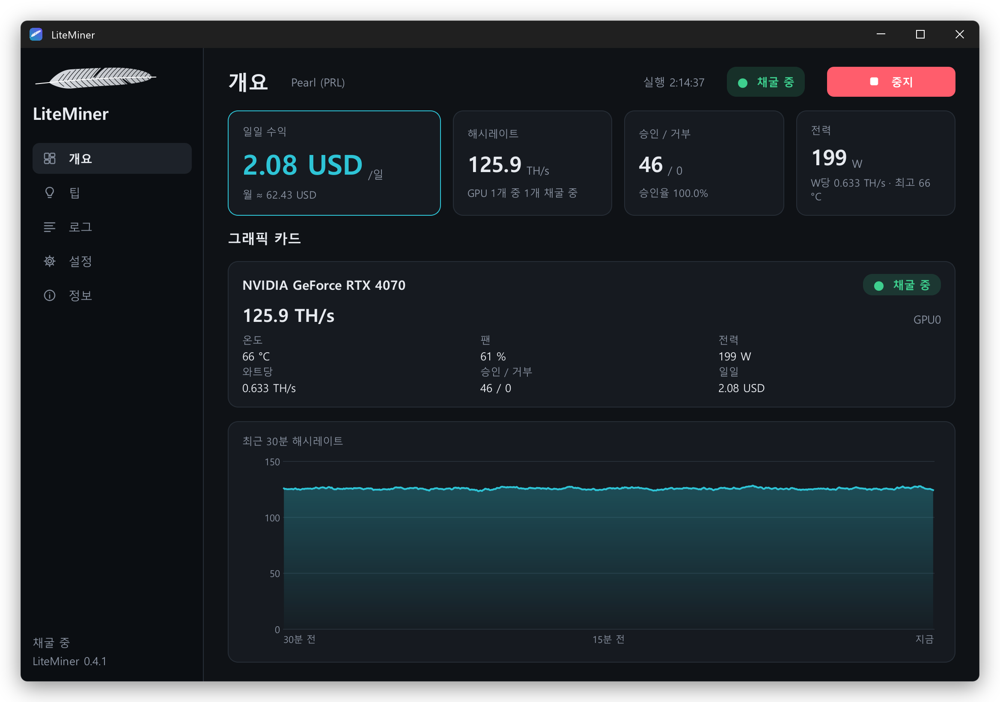
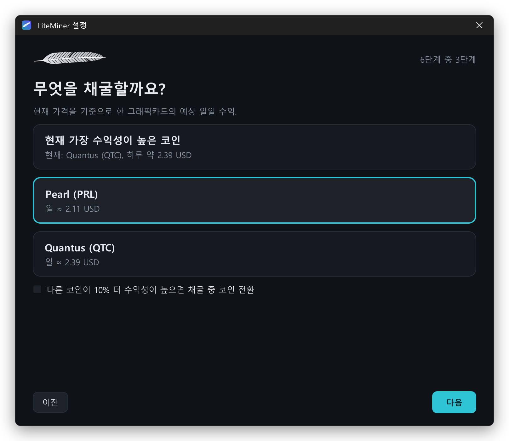
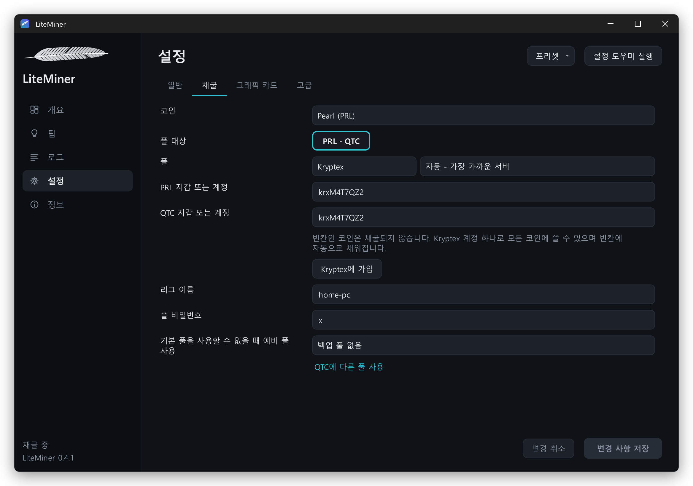

<p align="center"><a href="README.md">English</a> · <a href="README.zh-CN.md">简体中文</a> · <a href="README.es.md">Español</a> · <a href="README.pt-BR.md">Português</a> · <a href="README.de.md">Deutsch</a> · <a href="README.fr.md">Français</a> · <a href="README.ja.md">日本語</a> · <b>한국어</b> · <a href="README.ru.md">Русский</a> · <a href="README.tr.md">Türkçe</a> · <a href="README.vi.md">Tiếng Việt</a></p>

<p align="center"></p>

<p align="center"><b>NVIDIA와 AMD GPU로 Pearl(PRL)과 Quantus(QTC)를 채굴하는 간단한 방법.</b></p>

<p align="center">
<a href="https://github.com/liteminergpu/liteminer/releases/latest"></a>
<a href="https://github.com/liteminergpu/liteminer/releases/latest"></a>
<a href="https://hub.docker.com/r/liteminer/liteminer"></a>
<a href="#빠른-시작"></a>
<a href="#gpu와-해시레이트"></a>
<a href="#코인-알고리즘-개발자-수수료"></a>
<a href="#코인-알고리즘-개발자-수수료"></a>
<a href="https://www.virustotal.com/gui/file/5c1f965892905f51f715a3e71ae90a9c078eecf9d14a827551a40176b129e831"></a>
<a href="#지원"></a>
<a href="https://t.me/liteminergpu"></a>
<a href="https://discord.com/users/1572214196995624980"></a>
<a href="#라이선스"></a>
</p>

LiteMiner는 여러분이 늘 원하던 채굴기입니다. GPU 아키텍처마다 맞춰 조정한 최신 알고리즘, 편리한 데스크톱 앱(GUI) 또는 터미널(CLI), 코인 자동 선택, 예비 풀, 유용한 팁, 읽기 쉬운 로그를 갖추고 있습니다. 채굴 리그에서 최대 속도로 돌릴 수도 있고, 평소 쓰는 PC의 백그라운드에서 조용히 돌리면서 게임과 다른 프로그램에 GPU를 양보하게 할 수도 있습니다. Windows, Linux, HiveOS를 지원합니다.

## 목차

- [스크린샷](#스크린샷)
- [주요 특징](#주요-특징)
- [빠른 시작](#빠른-시작): [Windows](#windows) · [Linux](#linux) · [HiveOS](#hiveos) · [Docker와 GPU 임대](#docker와-gpu-임대vastai-cloreai-runpod-등-gpu-클라우드)
- [다운로드와 체크섬](#다운로드와-체크섬)
- [코인, 알고리즘, 개발자 수수료](#코인-알고리즘-개발자-수수료)
- [지원하는 풀](#지원하는-풀)
- [CLI 옵션](#cli-옵션)
- [통계와 로그](#통계와-로그)
- [GPU와 해시레이트](#gpu와-해시레이트)
- [LiteMiner 파일 위치](#liteminer-파일-위치)
- [문제 해결](#문제-해결)
- [지원](#지원)
- [라이선스](#라이선스)

## 스크린샷

<p align="center"><br><sub>그래픽 인터페이스(GUI)</sub></p>

<p align="center"><br><sub>콘솔 채굴기(CLI)</sub></p>

<details>
<summary><b>스크린샷 더 보기: 설정 도우미와 설정</b></summary>
<br>
<p align="center"> </p>
</details>

## 주요 특징

**1. 문서를 뒤질 필요 없이 클릭 몇 번으로 채굴을 시작하세요.** 압축을 풀고 `LiteMiner-GUI`를 실행한 뒤 간단한 질문 몇 가지에 답하면 됩니다. 설정 도우미가 지갑과 풀이 무엇인지 설명하고, 가장 가까운 풀 서버를 고르고, 주소를 확인한 다음 채굴을 시작합니다. 암호화폐를 처음 접하는 분도 괜찮습니다. 앱은 11개 언어를 지원합니다. 터미널이 더 편하다면 같은 채굴기를 명령 하나로 실행할 수 있습니다.

**2. 빠른 속도, 정직한 수치.** GPU 아키텍처마다 전용 설정이 내장되어 있고, Pearl은 여러분의 그래픽카드에 맞춰 추가로 미세 조정할 수도 있습니다. 변경할 때마다 자체 GPU와 임대 GPU로 속도를 다시 측정합니다. [해시레이트 표](#gpu와-해시레이트)에는 테스트한 각 그래픽카드에서 LiteMiner가 실제로 낸 결과만 있습니다. 추정치도, 부풀린 반올림도 없습니다.

**3. 아쉬웠던 기능을 모두 담았습니다.** 지금 가장 수익이 높은 코인을 채굴하고, 다른 코인이 더 유리해지면 자동으로 전환합니다. 게임을 실행하거나 다른 용도로 GPU를 쓰기 시작하면 채굴기가 이를 알아차리고 부하를 낮춰 방해하지 않습니다. 배터리 사용 시 일시 중지, 채굴하는 동안만 절전 모드 방지, GPU 과열 보호, 풀과 네트워크 장애 후 자동 복구 등 기능이 많습니다. 각 기능은 클릭 한 번으로 설정할 수 있습니다.

그리고 신경 쓰지 않아도 되는 것들:

- **그래픽카드 설정은 그대로입니다.** LiteMiner는 클럭, 전압, 전력 제한, 팬 속도를 절대 바꾸지 않고 센서만 읽습니다. 사용하시는 도구로 언더볼팅하거나 전력 제한을 낮춰도 LiteMiner 작동에는 문제가 없습니다.
- **세 가지 채굴 모드:** *최대 속도*, *자동*(GPU가 비어 있으면 최대 속도로, 여러분이 GPU를 쓸 때는 양보), *컴퓨터를 사용하지 않을 때만*.
- **GPU마다 별도 프로세스.** 그래픽카드에 오류가 나거나 드라이버가 멈추면 리그 전체가 아니라 그 카드만 다시 시작합니다.
- **끊기지 않는 풀 연결:** 인증서를 검증하는 TLS, 가장 가까운 서버 자동 선택, 최대 8개의 예비 풀, TLS가 막힌 곳에서는 일반 TCP, SOCKS5 프록시, DNS over HTTPS.
- **읽기 전용 로컬 API**로 대시보드와 스크립트를 지원하고, 필요하면 로그를 JSON으로 출력합니다.
- **모든 셰어를 전송 전에 CPU에서 검증**하므로 GPU 계산 오류가 거부된 셰어로 이어지지 않습니다.

## 빠른 시작

### Windows

1. [최신 릴리스를 다운로드](https://github.com/liteminergpu/liteminer/releases/download/v0.5.1/LiteMiner-0.5.1-windows-x64-portable.zip)합니다(`LiteMiner-0.5.1-windows-x64-portable.zip`).
2. 압축을 원하는 폴더에 풉니다.
3. **`LiteMiner-GUI.exe`** 파일을 실행합니다. 나머지는 설정 도우미가 안내합니다.

터미널이 더 편하다면 `start_LiteMiner_pearl.bat` 또는 `start_LiteMiner_quantus.bat` 맨 위에 지갑(다른 풀을 쓴다면 풀도)을 입력하고 실행하거나, 채굴기를 직접 실행하세요.

```bat
LiteMiner.exe -a pearl -o stratum+ssl://prl.kryptex.network:8048 -u YOUR_WALLET -w rig1
LiteMiner.exe -a quantus -o stratum+ssl://qtc.kryptex.network:8049 -u YOUR_WALLET -w rig1 --background
```

또는 PowerShell 명령 하나로 다운로드, 압축 해제, 실행까지 할 수 있습니다.

```powershell
irm https://github.com/liteminergpu/liteminer/releases/download/v0.5.1/LiteMiner-0.5.1-windows-x64-portable.zip -OutFile LiteMiner.zip; Expand-Archive LiteMiner.zip .; .\LiteMiner-0.5.1-windows-x64\LiteMiner-GUI.exe
```

요구 사항: Windows 10 또는 11(x64)과 최신 그래픽 드라이버. 데스크톱 앱은 Windows 10 버전 1809 이상이 필요하고, 터미널 채굴기(`LiteMiner.exe`와 `.bat` 파일)는 모든 Windows 10 x64에서 실행됩니다.

> [!TIP]
> 아직 지갑이 없나요? 무료 [Kryptex 계정](https://www.kryptex.com/register?ref=b629c482)은 두 코인 모두에 쓸 수 있습니다. 사용자 이름(`krxXXXXXX`)을 지갑 자리에 입력하면 Kryptex가 BTC 또는 USDT 중 원하는 것으로 지급합니다.

### Linux

가장 빠른 방법: 명령 하나로 다운로드, 압축 해제, 채굴 시작까지 합니다. `YOUR_WALLET`을 본인의 지갑으로 바꾸세요(다른 풀을 쓴다면 풀도).

Pearl:

```bash
curl -fsSL https://github.com/liteminergpu/liteminer/releases/download/v0.5.1/LiteMiner-0.5.1-linux-x64-portable.tar.gz | tar -xz && cd LiteMiner-0.5.1-linux-x64 && ./LiteMiner -a pearl -o stratum+ssl://prl.kryptex.network:8048 -u YOUR_WALLET -w rig1
```

Quantus:

```bash
curl -fsSL https://github.com/liteminergpu/liteminer/releases/download/v0.5.1/LiteMiner-0.5.1-linux-x64-portable.tar.gz | tar -xz && cd LiteMiner-0.5.1-linux-x64 && ./LiteMiner -a quantus -o stratum+ssl://qtc.kryptex.network:8049 -u YOUR_WALLET -w rig1
```

같은 폴더에 데스크톱 앱도 있습니다: `./LiteMiner-GUI`

배포판별 패키지:

```bash
# Debian, Ubuntu, Linux Mint, Pop!_OS
wget https://github.com/liteminergpu/liteminer/releases/download/v0.5.1/liteminer_0.5.1_amd64.deb https://github.com/liteminergpu/liteminer/releases/download/v0.5.1/liteminer-gui_0.5.1_amd64.deb
sudo apt install ./liteminer_0.5.1_amd64.deb ./liteminer-gui_0.5.1_amd64.deb
```

```bash
# Fedora, RHEL, AlmaLinux, Rocky Linux (openSUSE: sudo zypper install ...)
sudo dnf install https://github.com/liteminergpu/liteminer/releases/download/v0.5.1/liteminer-0.5.1-1.x86_64.rpm https://github.com/liteminergpu/liteminer/releases/download/v0.5.1/liteminer-gui-0.5.1-1.x86_64.rpm
```

```bash
# Flatpak
wget https://github.com/liteminergpu/liteminer/releases/download/v0.5.1/LiteMiner-0.5.1.flatpak
flatpak remote-add --user --if-not-exists flathub https://dl.flathub.org/repo/flathub.flatpakrepo
flatpak install --user ./LiteMiner-0.5.1.flatpak
flatpak run org.liteminer.LiteMiner
```

`liteminer` 패키지에는 서버와 리그용 터미널 채굴기가 들어 있고, `liteminer-gui`는 데스크톱 앱을 추가합니다. 채굴기를 서비스로 실행하려면 `sudo systemctl enable --now liteminer@YOUR_USER`를 사용하세요. 서비스는 `~/.local/share/liteminer/miner.json`을 읽습니다. 자세한 내용은 `man liteminer`를 참고하세요.

요구 사항: x86-64. 터미널 채굴기는 glibc 2.28 이상(Ubuntu 20.04, Debian 10, RHEL 8 이상), 데스크톱 앱은 2.34 이상(Ubuntu 22.04, Debian 12, Fedora 35, RHEL 9 이상)이 필요합니다. X11 또는 Wayland. NVIDIA는 독점 드라이버(CUDA Toolkit 불필요), AMD는 ROCm 같은 OpenCL 드라이버가 필요합니다. 최소 구성 시스템과 컨테이너에서 TLS 풀에 연결하려면 `ca-certificates` 패키지도 필요합니다.

### HiveOS

빠르게 설정하려면 HiveOS 아카이브의 README.md에서 PRL 또는 QTC 플라이트 시트를 가져온 뒤 지갑을 선택하세요.

HiveOS에서 Pearl 코인은 **PRL**, Quantus 코인은 **QUAN**입니다. HiveOS의 QTC는 다른 코인(QubitCoin)입니다.

플라이트 시트를 만드세요. **Coin**은 채굴할 코인, **Wallet**은 본인의 지갑, **Pool**은 *Configure in miner*, **Miner**는 *Custom*을 선택합니다. 그런 다음 **Setup Miner Config**를 누르고 다음과 같이 입력합니다.

| 항목 | 값 |
|---|---|
| Miner name | `liteminer` (URL에서 자동 입력) |
| Installation URL | `https://github.com/liteminergpu/liteminer/releases/download/v0.5.1/liteminer-0.5.1.tar.gz` |
| Hash algorithm | `pearlhash` 또는 `quantus` |
| Wallet and worker template | `%WAL%.%WORKER_NAME%` 또는 `%WAL%/%WORKER_NAME%` |
| Pool URL | `stratum+ssl://prl.kryptex.network:8048` (Pearl) 또는 `stratum+ssl://qtc.kryptex.network:8049` (Quantus) |
| Pass | `x` |
| Extra config arguments | 선택 사항. 예: `--devices 0,2` 또는 `--thermal off` |

플라이트 시트를 리그에 적용합니다. 각 GPU는 별도 워커로 채굴하고(풀에서는 `<worker>_gpuN`), Hive에는 GPU별 해시레이트가 표시됩니다. 오버클럭 설정은 Hive OC 프로필에 그대로 남으며 LiteMiner는 이를 건드리지 않습니다. 로그: `/var/log/miner/custom/liteminer.log`, 콘솔: Hive 셸에서 `miner`. 첫 번째 Pool URL만 사용되며, `stratum+ssl://`이나 `stratum+tcp://`가 없는 주소는 TLS 여부를 자동으로 확인합니다. Extra config arguments는 여러 줄로 써도 됩니다.

### Docker와 GPU 임대(Vast.ai, Clore.ai, RunPod 등 GPU 클라우드)

Docker를 쓰려면 NVIDIA 드라이버와 [NVIDIA Container Toolkit](https://docs.nvidia.com/datacenter/cloud-native/container-toolkit/latest/install-guide.html)이 설치된 Linux 호스트(또는 Docker Desktop과 WSL 2가 설치된 Windows)가 필요합니다. 컨테이너는 NVIDIA GPU만 지원합니다.

```bash
docker run -d --name liteminer --gpus all --restart unless-stopped -v liteminer-data:/data \
  liteminer/liteminer:0.5.1 -a pearl -o stratum+ssl://prl.kryptex.network:8048 -u YOUR_WALLET -w rig1
docker logs -f liteminer
```

옵션 대신 환경 변수 `LITEMINER_ALGORITHM`, `LITEMINER_POOL`, `LITEMINER_WALLET`, `LITEMINER_WORKER`, `LITEMINER_PASSWORD`, `LITEMINER_DEVICES`도 사용할 수 있습니다. `/data` 볼륨은 유지하세요. 로그와 GPU별 튜닝 결과가 저장되어, 다시 시작해도 튜닝을 반복하지 않습니다. `docker stop -t 60 liteminer`를 쓰면 각 GPU가 현재 작업을 마친 뒤 멈춥니다.

GPU 클라우드에서는 `liteminer/liteminer:0.5.1` 이미지를 선택하고 템플릿의 환경 변수에 `LITEMINER_ALGORITHM`, `LITEMINER_POOL`, `LITEMINER_WALLET`을 설정하세요. 또는 CUDA가 포함된 아무 Ubuntu 이미지(예: `nvidia/cuda:12.4.1-base-ubuntu22.04`)를 고르고 다음을 시작 스크립트(on-start script)로 지정하세요.

```bash
apt-get update && apt-get install -y --no-install-recommends ca-certificates curl
curl -fsSL https://github.com/liteminergpu/liteminer/releases/download/v0.5.1/LiteMiner-0.5.1-linux-x64-portable.tar.gz | tar -xz -C /opt
cd /opt/LiteMiner-0.5.1-linux-x64 && nohup ./LiteMiner -a quantus -o stratum+ssl://qtc.kryptex.network:8049 -u YOUR_WALLET -w cloud1 > /var/log/liteminer.log 2>&1 &
```

인스턴스의 모든 GPU가 채굴합니다. 로그는 `tail -f /var/log/liteminer.log`로 볼 수 있습니다. 임대 서버는 원래 높은 온도로 동작하도록 설계된 경우가 많습니다. 온도를 제공 업체가 관리한다면 `--thermal off`로 온도 관리를 업체에 맡기세요.

## 다운로드와 체크섬

0.5.1 릴리스의 모든 파일은 [릴리스 페이지](https://github.com/liteminergpu/liteminer/releases/latest)에 있습니다. 다운로드한 파일을 `SHA256SUMS.txt`와 대조하려면 Windows에서는 `certutil -hashfile 파일 SHA256`, Linux에서는 `sha256sum -c --ignore-missing SHA256SUMS.txt`를 실행하세요.

| 플랫폼 | 파일 | 크기 | SHA-256 | 검사 |
|---|---|---:|---|---|
| Windows x64 | [`LiteMiner-0.5.1-windows-x64-portable.zip`](https://github.com/liteminergpu/liteminer/releases/download/v0.5.1/LiteMiner-0.5.1-windows-x64-portable.zip) | 86.6 MB | <sub>`5c1f965892905f51f715a3e71ae90a9c078eecf9d14a827551a40176b129e831`</sub> | [VirusTotal](https://www.virustotal.com/gui/file/5c1f965892905f51f715a3e71ae90a9c078eecf9d14a827551a40176b129e831) |
| Linux x64 | [`LiteMiner-0.5.1-linux-x64-portable.tar.gz`](https://github.com/liteminergpu/liteminer/releases/download/v0.5.1/LiteMiner-0.5.1-linux-x64-portable.tar.gz) | 109.4 MB | <sub>`7ee9a792b0166fa240ee44084bcf64ed48013e54585ec83b5ab2d81373cf0fd1`</sub> | [VirusTotal](https://www.virustotal.com/gui/file/7ee9a792b0166fa240ee44084bcf64ed48013e54585ec83b5ab2d81373cf0fd1) |
| HiveOS | [`liteminer-0.5.1.tar.gz`](https://github.com/liteminergpu/liteminer/releases/download/v0.5.1/liteminer-0.5.1.tar.gz) | 31.8 MB | <sub>`2f928cc5f098e320e7b18e0c50b21ec689b617bade35ba5434ede96d31d59e2c`</sub> | [VirusTotal](https://www.virustotal.com/gui/file/2f928cc5f098e320e7b18e0c50b21ec689b617bade35ba5434ede96d31d59e2c) |
| Docker(빌드 컨텍스트) | [`LiteMiner-0.5.1-docker.tar.gz`](https://github.com/liteminergpu/liteminer/releases/download/v0.5.1/LiteMiner-0.5.1-docker.tar.gz) | 31.7 MB | <sub>`065abe902d455669072639a18e3096d3061976078c3bd622094bb491938f6df8`</sub> | [VirusTotal](https://www.virustotal.com/gui/file/065abe902d455669072639a18e3096d3061976078c3bd622094bb491938f6df8) |
| Debian / Ubuntu | [`liteminer_0.5.1_amd64.deb`](https://github.com/liteminergpu/liteminer/releases/download/v0.5.1/liteminer_0.5.1_amd64.deb) | 31.9 MB | <sub>`330824098d1f1e164c93a6cef10dca805456e895187c37967be1218b128f3ecc`</sub> | [VirusTotal](https://www.virustotal.com/gui/file/330824098d1f1e164c93a6cef10dca805456e895187c37967be1218b128f3ecc) |
| Debian / Ubuntu | [`liteminer-gui_0.5.1_amd64.deb`](https://github.com/liteminergpu/liteminer/releases/download/v0.5.1/liteminer-gui_0.5.1_amd64.deb) | 45.8 MB | <sub>`b046e4b126349545efc6986cf7472d7aa780dc4b7d5d51d0504d502479b88282`</sub> | [VirusTotal](https://www.virustotal.com/gui/file/b046e4b126349545efc6986cf7472d7aa780dc4b7d5d51d0504d502479b88282) |
| Fedora / RHEL / openSUSE | [`liteminer-0.5.1-1.x86_64.rpm`](https://github.com/liteminergpu/liteminer/releases/download/v0.5.1/liteminer-0.5.1-1.x86_64.rpm) | 26.9 MB | <sub>`69df9bb7d1d7cb38e14db95110a515d4107fdf69d394764aecc7ea9edf1f2a3d`</sub> | [VirusTotal](https://www.virustotal.com/gui/file/69df9bb7d1d7cb38e14db95110a515d4107fdf69d394764aecc7ea9edf1f2a3d) |
| Fedora / RHEL / openSUSE | [`liteminer-gui-0.5.1-1.x86_64.rpm`](https://github.com/liteminergpu/liteminer/releases/download/v0.5.1/liteminer-gui-0.5.1-1.x86_64.rpm) | 31.5 MB | <sub>`2ed087d7d6f72b8d1cd4128bbc9c91f99b6b0bd3d82593ed54ae774c42bb221e`</sub> | [VirusTotal](https://www.virustotal.com/gui/file/2ed087d7d6f72b8d1cd4128bbc9c91f99b6b0bd3d82593ed54ae774c42bb221e) |
| Flatpak(모든 배포판) | [`LiteMiner-0.5.1.flatpak`](https://github.com/liteminergpu/liteminer/releases/download/v0.5.1/LiteMiner-0.5.1.flatpak) | 58.8 MB | <sub>`593b042efa211a5ea171c571d97e8ffb5b051cf474c416f3836037026d4fab2c`</sub> | [VirusTotal](https://www.virustotal.com/gui/file/593b042efa211a5ea171c571d97e8ffb5b051cf474c416f3836037026d4fab2c) |

> [!IMPORTANT]
> 백신 프로그램은 거의 모든 채굴기를 '잠재적으로 원치 않는 프로그램'이나 '코인 채굴기'로 탐지합니다. 이는 특정 위협이 아니라 분류에 따른 탐지이므로 위 표에 VirusTotal 보고서를 공개해 두었습니다. LiteMiner는 이 페이지에서만 다운로드하고 체크섬을 대조하세요. Windows Defender가 파일을 삭제하면 LiteMiner 폴더를 제외 목록에 추가하세요.

## 코인, 알고리즘, 개발자 수수료

| 코인 | 알고리즘 | NVIDIA(CUDA) | AMD / Intel(OpenCL) | Devfee |
|---|---|---|---|---:|
| [Pearl (PRL)](https://pool.kryptex.com/prl) | Pearl (int8 MatMul PoW), `-a pearl` | Pascal (GTX 10) 이상 | 지원(아직 측정 전) | 2% |
| [Quantus (QTC)](https://pool.kryptex.com/qtc) | QPoW (Poseidon2), `-a quantus` | Maxwell (GTX 900) 이상 | 지원 | 2% |

요청이 있거나 채굴할 가치가 생기면 코인을 추가합니다. 추가할 만한 새 코인이 없을 때는 목록을 부풀리지 않고, 대신 기존 알고리즘을 여러분의 GPU에서 더 빠르게 만듭니다.

## 지원하는 풀

LiteMiner는 해당 코인의 Stratum 프로토콜을 지원하는 모든 풀과 TLS(`stratum+ssl://`, 인증서 검증) 또는 일반 TCP(`stratum+tcp://`)로 동작합니다. 아래 풀은 앱에 내장되어 있습니다. 앱은 지연 시간이 가장 짧은 서버를 고르고, 다른 지역을 자동 예비로 두며, 로그인 형식이 해당 풀에 맞는지 확인합니다.

| 풀 | PRL | QTC | 로그인 | 서버 수 |
|---|---|---|---|---:|
| **[Kryptex](https://pool.kryptex.com/prl)**<br><sub>[가입](https://www.kryptex.com/register?ref=b629c482)</sub> | `stratum+ssl://prl.kryptex.network:8048`<br><sub>TLS, TCP 7048</sub> | `stratum+ssl://qtc.kryptex.network:8049`<br><sub>TLS, TCP 7049</sub> | Kryptex 계정 또는 지갑 | 8 |
| **[PearlFortune](https://pearlfortune.org/)** | `stratum+ssl://global.pearlfortune.org:443`<br><sub>TLS, 고정 인증서</sub> | - | 지갑 주소 | 1 |
| **[LuckyPool](https://pearl.luckypool.io/)** | `stratum+ssl://pearl-eu1.luckypool.io:3360`<br><sub>TLS, 고정 인증서</sub> | `stratum+ssl://eu.lproute.com:5660`<br><sub>TLS, 고정 인증서</sub> | 지갑 주소 | 19 |
| **[F2Pool](https://www.f2pool.com/coin/pearl)**<br><sub>[가입](https://www.f2pool.com/user/signup)</sub> | `stratum+tcp://pearl.f2pool.com:5500`<br><sub>TCP만</sub> | `stratum+tcp://qtc.f2pool.com:4500`<br><sub>TCP만</sub> | 풀 계정 이름 | 1 |
| **[HeroMiners](https://pearl.herominers.com/)** | `stratum+ssl://de.pearl.herominers.com:1200`<br><sub>TLS</sub> | `stratum+ssl://de.quantus.herominers.com:1155`<br><sub>TLS</sub> | 지갑 주소 | 15 |
| **[2Miners](https://2miners.com/prl-mining-pool)** | `stratum+ssl://prl.2miners.com:11818`<br><sub>TLS, TCP 1818</sub> | `stratum+ssl://qtc.2miners.com:13636`<br><sub>TLS, TCP 3636</sub> | 지갑 주소 | 3 |

터미널 채굴기는 설정 파일로 같은 기능을 제공합니다(`LiteMiner --init`으로 예제를 만들 수 있습니다).

```json
{
  "pool_host": "prl.kryptex.network", "pool_port": 8048, "tls": true, "tcp_port": 7048, "tcp_fallback": true,
  "wallet": "YOUR_WALLET", "worker": "rig1", "password": "x",
  "backup_pools": [
    {"pool_host": "prl-eu.kryptex.network", "pool_port": 8048},
    {"pool_host": "de.pearl.herominers.com", "pool_port": 1200, "wallet": "YOUR_PRL_ADDRESS"}
  ],
  "proxy": "socks5://127.0.0.1:9050"
}
```

`backup_pools`에는 풀을 최대 8개까지 넣을 수 있으며, 기본 풀이 다시 동작하면 채굴기가 알아서 돌아갑니다. `tcp_fallback`은 TLS로 전혀 연결할 수 없을 때만 암호화되지 않은 포트를 사용합니다. `proxy`는 풀 연결을 SOCKS5로 보내고(로그인과 비밀번호는 `LITEMINER_PROXY_USERNAME`과 `LITEMINER_PROXY_PASSWORD`에 지정), `doh_url`은 풀 주소를 DNS over HTTPS로 조회합니다.

## CLI 옵션

**데스크톱 앱에서는 이 모든 것을 체크박스로 설정하므로 이 부분은 건너뛰어도 됩니다.** 터미널용으로, 이번 릴리스의 프로그램에서 직접 가져온 채굴기의 모든 옵션을 소개합니다.

| 옵션 | 설명 |
|---|---|
| `-V`, `--version` | 버전과 빌드를 표시하고 종료 |
| `-a`, `--algorithm` `ALGORITHM` | `pearl`(기본값), `quantus` / `qpow` / `qtc` |
| `--config` `CONFIG` | JSON 설정 파일(기본값: Pearl은 `miner.json`, Quantus는 `quantus.json`) |
| `-o`, `--pool` `POOL` | 포트를 포함한 풀 주소: `stratum+ssl://host:port` 또는 `stratum+tcp://host:port` |
| `-u`, `--wallet` `WALLET` | 지갑 주소 또는 풀 계정 |
| `-w`, `--worker` `WORKER` | 워커 이름(기본값: `rig1`) |
| `-p`, `--password` `PASSWORD` | 풀 비밀번호(기본값: `x`) |
| `--devices` `DEVICES` | `all`(기본값: CUDA 또는 Metal GPU와 OpenCL을 지원하는 NVIDIA 외 GPU) 또는 쉼표로 구분한 번호 / `opencl:N`. GPU마다 별도의 격리된 프로세스에서 실행 |
| `--list-devices` | GPU와 각 GPU가 채굴할 수 있는 코인을 표시하고 종료(`--log-format json`이면 JSON) |
| `-B`, `--benchmark` | 벤치마크: 풀과 지갑이 설정되어 있으면 그것으로, 아니면 온라인으로 실행하고 필요하면 자동으로 오프라인 전환 |
| `--benchmark-seconds` `BENCHMARK_SECONDS` | GPU 준비 후 벤치마크 시간(기본값: 900초, `0`이면 중지할 때까지) |
| `--stop-file` `PATH` | 이 파일이 생기면 정상적으로 중지(각 GPU는 현재 작업을 마친 뒤 중지) |
| `--no-autotune` | 자동 조정 없이 설정 파일의 연산 설정을 사용. 부하와 VRAM에 대한 적응은 계속 동작 |
| `--autotune` | Pearl 최대 속도: 시작할 때 아키텍처 기본 설정 대신 측정으로 연산 설정을 선택(최대 4분, 그동안 채굴하지 않음). 결과는 다음 실행을 위해 저장 |
| `--background` | 자동 모드: GPU가 비어 있으면 최대 속도, 게임과 다른 GPU 프로그램에 양보하고 그 프로그램이 GPU 전체를 필요로 하는 동안 일시 중지 |
| `--idle-only` | 아무도 컴퓨터를 사용하지 않을 때만 최대 속도(`--idle-seconds`초 동안 키보드와 마우스 입력 없음). 그 외에는 일시 중지하며 풀 연결은 유지. Windows에서는 자동 모드처럼 다른 GPU 프로그램에도 양보 |
| `--idle-seconds` `IDLE_SECONDS` | 채굴을 시작하기 전 키보드와 마우스 입력이 없는 시간(초, 10..86400, 기본값 120). `--idle-only`를 켬 |
| `--no-load-pause` | 다른 프로그램이 GPU를 많이 사용해도 일시 중지하지 않고 가장 낮은 단계로 계속 채굴. `--idle-only`가 없으면 `--background`를 켬 |
| `--mine-on-battery` | 배터리로 동작할 때도 계속 채굴(기본값: 전원에 연결될 때까지 일시 중지. 배터리 사용 시 해시레이트는 보통 훨씬 낮음) |
| `--allow-sleep` | 채굴 중에도 유휴 타이머에 따라 절전 모드 허용(기본값: GPU가 채굴하는 동안 절전하지 않음. 화면은 꺼질 수 있음) |
| `--api-port` `API_PORT` | 로컬 읽기 전용 JSON API 포트(기본값 4280, 사용 중이면 자동 선택) |
| `--api-endpoint-file` `PATH` | 로컬 API에 할당된 포트와 세션 ID를 이 파일에 기록 |
| `--api-bind` `API_BIND` | API 수신 주소: `127.0.0.1`(기본값), `::1`, `localhost`만 가능 |
| `--no-api` | 로컬 JSON API 끄기(데스크톱 앱에 필요) |
| `--thermal` `{auto,custom,off}` | 온도 보호: `auto`(기본값: 모든 GPU에서 칩이 85 °C 이상이면 감속, 90 °C에서 일시 중지, 80 °C 미만이면 재개. 메모리는 드라이버가 메모리 온도를 알려 주는 경우 그 한계값을 따름), `custom`(`--thermal-soft/hard/resume`, 지정하면 자동 선택) 또는 `off` |
| `--thermal-gpu` `LABEL=SOFT:HARD:RESUME` | GPU 한 개의 칩 온도 한계값. 예: `gpu1=80:88:75`(GPU마다 반복, `--thermal off`와 함께 사용 불가) |
| `--thermal-soft` `THERMAL_SOFT` | 속도를 낮추기 시작하는 칩 온도(°C) |
| `--thermal-hard` `THERMAL_HARD` | 채굴을 일시 중지하는 칩 온도(°C) |
| `--thermal-resume` `THERMAL_RESUME` | 채굴을 다시 시작하는 칩 온도(°C, 이보다 낮아지면 재개) |
| `--thermal-memory-soft` `THERMAL_MEMORY_SOFT` | 속도를 낮추기 시작하는 메모리 온도(°C) |
| `--thermal-memory-hard` `THERMAL_MEMORY_HARD` | 채굴을 일시 중지하는 메모리 온도(°C) |
| `--thermal-memory-resume` `THERMAL_MEMORY_RESUME` | 채굴을 다시 시작하는 메모리 온도(°C, 이보다 낮아지면 재개) |
| `-v`, `--verbose` | 추가 진단 정보 표시 |
| `--no-color` | 콘솔 출력에 색상 사용 안 함 |
| `--log-file` `LOG_FILE` | logs/liteminer.log - 로그 파일(기본값은 사용자 런타임 디렉터리, 10 MB마다 교체하고 3개 보관) |
| `--no-log-file` | 로그 파일을 쓰지 않음 |
| `--log-format` `{text,json}` | 콘솔 출력: `text`(기본값) 또는 한 줄에 JSON 레코드 하나(스크립트용) |
| `--no-update-check` | 새 버전을 확인하지 않음(기본값: 3~4시간마다 공개 릴리스 페이지를 읽음. 프로그램 이름과 버전만 전송됨) |
| `--gui` | 데스크톱 앱 열기(Windows에서는 `LiteMiner-GUI.exe`로도 가능) |
| `--init` | 현재 폴더에 예제 설정 `miner.example.json`과 `quantus.example.json` 만들기 |
| `--runtime-info` | 프로그램의 압축 해제된 파일이 있는 폴더 표시 |
| `--verify-package` | 내장 체크섬으로 프로그램의 모든 파일 검사 |

자주 쓰는 예:

```bash
LiteMiner --list-devices                                # LiteMiner가 인식하는 GPU와 각 GPU가 채굴할 수 있는 코인
LiteMiner -a quantus ... --devices 0,2                  # GPU 0과 2에서만 채굴(GPU마다 워커 하나)
LiteMiner -a pearl ... --background                     # 자동 모드: 게임과 다른 GPU 프로그램에 양보
LiteMiner -a pearl ... --idle-only --idle-seconds 300   # 키보드와 마우스 입력이 5분간 없을 때만 채굴
LiteMiner -a quantus ... --thermal-gpu gpu1=78:86:72    # 그래픽카드 한 장에 별도 온도 한계 설정
LiteMiner -B -a pearl --benchmark-seconds 300           # 5분 벤치마크, 지갑 불필요
```

## 통계와 로그

**콘솔.** 30초마다 GPU별 속도, 온도, 팬, 전력, 효율, 승인·거부된 셰어, 상태를 표로 보여 줍니다. 그 사이에는 이벤트마다 한 줄씩(새 작업, 셰어, 재연결, 온도 보호) 출력합니다. `--log-format json`을 쓰면 대신 한 줄에 JSON 레코드 하나를 출력하므로 `jq`나 로그 수집기에 바로 넘길 수 있습니다.

**로그 파일.** 사용자별 런타임 디렉터리의 `logs/liteminer.log`입니다. 10MB가 되면 교체되고 파일 3개를 보관합니다. `--log-file`로 위치를 바꾸고, `--no-log-file`로 끌 수 있습니다.
같은 폴더에서 여러 인스턴스를 실행하면 각각 별도의 기본 로그(`liteminer.log`, `liteminer-2.log` 등)를 사용합니다.

**로컬 API.** `127.0.0.1:4280`에서 동작하는 작은 읽기 전용 JSON API입니다. 데스크톱 앱이 이 API를 사용하며, 여러분의 스크립트와 대시보드도 쓸 수 있습니다.

CLI 기본 포트가 사용 중이면 빈 포트를 선택하고 실제 URL을 로그에 기록합니다. 포트를 고정하려면 `--api-port`를 사용하세요.

| 엔드포인트 | 반환 내용 |
|---|---|
| `GET /api/v1/summary` | 리그 전체 요약: 버전, 알고리즘, 가동 시간, 상태, 총 속도와 단위, 셰어(승인, 거부, 대기), 최고 온도, 전력, 에너지, 풀 |
| `GET /api/v1/devices` | GPU별 같은 정보: 이름, 상태, 속도, 셰어, 온도, 팬, 전력, 풀 |
| `GET /api/v1/health` | `ok`, `starting`, `degraded`, `down`(`down`일 때 HTTP 503). 감시 스크립트용 |
| `GET /api/v1/history` | GPU별 최근 1시간 데이터, 5초 간격: 속도, 온도, 전력 |

```bash
curl -s http://127.0.0.1:4280/api/v1/summary
```

```json
{"api_version":1,"product":"LiteMiner","version":"0.5.1","algorithm":"quantus","uptime_seconds":180.4,
 "health":"ok","devices":1,"device_states":{"mining":1},"rate":518.6,"unit":"MH/s","rate_window_seconds":60,
 "shares":{"accepted":2,"rejected":0,"submitted":2,"lost_unacknowledged":0,"discarded_stale":0,"verification_rejected":0,"pending":0},
 "max_temperature_c":64,"power_w":196.0,"pools":["qtc.kryptex.network:8049"]}
```

API는 루프백 인터페이스에서만 수신하고(`--api-bind`는 `127.0.0.1`, `::1`, `localhost`만 허용), DNS 리바인딩을 막기 위해 `Host` 헤더를 확인하며, 지갑, 비밀번호, 설정 값을 절대 반환하지 않습니다. **제어용 엔드포인트는 의도적으로 없습니다.** 네트워크의 그 무엇도 채굴기를 멈추거나 다시 설정하거나 다른 곳으로 돌릴 수 없습니다. 스크립트에서 멈추려면 `--stop-file 경로`를 쓰거나(파일이 생기면 각 GPU가 현재 작업을 마치고 채굴기가 종료), Ctrl+C / SIGINT를 보내세요.

**HiveOS**는 표준 커스텀 채굴기 통계를 통해 GPU별 해시레이트를 받습니다(PCI 버스로 매칭). 온도와 팬 정보는 Hive가 직접 읽습니다.

## GPU와 해시레이트

LiteMiner 0.5.1 및 최근 빌드가 73개 GPU 모델에서 낸 실제 결과입니다. `?`는 아직 그 조합을 측정하지 않았다는 뜻이지, 동작하지 않는다는 뜻이 아닙니다.

모든 결과는 그래픽카드 자체 설정에서 측정했습니다. LiteMiner는 클럭, 전압, 전력 제한, 팬을 바꾸지 않았습니다. 사용하시는 도구로 언더볼팅하거나 전력 제한을 낮추는 것도 완전히 지원하며, LiteMiner는 그래픽카드가 내는 속도에 맞춰 동작합니다.

### 해시레이트는 오버클럭 없이 기본 클럭과 기본 전력 제한(PL)에서 측정한 값입니다

#### GeForce와 TITAN

| GPU | PRL, TH/s | QTC, MH/s | 최근 테스트 |
|---|---:|---:|---|
| RTX 5090 | 372.6 | 1524.6 | 2026-11 |
| RTX 5090 Laptop | ? | 508.2 | 2026-11 |
| RTX 5090 Laptop GPU | 142.9 | 512.8 | 2026-11 |
| RTX 5080 | 238.3 | 982.8 | 2026-11 |
| RTX 5070 | 134.2 | 552.7 | 2026-11 |
| RTX 5070 Ti | 204.5 | 840.8 | 2026-11 |
| RTX 5060 | 83.4 | 352.0 | 2026-11 |
| RTX 5060 Ti | 100.0 | 421.7 | 2026-11 |
| RTX 4090 | 332.4 | 1388.9 | 2026-11 |
| RTX 4080 | 210.0 | 851.3 | 2026-11 |
| RTX 4080 SUPER | 215.1 | 875.6 | 2026-11 |
| RTX 4070 | 127.8 | 518.6 | 2026-11 |
| RTX 4070 SUPER | 127.1 | 456.8 | 2026-11 |
| RTX 4070 Ti SUPER | 170.2 | 686.7 | 2026-11 |
| RTX 4060 | 64.3 | 266.8 | 2026-11 |
| RTX 4060 Laptop | ? | 144.8 | 2026-11 |
| RTX 4060 Laptop GPU | 50.7 | 145.5 | 2026-11 |
| RTX 4060 Ti | 95.1 | 379.3 | 2026-11 |
| RTX 3090 | 148.5 | 619.1 | 2026-11 |
| RTX 3090 Ti | 150.2 | 619.6 | 2026-11 |
| RTX 3080 | 120.4 | 505.2 | 2026-11 |
| RTX 3080 Ti | 140.9 | 589.1 | 2026-11 |
| RTX 3070 | 80.9 | 331.7 | 2026-11 |
| RTX 3070 Ti | 95.3 | 389.4 | 2026-11 |
| RTX 3060 | 54.6 | 227.9 | 2026-11 |
| RTX 3060 laptop | 53.0 | 193.2 | 2026-11 |
| RTX 3060 Laptop GPU | 52.7 | 193.6 | 2026-11 |
| RTX 3060 Ti | 70.8 | 296.0 | 2026-11 |
| RTX 3050 | 36.5 | 154.6 | 2026-11 |
| RTX 3050 Laptop | ? | 93.6 | 2026-11 |
| RTX 3050 Laptop GPU | 29.6 | 94.0 | 2026-11 |
| RTX 2080 | 81.9 | 371.8 | 2026-11 |
| RTX 2080 Ti | 94.5 | 418.0 | 2026-11 |
| RTX 2070 | 58.1 | 257.1 | 2026-11 |
| RTX 2070 SUPER | 57.2 | 273.5 | 2026-11 |
| RTX 2060 | 47.4 | 227.1 | 2026-11 |
| RTX 2060 SUPER | 52.8 | 234.1 | 2026-11 |
| GTX 1660 | 2.50 | 47.4 | 2026-11 |
| GTX 1660 SUPER | 8.54 | 162.5 | 2026-11 |
| GTX 1660 Ti | 8.57 | 178.0 | 2026-11 |
| GTX 1650 | 3.49 | 76.5 | 2026-11 |
| GTX 1080 | 7.95 | 85.1 | 2026-11 |
| GTX 1080 Ti | 13.1 | 119.7 | 2026-11 |
| GTX 1070 | 7.16 | 63.8 | 2026-11 |
| GTX 1070 Ti | 9.21 | 81.0 | 2026-11 |
| GTX 1060 | 5.11 | 46.0 | 2026-11 |
| GTX TITAN X | ? | 33.9 | 2026-10 |
| TITAN RTX | 92.5 | 438.5 | 2026-11 |
| TITAN V | 34.1 | 398.0 | 2026-11 |
| TITAN Xp | 7.59 | 63.1 | 2026-10 |

#### 채굴 전용 카드(CMP, P104)

| GPU | PRL, TH/s | QTC, MH/s | 최근 테스트 |
|---|---:|---:|---|
| CMP 90HX | 60.0 | 282.8 | 2026-11 |
| CMP 70HX | 50.7 | 198.7 | 2026-11 |
| CMP 50HX | 40.0 | 350.4 | 2026-11 |
| CMP 40HX | 50.3 | 236.6 | 2026-11 |
| CMP 30HX | 1.05 | 150.0 | 2026-11 |
| P104-100 | 5.63 | 47.3 | 2026-11 |

#### 워크스테이션과 데이터센터

| GPU | PRL, TH/s | QTC, MH/s | 최근 테스트 |
|---|---:|---:|---|
| A10 | 92.8 | 396.6 | 2026-11 |
| A100 PCIe | 194.7 | 404.8 | 2026-10 |
| Quadro P4000 | 5.60 | 44.7 | 2026-11 |
| RTX A2000 | 29.2 | 137.6 | 2026-10 |
| RTX A4000 | 73.5 | 294.3 | 2026-11 |
| RTX A5000 | 93.2 | 395.3 | 2026-11 |
| RTX A6000 | 131.7 | 557.7 | 2026-11 |
| Tesla P40 | 11.6 | 118.2 | 2026-11 |
| Tesla P100 | ? | 88.8 | 2026-11 |
| Tesla T4 | 35.2 | 170.2 | 2026-11 |
| Tesla V100 | 41.2 | 486.3 | 2026-11 |
| Tesla V100 SXM2 16 GB | 30.6 | 347.1 | 2026-11 |

#### AMD Radeon

| GPU | PRL, TH/s | QTC, MH/s | 최근 테스트 |
|---|---:|---:|---|
| RX 9070 XT | 137.7 | 293.2 | 2026-11 |
| RX 9060 XT | 70.7 | 160.3 | 2026-11 |
| RX 7900 XT | 48.0 | 334.3 | 2026-11 |
| RX 7900 XTX | 59.6 | 396.4 | 2026-11 |
| RX 7800 XT | 31.8 | 235.2 | 2026-11 |

여러분의 그래픽카드가 없거나 여기보다 느린가요? `LiteMiner -B`(기본 15분)를 실행하고 결과를 [lmsupp@proton.me](mailto:lmsupp@proton.me)로 보내 주세요.

## LiteMiner 파일 위치

| 항목 | Windows | Linux |
|---|---|---|
| 데스크톱 앱 설정 | `%LOCALAPPDATA%\LiteMiner\data` | `~/.local/share/liteminer` |
| 터미널 채굴기 설정 | 현재 폴더의 `miner.json`과 `quantus.json` | 동일. 패키지는 `~/.local/share/liteminer` |
| 로그 | `%LOCALAPPDATA%\LiteMiner\runtime\logs\liteminer.log` | `~/.cache/LiteMiner/runtime/logs/liteminer.log` |

프로그램은 포터블입니다. 각 EXE에는 필요한 모든 것이 들어 있고, 실행할 때마다 자체 파일을 검사합니다. 새 버전을 다른 폴더에 풀어도 설정이 유지되며, 오래된 압축 해제 버전은 자동으로 삭제됩니다.

## 문제 해결

<details>
<summary><b>"No GPU found that LiteMiner can use"(LiteMiner가 사용할 수 있는 GPU 없음)</b></summary>

[NVIDIA](https://www.nvidia.com/Download/index.aspx) 또는 [AMD](https://www.amd.com/en/support)에서 최신 드라이버를 설치하세요. NVIDIA에서는 Pearl에 Pascal(GTX 10) 이상, Quantus에 Maxwell(GTX 900) 이상이 필요합니다. `LiteMiner --list-devices`로 채굴기가 인식하는 GPU와 각 GPU가 채굴할 수 있는 코인을 확인할 수 있습니다.
</details>

<details>
<summary><b>백신 프로그램이 LiteMiner를 삭제함</b></summary>

대부분의 백신 프로그램은 특정 위협이 아니라 분류에 따라 채굴기를 탐지합니다. 파일을 `SHA256SUMS.txt`와 '[다운로드와 체크섬](#다운로드와-체크섬)'의 VirusTotal 보고서로 대조한 다음 LiteMiner 폴더를 제외 목록에 추가하세요. LiteMiner는 프로그램 파일을 `.liteminer-runtime-v2` 폴더에 풉니다. 먼저 `%TEMP%` 아래를 시도하고, 그다음 EXE 옆, 마지막으로 `%LOCALAPPDATA%` 아래를 시도합니다. 그래도 시작되지 않으면 LiteMiner가 시도한 폴더가 오류 메시지에 표시됩니다. 그 폴더들도 제외 목록에 추가하거나 AppLocker에서 허용하세요.
</details>

<details>
<summary><b>"Another LiteMiner is already mining on this GPU"(종료 코드 8)</b></summary>

한 GPU는 한 번에 LiteMiner 하나만 사용할 수 있습니다. 다른 사본(또는 자체 채굴기를 실행하는 데스크톱 앱)을 닫거나, `--devices`로 사본마다 다른 GPU를 지정하세요.
</details>

<details>
<summary><b>최소 구성 Linux나 컨테이너에서 TLS 오류 발생</b></summary>

`ca-certificates`를 설치하세요. LiteMiner는 시스템 인증서 저장소로 풀 인증서를 검증하며, 검증되지 않은 연결로는 채굴하지 않습니다.
</details>

<details>
<summary><b>HiveOS에서 채굴이 시작되지 않음</b></summary>

`miner`로 콘솔을 열거나 `/var/log/miner/custom/liteminer.log`를 확인하세요. 플라이트 시트로 만든 인수는 `/hive/miners/custom/liteminer/liteminer.args`에 있습니다. 흔한 원인: Pool URL이 다른 코인의 풀인 경우(알려진 풀이면 LiteMiner가 주소에서 코인을 정합니다), 풀이 로그인을 거부하는 경우(지갑 또는 `krx...` 로그인을 확인하세요. 이메일 로그인에는 `%WAL%/%WORKER_NAME%`가 필요합니다), 리그의 메모리가 부족한 경우(GPU마다 Pearl은 약 200 MB, Quantus는 약 300 MB가 필요합니다), 다운로드 실패 후 손상된 사본(`/hive/miners/custom/custom-get <Installation URL> -f`), 오래된 HiveOS 이미지(`hive-replace -s -y`). 풀 통계는 시작 후 15-20분 뒤에 나타나며, 해시레이트는 Hive 대시보드와 `miner` 콘솔에 먼저 표시됩니다. "Its mining kernel failed the startup check": 오버클럭 프로필을 초기화하세요(다른 알고리즘에 맞춘 프로필은 여기서 계산 오류를 내는 경우가 많습니다). 느린 카드는 셰어 하나에 30분 이상 걸릴 수 있습니다(GTX 10 / P104-100의 Pearl). 워치독의 "셰어 없음" 재시작을 그보다 짧게 설정하지 마세요. 카드가 뜨거우면 85 C부터 속도를 낮추고 90 C에서 일시 정지하므로 대시보드에 더 낮은 값이나 0이 표시됩니다. Hive의 autofan으로 식히거나, Hive의 팬 제어와 임계 온도가 이미 리그를 보호한다면 Extra config에 `--thermal off`를 추가하세요.
</details>

<details>
<summary><b>채굴 중 게임이 끊김</b></summary>

앱에서 '자동' 모드(터미널에서는 `--background`)를 선택하세요. 게임에 GPU를 양보하고, 게임이 GPU 전체를 필요로 하는 동안 일시 중지합니다. '컴퓨터를 사용하지 않을 때만' 모드(`--idle-only`)는 자리를 비웠을 때만 채굴합니다.
</details>

## 지원

질문, 버그 신고, 벤치마크 결과는 여기로 보내 주세요: [lmsupp@proton.me](mailto:lmsupp@proton.me)

메시지로도 연락하실 수 있습니다: Telegram [@liteminergpu](https://t.me/liteminergpu) · Discord [liteminer.support](https://discord.com/users/1572214196995624980)

문의하기 전에 `LiteMiner --list-devices`를 실행하고 그 출력을 `logs/liteminer.log`와 함께 첨부해 주세요.

## 라이선스

LiteMiner는 무료로 다운로드하고 사용할 수 있으며, 위에 표시된 2%의 개발자 수수료가 있습니다. 소스 코드는 공개하지 않습니다.

채굴은 전기를 소비합니다. 온도와 전기 요금, 거주 국가의 법률을 잘 살펴보세요. LiteMiner는 있는 그대로 제공되며 어떠한 보증도 하지 않습니다. 프로그램에 포함된 서드파티 라이브러리를 제외하고, 프로그램의 디컴파일, 수정 및 이와 유사한 모든 행위를 엄격히 금지합니다. 컴퓨터에 해를 끼칠 수 있는 프로그램('바이러스')에 LiteMiner를 포함해 재배포하는 것과 거주 국가의 법률을 위반하는 그 밖의 재배포를 금지합니다. 컴퓨터 소유자가 암호화폐 채굴기의 설치 및/또는 사용을 허락하지 않은 컴퓨터에서 LiteMiner를 사용하는 것을 금지합니다.
