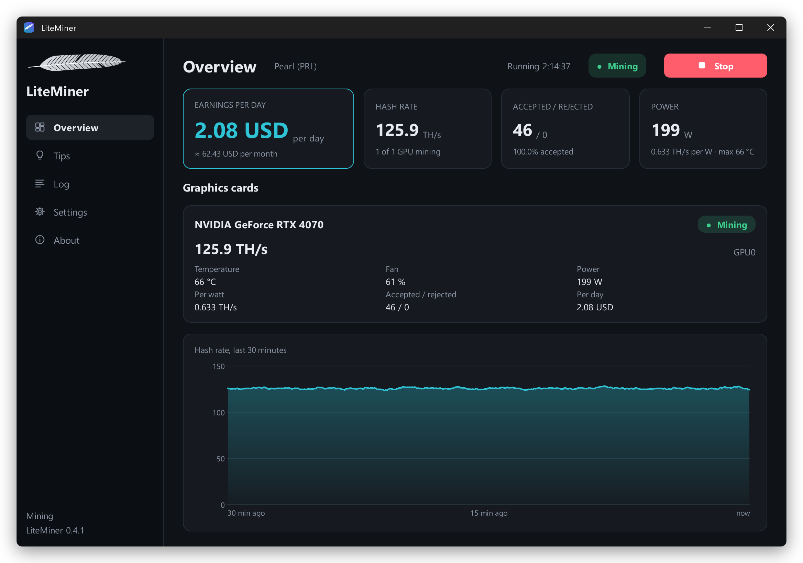
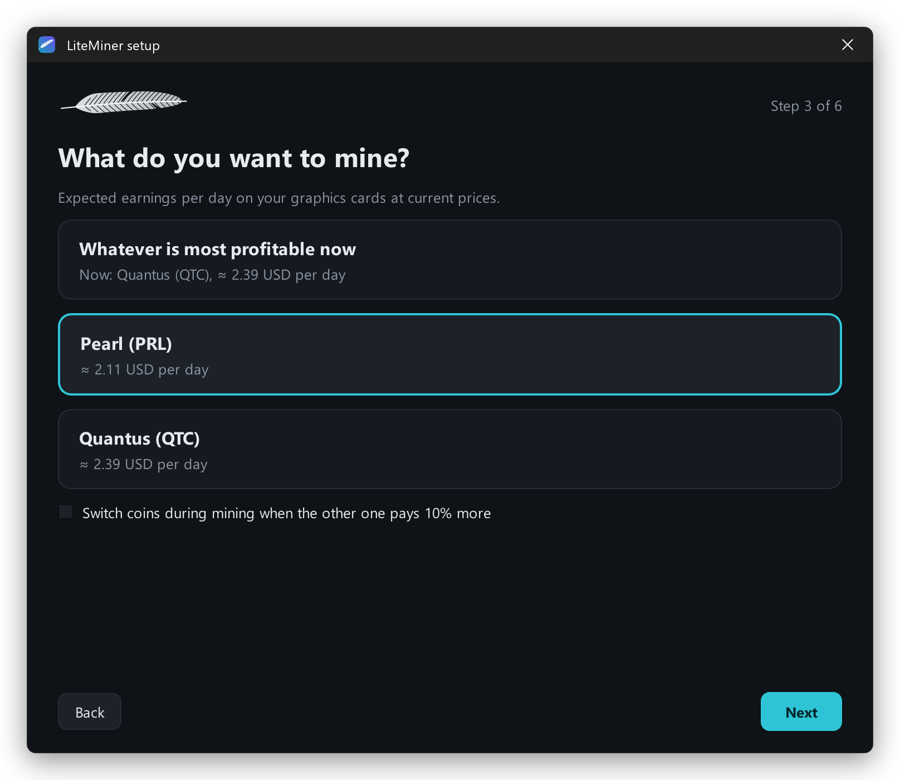
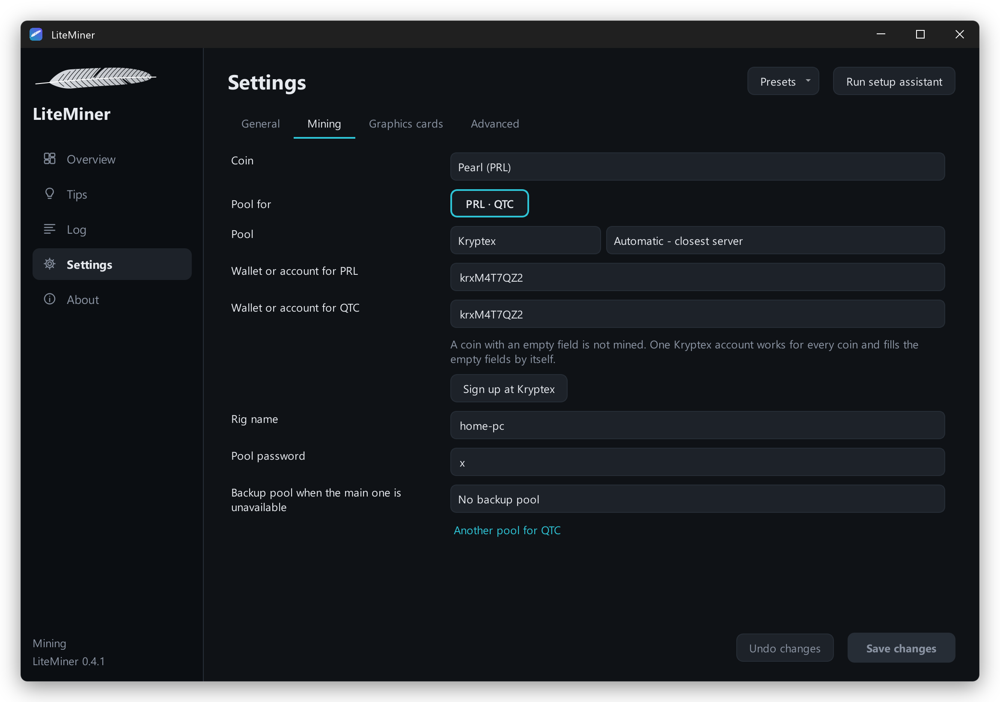

<p align="center"><b>English</b> · <a href="README.zh-CN.md">简体中文</a> · <a href="README.es.md">Español</a> · <a href="README.pt-BR.md">Português</a> · <a href="README.de.md">Deutsch</a> · <a href="README.fr.md">Français</a> · <a href="README.ja.md">日本語</a> · <a href="README.ko.md">한국어</a> · <a href="README.ru.md">Русский</a> · <a href="README.tr.md">Türkçe</a> · <a href="README.vi.md">Tiếng Việt</a></p>

<p align="center"></p>

<p align="center"><b>The simple way to mine Pearl (PRL) and Quantus (QTC) on NVIDIA and AMD GPUs.</b></p>

<p align="center">
<a href="https://github.com/liteminergpu/liteminer/releases/latest"></a>
<a href="https://github.com/liteminergpu/liteminer/releases/latest"></a>
<a href="https://hub.docker.com/r/liteminer/liteminer"></a>
<a href="#quick-start"></a>
<a href="#gpus-and-hashrate"></a>
<a href="#coins-algorithms-and-dev-fee"></a>
<a href="#coins-algorithms-and-dev-fee"></a>
<a href="https://www.virustotal.com/gui/file/5cecc0f5b6d505474d1881a279007852ee61bf670a7b5deefe0d298844d74180"></a>
<a href="#support"></a>
<a href="https://t.me/liteminergpu"></a>
<a href="https://discord.com/users/1572214196995624980"></a>
<a href="#license"></a>
</p>

LiteMiner is the miner you have always wanted: up-to-date algorithms tuned for every GPU architecture, a convenient desktop app (GUI) or a terminal miner (CLI), automatic coin choice, backup pools, practical tips and a log that is easy to read. Run it at full speed on a rig, or let it work quietly in the background of your everyday PC, giving way to games and other programs. For Windows, Linux and HiveOS.

## Contents

- [Screenshots](#screenshots)
- [Highlights](#highlights)
- [Quick start](#quick-start): [Windows](#windows) · [Linux](#linux) · [HiveOS](#hiveos) · [Docker and GPU rentals](#docker-and-gpu-rentals-vastai-cloreai-runpod-and-other-gpu-clouds)
- [Downloads and checksums](#downloads-and-checksums)
- [Coins, algorithms and dev fee](#coins-algorithms-and-dev-fee)
- [Supported pools](#supported-pools)
- [CLI reference](#cli-reference)
- [Stats and logs](#stats-and-logs)
- [GPUs and hashrate](#gpus-and-hashrate)
- [Where LiteMiner keeps its files](#where-liteminer-keeps-its-files)
- [Troubleshooting](#troubleshooting)
- [Support](#support)
- [License](#license)

## Screenshots

<p align="center"><br><sub>Graphical interface (GUI)</sub></p>

<p align="center"><br><sub>Miner in the terminal (CLI)</sub></p>

<details>
<summary><b>More screenshots: setup assistant and settings</b></summary>
<br>
<p align="center"> </p>
</details>

## Highlights

**1. Start mining in a couple of clicks instead of digging through documentation.** Unpack the archive, start `LiteMiner-GUI` and answer a few simple questions. The setup assistant explains what a wallet and a pool are, picks the nearest pool server, checks your address and starts mining, even if you have never dealt with crypto before. The app is available in 11 languages. Prefer the terminal? The same miner starts there with a single command.

**2. Fast, with honest numbers.** Every GPU architecture gets its own built-in settings, and for Pearl the miner can also fine-tune them on your card. After every change we measure the speed again on our own and rented GPUs. The [hashrate table](#gpus-and-hashrate) shows what LiteMiner actually achieved on each card we tested: real measurements only, no estimates and no rounding up.

**3. The features you were missing.** Mine the coin that pays more right now and switch automatically when the other one becomes more profitable. The miner notices when you start a game or put the GPU to other use, and lowers its load so it never gets in your way. Pause on battery power, keep the PC awake only while mining, protect the GPU from overheating, recover from pool and network failures on its own, and much more. Each of these features is set up with a single click.

And a few things you will never have to think about:

- **Your GPU settings stay yours.** LiteMiner never changes clocks, voltages, power limits or fan speeds; it only reads the sensors. Undervolting or a lower power limit set in your own tool does not interfere with LiteMiner.
- **Three mining modes:** *Maximum speed*; *Automatic*, which runs at full speed while the GPU is free and gives way when you need it; *Only when the computer is idle*.
- **One process per GPU.** If a card fails or its driver hangs, only that card is restarted, not the whole rig.
- **Pools that keep working:** TLS with certificate verification, automatic choice of the nearest server, up to eight backup pools, plain TCP where TLS is blocked, SOCKS5 proxies and DNS over HTTPS.
- **A read-only local API** for dashboards and scripts, and JSON logs on request.
- **Every share is verified on the CPU** before it is sent, so a faulty GPU calculation never turns into rejected shares.

## Quick start

### Windows

1. [Download the latest release](https://github.com/liteminergpu/liteminer/releases/download/v0.5.0/LiteMiner-0.5.0-windows-x64-portable.zip) (`LiteMiner-0.5.0-windows-x64-portable.zip`).
2. Unpack the archive into any folder.
3. Start **`LiteMiner-GUI.exe`**. The setup assistant will guide you through the rest.

Prefer the terminal? Enter your wallet (and your pool, if you use another one) at the top of `start_LiteMiner_pearl.bat` or `start_LiteMiner_quantus.bat` and run it, or start the miner directly:

```bat
LiteMiner.exe -a pearl -o stratum+ssl://prl.kryptex.network:8048 -u YOUR_WALLET -w rig1
LiteMiner.exe -a quantus -o stratum+ssl://qtc.kryptex.network:8049 -u YOUR_WALLET -w rig1 --background
```

Or download, unpack and start it with a single PowerShell command:

```powershell
irm https://github.com/liteminergpu/liteminer/releases/download/v0.5.0/LiteMiner-0.5.0-windows-x64-portable.zip -OutFile LiteMiner.zip; Expand-Archive LiteMiner.zip .; .\LiteMiner-0.5.0-windows-x64\LiteMiner-GUI.exe
```

Requirements: Windows 10 or 11 (x64) and an up-to-date graphics driver. The desktop app needs Windows 10 version 1809 or newer; the terminal miner (`LiteMiner.exe` and the `.bat` files) runs on any Windows 10 x64.

> [!TIP]
> No wallet yet? A free [Kryptex account](https://www.kryptex.com/register?ref=b629c482) works for both coins: enter its username (`krxXXXXXX`) as the wallet, and Kryptex will pay out in BTC or USDT, whichever you choose.

### Linux

The fastest way: one command downloads, unpacks and starts mining. Replace `YOUR_WALLET` with your wallet (and the pool, if you use another one):

Pearl:

```bash
curl -fsSL https://github.com/liteminergpu/liteminer/releases/download/v0.5.0/LiteMiner-0.5.0-linux-x64-portable.tar.gz | tar -xz && cd LiteMiner-0.5.0-linux-x64 && ./LiteMiner -a pearl -o stratum+ssl://prl.kryptex.network:8048 -u YOUR_WALLET -w rig1
```

Quantus:

```bash
curl -fsSL https://github.com/liteminergpu/liteminer/releases/download/v0.5.0/LiteMiner-0.5.0-linux-x64-portable.tar.gz | tar -xz && cd LiteMiner-0.5.0-linux-x64 && ./LiteMiner -a quantus -o stratum+ssl://qtc.kryptex.network:8049 -u YOUR_WALLET -w rig1
```

The same folder contains the desktop app: `./LiteMiner-GUI`.

Packages for different distributions:

```bash
# Debian, Ubuntu, Linux Mint, Pop!_OS
wget https://github.com/liteminergpu/liteminer/releases/download/v0.5.0/liteminer_0.5.0_amd64.deb https://github.com/liteminergpu/liteminer/releases/download/v0.5.0/liteminer-gui_0.5.0_amd64.deb
sudo apt install ./liteminer_0.5.0_amd64.deb ./liteminer-gui_0.5.0_amd64.deb
```

```bash
# Fedora, RHEL, AlmaLinux, Rocky Linux (openSUSE: sudo zypper install ...)
sudo dnf install https://github.com/liteminergpu/liteminer/releases/download/v0.5.0/liteminer-0.5.0-1.x86_64.rpm https://github.com/liteminergpu/liteminer/releases/download/v0.5.0/liteminer-gui-0.5.0-1.x86_64.rpm
```

The `liteminer` package contains the terminal miner for servers and rigs; `liteminer-gui` adds the desktop app. To run the miner as a service, use `sudo systemctl enable --now liteminer@YOUR_USER`; the service reads `~/.local/share/liteminer/miner.json`. More details: `man liteminer`.

Requirements: x86-64; glibc 2.28 or newer for the terminal miner (Ubuntu 20.04, Debian 10, RHEL 8 or later) and 2.34 or newer for the desktop app (Ubuntu 22.04, Debian 12, Fedora 35, RHEL 9 or later); X11 or Wayland. NVIDIA needs the proprietary driver (the CUDA Toolkit is not needed), AMD an OpenCL driver such as ROCm. Minimal systems and containers also need the `ca-certificates` package for TLS pools.

### HiveOS

Create a flight sheet: **Coin**: your coin, **Wallet**: your wallet, **Pool**: *Configure in miner*, **Miner**: *Custom*. Then click **Setup Miner Config** and fill in:

| Field | Value |
|---|---|
| Miner name | `liteminer` (filled in from the URL) |
| Installation URL | `https://github.com/liteminergpu/liteminer/releases/download/v0.5.0/liteminer-0.5.0.tar.gz` |
| Hash algorithm | `pearl` or `quantus` |
| Wallet and worker template | `%WAL%.%WORKER_NAME%` |
| Pool URL | `stratum+ssl://prl.kryptex.network:8048` (Pearl) or `stratum+ssl://qtc.kryptex.network:8049` (Quantus) |
| Pass | `x` |
| Extra config arguments | optional, for example `--devices 0,2` or `--thermal off` |

Apply the flight sheet to the rig. Each GPU mines as a separate worker (`<worker>_gpuN` on the pool), Hive shows the hashrate of every GPU, and overclocking stays in your Hive OC profile: LiteMiner never touches it. Log: `/var/log/miner/custom/liteminer.log`; console: `miner` in the Hive shell. Only the first Pool URL is used; for TLS ports, write `stratum+ssl://`.

### Docker and GPU rentals (Vast.ai, Clore.ai, RunPod and other GPU clouds)

Docker needs a Linux host (or Windows with Docker Desktop and WSL 2) with the NVIDIA driver and the [NVIDIA Container Toolkit](https://docs.nvidia.com/datacenter/cloud-native/container-toolkit/latest/install-guide.html). The container supports NVIDIA GPUs only.

```bash
docker run -d --name liteminer --gpus all --restart unless-stopped -v liteminer-data:/data \
  liteminer/liteminer:0.5.0 -a pearl -o stratum+ssl://prl.kryptex.network:8048 -u YOUR_WALLET -w rig1
docker logs -f liteminer
```

Instead of options, the container also accepts the environment variables `LITEMINER_ALGORITHM`, `LITEMINER_POOL`, `LITEMINER_WALLET`, `LITEMINER_WORKER`, `LITEMINER_PASSWORD` and `LITEMINER_DEVICES`. Keep the `/data` volume: it holds the logs and the tuning results of each GPU, so a restart does not tune again. `docker stop -t 60 liteminer` lets every GPU finish its current work.

In a GPU cloud, choose the `liteminer/liteminer:0.5.0` image and set `LITEMINER_ALGORITHM`, `LITEMINER_POOL` and `LITEMINER_WALLET` in the environment variables of the template. Or take any Ubuntu image with CUDA (for example `nvidia/cuda:12.4.1-base-ubuntu22.04`) and use this as the on-start script:

```bash
apt-get update && apt-get install -y --no-install-recommends ca-certificates curl
curl -fsSL https://github.com/liteminergpu/liteminer/releases/download/v0.5.0/LiteMiner-0.5.0-linux-x64-portable.tar.gz | tar -xz -C /opt
cd /opt/LiteMiner-0.5.0-linux-x64 && nohup ./LiteMiner -a quantus -o stratum+ssl://qtc.kryptex.network:8049 -u YOUR_WALLET -w cloud1 > /var/log/liteminer.log 2>&1 &
```

All GPUs of the instance will mine. Follow the log with `tail -f /var/log/liteminer.log`. Rented servers often run hot by design: if the provider controls the temperatures, `--thermal off` leaves them to it.

## Downloads and checksums

All files of release 0.5.0 are on the [releases page](https://github.com/liteminergpu/liteminer/releases/latest). To check a download against `SHA256SUMS.txt`, run `certutil -hashfile FILE SHA256` on Windows or `sha256sum -c --ignore-missing SHA256SUMS.txt` on Linux.

| Platform | File | Size | SHA-256 | Scan |
|---|---|---:|---|---|
| Windows x64 | [`LiteMiner-0.5.0-windows-x64-portable.zip`](https://github.com/liteminergpu/liteminer/releases/download/v0.5.0/LiteMiner-0.5.0-windows-x64-portable.zip) | 86.4 MB | <sub>`5cecc0f5b6d505474d1881a279007852ee61bf670a7b5deefe0d298844d74180`</sub> | [VirusTotal](https://www.virustotal.com/gui/file/5cecc0f5b6d505474d1881a279007852ee61bf670a7b5deefe0d298844d74180) |
| Linux x64 | [`LiteMiner-0.5.0-linux-x64-portable.tar.gz`](https://github.com/liteminergpu/liteminer/releases/download/v0.5.0/LiteMiner-0.5.0-linux-x64-portable.tar.gz) | 109.3 MB | <sub>`7012cf25d79081b5ae33163734b801453495fa2859ba716dad045621b906f297`</sub> | [VirusTotal](https://www.virustotal.com/gui/file/7012cf25d79081b5ae33163734b801453495fa2859ba716dad045621b906f297) |
| HiveOS | [`liteminer-0.5.0.tar.gz`](https://github.com/liteminergpu/liteminer/releases/download/v0.5.0/liteminer-0.5.0.tar.gz) | 31.7 MB | <sub>`6c481944cac595bc3ae9ea9c75fb4d5fc53356ba899c3cc0f29925e71f2a38e1`</sub> | [VirusTotal](https://www.virustotal.com/gui/file/6c481944cac595bc3ae9ea9c75fb4d5fc53356ba899c3cc0f29925e71f2a38e1) |
| Docker build context | [`LiteMiner-0.5.0-docker.tar.gz`](https://github.com/liteminergpu/liteminer/releases/download/v0.5.0/LiteMiner-0.5.0-docker.tar.gz) | 31.7 MB | <sub>`f9bb75ecc0e61766fed48b95fc1747d9f7f7b8b8da2665b8bc71a87f0b6a786f`</sub> | [VirusTotal](https://www.virustotal.com/gui/file/f9bb75ecc0e61766fed48b95fc1747d9f7f7b8b8da2665b8bc71a87f0b6a786f) |
| Debian / Ubuntu | [`liteminer_0.5.0_amd64.deb`](https://github.com/liteminergpu/liteminer/releases/download/v0.5.0/liteminer_0.5.0_amd64.deb) | 31.9 MB | <sub>`cbe27b0df79958b9157d1ce2f96ecd2232d8f26b87a65f896a06540d8c7ba4e2`</sub> | [VirusTotal](https://www.virustotal.com/gui/file/cbe27b0df79958b9157d1ce2f96ecd2232d8f26b87a65f896a06540d8c7ba4e2) |
| Debian / Ubuntu | [`liteminer-gui_0.5.0_amd64.deb`](https://github.com/liteminergpu/liteminer/releases/download/v0.5.0/liteminer-gui_0.5.0_amd64.deb) | 45.8 MB | <sub>`a594191023ad6e0d82421c54c0531d40eb8ead8ff145b21e1c5464c71448f7f6`</sub> | [VirusTotal](https://www.virustotal.com/gui/file/a594191023ad6e0d82421c54c0531d40eb8ead8ff145b21e1c5464c71448f7f6) |
| Fedora / RHEL / openSUSE | [`liteminer-0.5.0-1.x86_64.rpm`](https://github.com/liteminergpu/liteminer/releases/download/v0.5.0/liteminer-0.5.0-1.x86_64.rpm) | 26.4 MB | <sub>`02303eedc01ce0827e2be8af725a99411a43d713b9078f95dce4ccd81cb48b87`</sub> | [VirusTotal](https://www.virustotal.com/gui/file/02303eedc01ce0827e2be8af725a99411a43d713b9078f95dce4ccd81cb48b87) |
| Fedora / RHEL / openSUSE | [`liteminer-gui-0.5.0-1.x86_64.rpm`](https://github.com/liteminergpu/liteminer/releases/download/v0.5.0/liteminer-gui-0.5.0-1.x86_64.rpm) | 31.5 MB | <sub>`c91f566035fc4651c1592e78742e0dc1b41dfeb4839a842887113e061d1c9132`</sub> | [VirusTotal](https://www.virustotal.com/gui/file/c91f566035fc4651c1592e78742e0dc1b41dfeb4839a842887113e061d1c9132) |

> [!IMPORTANT]
> Antivirus programs flag almost every miner as a "potentially unwanted program" or a "coin miner". This is a category, not a specific threat, which is why the VirusTotal reports are linked openly above. Download LiteMiner only from this page and compare the checksum. If Windows Defender removes the file, add the LiteMiner folder to its exclusions.

## Coins, algorithms and dev fee

| Coin | Algorithm | NVIDIA (CUDA) | AMD / Intel (OpenCL) | Devfee |
|---|---|---|---|---:|
| [Pearl (PRL)](https://pool.kryptex.com/prl) | Pearl (int8 MatMul PoW), `-a pearl` | Pascal (GTX 10) and newer | yes (not benchmarked yet) | 2% |
| [Quantus (QTC)](https://pool.kryptex.com/qtc) | QPoW (Poseidon2), `-a quantus` | Maxwell (GTX 900) and newer | yes | 2% |

We add a coin when you ask for it or when it becomes worth mining. When there is nothing new worth adding, we do not pad the list; instead, we make the existing algorithms faster on your GPU.

## Supported pools

LiteMiner works with any pool that supports the coin's Stratum protocol, over TLS (`stratum+ssl://`, with certificate verification) or plain TCP (`stratum+tcp://`). The pools below are built into the app: it picks the server with the lowest latency, keeps another region as an automatic backup and checks that your login has the right format for the pool.

| Pool | PRL | QTC | Login | Servers |
|---|---|---|---|---:|
| **[Kryptex](https://pool.kryptex.com/prl)**<br><sub>[sign up](https://www.kryptex.com/register?ref=b629c482)</sub> | `stratum+ssl://prl.kryptex.network:8048`<br><sub>TLS, TCP 7048</sub> | `stratum+ssl://qtc.kryptex.network:8049`<br><sub>TLS, TCP 7049</sub> | Kryptex account or wallet | 8 |
| **[PearlFortune](https://pearlfortune.org/)** | `stratum+ssl://global.pearlfortune.org:443`<br><sub>TLS, pinned certificate</sub> | - | wallet address | 1 |
| **[LuckyPool](https://pearl.luckypool.io/)** | `stratum+ssl://pearl-eu1.luckypool.io:3360`<br><sub>TLS, pinned certificate</sub> | `stratum+ssl://eu.lproute.com:5660`<br><sub>TLS, pinned certificate</sub> | wallet address | 19 |
| **[F2Pool](https://www.f2pool.com/coin/pearl)**<br><sub>[sign up](https://www.f2pool.com/user/signup)</sub> | `stratum+tcp://pearl.f2pool.com:5500`<br><sub>TCP only</sub> | `stratum+tcp://qtc.f2pool.com:4500`<br><sub>TCP only</sub> | pool account name | 1 |
| **[HeroMiners](https://pearl.herominers.com/)** | `stratum+ssl://de.pearl.herominers.com:1200`<br><sub>TLS</sub> | `stratum+ssl://de.quantus.herominers.com:1155`<br><sub>TLS</sub> | wallet address | 15 |
| **[2Miners](https://2miners.com/prl-mining-pool)** | `stratum+ssl://prl.2miners.com:11818`<br><sub>TLS, TCP 1818</sub> | `stratum+ssl://qtc.2miners.com:13636`<br><sub>TLS, TCP 3636</sub> | wallet address | 3 |

The terminal miner offers the same in its configuration file (`LiteMiner --init` writes an example):

```json
{
  "pool_host": "prl.kryptex.network", "pool_port": 8048, "tls": true, "tcp_port": 7048, "tcp_fallback": true,
  "wallet": "YOUR_WALLET", "worker": "rig1", "password": "x",
  "backup_pools": [
    {"pool_host": "prl-eu.kryptex.network", "pool_port": 8048},
    {"pool_host": "de.pearl.herominers.com", "pool_port": 1200, "wallet": "YOUR_PRL_ADDRESS"}
  ],
  "proxy": "socks5://127.0.0.1:9050"
}
```

`backup_pools` holds up to eight pools; the miner returns to the main pool by itself once it works again. `tcp_fallback` uses the unencrypted port only when TLS cannot connect at all. `proxy` routes the pool connection through SOCKS5 (the login and password go in `LITEMINER_PROXY_USERNAME` and `LITEMINER_PROXY_PASSWORD`), and `doh_url` resolves the pool address over DNS over HTTPS.

## CLI reference

**In the desktop app, all of this is set up with checkboxes, so you can skip this section.** For the terminal, here is every option of the miner, taken from the program itself for this release:

| Option | Description |
|---|---|
| `-V`, `--version` | show the version and build, then exit |
| `-a`, `--algorithm` `ALGORITHM` | pearl (default), quantus / qpow / qtc |
| `--config` `CONFIG` | JSON configuration (default miner.json for Pearl, quantus.json for Quantus) |
| `-o`, `--pool` `POOL` | pool address, including port (stratum+ssl://host:port or stratum+tcp://host:port) |
| `-u`, `--wallet` `WALLET` | wallet address or pool account |
| `-w`, `--worker` `WORKER` | worker name (default rig1) |
| `-p`, `--password` `PASSWORD` | pool password (default x) |
| `--devices` `DEVICES` | all (default: CUDA/Metal GPUs plus non-NVIDIA OpenCL GPUs), or comma-separated indices / opencl:N; one isolated worker per GPU |
| `--list-devices` | list the GPUs and the coins each can mine, then exit (--log-format json: JSON) |
| `-B`, `--benchmark` | benchmark: on your own pool and wallet when they are set, otherwise online with automatic offline fallback |
| `--benchmark-seconds` `BENCHMARK_SECONDS` | benchmark duration after GPU preparation (default 900 seconds; 0 runs until stopped) |
| `--stop-file` `PATH` | stop cleanly (each GPU finishes its current work) as soon as this file exists |
| `--no-autotune` | keep configured full geometry; load/VRAM adaptation remains enabled |
| `--autotune` | Pearl full speed: measure geometries at startup (up to 4 min without mining) instead of the built-in per-architecture settings; a saved result is used on later starts |
| `--background` | automatic mode: full speed on a free GPU, gives way to games and other GPU programs and pauses while they need the whole card |
| `--idle-only` | full speed only while nobody uses the computer (no keyboard/mouse input for --idle-seconds); paused otherwise, the pool stays connected; on Windows also gives way to other GPU programs like the automatic mode |
| `--idle-seconds` `IDLE_SECONDS` | seconds without keyboard/mouse input before mining starts (10..86400, default 120); selects --idle-only |
| `--no-load-pause` | keep mining at the lowest level instead of pausing while other programs load the GPU heavily; selects --background unless --idle-only is given |
| `--mine-on-battery` | keep mining while the computer runs on battery (default: paused until it is on mains power again; on battery the hash rate is usually much lower) |
| `--allow-sleep` | let the computer go to sleep by its idle timer while mining (default: it stays awake while a GPU mines; the display may still turn off) |
| `--api-port` `API_PORT` | local read-only JSON API port (default 4280) |
| `--api-bind` `API_BIND` | API listen address: 127.0.0.1 (default), ::1 or localhost only |
| `--no-api` | disable the local read-only JSON API (the GUI needs it) |
| `--thermal` `{auto,custom,off}` | thermal protection: auto (default: the chip slows down above 85 C, pauses at 90 C and resumes below 80 C on every GPU; memory follows the driver limit where the driver reports a memory temperature), custom (--thermal-soft/hard/resume; selected automatically when they are given) or off |
| `--thermal-gpu` `LABEL=SOFT:HARD:RESUME` | own chip limits for one GPU, e.g. gpu1=80:88:75 (repeat per GPU; not with --thermal off) |
| `--thermal-soft` `THERMAL_SOFT` | custom chip soft temperature in C |
| `--thermal-hard` `THERMAL_HARD` | custom chip hard temperature in C |
| `--thermal-resume` `THERMAL_RESUME` | custom chip resume temperature in C |
| `--thermal-memory-soft` `THERMAL_MEMORY_SOFT` | custom memory soft temperature in C |
| `--thermal-memory-hard` `THERMAL_MEMORY_HARD` | custom memory hard temperature in C |
| `--thermal-memory-resume` `THERMAL_MEMORY_RESUME` | custom memory resume temperature in C |
| `-v`, `--verbose` | show additional operational diagnostics |
| `--no-color` | plain console output without colors |
| `--log-file` `LOG_FILE` | log file (default logs\liteminer.log; rotated at 10 MB, 3 kept) |
| `--no-log-file` | do not write a log file |
| `--log-format` `{text,json}` | console output: text (default) or one JSON record per line (for scripts) |
| `--no-update-check` | do not look for a new version (default: every 3-4 hours the public release page is read; only the program name and version are sent) |
| `--gui` | open the desktop program (on Windows also `LiteMiner-GUI.exe`) |
| `--init` | write the example configurations `miner.example.json` and `quantus.example.json` into the current folder |
| `--runtime-info` | print the folder where the unpacked program files live |
| `--verify-package` | check every program file against its built-in checksums |

Common recipes:

```bash
LiteMiner --list-devices                                # what LiteMiner sees and which coins each GPU can mine
LiteMiner -a quantus ... --devices 0,2                  # mine on GPUs 0 and 2 only (one worker each)
LiteMiner -a pearl ... --background                     # automatic mode: give way to games and other GPU programs
LiteMiner -a pearl ... --idle-only --idle-seconds 300   # mine only after 5 minutes without keyboard or mouse input
LiteMiner -a quantus ... --thermal-gpu gpu1=78:86:72    # custom temperature limits for one card
LiteMiner -B -a pearl --benchmark-seconds 300           # 5-minute benchmark, no wallet needed
```

## Stats and logs

**Console.** Every 30 seconds the miner prints a table with the speed, temperature, fan, power, efficiency, accepted and rejected shares and state of each GPU; in between, one line per event (new job, share, reconnection, temperature protection). With `--log-format json`, the console prints one JSON record per line instead, ready for `jq` or a log collector.

**Log file.** `logs/liteminer.log` next to the configuration. It is rotated at 10 MB, and three files are kept. `--log-file` moves it, `--no-log-file` turns it off.

**Local API.** A small read-only JSON API on `127.0.0.1:4280`. The desktop app uses it, and so can your scripts and dashboards:

| Endpoint | Returns |
|---|---|
| `GET /api/v1/summary` | rig totals: version, algorithm, uptime, health, total speed and its unit, shares (accepted, rejected, pending), maximum temperature, power, energy, pools |
| `GET /api/v1/devices` | the same for each GPU: name, state, speed, shares, temperature, fan, power, pool |
| `GET /api/v1/health` | `ok`, `starting`, `degraded` or `down` (HTTP 503 when down), for watchdogs |
| `GET /api/v1/history` | the last hour of each GPU in 5-second steps: speed, temperature, power |

```bash
curl -s http://127.0.0.1:4280/api/v1/summary
```

```json
{"api_version":1,"product":"LiteMiner","version":"0.5.0","algorithm":"quantus","uptime_seconds":180.4,
 "health":"ok","devices":1,"device_states":{"mining":1},"rate":518.6,"unit":"MH/s","rate_window_seconds":60,
 "shares":{"accepted":2,"rejected":0,"submitted":2,"lost_unacknowledged":0,"discarded_stale":0,"verification_rejected":0,"pending":0},
 "max_temperature_c":64,"power_w":196.0,"pools":["qtc.kryptex.network:8049"]}
```

The API listens only on the loopback interface (`--api-bind` accepts `127.0.0.1`, `::1` or `localhost`), checks the `Host` header to block DNS rebinding and never returns a wallet, a password or any configuration value. By design, it has **no control endpoints**: nothing on the network can stop, reconfigure or redirect your miner. To stop it from a script, use `--stop-file PATH` (once the file exists, each GPU finishes its current work and the miner exits) or send Ctrl+C / SIGINT.

**HiveOS** receives the hashrate of each GPU (matched by PCI bus) through the standard custom miner statistics; temperatures and fans come from Hive itself.

## GPUs and hashrate

Real results of LiteMiner 0.5.0 and its recent builds on 73 GPU models. A `?` means we have not measured that combination yet, not that it does not work.

All results were measured at the card's own settings: LiteMiner changed no clocks, voltages, power limits or fans. Undervolting or a lower power limit set in your own tool is fully supported: LiteMiner adapts to whatever speed the card delivers.

### Hashrates are shown without overclocking, at stock clocks and power limit (PL)

#### GeForce and TITAN

| GPU | PRL, TH/s | QTC, MH/s | Last test |
|---|---:|---:|---|
| RTX 5090 | 372.6 | 1524.6 | 2026-11 |
| RTX 5090 Laptop | ? | 508.2 | 2026-11 |
| RTX 5090 Laptop GPU | 142.9 | 512.8 | 2026-11 |
| RTX 5080 | 238.3 | 982.8 | 2026-11 |
| RTX 5070 | 134.2 | 552.7 | 2026-11 |
| RTX 5070 Ti | 204.5 | 840.8 | 2026-11 |
| RTX 5060 | 83.4 | 352.0 | 2026-11 |
| RTX 5060 Ti | 100.0 | 421.7 | 2026-11 |
| RTX 4090 | 332.4 | 1388.9 | 2026-11 |
| RTX 4080 | 210.0 | 851.3 | 2026-11 |
| RTX 4080 SUPER | 215.1 | 875.6 | 2026-11 |
| RTX 4070 | 127.8 | 518.6 | 2026-11 |
| RTX 4070 SUPER | 127.1 | 456.8 | 2026-11 |
| RTX 4070 Ti SUPER | 170.2 | 686.7 | 2026-11 |
| RTX 4060 | 64.3 | 266.8 | 2026-11 |
| RTX 4060 Laptop | ? | 144.8 | 2026-11 |
| RTX 4060 Laptop GPU | 50.7 | 145.5 | 2026-11 |
| RTX 4060 Ti | 95.1 | 379.3 | 2026-11 |
| RTX 3090 | 148.5 | 619.1 | 2026-11 |
| RTX 3090 Ti | 150.2 | 619.6 | 2026-11 |
| RTX 3080 | 120.4 | 505.2 | 2026-11 |
| RTX 3080 Ti | 140.9 | 589.1 | 2026-11 |
| RTX 3070 | 80.9 | 331.7 | 2026-11 |
| RTX 3070 Ti | 95.3 | 389.4 | 2026-11 |
| RTX 3060 | 54.6 | 227.9 | 2026-11 |
| RTX 3060 laptop | 53.0 | 193.2 | 2026-11 |
| RTX 3060 Laptop GPU | 52.7 | 193.6 | 2026-11 |
| RTX 3060 Ti | 70.8 | 296.0 | 2026-11 |
| RTX 3050 | 36.5 | 154.6 | 2026-11 |
| RTX 3050 Laptop | ? | 93.6 | 2026-11 |
| RTX 3050 Laptop GPU | 29.6 | 94.0 | 2026-11 |
| RTX 2080 | 81.9 | 371.8 | 2026-11 |
| RTX 2080 Ti | 94.5 | 418.0 | 2026-11 |
| RTX 2070 | 58.1 | 257.1 | 2026-11 |
| RTX 2070 SUPER | 57.2 | 273.5 | 2026-11 |
| RTX 2060 | 47.4 | 227.1 | 2026-11 |
| RTX 2060 SUPER | 52.8 | 234.1 | 2026-11 |
| GTX 1660 | 2.50 | 47.4 | 2026-11 |
| GTX 1660 SUPER | 8.54 | 162.5 | 2026-11 |
| GTX 1660 Ti | 8.57 | 178.0 | 2026-11 |
| GTX 1650 | 3.49 | 76.5 | 2026-11 |
| GTX 1080 | 7.95 | 85.1 | 2026-11 |
| GTX 1080 Ti | 13.1 | 119.7 | 2026-11 |
| GTX 1070 | 7.16 | 63.8 | 2026-11 |
| GTX 1070 Ti | 9.21 | 81.0 | 2026-11 |
| GTX 1060 | 5.11 | 46.0 | 2026-11 |
| GTX TITAN X | ? | 33.9 | 2026-10 |
| TITAN RTX | 92.5 | 438.5 | 2026-11 |
| TITAN V | 34.1 | 398.0 | 2026-11 |
| TITAN Xp | 7.59 | 63.1 | 2026-10 |

#### Mining cards (CMP, P104)

| GPU | PRL, TH/s | QTC, MH/s | Last test |
|---|---:|---:|---|
| CMP 90HX | 60.0 | 282.8 | 2026-11 |
| CMP 70HX | 50.7 | 198.7 | 2026-11 |
| CMP 50HX | 40.0 | 350.4 | 2026-11 |
| CMP 40HX | 50.3 | 236.6 | 2026-11 |
| CMP 30HX | 1.05 | 150.0 | 2026-11 |
| P104-100 | 5.63 | 47.3 | 2026-11 |

#### Workstation and data center

| GPU | PRL, TH/s | QTC, MH/s | Last test |
|---|---:|---:|---|
| A10 | 92.8 | 396.6 | 2026-11 |
| A100 PCIe | 194.7 | 404.8 | 2026-10 |
| Quadro P4000 | 5.60 | 44.7 | 2026-11 |
| RTX A2000 | 29.2 | 137.6 | 2026-10 |
| RTX A4000 | 73.5 | 294.3 | 2026-11 |
| RTX A5000 | 93.2 | 395.3 | 2026-11 |
| RTX A6000 | 131.7 | 557.7 | 2026-11 |
| Tesla P40 | 11.6 | 118.2 | 2026-11 |
| Tesla P100 | ? | 88.8 | 2026-11 |
| Tesla T4 | 35.2 | 170.2 | 2026-11 |
| Tesla V100 | 41.2 | 486.3 | 2026-11 |
| Tesla V100 SXM2 16 GB | 30.6 | 347.1 | 2026-11 |

#### AMD Radeon

| GPU | PRL, TH/s | QTC, MH/s | Last test |
|---|---:|---:|---|
| RX 9070 XT | 137.7 | 293.2 | 2026-11 |
| RX 9060 XT | 70.7 | 160.3 | 2026-11 |
| RX 7900 XT | 48.0 | 334.3 | 2026-11 |
| RX 7900 XTX | 59.6 | 396.4 | 2026-11 |
| RX 7800 XT | 31.8 | 235.2 | 2026-11 |

Your card is missing, or slower than shown here? Run `LiteMiner -B` (15 minutes by default) and send the result to [lmsupp@proton.me](mailto:lmsupp@proton.me).

## Where LiteMiner keeps its files

| What | Windows | Linux |
|---|---|---|
| Desktop app settings | `%LOCALAPPDATA%\LiteMiner\data` | `~/.local/share/liteminer` |
| Terminal miner configuration | `miner.json` and `quantus.json` in the current folder | the same; for the packages, `~/.local/share/liteminer` |
| Logs | `logs\liteminer.log` | `logs/liteminer.log` |

The program is portable: each EXE contains everything it needs and checks its own files at every start. A new version unpacked into another folder keeps your settings, and old unpacked versions are removed automatically.

## Troubleshooting

<details>
<summary><b>"No GPU found that LiteMiner can use"</b></summary>

Install the latest driver from [NVIDIA](https://www.nvidia.com/Download/index.aspx) or [AMD](https://www.amd.com/en/support). On NVIDIA, Pearl needs Pascal (GTX 10) or newer and Quantus needs Maxwell (GTX 900) or newer. `LiteMiner --list-devices` shows which GPUs the miner sees and which coins each of them can mine.
</details>

<details>
<summary><b>The antivirus deleted LiteMiner</b></summary>

Most antivirus programs flag miners by category, not because of a specific threat. Compare the file with `SHA256SUMS.txt` and the VirusTotal report in [Downloads and checksums](#downloads-and-checksums), then add the LiteMiner folder to the exclusions. LiteMiner unpacks its program files into the `.liteminer-runtime-v2` folder next to the EXE, or into `%TEMP%` if its own folder is read-only. If it still does not start, the error message names the folders it tried: add them to the exclusions too, or allow them in AppLocker.
</details>

<details>
<summary><b>"Another LiteMiner is already mining on this GPU" (exit code 8)</b></summary>

Only one copy of LiteMiner can use a GPU at a time. Close the other copy (or the desktop app, which runs its own miner), or give each copy its own GPUs with `--devices`.
</details>

<details>
<summary><b>TLS errors on a minimal Linux system or in a container</b></summary>

Install `ca-certificates`: LiteMiner verifies pool certificates against the system store and does not mine over an unverified connection.
</details>

<details>
<summary><b>Games stutter while mining</b></summary>

Choose the *Automatic* mode in the app (`--background` in the terminal): it gives way to games and pauses while they need the whole card. The *Only when the computer is idle* mode (`--idle-only`) mines only while you are away.
</details>

## Support

Questions, bug reports and benchmark results: [lmsupp@proton.me](mailto:lmsupp@proton.me).

Or message us: Telegram [@liteminergpu](https://t.me/liteminergpu) · Discord [liteminer.support](https://discord.com/users/1572214196995624980)

Before you write, run `LiteMiner --list-devices` and attach its output together with `logs/liteminer.log`.

## License

LiteMiner is free to download and use, with the 2% dev fee listed above. The source code is not published.

Mining uses electricity: keep an eye on temperatures, your power bill and the laws of your country. LiteMiner is provided as is, without any warranty. Decompiling, modifying or otherwise tampering with the program, except for the third-party libraries it includes, is strictly prohibited. Redistributing LiteMiner as part of software that may harm computers ("viruses"), or in any other case that breaks the laws of your country, is prohibited. Using LiteMiner on computers whose owners have not allowed you to install and/or use a cryptocurrency miner is prohibited.
