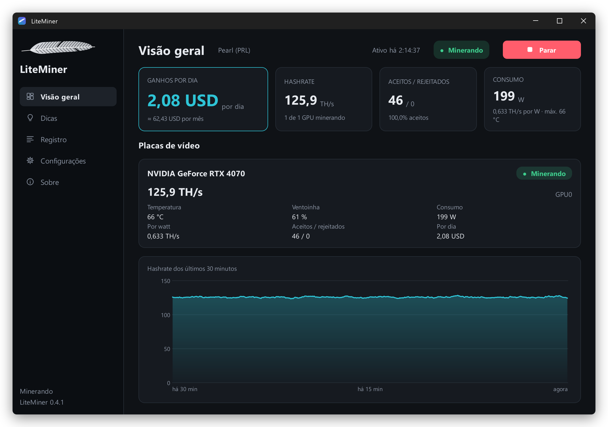
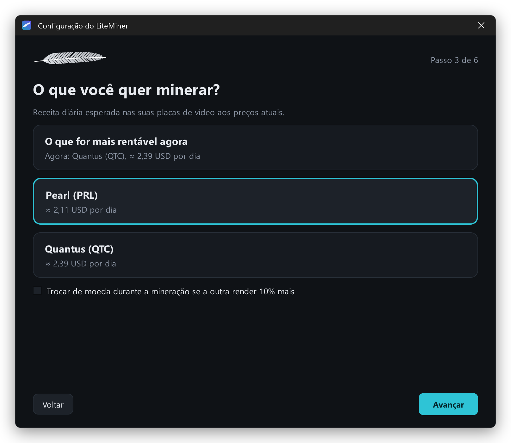
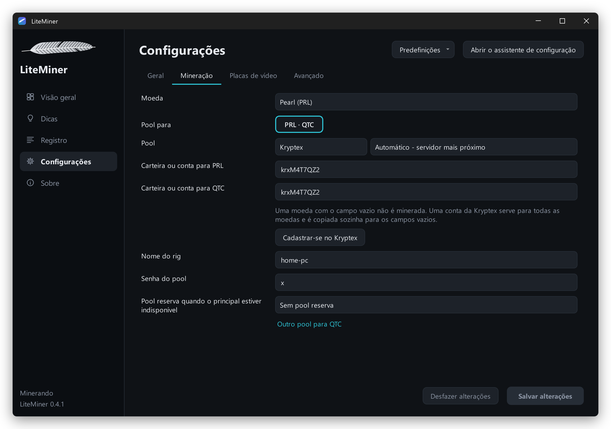

<p align="center"><a href="README.md">English</a> · <a href="README.zh-CN.md">简体中文</a> · <a href="README.es.md">Español</a> · <b>Português</b> · <a href="README.de.md">Deutsch</a> · <a href="README.fr.md">Français</a> · <a href="README.ja.md">日本語</a> · <a href="README.ko.md">한국어</a> · <a href="README.ru.md">Русский</a> · <a href="README.tr.md">Türkçe</a> · <a href="README.vi.md">Tiếng Việt</a></p>

<p align="center"></p>

<p align="center"><b>O jeito simples de minerar Pearl (PRL) e Quantus (QTC) em GPUs NVIDIA e AMD.</b></p>

<p align="center">
<a href="https://github.com/liteminergpu/liteminer/releases/latest"></a>
<a href="https://github.com/liteminergpu/liteminer/releases/latest"></a>
<a href="https://hub.docker.com/r/liteminer/liteminer"></a>
<a href="#início-rápido"></a>
<a href="#gpus-e-hashrate"></a>
<a href="#moedas-algoritmos-e-taxa-do-desenvolvedor"></a>
<a href="#moedas-algoritmos-e-taxa-do-desenvolvedor"></a>
<a href="https://www.virustotal.com/gui/file/f495dddb5ba706bedd41426fa79ff91ff9dc1de93fbb1239bd05bb43dc2c94ce"></a>
<a href="#suporte"></a>
<a href="#licença"></a>
</p>

LiteMiner é o minerador que você sempre quis: algoritmos atualizados e ajustados para cada arquitetura de GPU, um aplicativo de desktop prático (GUI) ou um minerador de terminal (CLI), escolha automática da moeda, pools reserva, dicas úteis e um log fácil de ler. Ele pode rodar em velocidade máxima em um rig ou trabalhar em silêncio, em segundo plano, no seu PC do dia a dia, dando lugar a jogos e outros programas. Para Windows, Linux e HiveOS.

## Conteúdo

- [Capturas de tela](#capturas-de-tela)
- [Destaques](#destaques)
- [Início rápido](#início-rápido): [Windows](#windows) · [Linux](#linux) · [HiveOS](#hiveos) · [Docker e aluguel de GPUs](#docker-e-aluguel-de-gpus-vastai-cloreai-runpod-e-outras-nuvens-de-gpu)
- [Downloads e somas de verificação](#downloads-e-somas-de-verificação)
- [Moedas, algoritmos e taxa do desenvolvedor](#moedas-algoritmos-e-taxa-do-desenvolvedor)
- [Pools compatíveis](#pools-compatíveis)
- [Opções da CLI](#opções-da-cli)
- [Estatísticas e logs](#estatísticas-e-logs)
- [GPUs e hashrate](#gpus-e-hashrate)
- [Onde o LiteMiner guarda os arquivos](#onde-o-liteminer-guarda-os-arquivos)
- [Solução de problemas](#solução-de-problemas)
- [Suporte](#suporte)
- [Licença](#licença)

## Capturas de tela

<p align="center"><br><sub>Interface gráfica (GUI)</sub></p>

<p align="center"><br><sub>Minerador no console (CLI)</sub></p>

<details>
<summary><b>Mais capturas: assistente de configuração e configurações</b></summary>
<br>
<p align="center"> </p>
</details>

## Destaques

**1. Comece a minerar em poucos cliques, sem garimpar a documentação.** Descompacte o arquivo, abra o `LiteMiner-GUI` e responda a algumas perguntas simples. O assistente de configuração explica o que são carteira e pool, escolhe o servidor de pool mais próximo, confere o seu endereço e começa a minerar, mesmo que você nunca tenha mexido com criptomoedas. O aplicativo está disponível em 11 idiomas. Prefere o terminal? O mesmo minerador inicia lá com um único comando.

**2. Rápido e com números honestos.** Cada arquitetura de GPU tem as próprias configurações embutidas, e no Pearl o minerador ainda pode ajustá-las finamente na sua placa. A cada mudança, medimos a velocidade de novo nas nossas GPUs e em GPUs alugadas. A [tabela de hashrate](#gpus-e-hashrate) mostra o que o LiteMiner realmente alcançou em cada placa testada: só medições reais, sem estimativas e sem arredondar para cima.

**3. Os recursos que faltavam para você.** Minere a moeda que paga mais agora e troque automaticamente quando a outra ficar mais lucrativa. O minerador percebe quando você abre um jogo ou usa a GPU de outra forma e reduz a carga para não atrapalhar. Pausa na bateria, impede a suspensão só durante a mineração, protege a GPU contra superaquecimento, se recupera sozinho de falhas do pool e da rede, e muito mais. Cada um desses recursos é configurado com um só clique.

E algumas coisas com que você nunca vai precisar se preocupar:

- **As configurações da sua GPU continuam suas.** O LiteMiner nunca muda clocks, tensões, limites de potência ou a velocidade das ventoinhas; ele só lê os sensores. Fazer undervolt ou reduzir o limite de potência na sua própria ferramenta não atrapalha o funcionamento do LiteMiner.
- **Três modos de mineração:** *Velocidade máxima*; *Automático*, que roda em velocidade máxima enquanto a GPU está livre e a libera quando você precisa; *Só quando o computador não está em uso*.
- **Um processo por GPU.** Se uma placa falhar ou o driver travar, só essa placa é reiniciada, não o rig inteiro.
- **Pools que não deixam na mão:** TLS com verificação de certificado, escolha automática do servidor mais próximo, até oito pools reserva, TCP comum onde o TLS é bloqueado, proxies SOCKS5 e DNS sobre HTTPS.
- **Uma API local somente leitura** para painéis e scripts, e logs em JSON quando você precisar.
- **Cada share é verificado na CPU** antes do envio, então um erro de cálculo da GPU nunca vira share rejeitado.

## Início rápido

### Windows

1. [Baixe a versão mais recente](https://github.com/liteminergpu/liteminer/releases/download/v0.4.2/LiteMiner-0.4.2-windows-x64-portable.zip) (`LiteMiner-0.4.2-windows-x64-portable.zip`).
2. Descompacte o arquivo em qualquer pasta.
3. Abra o **`LiteMiner-GUI.exe`**. O assistente de configuração guia você no resto.

Prefere o terminal? Coloque sua carteira (e o pool, se usar outro) no início de `start_LiteMiner_pearl.bat` ou `start_LiteMiner_quantus.bat` e execute o arquivo, ou inicie o minerador diretamente:

```bat
LiteMiner.exe -a pearl -o stratum+ssl://prl.kryptex.network:8048 -u YOUR_WALLET -w rig1
LiteMiner.exe -a quantus -o stratum+ssl://qtc.kryptex.network:8049 -u YOUR_WALLET -w rig1 --background
```

Ou baixe, descompacte e inicie com um único comando do PowerShell:

```powershell
irm https://github.com/liteminergpu/liteminer/releases/download/v0.4.2/LiteMiner-0.4.2-windows-x64-portable.zip -OutFile LiteMiner.zip; Expand-Archive LiteMiner.zip .; .\LiteMiner-0.4.2-windows-x64\LiteMiner-GUI.exe
```

Requisitos: Windows 10 ou 11 (x64) e um driver de vídeo atualizado.

> [!TIP]
> Ainda não tem carteira? Uma [conta Kryptex](https://www.kryptex.com/register?ref=b629c482) gratuita serve para as duas moedas: use o nome de usuário (`krxXXXXXX`) como carteira, e a Kryptex paga em BTC ou USDT, como você preferir.

### Linux

O jeito mais rápido: um comando baixa, descompacta e começa a minerar. Troque `YOUR_WALLET` pela sua carteira (e o pool, se usar outro):

Pearl:

```bash
curl -fsSL https://github.com/liteminergpu/liteminer/releases/download/v0.4.2/LiteMiner-0.4.2-linux-x64-portable.tar.gz | tar -xz && cd LiteMiner-0.4.2-linux-x64 && ./LiteMiner -a pearl -o stratum+ssl://prl.kryptex.network:8048 -u YOUR_WALLET -w rig1
```

Quantus:

```bash
curl -fsSL https://github.com/liteminergpu/liteminer/releases/download/v0.4.2/LiteMiner-0.4.2-linux-x64-portable.tar.gz | tar -xz && cd LiteMiner-0.4.2-linux-x64 && ./LiteMiner -a quantus -o stratum+ssl://qtc.kryptex.network:8049 -u YOUR_WALLET -w rig1
```

A mesma pasta traz o aplicativo de desktop: `./LiteMiner-GUI`.

Pacotes para diferentes distribuições:

```bash
# Debian, Ubuntu, Linux Mint, Pop!_OS
wget https://github.com/liteminergpu/liteminer/releases/download/v0.4.2/liteminer_0.4.2_amd64.deb https://github.com/liteminergpu/liteminer/releases/download/v0.4.2/liteminer-gui_0.4.2_amd64.deb
sudo apt install ./liteminer_0.4.2_amd64.deb ./liteminer-gui_0.4.2_amd64.deb
```

```bash
# Fedora, RHEL, AlmaLinux, Rocky Linux (openSUSE: sudo zypper install ...)
sudo dnf install https://github.com/liteminergpu/liteminer/releases/download/v0.4.2/liteminer-0.4.2-1.x86_64.rpm https://github.com/liteminergpu/liteminer/releases/download/v0.4.2/liteminer-gui-0.4.2-1.x86_64.rpm
```

O pacote `liteminer` contém o minerador de terminal para servidores e rigs; o `liteminer-gui` adiciona o aplicativo de desktop. Para rodar o minerador como serviço, use `sudo systemctl enable --now liteminer@YOUR_USER`; o serviço lê `~/.local/share/liteminer/miner.json`. Mais detalhes: `man liteminer`.

Requisitos: x86-64; glibc 2.28 ou mais recente para o minerador de terminal (Ubuntu 20.04, Debian 10, RHEL 8 ou mais recentes) e 2.34 ou mais recente para o aplicativo de desktop (Ubuntu 22.04, Debian 12, Fedora 35, RHEL 9 ou mais recentes); X11 ou Wayland. A NVIDIA precisa do driver proprietário (o CUDA Toolkit não é necessário); a AMD, de um driver OpenCL como o ROCm. Sistemas mínimos e contêineres também precisam do pacote `ca-certificates` para pools com TLS.

### HiveOS

Crie uma Flight Sheet: **Coin**: sua moeda; **Wallet**: sua carteira; **Pool**: *Configure in miner*; **Miner**: *Custom*. Depois clique em **Setup Miner Config** e preencha:

| Campo | Valor |
|---|---|
| Miner name | `liteminer` (preenchido a partir da URL) |
| Installation URL | `https://github.com/liteminergpu/liteminer/releases/download/v0.4.2/liteminer-0.4.2.tar.gz` |
| Hash algorithm | `pearl` ou `quantus` |
| Wallet and worker template | `%WAL%.%WORKER_NAME%` |
| Pool URL | `stratum+ssl://prl.kryptex.network:8048` (Pearl) ou `stratum+ssl://qtc.kryptex.network:8049` (Quantus) |
| Pass | `x` |
| Extra config arguments | opcional, por exemplo `--devices 0,2` ou `--thermal off` |

Aplique a Flight Sheet ao rig. Cada GPU minera como um worker separado (`<worker>_gpuN` no pool), o Hive mostra o hashrate de cada GPU e o overclock fica no seu perfil OC do Hive: o LiteMiner nunca mexe nele. Log: `/var/log/miner/custom/liteminer.log`; console: `miner` no shell do Hive. Só a primeira Pool URL é usada; para portas TLS, escreva `stratum+ssl://`.

### Docker e aluguel de GPUs (Vast.ai, Clore.ai, RunPod e outras nuvens de GPU)

O Docker precisa de um host Linux (ou Windows com Docker Desktop e WSL 2) com o driver da NVIDIA e o [NVIDIA Container Toolkit](https://docs.nvidia.com/datacenter/cloud-native/container-toolkit/latest/install-guide.html). O contêiner é compatível apenas com GPUs NVIDIA.

```bash
docker run -d --name liteminer --gpus all --restart unless-stopped -v liteminer-data:/data \
  liteminer/liteminer:0.4.2 -a pearl -o stratum+ssl://prl.kryptex.network:8048 -u YOUR_WALLET -w rig1
docker logs -f liteminer
```

Em vez de opções, o contêiner também aceita as variáveis de ambiente `LITEMINER_ALGORITHM`, `LITEMINER_POOL`, `LITEMINER_WALLET`, `LITEMINER_WORKER`, `LITEMINER_PASSWORD` e `LITEMINER_DEVICES`. Mantenha o volume `/data`: ele guarda os logs e os resultados do ajuste de cada GPU, então um reinício não refaz o ajuste. `docker stop -t 60 liteminer` deixa cada GPU terminar o trabalho atual.

Em uma nuvem de GPU, escolha a imagem `liteminer/liteminer:0.4.2` e defina `LITEMINER_ALGORITHM`, `LITEMINER_POOL` e `LITEMINER_WALLET` nas variáveis de ambiente do template. Ou use qualquer imagem Ubuntu com CUDA (por exemplo, `nvidia/cuda:12.4.1-base-ubuntu22.04`) com este script de inicialização (on-start script):

```bash
apt-get update && apt-get install -y --no-install-recommends ca-certificates curl
curl -fsSL https://github.com/liteminergpu/liteminer/releases/download/v0.4.2/LiteMiner-0.4.2-linux-x64-portable.tar.gz | tar -xz -C /opt
cd /opt/LiteMiner-0.4.2-linux-x64 && nohup ./LiteMiner -a quantus -o stratum+ssl://qtc.kryptex.network:8049 -u YOUR_WALLET -w cloud1 > /var/log/liteminer.log 2>&1 &
```

Todas as GPUs da instância vão minerar. Acompanhe o log com `tail -f /var/log/liteminer.log`. Servidores alugados costumam rodar quentes por projeto: se o provedor controla as temperaturas, `--thermal off` deixa isso com ele.

## Downloads e somas de verificação

Todos os arquivos da versão 0.4.2 estão na [página de versões](https://github.com/liteminergpu/liteminer/releases/latest). Para conferir um download com o `SHA256SUMS.txt`, execute `certutil -hashfile ARQUIVO SHA256` no Windows ou `sha256sum -c --ignore-missing SHA256SUMS.txt` no Linux.

| Plataforma | Arquivo | Tamanho | SHA-256 | Verificação |
|---|---|---:|---|---|
| Windows x64 | [`LiteMiner-0.4.2-windows-x64-portable.zip`](https://github.com/liteminergpu/liteminer/releases/download/v0.4.2/LiteMiner-0.4.2-windows-x64-portable.zip) | 80.8 MB | <sub>`f495dddb5ba706bedd41426fa79ff91ff9dc1de93fbb1239bd05bb43dc2c94ce`</sub> | [VirusTotal](https://www.virustotal.com/gui/file/f495dddb5ba706bedd41426fa79ff91ff9dc1de93fbb1239bd05bb43dc2c94ce) |
| Linux x64 | [`LiteMiner-0.4.2-linux-x64-portable.tar.gz`](https://github.com/liteminergpu/liteminer/releases/download/v0.4.2/LiteMiner-0.4.2-linux-x64-portable.tar.gz) | 103.3 MB | <sub>`8968150c50ac470bbcaf40f414dc4c83201883a67b60968c43ec196a7d030007`</sub> | [VirusTotal](https://www.virustotal.com/gui/file/8968150c50ac470bbcaf40f414dc4c83201883a67b60968c43ec196a7d030007) |
| HiveOS | [`liteminer-0.4.2.tar.gz`](https://github.com/liteminergpu/liteminer/releases/download/v0.4.2/liteminer-0.4.2.tar.gz) | 29.0 MB | <sub>`7ce474cb580e1f3114ef2453f66a36681d996a78c9d7148125a35bda238724bf`</sub> | [VirusTotal](https://www.virustotal.com/gui/file/7ce474cb580e1f3114ef2453f66a36681d996a78c9d7148125a35bda238724bf) |
| Docker (contexto de build) | [`LiteMiner-0.4.2-docker.tar.gz`](https://github.com/liteminergpu/liteminer/releases/download/v0.4.2/LiteMiner-0.4.2-docker.tar.gz) | 29.0 MB | <sub>`c6c42b3e6d00e0faedca497592b6fe8955a4fd1ea38263829518d29526d6fc34`</sub> | [VirusTotal](https://www.virustotal.com/gui/file/c6c42b3e6d00e0faedca497592b6fe8955a4fd1ea38263829518d29526d6fc34) |
| Debian / Ubuntu | [`liteminer_0.4.2_amd64.deb`](https://github.com/liteminergpu/liteminer/releases/download/v0.4.2/liteminer_0.4.2_amd64.deb) | 29.1 MB | <sub>`a9213322d7d36732e845aba9f26c382260cfef3986f162bf87c8dc4fce474f7f`</sub> | [VirusTotal](https://www.virustotal.com/gui/file/a9213322d7d36732e845aba9f26c382260cfef3986f162bf87c8dc4fce474f7f) |
| Debian / Ubuntu | [`liteminer-gui_0.4.2_amd64.deb`](https://github.com/liteminergpu/liteminer/releases/download/v0.4.2/liteminer-gui_0.4.2_amd64.deb) | 45.3 MB | <sub>`bb887052ca8807b846026ba0d4f5ce042b2f202ecb4bbbf71d47206388fe0122`</sub> | [VirusTotal](https://www.virustotal.com/gui/file/bb887052ca8807b846026ba0d4f5ce042b2f202ecb4bbbf71d47206388fe0122) |
| Fedora / RHEL / openSUSE | [`liteminer-0.4.2-1.x86_64.rpm`](https://github.com/liteminergpu/liteminer/releases/download/v0.4.2/liteminer-0.4.2-1.x86_64.rpm) | 24.4 MB | <sub>`7e0f6c9d748eae775a96338d46958384696aefd3726fd28706b56bc59ad531dc`</sub> | [VirusTotal](https://www.virustotal.com/gui/file/7e0f6c9d748eae775a96338d46958384696aefd3726fd28706b56bc59ad531dc) |
| Fedora / RHEL / openSUSE | [`liteminer-gui-0.4.2-1.x86_64.rpm`](https://github.com/liteminergpu/liteminer/releases/download/v0.4.2/liteminer-gui-0.4.2-1.x86_64.rpm) | 31.2 MB | <sub>`fbf9a0fc2d4627a3dc490f1f365f36359ca11e04ed78ab9246d2d201543d34eb`</sub> | [VirusTotal](https://www.virustotal.com/gui/file/fbf9a0fc2d4627a3dc490f1f365f36359ca11e04ed78ab9246d2d201543d34eb) |

> [!IMPORTANT]
> Os antivírus marcam quase todo minerador como "programa potencialmente indesejado" ou "minerador de criptomoedas". Isso é uma categoria, não uma ameaça específica, e por isso os relatórios do VirusTotal estão abertamente nos links acima. Baixe o LiteMiner apenas desta página e confira a soma de verificação. Se o Windows Defender remover o arquivo, adicione a pasta do LiteMiner às exclusões dele.

## Moedas, algoritmos e taxa do desenvolvedor

| Moeda | Algoritmo | NVIDIA (CUDA) | AMD / Intel (OpenCL) | Devfee |
|---|---|---|---|---:|
| [Pearl (PRL)](https://pool.kryptex.com/prl) | Pearl (int8 MatMul PoW), `-a pearl` | Pascal (GTX 10) ou mais recente | sim (ainda sem medição) | 2% |
| [Quantus (QTC)](https://pool.kryptex.com/qtc) | QPoW (Poseidon2), `-a quantus` | Maxwell (GTX 900) ou mais recente | sim | 2% |

Adicionamos uma moeda quando você pede ou quando ela passa a valer a pena. Quando não há nada novo que valha a pena, não enchemos a lista: deixamos os algoritmos existentes mais rápidos na sua GPU.

## Pools compatíveis

O LiteMiner funciona com qualquer pool compatível com o protocolo Stratum da moeda, via TLS (`stratum+ssl://`, com verificação do certificado) ou TCP comum (`stratum+tcp://`). Os pools abaixo vêm integrados ao aplicativo: ele escolhe o servidor com menor latência, mantém outra região como reserva automática e confere se o seu login tem o formato certo para aquele pool.

| Pool | PRL | QTC | Login | Servidores |
|---|---|---|---|---:|
| **[Kryptex](https://pool.kryptex.com/prl)**<br><sub>[cadastrar](https://www.kryptex.com/register?ref=b629c482)</sub> | `stratum+ssl://prl.kryptex.network:8048`<br><sub>TLS, TCP 7048</sub> | `stratum+ssl://qtc.kryptex.network:8049`<br><sub>TLS, TCP 7049</sub> | conta Kryptex ou carteira | 8 |
| **[PearlFortune](https://pearlfortune.org/)** | `stratum+ssl://global.pearlfortune.org:443`<br><sub>TLS, certificado fixado</sub> | - | endereço da carteira | 1 |
| **[LuckyPool](https://pearl.luckypool.io/)** | `stratum+ssl://pearl-eu1.luckypool.io:3360`<br><sub>TLS, certificado fixado</sub> | `stratum+ssl://eu.lproute.com:5660`<br><sub>TLS, certificado fixado</sub> | endereço da carteira | 19 |
| **[F2Pool](https://www.f2pool.com/coin/pearl)**<br><sub>[cadastrar](https://www.f2pool.com/user/signup)</sub> | `stratum+tcp://pearl.f2pool.com:5500`<br><sub>só TCP</sub> | `stratum+tcp://qtc.f2pool.com:4500`<br><sub>só TCP</sub> | nome da conta no pool | 1 |
| **[HeroMiners](https://pearl.herominers.com/)** | `stratum+ssl://de.pearl.herominers.com:1200`<br><sub>TLS</sub> | `stratum+ssl://de.quantus.herominers.com:1155`<br><sub>TLS</sub> | endereço da carteira | 15 |
| **[2Miners](https://2miners.com/prl-mining-pool)** | `stratum+ssl://prl.2miners.com:11818`<br><sub>TLS, TCP 1818</sub> | `stratum+ssl://qtc.2miners.com:13636`<br><sub>TLS, TCP 3636</sub> | endereço da carteira | 3 |

O minerador de terminal oferece o mesmo no arquivo de configuração (`LiteMiner --init` cria um exemplo):

```json
{
  "pool_host": "prl.kryptex.network", "pool_port": 8048, "tls": true, "tcp_port": 7048, "tcp_fallback": true,
  "wallet": "YOUR_WALLET", "worker": "rig1", "password": "x",
  "backup_pools": [
    {"pool_host": "prl-eu.kryptex.network", "pool_port": 8048},
    {"pool_host": "de.pearl.herominers.com", "pool_port": 1200, "wallet": "YOUR_PRL_ADDRESS"}
  ],
  "proxy": "socks5://127.0.0.1:9050"
}
```

`backup_pools` aceita até oito pools; o minerador volta sozinho ao pool principal assim que ele funcionar de novo. `tcp_fallback` usa a porta sem criptografia só quando o TLS não consegue conectar de jeito nenhum. `proxy` passa a conexão com o pool por SOCKS5 (usuário e senha ficam em `LITEMINER_PROXY_USERNAME` e `LITEMINER_PROXY_PASSWORD`), e `doh_url` resolve o endereço do pool via DNS sobre HTTPS.

## Opções da CLI

**No aplicativo de desktop, tudo isso se configura com caixas de seleção, então você pode pular esta seção.** Para o terminal, aqui estão todas as opções do minerador, tiradas do próprio programa desta versão:

| Opção | Descrição |
|---|---|
| `-V`, `--version` | mostrar a versão e a compilação e sair |
| `-a`, `--algorithm` `ALGORITHM` | `pearl` (padrão), `quantus` / `qpow` / `qtc` |
| `--config` `CONFIG` | arquivo de configuração JSON (padrão: `miner.json` para Pearl, `quantus.json` para Quantus) |
| `-o`, `--pool` `POOL` | endereço do pool com a porta: `stratum+ssl://host:port` ou `stratum+tcp://host:port` |
| `-u`, `--wallet` `WALLET` | endereço da carteira ou conta do pool |
| `-w`, `--worker` `WORKER` | nome do worker (padrão: `rig1`) |
| `-p`, `--password` `PASSWORD` | senha do pool (padrão: `x`) |
| `--devices` `DEVICES` | `all` (padrão: GPUs com CUDA ou Metal e GPUs não NVIDIA com OpenCL) ou números separados por vírgula / `opencl:N`; cada GPU roda em um processo isolado próprio |
| `--list-devices` | listar as GPUs e as moedas que cada uma pode minerar e sair (com `--log-format json`, em JSON) |
| `-B`, `--benchmark` | benchmark: no seu pool e na sua carteira, se estiverem configurados; caso contrário, online, com passagem automática para o modo offline |
| `--benchmark-seconds` `BENCHMARK_SECONDS` | duração do benchmark após a preparação das GPUs (padrão: 900 segundos; `0`: até ser interrompido) |
| `--stop-file` `PATH` | parar de forma limpa (cada GPU termina o trabalho atual) assim que este arquivo existir |
| `--no-autotune` | usar as configurações de cálculo do arquivo de configuração, sem ajuste automático; a adaptação à carga e à VRAM continua ativa |
| `--autotune` | Pearl em velocidade máxima: ao iniciar, medir e escolher as configurações de cálculo (até 4 min sem minerar) em vez das embutidas para a arquitetura; o resultado fica salvo para as próximas vezes |
| `--background` | modo automático: velocidade máxima enquanto a GPU está livre; dá lugar a jogos e outros programas que usam a GPU e pausa enquanto eles precisam da placa inteira |
| `--idle-only` | velocidade máxima só enquanto ninguém usa o computador (sem teclado nem mouse por `--idle-seconds`); no resto do tempo fica em pausa, com a conexão ao pool mantida; no Windows também dá lugar a outros programas que usam a GPU, como o modo automático |
| `--idle-seconds` `IDLE_SECONDS` | segundos sem teclado nem mouse antes de começar a minerar (10..86400, padrão: 120); ativa `--idle-only` |
| `--no-load-pause` | não pausar quando outros programas carregam muito a GPU, mas continuar minerando no nível mais baixo; ativa `--background` se `--idle-only` não for informado |
| `--mine-on-battery` | continuar minerando na bateria (por padrão pausa até voltar à tomada: na bateria o hashrate costuma ser bem menor) |
| `--allow-sleep` | permitir que o computador entre em suspensão por inatividade durante a mineração (por padrão ele não suspende enquanto uma GPU minera; a tela ainda pode desligar) |
| `--api-port` `API_PORT` | porta da API JSON local somente leitura (padrão: 4280) |
| `--api-bind` `API_BIND` | endereço de escuta da API: apenas `127.0.0.1` (padrão), `::1` ou `localhost` |
| `--no-api` | desativar a API JSON local (o aplicativo de desktop precisa dela) |
| `--thermal` `{auto,custom,off}` | proteção térmica: `auto` (limites do driver, padrão), `custom` (`--thermal-soft/hard/resume`; ativado sozinho quando eles são informados) ou `off` |
| `--thermal-gpu` `LABEL=SOFT:HARD:RESUME` | limites próprios do chip para uma GPU, por exemplo `gpu1=80:88:75` (repita para cada GPU; não junto com `--thermal off`) |
| `--thermal-soft` `THERMAL_SOFT` | temperatura própria do chip (°C) acima da qual a velocidade é reduzida |
| `--thermal-hard` `THERMAL_HARD` | temperatura própria do chip (°C) em que a mineração pausa |
| `--thermal-resume` `THERMAL_RESUME` | temperatura do chip (°C) abaixo da qual a mineração é retomada |
| `--thermal-memory-soft` `THERMAL_MEMORY_SOFT` | temperatura própria da memória (°C) acima da qual a velocidade é reduzida |
| `--thermal-memory-hard` `THERMAL_MEMORY_HARD` | temperatura própria da memória (°C) em que a mineração pausa |
| `--thermal-memory-resume` `THERMAL_MEMORY_RESUME` | temperatura da memória (°C) abaixo da qual a mineração é retomada |
| `-v`, `--verbose` | mostrar mais informações de diagnóstico |
| `--no-color` | saída do console sem cores |
| `--log-file` `LOG_FILE` | arquivo de log (padrão: `logs\liteminer.log`; rotaciona aos 10 MB e mantém 3) |
| `--no-log-file` | não gravar arquivo de log |
| `--log-format` `{text,json}` | saída do console: `text` (padrão) ou um registro JSON por linha (para scripts) |
| `--no-update-check` | não procurar novas versões (por padrão a página pública de versões é lida uma vez por dia; só o nome e a versão do programa são enviados) |
| `--gui` | abrir o aplicativo de desktop (no Windows também `LiteMiner-GUI.exe`) |
| `--init` | criar as configurações de exemplo `miner.json` e `quantus.json` na pasta atual |
| `--runtime-info` | mostrar a pasta com os arquivos descompactados do programa |
| `--verify-package` | verificar todos os arquivos do programa pelas somas de verificação embutidas |

Exemplos comuns:

```bash
LiteMiner --list-devices                                # quais GPUs o LiteMiner vê e quais moedas cada uma pode minerar
LiteMiner -a quantus ... --devices 0,2                  # minerar só nas GPUs 0 e 2 (um worker por GPU)
LiteMiner -a pearl ... --background                     # modo automático: dar lugar a jogos e outros programas de GPU
LiteMiner -a pearl ... --idle-only --idle-seconds 300   # minerar só após 5 minutos sem teclado nem mouse
LiteMiner -a quantus ... --thermal-gpu gpu1=78:86:72    # limites de temperatura próprios para uma placa
LiteMiner -B -a pearl --benchmark-seconds 300           # benchmark de 5 minutos, sem carteira
```

## Estatísticas e logs

**Console.** A cada 30 segundos o minerador mostra uma tabela com velocidade, temperatura, ventoinha, potência, eficiência, shares aceitos e rejeitados e o estado de cada GPU; entre as tabelas, uma linha por evento (novo trabalho, share, reconexão, proteção térmica). Com `--log-format json`, o console passa a mostrar um registro JSON por linha, pronto para o `jq` ou um coletor de logs.

**Arquivo de log.** `logs/liteminer.log`, ao lado da configuração. Ele é rotacionado aos 10 MB, e três arquivos são mantidos. `--log-file` muda o local e `--no-log-file` desativa o arquivo.

**API local.** Uma pequena API JSON somente leitura em `127.0.0.1:4280`. O aplicativo de desktop usa essa API, e seus scripts e painéis também podem usar:

| Endpoint | Retorna |
|---|---|
| `GET /api/v1/summary` | totais do rig: versão, algoritmo, tempo ativo, estado, velocidade total e sua unidade, shares (aceitos, rejeitados, pendentes), temperatura máxima, potência, energia, pools |
| `GET /api/v1/devices` | o mesmo para cada GPU: nome, estado, velocidade, shares, temperatura, ventoinha, potência, pool |
| `GET /api/v1/health` | `ok`, `starting`, `degraded` ou `down` (HTTP 503 com `down`), para scripts de monitoramento |
| `GET /api/v1/history` | a última hora de cada GPU em passos de 5 segundos: velocidade, temperatura, potência |

```bash
curl -s http://127.0.0.1:4280/api/v1/summary
```

```json
{"api_version":1,"product":"LiteMiner","version":"0.4.2","algorithm":"quantus","uptime_seconds":180.4,
 "health":"ok","devices":1,"device_states":{"mining":1},"rate":518.6,"unit":"MH/s","rate_window_seconds":60,
 "shares":{"accepted":2,"rejected":0,"submitted":2,"lost_unacknowledged":0,"discarded_stale":0,"verification_rejected":0,"pending":0},
 "max_temperature_c":64,"power_w":196.0,"pools":["qtc.kryptex.network:8049"]}
```

A API escuta só na interface de loopback (`--api-bind` aceita `127.0.0.1`, `::1` ou `localhost`), confere o cabeçalho `Host` para barrar DNS rebinding e nunca retorna carteira, senha ou qualquer valor da configuração. **Ela não tem endpoints de controle, de propósito:** nada na rede consegue parar, reconfigurar ou redirecionar o seu minerador. Para parar o minerador por script, use `--stop-file CAMINHO` (assim que o arquivo existir, cada GPU termina o trabalho atual e o minerador fecha) ou envie Ctrl+C / SIGINT.

O **HiveOS** recebe o hashrate de cada GPU (associado pelo barramento PCI) pelas estatísticas padrão de minerador personalizado; temperaturas e ventoinhas vêm do próprio Hive.

## GPUs e hashrate

Resultados reais do LiteMiner 0.4.2 e de builds recentes em 67 modelos de GPU. Um `?` significa que ainda não medimos essa combinação, não que ela não funcione.

Todos os resultados foram medidos com as configurações de fábrica de cada placa: o LiteMiner não mudou clocks, tensões, limites de potência nem ventoinhas. Undervolt ou um limite de potência menor na sua própria ferramenta são totalmente suportados: o LiteMiner se adapta à velocidade que a placa entrega.

#### GeForce e TITAN

| GPU | PRL, TH/s | QTC, MH/s | Último teste |
|---|---:|---:|---|
| RTX 5090 | 372.6 | 1524.6 | 2026-11 |
| RTX 5080 | 238.3 | 982.8 | 2026-11 |
| RTX 5070 | 134.2 | 552.7 | 2026-11 |
| RTX 5070 Ti | 204.5 | 840.8 | 2026-11 |
| RTX 5060 | 83.4 | 352.0 | 2026-11 |
| RTX 5060 Ti | 100.0 | 421.7 | 2026-11 |
| RTX 4090 | 332.4 | 1388.9 | 2026-11 |
| RTX 4080 | 210.0 | 851.3 | 2026-11 |
| RTX 4080 SUPER | 215.1 | 875.6 | 2026-11 |
| RTX 4070 | 127.8 | 518.6 | 2026-11 |
| RTX 4070 SUPER | 127.1 | 456.8 | 2026-11 |
| RTX 4070 Ti SUPER | 170.2 | 686.7 | 2026-11 |
| RTX 4060 | 64.3 | 266.8 | 2026-11 |
| RTX 4060 Ti | 95.1 | 379.3 | 2026-11 |
| RTX 3090 | 148.5 | 619.1 | 2026-11 |
| RTX 3090 Ti | 150.2 | 619.6 | 2026-11 |
| RTX 3080 | 120.4 | 505.2 | 2026-11 |
| RTX 3080 Ti | 140.9 | 589.1 | 2026-11 |
| RTX 3070 | 80.9 | 331.7 | 2026-11 |
| RTX 3070 Ti | 95.3 | 389.4 | 2026-11 |
| RTX 3060 | 54.6 | 227.9 | 2026-11 |
| RTX 3060 Ti | 70.8 | 296.0 | 2026-11 |
| RTX 3050 | 36.5 | 154.6 | 2026-11 |
| RTX 3050 Laptop GPU | 29.6 | ? | 2026-11 |
| RTX 2080 | 81.9 | 371.8 | 2026-11 |
| RTX 2080 Ti | 94.5 | 418.0 | 2026-11 |
| RTX 2070 | 58.1 | 257.1 | 2026-11 |
| RTX 2070 SUPER | 57.7 | 273.5 | 2026-11 |
| RTX 2060 | 47.4 | 227.1 | 2026-11 |
| RTX 2060 SUPER | 52.8 | 234.1 | 2026-11 |
| GTX 1660 | 2.50 | 47.4 | 2026-11 |
| GTX 1660 SUPER | 8.54 | 162.5 | 2026-11 |
| GTX 1660 Ti | 8.57 | 178.0 | 2026-11 |
| GTX 1650 | 3.49 | 76.5 | 2026-11 |
| GTX 1080 | 7.95 | 85.1 | 2026-11 |
| GTX 1080 Ti | 13.1 | 119.7 | 2026-11 |
| GTX 1070 | 7.16 | 63.8 | 2026-11 |
| GTX 1070 Ti | 9.21 | 81.0 | 2026-11 |
| GTX 1060 | 5.11 | 46.0 | 2026-11 |
| GTX TITAN X | ? | 33.9 | 2026-10 |
| TITAN RTX | 92.5 | 438.5 | 2026-11 |
| TITAN V | 34.1 | 398.0 | 2026-11 |
| TITAN Xp | 7.59 | 63.1 | 2026-10 |

#### Placas de mineração (CMP, P104)

| GPU | PRL, TH/s | QTC, MH/s | Último teste |
|---|---:|---:|---|
| CMP 90HX | 60.0 | 282.8 | 2026-11 |
| CMP 70HX | 50.7 | 198.7 | 2026-11 |
| CMP 50HX | 40.0 | 350.4 | 2026-11 |
| CMP 40HX | 50.3 | 236.6 | 2026-11 |
| CMP 30HX | 1.05 | 150.0 | 2026-11 |
| P104-100 | 5.63 | 47.3 | 2026-11 |

#### Estações de trabalho e data centers

| GPU | PRL, TH/s | QTC, MH/s | Último teste |
|---|---:|---:|---|
| A10 | 75.7 | 333.9 | 2026-10 |
| A100 PCIe | 194.7 | 404.8 | 2026-10 |
| Quadro P4000 | 5.60 | 44.7 | 2026-11 |
| RTX A2000 | 29.2 | 137.6 | 2026-10 |
| RTX A4000 | 73.5 | 294.3 | 2026-11 |
| RTX A5000 | 93.2 | 395.3 | 2026-11 |
| RTX A6000 | 131.7 | 557.7 | 2026-11 |
| Tesla P40 | 11.6 | 118.2 | 2026-11 |
| Tesla P100 | ? | 88.8 | 2026-11 |
| Tesla T4 | 35.2 | 170.2 | 2026-11 |
| Tesla V100 | 41.2 | 486.3 | 2026-11 |
| Tesla V100 SXM2 16 GB | 30.6 | 347.1 | 2026-11 |
| Tesla V100S | 18.8 | 248.9 | 2026-11 |

#### AMD Radeon

| GPU | PRL, TH/s | QTC, MH/s | Último teste |
|---|---:|---:|---|
| RX 9070 XT | 137.7 | 293.2 | 2026-11 |
| RX 9060 XT | 67.9 | 151.9 | 2026-11 |
| RX 7900 XT | 48.0 | 334.3 | 2026-11 |
| RX 7900 XTX | 59.6 | 396.4 | 2026-11 |
| RX 7800 XT | 31.8 | 226.6 | 2026-11 |

Sua placa não aparece ou está mais lenta que aqui? Rode `LiteMiner -B` (15 minutos por padrão) e mande o resultado para [lmsupp@proton.me](mailto:lmsupp@proton.me).

## Onde o LiteMiner guarda os arquivos

| O quê | Windows | Linux |
|---|---|---|
| Configurações do aplicativo de desktop | `%LOCALAPPDATA%\LiteMiner\data` | `~/.local/share/liteminer` |
| Configuração do minerador de terminal | `miner.json` e `quantus.json` na pasta atual | o mesmo; nos pacotes, `~/.local/share/liteminer` |
| Logs | `logs\liteminer.log` | `logs/liteminer.log` |

O programa é portátil: cada EXE traz tudo de que precisa e confere os próprios arquivos a cada início. Uma versão nova descompactada em outra pasta mantém suas configurações, e as versões antigas descompactadas são removidas automaticamente.

## Solução de problemas

<details>
<summary><b>"No GPU found that LiteMiner can use" (nenhuma GPU utilizável encontrada)</b></summary>

Instale o driver mais recente da [NVIDIA](https://www.nvidia.com/Download/index.aspx) ou da [AMD](https://www.amd.com/en/support). Na NVIDIA, o Pearl precisa de Pascal (GTX 10) ou mais recente e o Quantus, de Maxwell (GTX 900) ou mais recente. `LiteMiner --list-devices` mostra quais GPUs o minerador vê e quais moedas cada uma pode minerar.
</details>

<details>
<summary><b>O antivírus apagou o LiteMiner</b></summary>

A maioria dos antivírus marca mineradores pela categoria, não por uma ameaça específica. Confira o arquivo com o `SHA256SUMS.txt` e o relatório do VirusTotal em [Downloads e somas de verificação](#downloads-e-somas-de-verificação) e depois adicione a pasta do LiteMiner às exclusões.
</details>

<details>
<summary><b>"Another LiteMiner is already mining on this GPU" (código de saída 8)</b></summary>

Só uma cópia do LiteMiner pode usar uma GPU por vez. Feche a outra cópia (ou o aplicativo de desktop, que roda o próprio minerador) ou dê a cada cópia as suas próprias GPUs com `--devices`.
</details>

<details>
<summary><b>Erros de TLS em um Linux mínimo ou em um contêiner</b></summary>

Instale o `ca-certificates`: o LiteMiner verifica os certificados dos pools pelo repositório do sistema e não minera por uma conexão não verificada.
</details>

<details>
<summary><b>Os jogos travam durante a mineração</b></summary>

Escolha o modo *Automático* no aplicativo (`--background` no terminal): ele libera a GPU para os jogos e pausa enquanto eles precisam da placa inteira. O modo *Só quando o computador não está em uso* (`--idle-only`) minera apenas enquanto você está longe.
</details>

## Suporte

Dúvidas, relatos de erros e resultados de benchmark: [lmsupp@proton.me](mailto:lmsupp@proton.me).

Antes de escrever, rode `LiteMiner --list-devices` e anexe a saída junto com o `logs/liteminer.log`.

## Licença

O LiteMiner é gratuito para baixar e usar, com a taxa do desenvolvedor de 2% indicada acima. O código-fonte não é publicado.

A mineração consome eletricidade: fique de olho nas temperaturas, na conta de luz e nas leis do seu país. O LiteMiner é fornecido como está, sem nenhuma garantia. São totalmente proibidas a descompilação, a modificação e quaisquer ações semelhantes com o programa, exceto nas bibliotecas de terceiros que ele inclui. É proibido redistribuir o LiteMiner como parte de programas que possam prejudicar o computador (“vírus”), bem como em quaisquer outros casos que violem as leis do seu país. É proibido usar o LiteMiner em computadores cujos donos não tenham autorizado você a instalar e/ou usar um minerador de criptomoedas.
