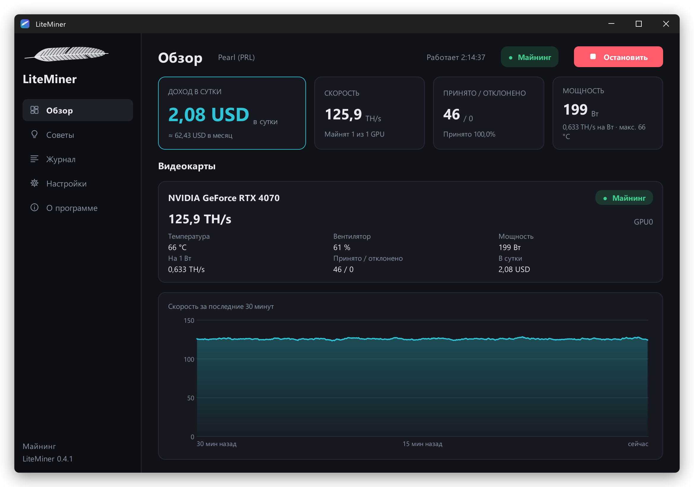
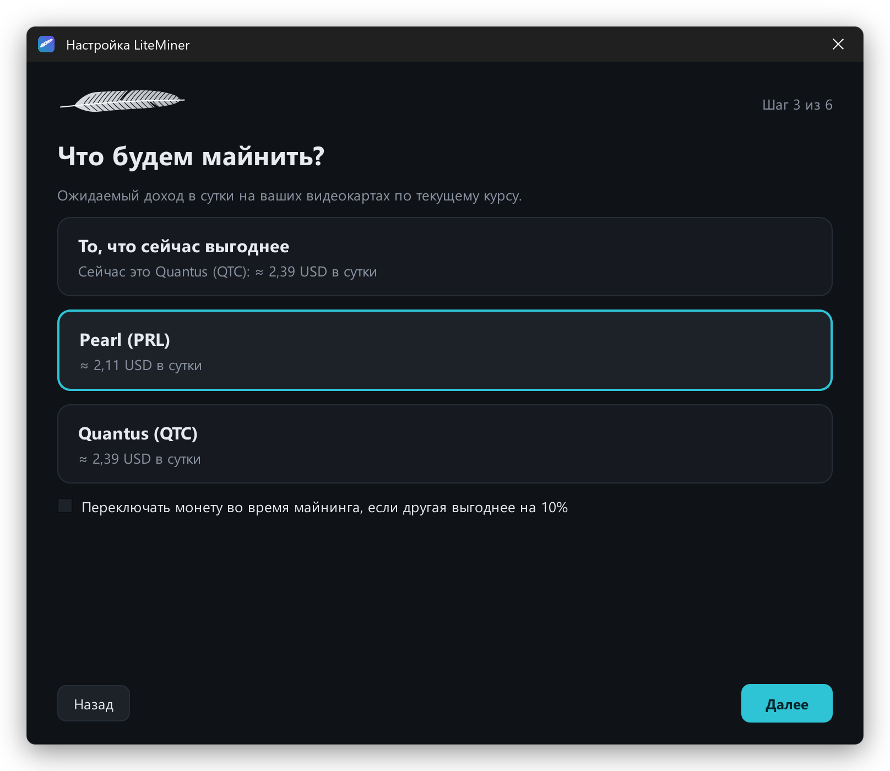
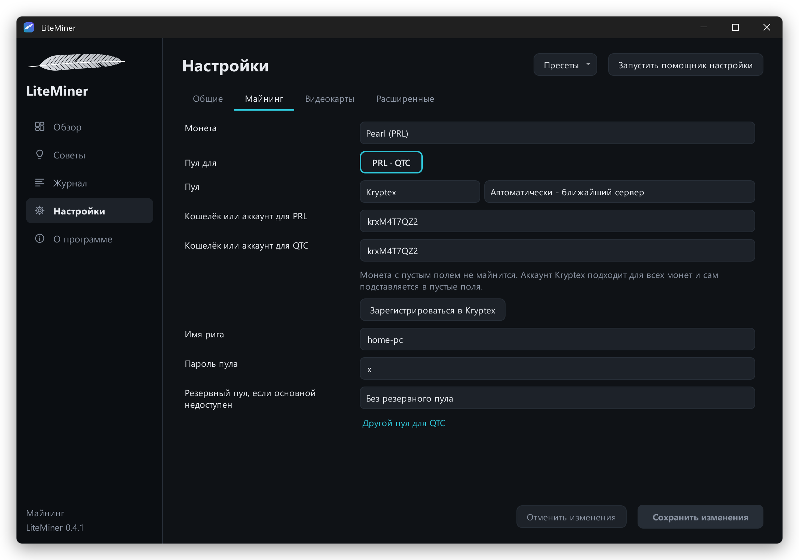

<p align="center"><a href="README.md">English</a> · <a href="README.zh-CN.md">简体中文</a> · <a href="README.es.md">Español</a> · <a href="README.pt-BR.md">Português</a> · <a href="README.de.md">Deutsch</a> · <a href="README.fr.md">Français</a> · <a href="README.ja.md">日本語</a> · <a href="README.ko.md">한국어</a> · <b>Русский</b> · <a href="README.tr.md">Türkçe</a> · <a href="README.vi.md">Tiếng Việt</a></p>

<p align="center"></p>

<p align="center"><b>Простой способ майнить Pearl (PRL) и Quantus (QTC) на видеокартах NVIDIA и AMD.</b></p>

<p align="center">
<a href="https://github.com/liteminergpu/liteminer/releases/latest"></a>
<a href="https://github.com/liteminergpu/liteminer/releases/latest"></a>
<a href="https://hub.docker.com/r/liteminer/liteminer"></a>
<a href="#быстрый-старт"></a>
<a href="#видеокарты-и-хешрейт"></a>
<a href="#монеты-алгоритмы-и-комиссия"></a>
<a href="#монеты-алгоритмы-и-комиссия"></a>
<a href="https://www.virustotal.com/gui/file/bc30431c6269a0bc9a03dfb6e8125042bf01467bad59d4153e3432957a4097d0"></a>
<a href="#поддержка"></a>
<a href="#лицензия"></a>
</p>

LiteMiner - майнер, который вы всегда хотели: актуальные алгоритмы, настроенные под каждую архитектуру видеокарт, удобный графический интерфейс (GUI) или терминал (CLI), автоматический выбор монеты, резервные пулы, полезные подсказки и понятный журнал. Он может работать на полной скорости на риге или тихо в фоне на вашем обычном компьютере, уступая видеокарту играм и другим программам. Для Windows, Linux и HiveOS.

## Содержание

- [Скриншоты](#скриншоты)
- [Главное](#главное)
- [Быстрый старт](#быстрый-старт): [Windows](#windows) · [Linux](#linux) · [HiveOS](#hiveos) · [Docker и аренда GPU](#docker-и-аренда-gpu-vastai-cloreai-runpod-и-другие-gpu-облака)
- [Загрузки и контрольные суммы](#загрузки-и-контрольные-суммы)
- [Монеты, алгоритмы и комиссия](#монеты-алгоритмы-и-комиссия)
- [Поддерживаемые пулы](#поддерживаемые-пулы)
- [Параметры CLI](#параметры-cli)
- [Статистика и журналы](#статистика-и-журналы)
- [Видеокарты и хешрейт](#видеокарты-и-хешрейт)
- [Где LiteMiner хранит файлы](#где-liteminer-хранит-файлы)
- [Решение проблем](#решение-проблем)
- [Поддержка](#поддержка)
- [Лицензия](#лицензия)

## Скриншоты

<p align="center"><br><sub>Графический интерфейс (GUI)</sub></p>

<p align="center"><br><sub>Майнер в консоли (CLI)</sub></p>

<details>
<summary><b>Ещё скриншоты: помощник настройки и окно настроек</b></summary>
<br>
<p align="center"> </p>
</details>

## Главное

**1. Начните майнить за пару кликов, а не копайтесь в документации.** Распакуйте архив, запустите `LiteMiner-GUI` и ответьте на несколько простых вопросов. Помощник настройки объяснит, что такое кошелёк и пул, выберет ближайший сервер пула, проверит адрес и запустит майнинг, даже если вы никогда раньше не имели дела с криптовалютой. Приложение доступно на 11 языках. Предпочитаете терминал? Тот же майнер запускается там одной командой.

**2. Высокая скорость и честные цифры.** Для каждой архитектуры видеокарт заложены свои настройки, а для Pearl майнер может дополнительно подобрать их под вашу карту. После каждого изменения мы заново измеряем скорость на своих и арендованных видеокартах. В [таблице хешрейтов](#видеокарты-и-хешрейт) - то, что LiteMiner действительно показал на каждой проверенной карте: только реальные замеры, без оценок и округлений в свою пользу.

**3. Функции, которых вам не хватало.** Майньте монету, которая выгоднее прямо сейчас, и переключайтесь автоматически, когда прибыльнее становится другая. Майнер сам поймёт, когда вы запустили игру или как-либо ещё нагружаете GPU, и снизит нагрузку, чтобы не мешать. Пауза при работе от батареи, запрет спящего режима только на время майнинга, защита видеокарты от перегрева, самостоятельное восстановление после сбоев пула и сети и многое другое. Каждая из этих функций настраивается одним кликом.

И несколько вещей, о которых вам не придётся думать:

- **Настройки видеокарты остаются вашими.** LiteMiner никогда не меняет частоты, напряжения, лимит мощности и обороты вентиляторов, а только читает датчики. Андервольт и сниженный лимит мощности в вашей программе разгона не мешают работе LiteMiner.
- **Три режима майнинга:** *Максимальная скорость*; *Автоматический* - полная скорость, пока видеокарта свободна, и уступает её, когда она нужна вам; *Только когда компьютер не используется*.
- **Отдельный процесс для каждой видеокарты.** Если карта дала сбой или зависла в драйвере, перезапускается только она, а не весь риг.
- **Пулы, которые не подводят:** TLS с проверкой сертификата, автоматический выбор ближайшего сервера, до восьми резервных пулов, обычный TCP там, где TLS заблокирован, прокси SOCKS5 и DNS over HTTPS.
- **Локальный API только для чтения** для панелей мониторинга и скриптов, а также журнал в формате JSON по запросу.
- **Каждая шара проверяется на процессоре** перед отправкой, поэтому ошибка расчёта на видеокарте не превращается в отклонённые шары.

## Быстрый старт

### Windows

1. [Скачайте последний выпуск](https://github.com/liteminergpu/liteminer/releases/download/v0.4.1/LiteMiner-0.4.1-windows-x64-portable.zip) (`LiteMiner-0.4.1-windows-x64-portable.zip`).
2. Распакуйте архив в любую папку.
3. Запустите **`LiteMiner-GUI.exe`**. Дальше вас проведёт помощник настройки.

Предпочитаете терминал? Укажите кошелёк (и пул, если используете другой) в начале `start_LiteMiner_pearl.bat` или `start_LiteMiner_quantus.bat` и запустите его либо запустите майнер напрямую:

```bat
LiteMiner.exe -a pearl -o stratum+ssl://prl.kryptex.network:8048 -u YOUR_WALLET -w rig1
LiteMiner.exe -a quantus -o stratum+ssl://qtc.kryptex.network:8049 -u YOUR_WALLET -w rig1 --background
```

Или скачайте, распакуйте и запустите его одной командой PowerShell:

```powershell
irm https://github.com/liteminergpu/liteminer/releases/download/v0.4.1/LiteMiner-0.4.1-windows-x64-portable.zip -OutFile LiteMiner.zip; Expand-Archive LiteMiner.zip .; .\LiteMiner-0.4.1-windows-x64\LiteMiner-GUI.exe
```

Требования: Windows 10 или 11 (x64) и актуальный драйвер видеокарты.

> [!TIP]
> Ещё нет кошелька? Бесплатный [аккаунт Kryptex](https://www.kryptex.com/register?ref=b629c482) подходит для обеих монет: укажите его имя пользователя (`krxXXXXXX`) вместо кошелька, а Kryptex выплатит заработанное в BTC или USDT - как вы выберете.

### Linux

Самый быстрый способ: одна команда скачивает, распаковывает и запускает майнинг. Замените `YOUR_WALLET` на свой кошелёк (и пул, если используете другой):

Pearl:

```bash
curl -fsSL https://github.com/liteminergpu/liteminer/releases/download/v0.4.1/LiteMiner-0.4.1-linux-x64-portable.tar.gz | tar -xz && cd LiteMiner-0.4.1-linux-x64 && ./LiteMiner -a pearl -o stratum+ssl://prl.kryptex.network:8048 -u YOUR_WALLET -w rig1
```

Quantus:

```bash
curl -fsSL https://github.com/liteminergpu/liteminer/releases/download/v0.4.1/LiteMiner-0.4.1-linux-x64-portable.tar.gz | tar -xz && cd LiteMiner-0.4.1-linux-x64 && ./LiteMiner -a quantus -o stratum+ssl://qtc.kryptex.network:8049 -u YOUR_WALLET -w rig1
```

В той же папке лежит графическое приложение: `./LiteMiner-GUI`.

Пакеты для разных дистрибутивов:

```bash
# Debian, Ubuntu, Linux Mint, Pop!_OS
wget https://github.com/liteminergpu/liteminer/releases/download/v0.4.1/liteminer_0.4.1_amd64.deb https://github.com/liteminergpu/liteminer/releases/download/v0.4.1/liteminer-gui_0.4.1_amd64.deb
sudo apt install ./liteminer_0.4.1_amd64.deb ./liteminer-gui_0.4.1_amd64.deb
```

```bash
# Fedora, RHEL, AlmaLinux, Rocky Linux (openSUSE: sudo zypper install ...)
sudo dnf install https://github.com/liteminergpu/liteminer/releases/download/v0.4.1/liteminer-0.4.1-1.x86_64.rpm https://github.com/liteminergpu/liteminer/releases/download/v0.4.1/liteminer-gui-0.4.1-1.x86_64.rpm
```

Пакет `liteminer` содержит консольный майнер для серверов и ригов, `liteminer-gui` добавляет графическое приложение. Чтобы запустить майнер как службу, выполните `sudo systemctl enable --now liteminer@YOUR_USER`; служба читает `~/.local/share/liteminer/miner.json`. Подробнее: `man liteminer`.

Требования: x86-64; glibc 2.28 или новее для консольного майнера (Ubuntu 20.04, Debian 10, RHEL 8 и новее) и 2.34 или новее для графического приложения (Ubuntu 22.04, Debian 12, Fedora 35, RHEL 9 и новее); X11 или Wayland. Для NVIDIA нужен проприетарный драйвер (CUDA Toolkit не нужен), для AMD - драйвер OpenCL, например ROCm. Минимальным системам и контейнерам для пулов с TLS нужен ещё пакет `ca-certificates`.

### HiveOS

Создайте полётный лист (Flight Sheet): **Coin** - ваша монета, **Wallet** - ваш кошелёк, **Pool** - *Configure in miner*, **Miner** - *Custom*. Затем нажмите **Setup Miner Config** и заполните:

| Поле | Значение |
|---|---|
| Miner name | `liteminer` (заполнится из URL) |
| Installation URL | `https://github.com/liteminergpu/liteminer/releases/download/v0.4.1/liteminer-0.4.1.tar.gz` |
| Hash algorithm | `pearl` или `quantus` |
| Wallet and worker template | `%WAL%.%WORKER_NAME%` |
| Pool URL | `stratum+ssl://prl.kryptex.network:8048` (Pearl) или `stratum+ssl://qtc.kryptex.network:8049` (Quantus) |
| Pass | `x` |
| Extra config arguments | необязательно, например `--devices 0,2` или `--thermal off` |

Примените полётный лист к ригу. Каждая видеокарта майнит отдельным воркером (`<worker>_gpuN` на пуле), Hive показывает хешрейт каждой карты, а разгон остаётся в вашем OC-профиле Hive: LiteMiner его не трогает. Журнал: `/var/log/miner/custom/liteminer.log`; консоль: команда `miner` в оболочке Hive. Используется только первый Pool URL; для портов с TLS пишите `stratum+ssl://`.

### Docker и аренда GPU (Vast.ai, Clore.ai, RunPod и другие GPU-облака)

Docker нужен хост с Linux (или Windows с Docker Desktop и WSL 2), драйвером NVIDIA и [NVIDIA Container Toolkit](https://docs.nvidia.com/datacenter/cloud-native/container-toolkit/latest/install-guide.html). В контейнере поддерживаются только видеокарты NVIDIA.

```bash
docker run -d --name liteminer --gpus all --restart unless-stopped -v liteminer-data:/data \
  liteminer/liteminer:0.4.1 -a pearl -o stratum+ssl://prl.kryptex.network:8048 -u YOUR_WALLET -w rig1
docker logs -f liteminer
```

Вместо параметров контейнер принимает и переменные окружения `LITEMINER_ALGORITHM`, `LITEMINER_POOL`, `LITEMINER_WALLET`, `LITEMINER_WORKER`, `LITEMINER_PASSWORD` и `LITEMINER_DEVICES`. Сохраняйте том `/data`: в нём журналы и результаты подстройки каждой видеокарты, поэтому после перезапуска подстройка не повторяется. `docker stop -t 60 liteminer` даёт каждой видеокарте закончить текущую работу.

В GPU-облаке выберите образ `liteminer/liteminer:0.4.1` и задайте `LITEMINER_ALGORITHM`, `LITEMINER_POOL` и `LITEMINER_WALLET` в переменных окружения шаблона. Или возьмите любой образ Ubuntu с CUDA (например, `nvidia/cuda:12.4.1-base-ubuntu22.04`) и укажите этот скрипт запуска (on-start script):

```bash
apt-get update && apt-get install -y --no-install-recommends ca-certificates curl
curl -fsSL https://github.com/liteminergpu/liteminer/releases/download/v0.4.1/LiteMiner-0.4.1-linux-x64-portable.tar.gz | tar -xz -C /opt
cd /opt/LiteMiner-0.4.1-linux-x64 && nohup ./LiteMiner -a quantus -o stratum+ssl://qtc.kryptex.network:8049 -u YOUR_WALLET -w cloud1 > /var/log/liteminer.log 2>&1 &
```

Майнить будут все видеокарты инстанса. Журнал можно смотреть командой `tail -f /var/log/liteminer.log`. Арендованные серверы часто работают горячими намеренно: если температурой управляет провайдер, `--thermal off` оставит её ему.

## Загрузки и контрольные суммы

Все файлы выпуска 0.4.1 - на [странице выпусков](https://github.com/liteminergpu/liteminer/releases/latest). Чтобы сверить загруженный файл с `SHA256SUMS.txt`, выполните `certutil -hashfile ФАЙЛ SHA256` в Windows или `sha256sum -c --ignore-missing SHA256SUMS.txt` в Linux.

| Платформа | Файл | Размер | SHA-256 | Проверка |
|---|---|---:|---|---|
| Windows x64 | [`LiteMiner-0.4.1-windows-x64-portable.zip`](https://github.com/liteminergpu/liteminer/releases/download/v0.4.1/LiteMiner-0.4.1-windows-x64-portable.zip) | 80.5 МБ | <sub>`bc30431c6269a0bc9a03dfb6e8125042bf01467bad59d4153e3432957a4097d0`</sub> | [VirusTotal](https://www.virustotal.com/gui/file/bc30431c6269a0bc9a03dfb6e8125042bf01467bad59d4153e3432957a4097d0) |
| Linux x64 | [`LiteMiner-0.4.1-linux-x64-portable.tar.gz`](https://github.com/liteminergpu/liteminer/releases/download/v0.4.1/LiteMiner-0.4.1-linux-x64-portable.tar.gz) | 103.1 МБ | <sub>`b2ec6d7f92f95096953ef060056b269703189d732c32f75cf95824b6d83637d1`</sub> | [VirusTotal](https://www.virustotal.com/gui/file/b2ec6d7f92f95096953ef060056b269703189d732c32f75cf95824b6d83637d1) |
| HiveOS | [`liteminer-0.4.1.tar.gz`](https://github.com/liteminergpu/liteminer/releases/download/v0.4.1/liteminer-0.4.1.tar.gz) | 28.9 МБ | <sub>`c32315c22ea0fbc5ce3e3752b9270b52d48e93d321cc5e3c29874900af2e6c41`</sub> | [VirusTotal](https://www.virustotal.com/gui/file/c32315c22ea0fbc5ce3e3752b9270b52d48e93d321cc5e3c29874900af2e6c41) |
| Docker (контекст сборки) | [`LiteMiner-0.4.1-docker.tar.gz`](https://github.com/liteminergpu/liteminer/releases/download/v0.4.1/LiteMiner-0.4.1-docker.tar.gz) | 28.9 МБ | <sub>`04f0921d1e2f148543d90f55ae2c6568c434e2d23053d3c6fcf0d06318c62c2d`</sub> | [VirusTotal](https://www.virustotal.com/gui/file/04f0921d1e2f148543d90f55ae2c6568c434e2d23053d3c6fcf0d06318c62c2d) |
| Debian / Ubuntu | [`liteminer_0.4.1_amd64.deb`](https://github.com/liteminergpu/liteminer/releases/download/v0.4.1/liteminer_0.4.1_amd64.deb) | 29.0 МБ | <sub>`ac2754a69d8d5eefa2ad6dfbb94db907baa1e2704011d534c0bf62cec65f11af`</sub> | [VirusTotal](https://www.virustotal.com/gui/file/ac2754a69d8d5eefa2ad6dfbb94db907baa1e2704011d534c0bf62cec65f11af) |
| Debian / Ubuntu | [`liteminer-gui_0.4.1_amd64.deb`](https://github.com/liteminergpu/liteminer/releases/download/v0.4.1/liteminer-gui_0.4.1_amd64.deb) | 45.3 МБ | <sub>`3940465636d7332f7b33597132c2c8186325aa0031fcb25b829c344669282ad1`</sub> | [VirusTotal](https://www.virustotal.com/gui/file/3940465636d7332f7b33597132c2c8186325aa0031fcb25b829c344669282ad1) |
| Fedora / RHEL / openSUSE | [`liteminer-0.4.1-1.x86_64.rpm`](https://github.com/liteminergpu/liteminer/releases/download/v0.4.1/liteminer-0.4.1-1.x86_64.rpm) | 24.0 МБ | <sub>`6b1fd1555f93bca50deb1b9d4a4cbb221f306ae5b2092149d8909f62f1522ca8`</sub> | [VirusTotal](https://www.virustotal.com/gui/file/6b1fd1555f93bca50deb1b9d4a4cbb221f306ae5b2092149d8909f62f1522ca8) |
| Fedora / RHEL / openSUSE | [`liteminer-gui-0.4.1-1.x86_64.rpm`](https://github.com/liteminergpu/liteminer/releases/download/v0.4.1/liteminer-gui-0.4.1-1.x86_64.rpm) | 31.2 МБ | <sub>`c9a0f98140a842c9e528cadd46d785d2d3d5be06f2e7455a9b90cb9ff063763e`</sub> | [VirusTotal](https://www.virustotal.com/gui/file/c9a0f98140a842c9e528cadd46d785d2d3d5be06f2e7455a9b90cb9ff063763e) |

> [!IMPORTANT]
> Антивирусы помечают почти любой майнер как «потенциально нежелательную программу» или «майнер криптовалюты». Это категория, а не конкретная угроза, поэтому отчёты VirusTotal выше приведены открыто. Скачивайте LiteMiner только с этой страницы и сверяйте контрольную сумму. Если Защитник Windows удалил файл, добавьте папку LiteMiner в его исключения.

## Монеты, алгоритмы и комиссия

| Монета | Алгоритм | NVIDIA (CUDA) | AMD / Intel (OpenCL) | Devfee |
|---|---|---|---|---:|
| [Pearl (PRL)](https://pool.kryptex.com/prl) | Pearl (int8 MatMul PoW), `-a pearl` | Pascal (GTX 10) и новее | да (замеров пока нет) | 2% |
| [Quantus (QTC)](https://pool.kryptex.com/qtc) | QPoW (Poseidon2), `-a quantus` | Maxwell (GTX 900) и новее | да | 2% |

Мы добавляем монету, когда вы о ней просите или когда её становится выгодно майнить. Если добавлять пока нечего, мы не раздуваем список, а ускоряем существующие алгоритмы на ваших видеокартах.

## Поддерживаемые пулы

LiteMiner работает с любым пулом, который поддерживает протокол Stratum этой монеты, через TLS (`stratum+ssl://`, с проверкой сертификата) или обычный TCP (`stratum+tcp://`). Пулы ниже встроены в приложение: оно выбирает сервер с наименьшей задержкой, держит другой регион как автоматический резерв и проверяет, что логин подходит по формату для этого пула.

| Пул | PRL | QTC | Логин | Серверов |
|---|---|---|---|---:|
| **[Kryptex](https://pool.kryptex.com/prl)**<br><sub>[регистрация](https://www.kryptex.com/register?ref=b629c482)</sub> | `stratum+ssl://prl.kryptex.network:8048`<br><sub>TLS, TCP 7048</sub> | `stratum+ssl://qtc.kryptex.network:8049`<br><sub>TLS, TCP 7049</sub> | аккаунт Kryptex или кошелёк | 8 |
| **[PearlFortune](https://pearlfortune.org/)** | `stratum+ssl://global.pearlfortune.org:443`<br><sub>TLS, закреплённый сертификат</sub> | - | адрес кошелька | 1 |
| **[LuckyPool](https://pearl.luckypool.io/)** | `stratum+ssl://pearl-eu1.luckypool.io:3360`<br><sub>TLS, закреплённый сертификат</sub> | `stratum+ssl://eu.lproute.com:5660`<br><sub>TLS, закреплённый сертификат</sub> | адрес кошелька | 19 |
| **[F2Pool](https://www.f2pool.com/coin/pearl)**<br><sub>[регистрация](https://www.f2pool.com/user/signup)</sub> | `stratum+tcp://pearl.f2pool.com:5500`<br><sub>только TCP</sub> | `stratum+tcp://qtc.f2pool.com:4500`<br><sub>только TCP</sub> | имя аккаунта на пуле | 1 |
| **[HeroMiners](https://pearl.herominers.com/)** | `stratum+ssl://de.pearl.herominers.com:1200`<br><sub>TLS</sub> | `stratum+ssl://de.quantus.herominers.com:1155`<br><sub>TLS</sub> | адрес кошелька | 15 |
| **[2Miners](https://2miners.com/prl-mining-pool)** | `stratum+ssl://prl.2miners.com:11818`<br><sub>TLS, TCP 1818</sub> | `stratum+ssl://qtc.2miners.com:13636`<br><sub>TLS, TCP 3636</sub> | адрес кошелька | 3 |

Консольный майнер умеет то же самое через файл конфигурации (`LiteMiner --init` создаёт пример):

```json
{
  "pool_host": "prl.kryptex.network", "pool_port": 8048, "tls": true, "tcp_port": 7048, "tcp_fallback": true,
  "wallet": "YOUR_WALLET", "worker": "rig1", "password": "x",
  "backup_pools": [
    {"pool_host": "prl-eu.kryptex.network", "pool_port": 8048},
    {"pool_host": "de.pearl.herominers.com", "pool_port": 1200, "wallet": "YOUR_PRL_ADDRESS"}
  ],
  "proxy": "socks5://127.0.0.1:9050"
}
```

`backup_pools` вмещает до восьми пулов; майнер сам возвращается на основной пул, как только тот снова работает. `tcp_fallback` использует незашифрованный порт, только если через TLS подключиться не удаётся совсем. `proxy` направляет подключение к пулу через SOCKS5 (логин и пароль задаются в `LITEMINER_PROXY_USERNAME` и `LITEMINER_PROXY_PASSWORD`), а `doh_url` определяет адрес пула через DNS over HTTPS.

## Параметры CLI

**В графическом приложении всё это настраивается галочками, так что этот раздел можно пропустить.** Для терминала - все параметры майнера, взятые из самой программы этого выпуска:

| Параметр | Описание |
|---|---|
| `-V`, `--version` | показать версию и сборку и выйти |
| `-a`, `--algorithm` `ALGORITHM` | `pearl` (по умолчанию), `quantus` / `qpow` / `qtc` |
| `--config` `CONFIG` | файл конфигурации JSON (по умолчанию `miner.json` для Pearl и `quantus.json` для Quantus) |
| `-o`, `--pool` `POOL` | адрес пула с портом: `stratum+ssl://host:port` или `stratum+tcp://host:port` |
| `-u`, `--wallet` `WALLET` | адрес кошелька или аккаунт пула |
| `-w`, `--worker` `WORKER` | имя воркера (по умолчанию `rig1`) |
| `-p`, `--password` `PASSWORD` | пароль пула (по умолчанию `x`) |
| `--devices` `DEVICES` | `all` (по умолчанию: видеокарты с CUDA или Metal и видеокарты не NVIDIA с OpenCL) либо номера через запятую или `opencl:N`; каждая видеокарта работает в отдельном изолированном процессе |
| `--list-devices` | показать видеокарты и монеты, которые может майнить каждая из них, и выйти (с `--log-format json` - в формате JSON) |
| `-B`, `--benchmark` | бенчмарк: на вашем пуле и кошельке, если они заданы, иначе онлайн с автоматическим переходом в офлайн |
| `--benchmark-seconds` `BENCHMARK_SECONDS` | длительность бенчмарка после подготовки видеокарт (по умолчанию 900 секунд; `0` - до остановки) |
| `--stop-file` `PATH` | аккуратно остановиться (каждая видеокарта закончит текущую работу), как только появится этот файл |
| `--no-autotune` | использовать настройки вычислений из конфигурации без подбора; подстройка под нагрузку и видеопамять остаётся |
| `--autotune` | Pearl на полной скорости: при запуске подобрать настройки вычислений замерами (до 4 минут без майнинга) вместо встроенных для архитектуры; результат сохраняется для следующих запусков |
| `--background` | автоматический режим: полная скорость, пока видеокарта свободна; уступает играм и другим программам на видеокарте и встаёт на паузу, пока им нужна вся карта |
| `--idle-only` | полная скорость, только пока компьютером никто не пользуется (нет ввода с клавиатуры и мыши `--idle-seconds` секунд); в остальное время пауза, подключение к пулу сохраняется; в Windows также уступает другим программам на видеокарте, как автоматический режим |
| `--idle-seconds` `IDLE_SECONDS` | сколько секунд без клавиатуры и мыши ждать перед началом майнинга (10..86400, по умолчанию 120); включает `--idle-only` |
| `--no-load-pause` | не вставать на паузу, когда другие программы сильно нагружают видеокарту, а майнить на минимальном уровне; включает `--background`, если не задан `--idle-only` |
| `--mine-on-battery` | майнить и при работе от батареи (по умолчанию пауза до подключения к сети: от батареи хешрейт обычно намного ниже) |
| `--allow-sleep` | разрешить компьютеру засыпать по таймеру простоя во время майнинга (по умолчанию он не засыпает, пока видеокарта майнит; экран при этом может отключаться) |
| `--api-port` `API_PORT` | порт локального JSON API только для чтения (по умолчанию 4280) |
| `--api-bind` `API_BIND` | адрес API: только `127.0.0.1` (по умолчанию), `::1` или `localhost` |
| `--no-api` | отключить локальный JSON API (он нужен графическому приложению) |
| `--thermal` `{auto,custom,off}` | защита от перегрева: `auto` (пределы драйвера, по умолчанию), `custom` (`--thermal-soft/hard/resume`; включается сама, если они заданы) или `off` |
| `--thermal-gpu` `LABEL=SOFT:HARD:RESUME` | свои пределы чипа для одной видеокарты, например `gpu1=80:88:75` (повторяйте для каждой; не вместе с `--thermal off`) |
| `--thermal-soft` `THERMAL_SOFT` | своя температура чипа, °C, выше которой майнер замедляется |
| `--thermal-hard` `THERMAL_HARD` | своя температура чипа, °C, при которой майнинг встаёт на паузу |
| `--thermal-resume` `THERMAL_RESUME` | температура чипа, °C, ниже которой майнинг возобновляется |
| `--thermal-memory-soft` `THERMAL_MEMORY_SOFT` | своя температура памяти, °C, выше которой майнер замедляется |
| `--thermal-memory-hard` `THERMAL_MEMORY_HARD` | своя температура памяти, °C, при которой майнинг встаёт на паузу |
| `--thermal-memory-resume` `THERMAL_MEMORY_RESUME` | температура памяти, °C, ниже которой майнинг возобновляется |
| `-v`, `--verbose` | показывать дополнительную рабочую диагностику |
| `--no-color` | вывод в консоль без цветов |
| `--log-file` `LOG_FILE` | файл журнала (по умолчанию `logs\liteminer.log`; ротация при 10 МБ, хранятся 3 файла) |
| `--no-log-file` | не писать журнал в файл |
| `--log-format` `{text,json}` | вывод в консоль: `text` (по умолчанию) или по одной JSON-записи на строку (для скриптов) |
| `--no-update-check` | не проверять наличие новой версии (по умолчанию раз в сутки читается публичная страница выпусков; передаются только название и версия программы) |
| `--gui` | открыть графическое приложение (в Windows также `LiteMiner-GUI.exe`) |
| `--init` | создать примеры конфигураций `miner.json` и `quantus.json` в текущей папке |
| `--runtime-info` | показать папку с распакованными файлами программы |
| `--verify-package` | проверить все файлы программы по встроенным контрольным суммам |

Частые сценарии:

```bash
LiteMiner --list-devices                                # что видит LiteMiner и какие монеты может майнить каждая видеокарта
LiteMiner -a quantus ... --devices 0,2                  # майнить только на видеокартах 0 и 2 (по воркеру на каждую)
LiteMiner -a pearl ... --background                     # автоматический режим: уступать играм и другим программам на GPU
LiteMiner -a pearl ... --idle-only --idle-seconds 300   # майнить только после 5 минут без клавиатуры и мыши
LiteMiner -a quantus ... --thermal-gpu gpu1=78:86:72    # свои температурные пределы для одной карты
LiteMiner -B -a pearl --benchmark-seconds 300           # бенчмарк на 5 минут, кошелёк не нужен
```

## Статистика и журналы

**Консоль.** Каждые 30 секунд майнер выводит таблицу: скорость, температура, вентилятор, мощность, эффективность, принятые и отклонённые шары и состояние каждой видеокарты; между таблицами - по строке на событие (новое задание, шара, переподключение, защита от перегрева). С `--log-format json` консоль вместо этого выводит по одной JSON-записи на строку, готовой для `jq` или сборщика журналов.

**Файл журнала.** `logs/liteminer.log` рядом с конфигурацией. При 10 МБ он ротируется, хранятся три файла. `--log-file` переносит его, `--no-log-file` отключает.

**Локальный API.** Небольшой JSON API только для чтения на `127.0.0.1:4280`. Его использует графическое приложение, могут использовать и ваши скрипты и панели мониторинга:

| Адрес | Что возвращает |
|---|---|
| `GET /api/v1/summary` | итоги рига: версия, алгоритм, время работы, состояние, общая скорость и её единица, шары (принятые, отклонённые, ожидающие), максимальная температура, мощность, энергия, пулы |
| `GET /api/v1/devices` | то же для каждой видеокарты: название, состояние, скорость, шары, температура, вентилятор, мощность, пул |
| `GET /api/v1/health` | `ok`, `starting`, `degraded` или `down` (HTTP 503 при `down`) - для сторожевых скриптов |
| `GET /api/v1/history` | последний час каждой видеокарты с шагом 5 секунд: скорость, температура, мощность |

```bash
curl -s http://127.0.0.1:4280/api/v1/summary
```

```json
{"api_version":1,"product":"LiteMiner","version":"0.4.1","algorithm":"quantus","uptime_seconds":180.4,
 "health":"ok","devices":1,"device_states":{"mining":1},"rate":518.6,"unit":"MH/s","rate_window_seconds":60,
 "shares":{"accepted":2,"rejected":0,"submitted":2,"lost_unacknowledged":0,"discarded_stale":0,"verification_rejected":0,"pending":0},
 "max_temperature_c":64,"power_w":196.0,"pools":["qtc.kryptex.network:8049"]}
```

API слушает только локальный интерфейс (`--api-bind` принимает `127.0.0.1`, `::1` или `localhost`), проверяет заголовок `Host` против атак DNS rebinding и никогда не отдаёт кошелёк, пароль или значения конфигурации. Команд управления в нём **нет намеренно**: ничто в сети не может остановить, перенастроить или перенаправить ваш майнер. Чтобы остановить майнер из скрипта, используйте `--stop-file ПУТЬ` (как только файл появится, каждая видеокарта закончит текущую работу и майнер завершится) или отправьте Ctrl+C / SIGINT.

**HiveOS** получает хешрейт каждой видеокарты (с привязкой по шине PCI) через стандартную статистику custom-майнера; температуры и вентиляторы Hive берёт сам.

## Видеокарты и хешрейт

Реальные результаты LiteMiner 0.4.1 и его недавних сборок на 56 моделях видеокарт. Знак `?` означает, что мы ещё не измеряли эту пару, а не что она не работает.

Все результаты получены на собственных настройках карт: LiteMiner не менял частоты, напряжения, лимиты мощности и вентиляторы. Андервольт и сниженный лимит мощности в вашей программе полностью поддерживаются: LiteMiner подстраивается под ту скорость, которую выдаёт карта.

#### GeForce и TITAN

| Видеокарта | PRL, TH/s | QTC, MH/s | Последний тест |
|---|---:|---:|---|
| RTX 5080 | 238.3 | 982.8 | 2026-11 |
| RTX 5070 | 134.2 | 552.7 | 2026-11 |
| RTX 5070 Ti | 204.5 | 840.8 | 2026-11 |
| RTX 5060 | 83.4 | 352.0 | 2026-11 |
| RTX 5060 Ti | 100.0 | 421.7 | 2026-11 |
| RTX 4090 | 332.4 | 1388.9 | 2026-11 |
| RTX 4080 | 210.0 | 851.3 | 2026-11 |
| RTX 4080 SUPER | 215.1 | 875.6 | 2026-11 |
| RTX 4070 | 127.8 | 518.6 | 2026-11 |
| RTX 4070 SUPER | 123.8 | 456.8 | 2026-11 |
| RTX 4060 | 64.3 | 266.8 | 2026-11 |
| RTX 4060 Ti | 95.1 | 379.3 | 2026-11 |
| RTX 3090 | 140.8 | 589.2 | 2026-11 |
| RTX 3090 Ti | 150.2 | 619.6 | 2026-11 |
| RTX 3080 | 120.4 | 505.2 | 2026-11 |
| RTX 3080 Ti | 140.9 | 589.1 | 2026-11 |
| RTX 3070 | 80.9 | 331.7 | 2026-11 |
| RTX 3070 Ti | 95.3 | 389.4 | 2026-11 |
| RTX 3060 | 54.6 | 227.9 | 2026-11 |
| RTX 3060 Ti | 70.8 | 296.0 | 2026-11 |
| RTX 2080 | 64.8 | 303.1 | 2026-10 |
| RTX 2080 Ti | 89.5 | 418.0 | 2026-11 |
| RTX 2070 | 58.1 | 257.1 | 2026-11 |
| RTX 2070 SUPER | 37.8 | 207.5 | 2026-10 |
| RTX 2060 | 39.3 | 170.1 | 2026-10 |
| RTX 2060 SUPER | 52.8 | 234.1 | 2026-11 |
| GTX 1660 SUPER | 8.54 | 162.5 | 2026-11 |
| GTX 1660 Ti | 7.34 | 140.6 | 2026-11 |
| GTX 1080 | 7.95 | 53.5 | 2026-10 |
| GTX 1080 Ti | 13.1 | 119.7 | 2026-11 |
| GTX 1070 | 6.47 | 42.6 | 2026-11 |
| GTX 1070 Ti | 9.21 | 71.6 | 2026-11 |
| GTX 1060 | 5.11 | 43.1 | 2026-11 |
| GTX TITAN X | ? | 33.9 | 2026-10 |
| TITAN RTX | 66.3 | 344.1 | 2026-10 |
| TITAN V | 11.7 | 235.4 | 2026-10 |
| TITAN Xp | 7.59 | 63.1 | 2026-10 |

#### Майнинговые карты (CMP, P104)

| Видеокарта | PRL, TH/s | QTC, MH/s | Последний тест |
|---|---:|---:|---|
| CMP 90HX | 60.0 | 282.8 | 2026-10 |
| CMP 70HX | 19.4 | 188.7 | 2026-11 |
| CMP 50HX | 40.0 | 234.2 | 2026-10 |
| CMP 30HX | 0.87 | 91.6 | 2026-10 |
| P104-100 | 5.63 | 47.3 | 2026-11 |

#### Рабочие станции и дата-центры

| Видеокарта | PRL, TH/s | QTC, MH/s | Последний тест |
|---|---:|---:|---|
| A10 | 75.7 | 333.9 | 2026-10 |
| A100 PCIe | 194.7 | 404.8 | 2026-10 |
| Quadro P4000 | 5.60 | 44.7 | 2026-10 |
| RTX A2000 | 29.2 | 137.6 | 2026-10 |
| RTX A4000 | 70.6 | 294.3 | 2026-11 |
| RTX A5000 | 75.7 | 323.5 | 2026-10 |
| Tesla P40 | 10.6 | 59.7 | 2026-10 |
| Tesla P100 | ? | 88.8 | 2026-11 |
| Tesla V100 | 41.2 | 486.3 | 2026-11 |
| Tesla V100 SXM2 16 GB | 30.6 | 347.1 | 2026-11 |

#### AMD Radeon

| Видеокарта | PRL, TH/s | QTC, MH/s | Последний тест |
|---|---:|---:|---|
| RX 9070 XT | 123.6 | 293.2 | 2026-11 |
| RX 9060 XT | 60.4 | 151.9 | 2026-11 |
| RX 7900 XTX | 56.0 | 396.4 | 2026-11 |
| RX 7800 XT | 31.8 | 226.6 | 2026-11 |

Вашей карты нет или она медленнее, чем здесь? Запустите `LiteMiner -B` (по умолчанию 15 минут) и пришлите результат на [lmsupp@proton.me](mailto:lmsupp@proton.me).

## Где LiteMiner хранит файлы

| Что | Windows | Linux |
|---|---|---|
| Настройки графического приложения | `%LOCALAPPDATA%\LiteMiner\data` | `~/.local/share/liteminer` |
| Конфигурация консольного майнера | `miner.json` и `quantus.json` в текущей папке | так же; для пакетов - `~/.local/share/liteminer` |
| Журналы | `logs\liteminer.log` | `logs/liteminer.log` |
| Распакованные файлы программы | `%TEMP%\.liteminer-runtime-v2` (показывает `--runtime-info`) | `$TMPDIR` или `/tmp`, иначе `~/.cache` |

Программа переносимая: каждый EXE содержит всё необходимое и проверяет свои файлы при каждом запуске. Новая версия, распакованная в другую папку, сохраняет ваши настройки, а старые распакованные версии удаляются автоматически.

## Решение проблем

<details>
<summary><b>«No GPU found that LiteMiner can use»</b></summary>

Установите свежий драйвер с сайта [NVIDIA](https://www.nvidia.com/Download/index.aspx) или [AMD](https://www.amd.com/en/support). На NVIDIA для Pearl нужна Pascal (GTX 10) или новее, для Quantus - Maxwell (GTX 900) или новее. `LiteMiner --list-devices` покажет, какие видеокарты видит майнер и какие монеты может майнить каждая из них.
</details>

<details>
<summary><b>Антивирус удалил LiteMiner</b></summary>

Большинство антивирусов помечает майнеры по категории, а не из-за конкретной угрозы. Сверьте файл с `SHA256SUMS.txt` и отчётом VirusTotal в разделе [Загрузки и контрольные суммы](#загрузки-и-контрольные-суммы), затем добавьте папку LiteMiner в исключения.
</details>

<details>
<summary><b>«Another LiteMiner is already mining on this GPU» (код выхода 8)</b></summary>

Видеокарту одновременно может использовать только одна копия LiteMiner. Закройте другую копию (или графическое приложение: оно запускает собственный майнер) либо дайте каждой копии свои видеокарты через `--devices`.
</details>

<details>
<summary><b>Ошибки TLS на минимальном Linux или в контейнере</b></summary>

Установите `ca-certificates`: LiteMiner проверяет сертификаты пулов по системному хранилищу и не майнит через непроверенное соединение.
</details>

<details>
<summary><b>Игры подтормаживают во время майнинга</b></summary>

Выберите в приложении режим *Автоматический* (в терминале - `--background`): он уступает видеокарту играм и встаёт на паузу, пока им нужна вся карта. Режим *Только когда компьютер не используется* (`--idle-only`) майнит, только пока вас нет за компьютером.
</details>

## Поддержка

Вопросы, сообщения об ошибках и результаты бенчмарков: [lmsupp@proton.me](mailto:lmsupp@proton.me).

Перед тем как написать, выполните `LiteMiner --list-devices` и приложите его вывод вместе с `logs/liteminer.log`.

## Лицензия

LiteMiner можно бесплатно скачивать и использовать, с комиссией разработчика 2%, указанной выше. Исходный код не публикуется.

Майнинг расходует электроэнергию: следите за температурой, счетами за электричество и законами вашей страны. LiteMiner предоставляется «как есть», без каких-либо гарантий. Полностью запрещены декомпиляция, изменение и другие подобные действия с программой, за исключением сторонних библиотек в её составе. Запрещено распространять LiteMiner в составе программ, потенциально наносящих вред компьютеру («вирусов»), а также в других случаях, нарушающих законодательство вашей страны. Запрещено использовать LiteMiner на компьютерах, владельцы которых не давали вам разрешения устанавливать и/или использовать майнер криптовалюты.
