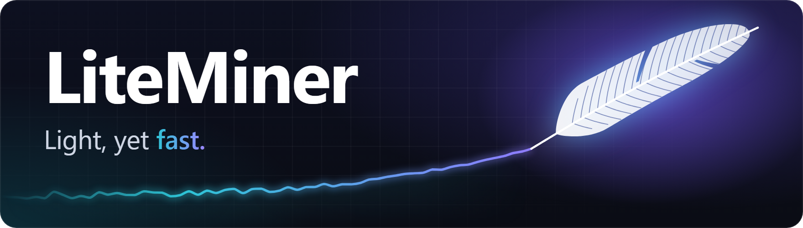
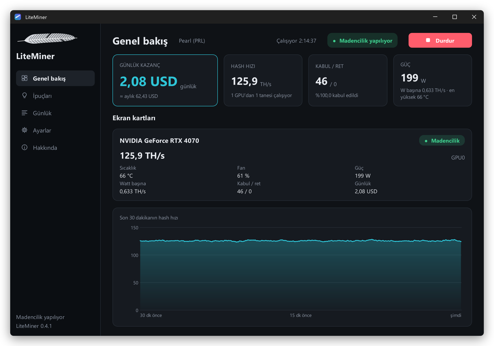
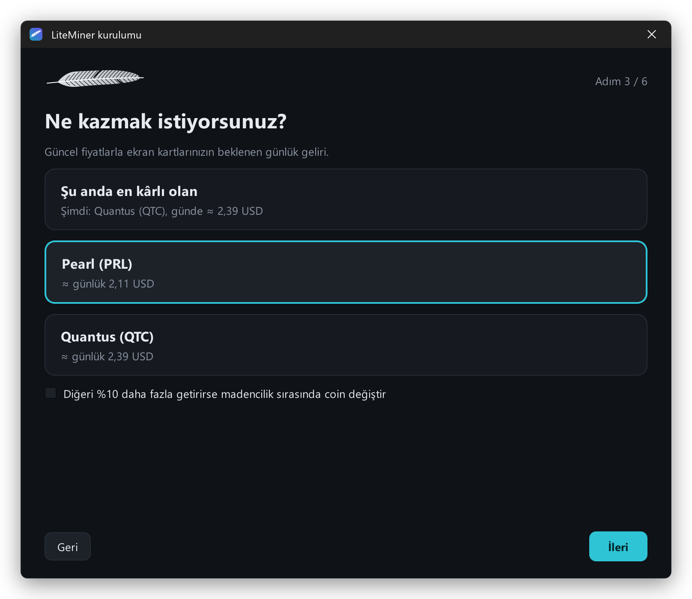
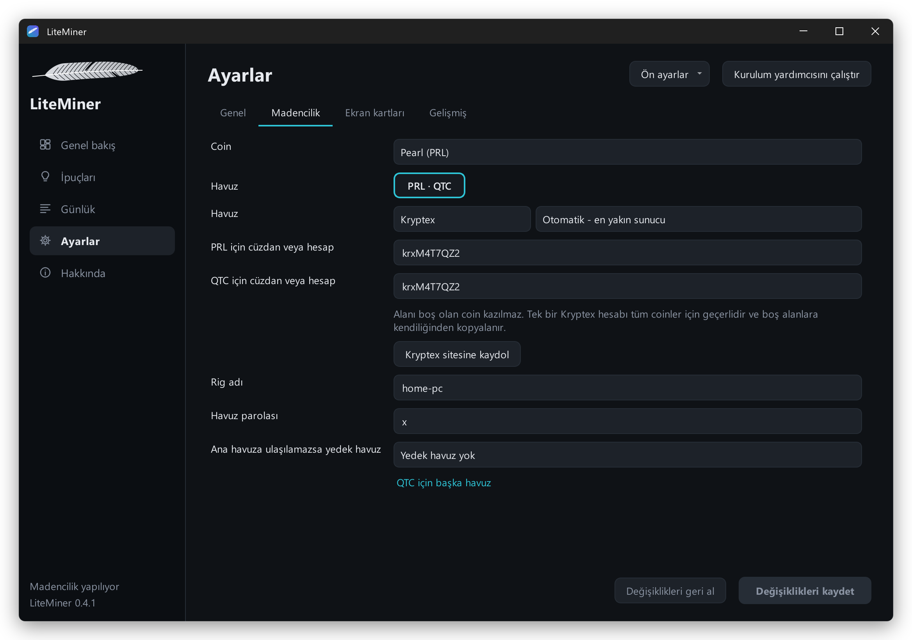

<p align="center"><a href="README.md">English</a> · <a href="README.zh-CN.md">简体中文</a> · <a href="README.es.md">Español</a> · <a href="README.pt-BR.md">Português</a> · <a href="README.de.md">Deutsch</a> · <a href="README.fr.md">Français</a> · <a href="README.ja.md">日本語</a> · <a href="README.ko.md">한국어</a> · <a href="README.ru.md">Русский</a> · <b>Türkçe</b> · <a href="README.vi.md">Tiếng Việt</a></p>

<p align="center"></p>

<p align="center"><b>NVIDIA ve AMD ekran kartlarıyla Pearl (PRL) ve Quantus (QTC) kazmanın basit yolu.</b></p>

<p align="center">
<a href="https://github.com/liteminergpu/liteminer/releases/latest"></a>
<a href="https://github.com/liteminergpu/liteminer/releases/latest"></a>
<a href="https://hub.docker.com/r/liteminer/liteminer"></a>
<a href="#hızlı-başlangıç"></a>
<a href="#ekran-kartları-ve-hash-hızı"></a>
<a href="#coinler-algoritmalar-ve-geliştirici-payı"></a>
<a href="#coinler-algoritmalar-ve-geliştirici-payı"></a>
<a href="https://www.virustotal.com/gui/file/f495dddb5ba706bedd41426fa79ff91ff9dc1de93fbb1239bd05bb43dc2c94ce"></a>
<a href="#destek"></a>
<a href="#lisans"></a>
</p>

LiteMiner her zaman istediğiniz madencilik programı: her GPU mimarisi için ayarlanmış güncel algoritmalar, kullanışlı bir masaüstü uygulaması (GUI) ya da terminal madencisi (CLI), otomatik coin seçimi, yedek havuzlar, işe yarar ipuçları ve kolay okunan bir günlük. Bir rig'de tam hızda çalışabilir ya da günlük kullandığınız bilgisayarda arka planda sessizce çalışıp ekran kartını oyunlara ve diğer programlara bırakabilir. Windows, Linux ve HiveOS için.

## İçindekiler

- [Ekran görüntüleri](#ekran-görüntüleri)
- [Öne çıkanlar](#öne-çıkanlar)
- [Hızlı başlangıç](#hızlı-başlangıç): [Windows](#windows) · [Linux](#linux) · [HiveOS](#hiveos) · [Docker ve GPU kiralama](#docker-ve-gpu-kiralama-vastai-cloreai-runpod-ve-diğer-gpu-bulutları)
- [İndirmeler ve sağlama toplamları](#indirmeler-ve-sağlama-toplamları)
- [Coin'ler, algoritmalar ve geliştirici payı](#coinler-algoritmalar-ve-geliştirici-payı)
- [Desteklenen havuzlar](#desteklenen-havuzlar)
- [CLI seçenekleri](#cli-seçenekleri)
- [İstatistikler ve günlükler](#istatistikler-ve-günlükler)
- [Ekran kartları ve hash hızı](#ekran-kartları-ve-hash-hızı)
- [LiteMiner dosyalarını nerede tutar](#liteminer-dosyalarını-nerede-tutar)
- [Sorun giderme](#sorun-giderme)
- [Destek](#destek)
- [Lisans](#lisans)

## Ekran görüntüleri

<p align="center"><br><sub>Grafik arayüz (GUI)</sub></p>

<p align="center"><br><sub>Konsol madencisi (CLI)</sub></p>

<details>
<summary><b>Daha fazla ekran görüntüsü: kurulum yardımcısı ve ayarlar</b></summary>
<br>
<p align="center"> </p>
</details>

## Öne çıkanlar

**1. Belgeleri karıştırmak yerine birkaç tıklamayla kazmaya başlayın.** Arşivi açın, `LiteMiner-GUI` uygulamasını başlatın ve birkaç basit soruyu yanıtlayın. Kurulum yardımcısı cüzdanın ve havuzun ne olduğunu açıklar, en yakın havuz sunucusunu seçer, adresinizi kontrol eder ve kazmaya başlar; daha önce kripto parayla hiç uğraşmamış olsanız bile. Uygulama 11 dilde kullanılabilir. Terminali mi tercih ediyorsunuz? Aynı madenci orada tek bir komutla başlar.

**2. Hızlı ve dürüst rakamlarla.** Her GPU mimarisinin kendi yerleşik ayarları vardır; Pearl'de madenci bunları ayrıca kartınıza göre ince ayarlayabilir. Her değişiklikten sonra hızı kendi ve kiralık ekran kartlarımızda yeniden ölçeriz. [Hash hızı tablosu](#ekran-kartları-ve-hash-hızı), LiteMiner'ın test edilen her kartta gerçekte ne elde ettiğini gösterir: yalnızca gerçek ölçümler, tahmin yok, yukarı yuvarlama yok.

**3. Eksikliğini hissettiğiniz özellikler.** Şu anda daha çok kazandıran coin'i kazın, diğeri daha kârlı hâle gelince otomatik olarak geçin. Bir oyun başlattığınızda ya da GPU'yu başka bir şekilde kullandığınızda madenci bunu fark eder ve sizi rahatsız etmemek için yükünü azaltır. Pille çalışırken duraklama, uyku modunu yalnızca madencilik sırasında engelleme, GPU'yu aşırı ısınmaya karşı koruma, havuz ve ağ arızalarından sonra kendi kendine toparlanma ve çok daha fazlası. Bu özelliklerin her biri tek tıklamayla ayarlanır.

Ve hiç düşünmeniz gerekmeyecek birkaç şey:

- **Ekran kartı ayarlarınız sizde kalır.** LiteMiner saat hızlarını, voltajları, güç sınırlarını veya fan hızlarını asla değiştirmez; yalnızca sensörleri okur. Kendi aracınızla undervolt yapmanız ya da güç sınırını düşürmeniz LiteMiner'ın çalışmasına engel olmaz.
- **Üç madencilik modu:** *En yüksek hız*; *Otomatik*: GPU boşken tam hız, ihtiyacınız olduğunda ise GPU'yu size bırakır; *Yalnızca bilgisayar kullanılmazken*.
- **Her GPU için ayrı işlem.** Bir kart hata verirse veya sürücüsü takılırsa, rig'in tamamı değil yalnızca o kart yeniden başlatılır.
- **Çalışmaya devam eden havuzlar:** sertifika doğrulamalı TLS, en yakın sunucunun otomatik seçimi, en fazla sekiz yedek havuz, TLS'nin engellendiği yerlerde düz TCP, SOCKS5 proxy'leri ve DNS over HTTPS.
- **Salt okunur yerel API** panolar ve betikler için; istenirse JSON biçiminde günlükler.
- **Her share gönderilmeden önce CPU'da doğrulanır**; böylece GPU'daki bir hesaplama hatası asla reddedilen share'e dönüşmez.

## Hızlı başlangıç

### Windows

1. [En son sürümü indirin](https://github.com/liteminergpu/liteminer/releases/download/v0.4.2/LiteMiner-0.4.2-windows-x64-portable.zip) (`LiteMiner-0.4.2-windows-x64-portable.zip`).
2. Arşivi herhangi bir klasöre çıkarın.
3. **`LiteMiner-GUI.exe`** dosyasını başlatın. Gerisinde kurulum yardımcısı size yol gösterir.

Terminali mi tercih ediyorsunuz? Cüzdanınızı (başka bir havuz kullanıyorsanız havuzu da) `start_LiteMiner_pearl.bat` veya `start_LiteMiner_quantus.bat` dosyasının başına yazıp çalıştırın ya da madenciyi doğrudan başlatın:

```bat
LiteMiner.exe -a pearl -o stratum+ssl://prl.kryptex.network:8048 -u YOUR_WALLET -w rig1
LiteMiner.exe -a quantus -o stratum+ssl://qtc.kryptex.network:8049 -u YOUR_WALLET -w rig1 --background
```

Ya da tek bir PowerShell komutuyla indirin, açın ve başlatın:

```powershell
irm https://github.com/liteminergpu/liteminer/releases/download/v0.4.2/LiteMiner-0.4.2-windows-x64-portable.zip -OutFile LiteMiner.zip; Expand-Archive LiteMiner.zip .; .\LiteMiner-0.4.2-windows-x64\LiteMiner-GUI.exe
```

Gereksinimler: Windows 10 veya 11 (x64) ve güncel bir ekran kartı sürücüsü.

> [!TIP]
> Henüz cüzdanınız yok mu? Ücretsiz bir [Kryptex hesabı](https://www.kryptex.com/register?ref=b629c482) iki coin için de geçerlidir: kullanıcı adını (`krxXXXXXX`) cüzdan olarak girin; Kryptex de seçiminize göre BTC veya USDT olarak ödeme yapar.

### Linux

En hızlı yol: tek bir komut indirir, açar ve kazmaya başlar. `YOUR_WALLET` yerine kendi cüzdanınızı yazın (başka bir havuz kullanıyorsanız havuzu da değiştirin):

Pearl:

```bash
curl -fsSL https://github.com/liteminergpu/liteminer/releases/download/v0.4.2/LiteMiner-0.4.2-linux-x64-portable.tar.gz | tar -xz && cd LiteMiner-0.4.2-linux-x64 && ./LiteMiner -a pearl -o stratum+ssl://prl.kryptex.network:8048 -u YOUR_WALLET -w rig1
```

Quantus:

```bash
curl -fsSL https://github.com/liteminergpu/liteminer/releases/download/v0.4.2/LiteMiner-0.4.2-linux-x64-portable.tar.gz | tar -xz && cd LiteMiner-0.4.2-linux-x64 && ./LiteMiner -a quantus -o stratum+ssl://qtc.kryptex.network:8049 -u YOUR_WALLET -w rig1
```

Aynı klasörde masaüstü uygulaması da bulunur: `./LiteMiner-GUI`.

Farklı dağıtımlar için paketler:

```bash
# Debian, Ubuntu, Linux Mint, Pop!_OS
wget https://github.com/liteminergpu/liteminer/releases/download/v0.4.2/liteminer_0.4.2_amd64.deb https://github.com/liteminergpu/liteminer/releases/download/v0.4.2/liteminer-gui_0.4.2_amd64.deb
sudo apt install ./liteminer_0.4.2_amd64.deb ./liteminer-gui_0.4.2_amd64.deb
```

```bash
# Fedora, RHEL, AlmaLinux, Rocky Linux (openSUSE: sudo zypper install ...)
sudo dnf install https://github.com/liteminergpu/liteminer/releases/download/v0.4.2/liteminer-0.4.2-1.x86_64.rpm https://github.com/liteminergpu/liteminer/releases/download/v0.4.2/liteminer-gui-0.4.2-1.x86_64.rpm
```

`liteminer` paketi sunucular ve rig'ler için terminal madencisini içerir; `liteminer-gui` masaüstü uygulamasını ekler. Madenciyi hizmet olarak çalıştırmak için `sudo systemctl enable --now liteminer@YOUR_USER` kullanın; hizmet `~/.local/share/liteminer/miner.json` dosyasını okur. Ayrıntılar: `man liteminer`.

Gereksinimler: x86-64; terminal madencisi için glibc 2.28 veya daha yenisi (Ubuntu 20.04, Debian 10, RHEL 8 veya daha yenisi), masaüstü uygulaması için 2.34 veya daha yenisi (Ubuntu 22.04, Debian 12, Fedora 35, RHEL 9 veya daha yenisi); X11 veya Wayland. NVIDIA için özel sürücü (CUDA Toolkit gerekmez), AMD için ROCm gibi bir OpenCL sürücüsü gerekir. En küçük kurulumlu sistemler ve konteynerler TLS havuzları için ayrıca `ca-certificates` paketine ihtiyaç duyar.

### HiveOS

Bir Flight Sheet oluşturun: **Coin**: coin'iniz, **Wallet**: cüzdanınız, **Pool**: *Configure in miner*, **Miner**: *Custom*. Ardından **Setup Miner Config** düğmesine tıklayıp şunları doldurun:

| Alan | Değer |
|---|---|
| Miner name | `liteminer` (URL'den otomatik doldurulur) |
| Installation URL | `https://github.com/liteminergpu/liteminer/releases/download/v0.4.2/liteminer-0.4.2.tar.gz` |
| Hash algorithm | `pearl` veya `quantus` |
| Wallet and worker template | `%WAL%.%WORKER_NAME%` |
| Pool URL | `stratum+ssl://prl.kryptex.network:8048` (Pearl) veya `stratum+ssl://qtc.kryptex.network:8049` (Quantus) |
| Pass | `x` |
| Extra config arguments | isteğe bağlı, ör. `--devices 0,2` veya `--thermal off` |

Flight Sheet'i rig'e uygulayın. Her GPU ayrı bir worker olarak kazar (havuzda `<worker>_gpuN`), Hive her GPU'nun hash hızını gösterir ve overclock ayarları Hive OC profilinizde kalır: LiteMiner onlara asla dokunmaz. Günlük: `/var/log/miner/custom/liteminer.log`; konsol: Hive kabuğunda `miner`. Yalnızca ilk Pool URL kullanılır; TLS portları için `stratum+ssl://` yazın.

### Docker ve GPU kiralama (Vast.ai, Clore.ai, RunPod ve diğer GPU bulutları)

Docker için NVIDIA sürücüsü ve [NVIDIA Container Toolkit](https://docs.nvidia.com/datacenter/cloud-native/container-toolkit/latest/install-guide.html) kurulu bir Linux ana makinesi (ya da Docker Desktop ve WSL 2 kurulu Windows) gerekir. Konteyner yalnızca NVIDIA ekran kartlarını destekler.

```bash
docker run -d --name liteminer --gpus all --restart unless-stopped -v liteminer-data:/data \
  liteminer/liteminer:0.4.2 -a pearl -o stratum+ssl://prl.kryptex.network:8048 -u YOUR_WALLET -w rig1
docker logs -f liteminer
```

Konteyner, seçenekler yerine `LITEMINER_ALGORITHM`, `LITEMINER_POOL`, `LITEMINER_WALLET`, `LITEMINER_WORKER`, `LITEMINER_PASSWORD` ve `LITEMINER_DEVICES` ortam değişkenlerini de kabul eder. `/data` birimini koruyun: günlükler ve her GPU'nun ayar sonuçları oradadır, bu sayede yeniden başlatmadan sonra ayarlama tekrarlanmaz. `docker stop -t 60 liteminer`, her GPU'nun mevcut işini bitirmesini sağlar.

Bir GPU bulutunda `liteminer/liteminer:0.4.2` imajını seçin ve şablonun ortam değişkenlerinde `LITEMINER_ALGORITHM`, `LITEMINER_POOL` ve `LITEMINER_WALLET` değerlerini ayarlayın. Ya da CUDA içeren herhangi bir Ubuntu imajını (örneğin `nvidia/cuda:12.4.1-base-ubuntu22.04`) seçip başlangıç betiği (on-start script) olarak şunu kullanın:

```bash
apt-get update && apt-get install -y --no-install-recommends ca-certificates curl
curl -fsSL https://github.com/liteminergpu/liteminer/releases/download/v0.4.2/LiteMiner-0.4.2-linux-x64-portable.tar.gz | tar -xz -C /opt
cd /opt/LiteMiner-0.4.2-linux-x64 && nohup ./LiteMiner -a quantus -o stratum+ssl://qtc.kryptex.network:8049 -u YOUR_WALLET -w cloud1 > /var/log/liteminer.log 2>&1 &
```

Örnekteki tüm ekran kartları kazar. Günlüğü `tail -f /var/log/liteminer.log` ile izleyin. Kiralık sunucular çoğu zaman bilerek sıcak çalışır: sıcaklıkları sağlayıcı yönetiyorsa `--thermal off` bu işi ona bırakır.

## İndirmeler ve sağlama toplamları

0.4.2 sürümünün tüm dosyaları [sürümler sayfasında](https://github.com/liteminergpu/liteminer/releases/latest). İndirdiğiniz dosyayı `SHA256SUMS.txt` ile karşılaştırmak için Windows'ta `certutil -hashfile DOSYA SHA256`, Linux'ta `sha256sum -c --ignore-missing SHA256SUMS.txt` komutunu çalıştırın.

| Platform | Dosya | Boyut | SHA-256 | Tarama |
|---|---|---:|---|---|
| Windows x64 | [`LiteMiner-0.4.2-windows-x64-portable.zip`](https://github.com/liteminergpu/liteminer/releases/download/v0.4.2/LiteMiner-0.4.2-windows-x64-portable.zip) | 80.8 MB | <sub>`f495dddb5ba706bedd41426fa79ff91ff9dc1de93fbb1239bd05bb43dc2c94ce`</sub> | [VirusTotal](https://www.virustotal.com/gui/file/f495dddb5ba706bedd41426fa79ff91ff9dc1de93fbb1239bd05bb43dc2c94ce) |
| Linux x64 | [`LiteMiner-0.4.2-linux-x64-portable.tar.gz`](https://github.com/liteminergpu/liteminer/releases/download/v0.4.2/LiteMiner-0.4.2-linux-x64-portable.tar.gz) | 103.3 MB | <sub>`8968150c50ac470bbcaf40f414dc4c83201883a67b60968c43ec196a7d030007`</sub> | [VirusTotal](https://www.virustotal.com/gui/file/8968150c50ac470bbcaf40f414dc4c83201883a67b60968c43ec196a7d030007) |
| HiveOS | [`liteminer-0.4.2.tar.gz`](https://github.com/liteminergpu/liteminer/releases/download/v0.4.2/liteminer-0.4.2.tar.gz) | 29.0 MB | <sub>`7ce474cb580e1f3114ef2453f66a36681d996a78c9d7148125a35bda238724bf`</sub> | [VirusTotal](https://www.virustotal.com/gui/file/7ce474cb580e1f3114ef2453f66a36681d996a78c9d7148125a35bda238724bf) |
| Docker (derleme bağlamı) | [`LiteMiner-0.4.2-docker.tar.gz`](https://github.com/liteminergpu/liteminer/releases/download/v0.4.2/LiteMiner-0.4.2-docker.tar.gz) | 29.0 MB | <sub>`c6c42b3e6d00e0faedca497592b6fe8955a4fd1ea38263829518d29526d6fc34`</sub> | [VirusTotal](https://www.virustotal.com/gui/file/c6c42b3e6d00e0faedca497592b6fe8955a4fd1ea38263829518d29526d6fc34) |
| Debian / Ubuntu | [`liteminer_0.4.2_amd64.deb`](https://github.com/liteminergpu/liteminer/releases/download/v0.4.2/liteminer_0.4.2_amd64.deb) | 29.1 MB | <sub>`a9213322d7d36732e845aba9f26c382260cfef3986f162bf87c8dc4fce474f7f`</sub> | [VirusTotal](https://www.virustotal.com/gui/file/a9213322d7d36732e845aba9f26c382260cfef3986f162bf87c8dc4fce474f7f) |
| Debian / Ubuntu | [`liteminer-gui_0.4.2_amd64.deb`](https://github.com/liteminergpu/liteminer/releases/download/v0.4.2/liteminer-gui_0.4.2_amd64.deb) | 45.3 MB | <sub>`bb887052ca8807b846026ba0d4f5ce042b2f202ecb4bbbf71d47206388fe0122`</sub> | [VirusTotal](https://www.virustotal.com/gui/file/bb887052ca8807b846026ba0d4f5ce042b2f202ecb4bbbf71d47206388fe0122) |
| Fedora / RHEL / openSUSE | [`liteminer-0.4.2-1.x86_64.rpm`](https://github.com/liteminergpu/liteminer/releases/download/v0.4.2/liteminer-0.4.2-1.x86_64.rpm) | 24.4 MB | <sub>`7e0f6c9d748eae775a96338d46958384696aefd3726fd28706b56bc59ad531dc`</sub> | [VirusTotal](https://www.virustotal.com/gui/file/7e0f6c9d748eae775a96338d46958384696aefd3726fd28706b56bc59ad531dc) |
| Fedora / RHEL / openSUSE | [`liteminer-gui-0.4.2-1.x86_64.rpm`](https://github.com/liteminergpu/liteminer/releases/download/v0.4.2/liteminer-gui-0.4.2-1.x86_64.rpm) | 31.2 MB | <sub>`fbf9a0fc2d4627a3dc490f1f365f36359ca11e04ed78ab9246d2d201543d34eb`</sub> | [VirusTotal](https://www.virustotal.com/gui/file/fbf9a0fc2d4627a3dc490f1f365f36359ca11e04ed78ab9246d2d201543d34eb) |

> [!IMPORTANT]
> Antivirüs programları neredeyse her madenciyi "istenmeyebilecek program" veya "coin madencisi" olarak işaretler. Bu belirli bir tehdit değil, bir kategoridir; bu yüzden VirusTotal raporlarının bağlantıları yukarıda açıkça verilmiştir. LiteMiner'ı yalnızca bu sayfadan indirin ve sağlama toplamını karşılaştırın. Windows Defender dosyayı silerse LiteMiner klasörünü onun dışlamalarına ekleyin.

## Coin'ler, algoritmalar ve geliştirici payı

| Coin | Algoritma | NVIDIA (CUDA) | AMD / Intel (OpenCL) | Devfee |
|---|---|---|---|---:|
| [Pearl (PRL)](https://pool.kryptex.com/prl) | Pearl (int8 MatMul PoW), `-a pearl` | Pascal (GTX 10) ve daha yenisi | evet (henüz ölçülmedi) | 2% |
| [Quantus (QTC)](https://pool.kryptex.com/qtc) | QPoW (Poseidon2), `-a quantus` | Maxwell (GTX 900) ve daha yenisi | evet | 2% |

Siz istediğinizde ya da kazmaya değer hâle geldiğinde yeni bir coin ekleriz. Eklemeye değer yeni bir şey olmadığında listeyi şişirmeyiz; bunun yerine mevcut algoritmaları ekran kartınızda hızlandırırız.

## Desteklenen havuzlar

LiteMiner, coin'in Stratum protokolünü destekleyen her havuzla TLS (`stratum+ssl://`, sertifika doğrulamalı) veya düz TCP (`stratum+tcp://`) üzerinden çalışır. Aşağıdaki havuzlar uygulamaya yerleşiktir: uygulama gecikmesi en düşük sunucuyu seçer, başka bir bölgeyi otomatik yedek olarak tutar ve oturum açma adınızın o havuz için doğru biçimde olup olmadığını kontrol eder.

| Havuz | PRL | QTC | Oturum adı | Sunucu |
|---|---|---|---|---:|
| **[Kryptex](https://pool.kryptex.com/prl)**<br><sub>[kaydol](https://www.kryptex.com/register?ref=b629c482)</sub> | `stratum+ssl://prl.kryptex.network:8048`<br><sub>TLS, TCP 7048</sub> | `stratum+ssl://qtc.kryptex.network:8049`<br><sub>TLS, TCP 7049</sub> | Kryptex hesabı veya cüzdan | 8 |
| **[PearlFortune](https://pearlfortune.org/)** | `stratum+ssl://global.pearlfortune.org:443`<br><sub>TLS, sabitlenmiş sertifika</sub> | - | cüzdan adresi | 1 |
| **[LuckyPool](https://pearl.luckypool.io/)** | `stratum+ssl://pearl-eu1.luckypool.io:3360`<br><sub>TLS, sabitlenmiş sertifika</sub> | `stratum+ssl://eu.lproute.com:5660`<br><sub>TLS, sabitlenmiş sertifika</sub> | cüzdan adresi | 19 |
| **[F2Pool](https://www.f2pool.com/coin/pearl)**<br><sub>[kaydol](https://www.f2pool.com/user/signup)</sub> | `stratum+tcp://pearl.f2pool.com:5500`<br><sub>yalnızca TCP</sub> | `stratum+tcp://qtc.f2pool.com:4500`<br><sub>yalnızca TCP</sub> | havuz hesabı adı | 1 |
| **[HeroMiners](https://pearl.herominers.com/)** | `stratum+ssl://de.pearl.herominers.com:1200`<br><sub>TLS</sub> | `stratum+ssl://de.quantus.herominers.com:1155`<br><sub>TLS</sub> | cüzdan adresi | 15 |
| **[2Miners](https://2miners.com/prl-mining-pool)** | `stratum+ssl://prl.2miners.com:11818`<br><sub>TLS, TCP 1818</sub> | `stratum+ssl://qtc.2miners.com:13636`<br><sub>TLS, TCP 3636</sub> | cüzdan adresi | 3 |

Terminal madencisi aynısını yapılandırma dosyasında sunar (`LiteMiner --init` bir örnek oluşturur):

```json
{
  "pool_host": "prl.kryptex.network", "pool_port": 8048, "tls": true, "tcp_port": 7048, "tcp_fallback": true,
  "wallet": "YOUR_WALLET", "worker": "rig1", "password": "x",
  "backup_pools": [
    {"pool_host": "prl-eu.kryptex.network", "pool_port": 8048},
    {"pool_host": "de.pearl.herominers.com", "pool_port": 1200, "wallet": "YOUR_PRL_ADDRESS"}
  ],
  "proxy": "socks5://127.0.0.1:9050"
}
```

`backup_pools` en fazla sekiz havuz alır; ana havuz yeniden çalışınca madenci kendiliğinden ona döner. `tcp_fallback`, şifresiz portu yalnızca TLS ile hiç bağlanılamadığında kullanır. `proxy`, havuz bağlantısını SOCKS5 üzerinden geçirir (kullanıcı adı ve parola `LITEMINER_PROXY_USERNAME` ile `LITEMINER_PROXY_PASSWORD` içinde), `doh_url` ise havuz adresini DNS over HTTPS ile çözer.

## CLI seçenekleri

**Masaüstü uygulamasında bunların hepsi onay kutularıyla ayarlanır, yani bu bölümü atlayabilirsiniz.** Terminal için, bu sürümün programından doğrudan alınmış tüm madenci seçenekleri:

| Seçenek | Açıklama |
|---|---|
| `-V`, `--version` | sürümü ve derlemeyi gösterip çık |
| `-a`, `--algorithm` `ALGORITHM` | `pearl` (varsayılan), `quantus` / `qpow` / `qtc` |
| `--config` `CONFIG` | JSON yapılandırma dosyası (varsayılan: Pearl için `miner.json`, Quantus için `quantus.json`) |
| `-o`, `--pool` `POOL` | port dahil havuz adresi: `stratum+ssl://host:port` veya `stratum+tcp://host:port` |
| `-u`, `--wallet` `WALLET` | cüzdan adresi veya havuz hesabı |
| `-w`, `--worker` `WORKER` | worker adı (varsayılan: `rig1`) |
| `-p`, `--password` `PASSWORD` | havuz parolası (varsayılan: `x`) |
| `--devices` `DEVICES` | `all` (varsayılan: CUDA veya Metal destekli GPU'lar ve OpenCL destekli NVIDIA dışı GPU'lar) ya da virgülle ayrılmış numaralar / `opencl:N`; her GPU kendi yalıtılmış işleminde çalışır |
| `--list-devices` | GPU'ları ve her birinin kazabileceği coin'leri listeleyip çık (`--log-format json` ile JSON olarak) |
| `-B`, `--benchmark` | kıyaslama testi: havuz ve cüzdan ayarlıysa onlarla, değilse çevrim içi, gerekirse otomatik olarak çevrim dışına geçerek |
| `--benchmark-seconds` `BENCHMARK_SECONDS` | GPU hazırlığından sonraki test süresi (varsayılan: 900 saniye; `0`: durdurulana kadar) |
| `--stop-file` `PATH` | bu dosya oluşur oluşmaz düzgünce dur (her GPU mevcut işini bitirir) |
| `--no-autotune` | hesaplama ayarlarını otomatik ayarlama yapmadan yapılandırmadan kullan; yüke ve VRAM'e uyum sağlama açık kalır |
| `--autotune` | Pearl tam hız: başlangıçta mimariye ait yerleşik ayarlar yerine hesaplama ayarlarını ölçerek seç (madencilik yapmadan en fazla 4 dk); sonuç sonraki başlatmalar için kaydedilir |
| `--background` | otomatik mod: GPU boşken tam hız; oyunlara ve diğer GPU programlarına yol verir, kartın tamamına ihtiyaç duyduklarında duraklar |
| `--idle-only` | yalnızca bilgisayarı kimse kullanmazken tam hız (`--idle-seconds` boyunca klavye ve fare girişi yok); diğer zamanlarda duraklar, havuz bağlantısı korunur; Windows'ta otomatik mod gibi diğer GPU programlarına da yol verir |
| `--idle-seconds` `IDLE_SECONDS` | madencilik başlamadan önce klavye ve fare girişi olmadan geçmesi gereken saniye (10..86400, varsayılan: 120); `--idle-only` seçeneğini açar |
| `--no-load-pause` | diğer programlar GPU'yu yoğun kullanırken duraklamak yerine en düşük seviyede kazmaya devam et; `--idle-only` verilmemişse `--background` seçeneğini açar |
| `--mine-on-battery` | bilgisayar pille çalışırken de kazmaya devam et (varsayılan: prize takılana kadar duraklar; pilde hash hızı genellikle çok daha düşüktür) |
| `--allow-sleep` | madencilik sırasında bilgisayarın boşta kalma zamanlayıcısıyla uyku moduna geçmesine izin ver (varsayılan: bir GPU kazarken uyanık kalır; ekran yine de kapanabilir) |
| `--api-port` `API_PORT` | yerel, salt okunur JSON API portu (varsayılan: 4280) |
| `--api-bind` `API_BIND` | API dinleme adresi: yalnızca `127.0.0.1` (varsayılan), `::1` veya `localhost` |
| `--no-api` | yerel JSON API'yi kapat (masaüstü uygulaması buna ihtiyaç duyar) |
| `--thermal` `{auto,custom,off}` | sıcaklık koruması: `auto` (sürücü sınırları, varsayılan), `custom` (`--thermal-soft/hard/resume`; bunlar verilince kendiliğinden seçilir) veya `off` |
| `--thermal-gpu` `LABEL=SOFT:HARD:RESUME` | tek bir GPU için çip sınırları, ör. `gpu1=80:88:75` (her GPU için tekrarlayın; `--thermal off` ile birlikte kullanılmaz) |
| `--thermal-soft` `THERMAL_SOFT` | üzerinde yavaşlanacak çip sıcaklığı (°C) |
| `--thermal-hard` `THERMAL_HARD` | madenciliğin duraklayacağı çip sıcaklığı (°C) |
| `--thermal-resume` `THERMAL_RESUME` | altına inince madenciliğin sürdüğü çip sıcaklığı (°C) |
| `--thermal-memory-soft` `THERMAL_MEMORY_SOFT` | üzerinde yavaşlanacak bellek sıcaklığı (°C) |
| `--thermal-memory-hard` `THERMAL_MEMORY_HARD` | madenciliğin duraklayacağı bellek sıcaklığı (°C) |
| `--thermal-memory-resume` `THERMAL_MEMORY_RESUME` | altına inince madenciliğin sürdüğü bellek sıcaklığı (°C) |
| `-v`, `--verbose` | ek tanılama bilgilerini göster |
| `--no-color` | renksiz konsol çıktısı |
| `--log-file` `LOG_FILE` | günlük dosyası (varsayılan: `logs\liteminer.log`; 10 MB'ta döndürülür, 3 dosya tutulur) |
| `--no-log-file` | günlük dosyası yazma |
| `--log-format` `{text,json}` | konsol çıktısı: `text` (varsayılan) veya satır başına bir JSON kaydı (betikler için) |
| `--no-update-check` | yeni sürüm denetleme (varsayılan: herkese açık sürüm sayfası günde bir kez okunur; yalnızca program adı ve sürümü gönderilir) |
| `--gui` | masaüstü uygulamasını aç (Windows'ta `LiteMiner-GUI.exe` ile de açılır) |
| `--init` | geçerli klasöre örnek yapılandırmalar `miner.json` ve `quantus.json` yaz |
| `--runtime-info` | programın açılmış dosyalarının bulunduğu klasörü göster |
| `--verify-package` | tüm program dosyalarını yerleşik sağlama toplamlarıyla denetle |

Sık kullanılan örnekler:

```bash
LiteMiner --list-devices                                # LiteMiner'ın hangi GPU'ları gördüğü ve her birinin hangi coin'leri kazabileceği
LiteMiner -a quantus ... --devices 0,2                  # yalnızca 0 ve 2 numaralı GPU'larda kaz (her biri için bir worker)
LiteMiner -a pearl ... --background                     # otomatik mod: oyunlara ve diğer GPU programlarına yol ver
LiteMiner -a pearl ... --idle-only --idle-seconds 300   # yalnızca 5 dakika klavye ve fare kullanılmadığında kaz
LiteMiner -a quantus ... --thermal-gpu gpu1=78:86:72    # tek bir kart için özel sıcaklık sınırları
LiteMiner -B -a pearl --benchmark-seconds 300           # 5 dakikalık kıyaslama testi, cüzdan gerekmez
```

## İstatistikler ve günlükler

**Konsol.** Madenci her 30 saniyede bir, her GPU'nun hızını, sıcaklığını, fanını, gücünü, verimliliğini, kabul edilen ve reddedilen share'lerini ve durumunu gösteren bir tablo yazdırır; aralarda her olay için bir satır yazar (yeni iş, share, yeniden bağlanma, sıcaklık koruması). `--log-format json` ile konsol bunun yerine satır başına bir JSON kaydı yazar; `jq` veya bir günlük toplayıcı için hazırdır.

**Günlük dosyası.** Yapılandırmanın yanında `logs/liteminer.log`. 10 MB'ta döndürülür ve üç dosya saklanır. `--log-file` konumunu değiştirir, `--no-log-file` kapatır.

**Yerel API.** `127.0.0.1:4280` üzerinde küçük, salt okunur bir JSON API. Masaüstü uygulaması bunu kullanır; betikleriniz ve panolarınız da kullanabilir:

| Uç nokta | Döndürdüğü |
|---|---|
| `GET /api/v1/summary` | rig toplamları: sürüm, algoritma, çalışma süresi, durum, toplam hız ve birimi, share'ler (kabul edilen, reddedilen, bekleyen), en yüksek sıcaklık, güç, enerji, havuzlar |
| `GET /api/v1/devices` | her GPU için aynısı: ad, durum, hız, share'ler, sıcaklık, fan, güç, havuz |
| `GET /api/v1/health` | `ok`, `starting`, `degraded` veya `down` (`down` iken HTTP 503); izleme betikleri için |
| `GET /api/v1/history` | her GPU'nun son bir saati, 5 saniyelik adımlarla: hız, sıcaklık, güç |

```bash
curl -s http://127.0.0.1:4280/api/v1/summary
```

```json
{"api_version":1,"product":"LiteMiner","version":"0.4.2","algorithm":"quantus","uptime_seconds":180.4,
 "health":"ok","devices":1,"device_states":{"mining":1},"rate":518.6,"unit":"MH/s","rate_window_seconds":60,
 "shares":{"accepted":2,"rejected":0,"submitted":2,"lost_unacknowledged":0,"discarded_stale":0,"verification_rejected":0,"pending":0},
 "max_temperature_c":64,"power_w":196.0,"pools":["qtc.kryptex.network:8049"]}
```

API yalnızca geri döngü arayüzünde dinler (`--api-bind`; `127.0.0.1`, `::1` veya `localhost` kabul eder), DNS rebinding'e karşı `Host` başlığını denetler ve asla cüzdan, parola ya da herhangi bir yapılandırma değeri döndürmez. **Bilerek hiçbir kontrol uç noktası yoktur:** ağdaki hiçbir şey madencinizi durduramaz, yeniden yapılandıramaz veya yönlendiremez. Bir betikten durdurmak için `--stop-file YOL` kullanın (dosya oluşur oluşmaz her GPU mevcut işini bitirir ve madenci kapanır) ya da Ctrl+C / SIGINT gönderin.

**HiveOS**, standart özel madenci istatistikleri üzerinden her GPU'nun hash hızını alır (PCI veri yoluyla eşleştirilir); sıcaklıkları ve fanları Hive kendisi okur.

## Ekran kartları ve hash hızı

LiteMiner 0.4.2 ve son derlemelerinin 67 GPU modelindeki gerçek sonuçları. `?` işareti, o kombinasyonu henüz ölçmediğimiz anlamına gelir, çalışmadığı anlamına gelmez.

Tüm sonuçlar kartların kendi ayarlarıyla ölçülmüştür: LiteMiner saat hızlarını, voltajları, güç sınırlarını veya fanları değiştirmedi. Kendi aracınızla undervolt ya da daha düşük bir güç sınırı tamamen desteklenir: LiteMiner, kartın verdiği hıza uyum sağlar.

#### GeForce ve TITAN

| Ekran kartı | PRL, TH/s | QTC, MH/s | Son test |
|---|---:|---:|---|
| RTX 5090 | 372.6 | 1524.6 | 2026-11 |
| RTX 5080 | 238.3 | 982.8 | 2026-11 |
| RTX 5070 | 134.2 | 552.7 | 2026-11 |
| RTX 5070 Ti | 204.5 | 840.8 | 2026-11 |
| RTX 5060 | 83.4 | 352.0 | 2026-11 |
| RTX 5060 Ti | 100.0 | 421.7 | 2026-11 |
| RTX 4090 | 332.4 | 1388.9 | 2026-11 |
| RTX 4080 | 210.0 | 851.3 | 2026-11 |
| RTX 4080 SUPER | 215.1 | 875.6 | 2026-11 |
| RTX 4070 | 127.8 | 518.6 | 2026-11 |
| RTX 4070 SUPER | 127.1 | 456.8 | 2026-11 |
| RTX 4070 Ti SUPER | 170.2 | 686.7 | 2026-11 |
| RTX 4060 | 64.3 | 266.8 | 2026-11 |
| RTX 4060 Ti | 95.1 | 379.3 | 2026-11 |
| RTX 3090 | 148.5 | 619.1 | 2026-11 |
| RTX 3090 Ti | 150.2 | 619.6 | 2026-11 |
| RTX 3080 | 120.4 | 505.2 | 2026-11 |
| RTX 3080 Ti | 140.9 | 589.1 | 2026-11 |
| RTX 3070 | 80.9 | 331.7 | 2026-11 |
| RTX 3070 Ti | 95.3 | 389.4 | 2026-11 |
| RTX 3060 | 54.6 | 227.9 | 2026-11 |
| RTX 3060 Ti | 70.8 | 296.0 | 2026-11 |
| RTX 3050 | 36.5 | 154.6 | 2026-11 |
| RTX 3050 Laptop GPU | 29.6 | ? | 2026-11 |
| RTX 2080 | 81.9 | 371.8 | 2026-11 |
| RTX 2080 Ti | 94.5 | 418.0 | 2026-11 |
| RTX 2070 | 58.1 | 257.1 | 2026-11 |
| RTX 2070 SUPER | 57.7 | 273.5 | 2026-11 |
| RTX 2060 | 47.4 | 227.1 | 2026-11 |
| RTX 2060 SUPER | 52.8 | 234.1 | 2026-11 |
| GTX 1660 | 2.50 | 47.4 | 2026-11 |
| GTX 1660 SUPER | 8.54 | 162.5 | 2026-11 |
| GTX 1660 Ti | 8.57 | 178.0 | 2026-11 |
| GTX 1650 | 3.49 | 76.5 | 2026-11 |
| GTX 1080 | 7.95 | 85.1 | 2026-11 |
| GTX 1080 Ti | 13.1 | 119.7 | 2026-11 |
| GTX 1070 | 7.16 | 63.8 | 2026-11 |
| GTX 1070 Ti | 9.21 | 81.0 | 2026-11 |
| GTX 1060 | 5.11 | 46.0 | 2026-11 |
| GTX TITAN X | ? | 33.9 | 2026-10 |
| TITAN RTX | 92.5 | 438.5 | 2026-11 |
| TITAN V | 34.1 | 398.0 | 2026-11 |
| TITAN Xp | 7.59 | 63.1 | 2026-10 |

#### Madencilik kartları (CMP, P104)

| Ekran kartı | PRL, TH/s | QTC, MH/s | Son test |
|---|---:|---:|---|
| CMP 90HX | 60.0 | 282.8 | 2026-11 |
| CMP 70HX | 50.7 | 198.7 | 2026-11 |
| CMP 50HX | 40.0 | 350.4 | 2026-11 |
| CMP 40HX | 50.3 | 236.6 | 2026-11 |
| CMP 30HX | 1.05 | 150.0 | 2026-11 |
| P104-100 | 5.63 | 47.3 | 2026-11 |

#### İş istasyonu ve veri merkezi

| Ekran kartı | PRL, TH/s | QTC, MH/s | Son test |
|---|---:|---:|---|
| A10 | 75.7 | 333.9 | 2026-10 |
| A100 PCIe | 194.7 | 404.8 | 2026-10 |
| Quadro P4000 | 5.60 | 44.7 | 2026-11 |
| RTX A2000 | 29.2 | 137.6 | 2026-10 |
| RTX A4000 | 73.5 | 294.3 | 2026-11 |
| RTX A5000 | 93.2 | 395.3 | 2026-11 |
| RTX A6000 | 131.7 | 557.7 | 2026-11 |
| Tesla P40 | 11.6 | 118.2 | 2026-11 |
| Tesla P100 | ? | 88.8 | 2026-11 |
| Tesla T4 | 35.2 | 170.2 | 2026-11 |
| Tesla V100 | 41.2 | 486.3 | 2026-11 |
| Tesla V100 SXM2 16 GB | 30.6 | 347.1 | 2026-11 |
| Tesla V100S | 18.8 | 248.9 | 2026-11 |

#### AMD Radeon

| Ekran kartı | PRL, TH/s | QTC, MH/s | Son test |
|---|---:|---:|---|
| RX 9070 XT | 137.7 | 293.2 | 2026-11 |
| RX 9060 XT | 67.9 | 151.9 | 2026-11 |
| RX 7900 XT | 48.0 | 334.3 | 2026-11 |
| RX 7900 XTX | 59.6 | 396.4 | 2026-11 |
| RX 7800 XT | 31.8 | 226.6 | 2026-11 |

Kartınız listede yok mu, ya da buradakinden yavaş mı? `LiteMiner -B` komutunu çalıştırın (varsayılan olarak 15 dakika) ve sonucu [lmsupp@proton.me](mailto:lmsupp@proton.me) adresine gönderin.

## LiteMiner dosyalarını nerede tutar

| Ne | Windows | Linux |
|---|---|---|
| Masaüstü uygulamasının ayarları | `%LOCALAPPDATA%\LiteMiner\data` | `~/.local/share/liteminer` |
| Terminal madencisinin yapılandırması | geçerli klasördeki `miner.json` ve `quantus.json` | aynısı; paketlerde `~/.local/share/liteminer` |
| Günlükler | `logs\liteminer.log` | `logs/liteminer.log` |

Program taşınabilirdir: her EXE ihtiyaç duyduğu her şeyi içerir ve her başlangıçta kendi dosyalarını denetler. Başka bir klasöre açılan yeni sürüm ayarlarınızı korur; eski açılmış sürümler otomatik olarak silinir.

## Sorun giderme

<details>
<summary><b>"No GPU found that LiteMiner can use" (kullanılabilir GPU bulunamadı)</b></summary>

[NVIDIA](https://www.nvidia.com/Download/index.aspx) veya [AMD](https://www.amd.com/en/support) sitesinden en güncel sürücüyü kurun. NVIDIA'da Pearl için Pascal (GTX 10) veya daha yenisi, Quantus için Maxwell (GTX 900) veya daha yenisi gerekir. `LiteMiner --list-devices`, madencinin hangi GPU'ları gördüğünü ve her birinin hangi coin'leri kazabileceğini gösterir.
</details>

<details>
<summary><b>Antivirüs LiteMiner'ı sildi</b></summary>

Çoğu antivirüs programı madencileri belirli bir tehdit yüzünden değil, kategorileri yüzünden işaretler. Dosyayı `SHA256SUMS.txt` ve [İndirmeler ve sağlama toplamları](#indirmeler-ve-sağlama-toplamları) bölümündeki VirusTotal raporuyla karşılaştırın, ardından LiteMiner klasörünü dışlamalara ekleyin.
</details>

<details>
<summary><b>"Another LiteMiner is already mining on this GPU" (çıkış kodu 8)</b></summary>

Bir GPU'yu aynı anda yalnızca bir LiteMiner kopyası kullanabilir. Diğer kopyayı (ya da kendi madencisini çalıştıran masaüstü uygulamasını) kapatın veya `--devices` ile her kopyaya ayrı GPU'lar verin.
</details>

<details>
<summary><b>En küçük kurulumlu Linux'ta veya bir konteynerde TLS hataları</b></summary>

`ca-certificates` paketini kurun: LiteMiner havuz sertifikalarını sistemin sertifika deposuyla doğrular ve doğrulanmamış bir bağlantı üzerinden kazmaz.
</details>

<details>
<summary><b>Madencilik sırasında oyunlar takılıyor</b></summary>

Uygulamada *Otomatik* modu seçin (terminalde `--background`): GPU'yu oyunlara bırakır ve kartın tamamına ihtiyaç duydukları sürece duraklar. *Yalnızca bilgisayar kullanılmazken* modu (`--idle-only`) yalnızca siz bilgisayar başında değilken kazar.
</details>

## Destek

Sorular, hata bildirimleri ve kıyaslama sonuçları için: [lmsupp@proton.me](mailto:lmsupp@proton.me).

Yazmadan önce `LiteMiner --list-devices` komutunu çalıştırın ve çıktısını `logs/liteminer.log` ile birlikte ekleyin.

## Lisans

LiteMiner'ı indirmek ve kullanmak ücretsizdir; yukarıda belirtilen %2 geliştirici payı uygulanır. Kaynak kodu yayımlanmaz.

Madencilik elektrik tüketir: sıcaklıkları, elektrik faturanızı ve ülkenizin yasalarını göz önünde bulundurun. LiteMiner olduğu gibi, hiçbir garanti olmaksızın sunulur. Programla birlikte gelen üçüncü taraf kütüphaneler hariç, programın tersine derlenmesi (decompile), değiştirilmesi ve benzeri her türlü işlem kesinlikle yasaktır. LiteMiner'ın bilgisayara zarar verebilecek programların (“virüslerin”) parçası olarak ya da ülkenizin yasalarını ihlal eden başka herhangi bir şekilde yeniden dağıtılması yasaktır. LiteMiner'ın, sahipleri size kripto para madencisi kurma ve/veya kullanma izni vermemiş bilgisayarlarda kullanılması yasaktır.
