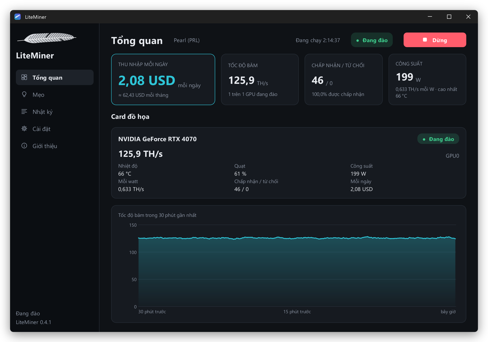
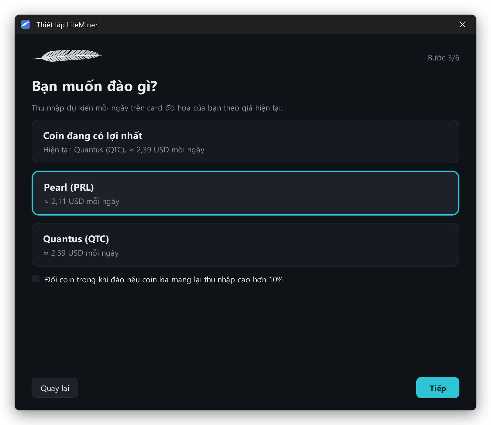
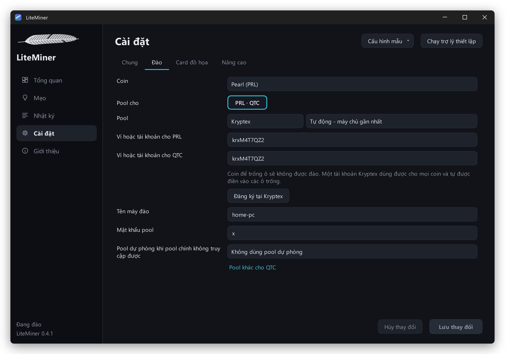

<p align="center"><a href="README.md">English</a> · <a href="README.zh-CN.md">简体中文</a> · <a href="README.es.md">Español</a> · <a href="README.pt-BR.md">Português</a> · <a href="README.de.md">Deutsch</a> · <a href="README.fr.md">Français</a> · <a href="README.ja.md">日本語</a> · <a href="README.ko.md">한국어</a> · <a href="README.ru.md">Русский</a> · <a href="README.tr.md">Türkçe</a> · <b>Tiếng Việt</b></p>

<p align="center"></p>

<p align="center"><b>Cách đơn giản để đào Pearl (PRL) và Quantus (QTC) bằng GPU NVIDIA và AMD.</b></p>

<p align="center">
<a href="https://github.com/liteminergpu/liteminer/releases/latest"></a>
<a href="https://github.com/liteminergpu/liteminer/releases/latest"></a>
<a href="https://hub.docker.com/r/liteminer/liteminer"></a>
<a href="#bắt-đầu-nhanh"></a>
<a href="#gpu-và-hashrate"></a>
<a href="#coin-thuật-toán-và-phí-nhà-phát-triển"></a>
<a href="#coin-thuật-toán-và-phí-nhà-phát-triển"></a>
<a href="https://www.virustotal.com/gui/file/bc30431c6269a0bc9a03dfb6e8125042bf01467bad59d4153e3432957a4097d0"></a>
<a href="#hỗ-trợ"></a>
<a href="#giấy-phép"></a>
</p>

LiteMiner là phần mềm đào mà bạn luôn mong muốn: thuật toán mới nhất được tinh chỉnh cho từng kiến trúc GPU, ứng dụng giao diện (GUI) tiện lợi hoặc trình đào dòng lệnh (CLI), tự động chọn coin, pool dự phòng, mẹo hữu ích và nhật ký dễ đọc. Nó có thể chạy hết tốc độ trên máy đào, hoặc lặng lẽ chạy nền trên chiếc máy tính bạn dùng hằng ngày, nhường card đồ họa cho game và các chương trình khác. Dành cho Windows, Linux và HiveOS.

## Mục lục

- [Ảnh chụp màn hình](#ảnh-chụp-màn-hình)
- [Điểm nổi bật](#điểm-nổi-bật)
- [Bắt đầu nhanh](#bắt-đầu-nhanh): [Windows](#windows) · [Linux](#linux) · [HiveOS](#hiveos) · [Docker và thuê GPU](#docker-và-thuê-gpu-vastai-cloreai-runpod-và-các-dịch-vụ-gpu-đám-mây-khác)
- [Tải về và tổng kiểm tra](#tải-về-và-tổng-kiểm-tra)
- [Coin, thuật toán và phí nhà phát triển](#coin-thuật-toán-và-phí-nhà-phát-triển)
- [Các pool được hỗ trợ](#các-pool-được-hỗ-trợ)
- [Tùy chọn CLI](#tùy-chọn-cli)
- [Thống kê và nhật ký](#thống-kê-và-nhật-ký)
- [GPU và hashrate](#gpu-và-hashrate)
- [LiteMiner lưu tệp ở đâu](#liteminer-lưu-tệp-ở-đâu)
- [Khắc phục sự cố](#khắc-phục-sự-cố)
- [Hỗ trợ](#hỗ-trợ)
- [Giấy phép](#giấy-phép)

## Ảnh chụp màn hình

<p align="center"><br><sub>Giao diện đồ họa (GUI)</sub></p>

<p align="center"><br><sub>Trình đào trong console (CLI)</sub></p>

<details>
<summary><b>Thêm ảnh chụp: trợ lý thiết lập và phần cài đặt</b></summary>
<br>
<p align="center"> </p>
</details>

## Điểm nổi bật

**1. Bắt đầu đào chỉ với vài cú nhấp chuột, không cần lục tìm tài liệu.** Giải nén, mở `LiteMiner-GUI` và trả lời vài câu hỏi đơn giản. Trợ lý thiết lập giải thích ví và pool là gì, chọn máy chủ pool gần nhất, kiểm tra địa chỉ của bạn và bắt đầu đào, kể cả khi bạn chưa từng đụng tới tiền mã hóa. Ứng dụng có sẵn 11 ngôn ngữ. Thích dòng lệnh hơn? Chính trình đào đó khởi động ở đó chỉ bằng một lệnh.

**2. Nhanh, với những con số trung thực.** Mỗi kiến trúc GPU có thiết lập dựng sẵn riêng, và với Pearl, trình đào còn có thể tinh chỉnh thêm cho chính card của bạn. Sau mỗi thay đổi, chúng tôi đo lại tốc độ trên GPU của mình và GPU thuê. [Bảng hashrate](#gpu-và-hashrate) cho thấy những gì LiteMiner thực sự đạt được trên từng card đã thử: chỉ có số đo thật, không ước tính và không làm tròn lên.

**3. Những tính năng bạn còn thiếu.** Đào coin đang mang lại nhiều tiền nhất và tự động chuyển khi coin kia trở nên có lợi hơn. Trình đào tự nhận ra khi bạn mở game hoặc dùng GPU vào việc khác, rồi giảm tải để không làm phiền bạn. Tạm dừng khi chạy bằng pin, chỉ chặn chế độ ngủ trong lúc đào, bảo vệ GPU khỏi quá nhiệt, tự phục hồi sau sự cố pool và mạng, và còn nhiều nữa. Mỗi tính năng đều được thiết lập chỉ bằng một cú nhấp.

Và vài điều bạn sẽ không bao giờ phải bận tâm:

- **Thiết lập GPU vẫn là của bạn.** LiteMiner không bao giờ thay đổi xung nhịp, điện áp, giới hạn công suất hay tốc độ quạt; nó chỉ đọc cảm biến. Hạ điện áp (undervolt) hoặc giảm giới hạn công suất bằng công cụ của riêng bạn không ảnh hưởng đến hoạt động của LiteMiner.
- **Ba chế độ đào:** *Tốc độ tối đa*; *Tự động*: chạy hết tốc độ khi GPU rảnh và nhường GPU khi bạn cần; *Chỉ khi máy tính không được dùng*.
- **Mỗi GPU một tiến trình.** Nếu một card gặp lỗi hoặc driver bị treo, chỉ card đó được khởi động lại chứ không phải cả máy đào.
- **Kết nối pool bền bỉ:** TLS có xác minh chứng chỉ, tự động chọn máy chủ gần nhất, tối đa tám pool dự phòng, TCP thường ở nơi TLS bị chặn, proxy SOCKS5 và DNS over HTTPS.
- **API cục bộ chỉ đọc** cho bảng điều khiển và script, cùng nhật ký dạng JSON khi cần.
- **Mỗi share đều được kiểm tra trên CPU** trước khi gửi, nên lỗi tính toán của GPU không bao giờ biến thành share bị từ chối.

## Bắt đầu nhanh

### Windows

1. [Tải bản phát hành mới nhất](https://github.com/liteminergpu/liteminer/releases/download/v0.4.1/LiteMiner-0.4.1-windows-x64-portable.zip) (`LiteMiner-0.4.1-windows-x64-portable.zip`).
2. Giải nén vào thư mục bất kỳ.
3. Mở **`LiteMiner-GUI.exe`**. Trợ lý thiết lập sẽ dẫn bạn qua các bước còn lại.

Thích dòng lệnh hơn? Nhập ví của bạn (và pool, nếu bạn dùng pool khác) ở đầu tệp `start_LiteMiner_pearl.bat` hoặc `start_LiteMiner_quantus.bat` rồi chạy tệp đó, hoặc khởi động trình đào trực tiếp:

```bat
LiteMiner.exe -a pearl -o stratum+ssl://prl.kryptex.network:8048 -u YOUR_WALLET -w rig1
LiteMiner.exe -a quantus -o stratum+ssl://qtc.kryptex.network:8049 -u YOUR_WALLET -w rig1 --background
```

Hoặc tải về, giải nén và khởi động chỉ bằng một lệnh PowerShell:

```powershell
irm https://github.com/liteminergpu/liteminer/releases/download/v0.4.1/LiteMiner-0.4.1-windows-x64-portable.zip -OutFile LiteMiner.zip; Expand-Archive LiteMiner.zip .; .\LiteMiner-0.4.1-windows-x64\LiteMiner-GUI.exe
```

Yêu cầu: Windows 10 hoặc 11 (x64) và driver đồ họa mới nhất.

> [!TIP]
> Chưa có ví? Một [tài khoản Kryptex](https://www.kryptex.com/register?ref=b629c482) miễn phí dùng được cho cả hai coin: nhập tên người dùng (`krxXXXXXX`) vào ô ví, và Kryptex sẽ trả bằng BTC hoặc USDT tùy bạn chọn.

### Linux

Cách nhanh nhất: một lệnh duy nhất tải về, giải nén và bắt đầu đào. Thay `YOUR_WALLET` bằng ví của bạn (và pool, nếu bạn dùng pool khác):

Pearl:

```bash
curl -fsSL https://github.com/liteminergpu/liteminer/releases/download/v0.4.1/LiteMiner-0.4.1-linux-x64-portable.tar.gz | tar -xz && cd LiteMiner-0.4.1-linux-x64 && ./LiteMiner -a pearl -o stratum+ssl://prl.kryptex.network:8048 -u YOUR_WALLET -w rig1
```

Quantus:

```bash
curl -fsSL https://github.com/liteminergpu/liteminer/releases/download/v0.4.1/LiteMiner-0.4.1-linux-x64-portable.tar.gz | tar -xz && cd LiteMiner-0.4.1-linux-x64 && ./LiteMiner -a quantus -o stratum+ssl://qtc.kryptex.network:8049 -u YOUR_WALLET -w rig1
```

Cùng thư mục đó có ứng dụng giao diện: `./LiteMiner-GUI`.

Gói cho các bản phân phối khác nhau:

```bash
# Debian, Ubuntu, Linux Mint, Pop!_OS
wget https://github.com/liteminergpu/liteminer/releases/download/v0.4.1/liteminer_0.4.1_amd64.deb https://github.com/liteminergpu/liteminer/releases/download/v0.4.1/liteminer-gui_0.4.1_amd64.deb
sudo apt install ./liteminer_0.4.1_amd64.deb ./liteminer-gui_0.4.1_amd64.deb
```

```bash
# Fedora, RHEL, AlmaLinux, Rocky Linux (openSUSE: sudo zypper install ...)
sudo dnf install https://github.com/liteminergpu/liteminer/releases/download/v0.4.1/liteminer-0.4.1-1.x86_64.rpm https://github.com/liteminergpu/liteminer/releases/download/v0.4.1/liteminer-gui-0.4.1-1.x86_64.rpm
```

Gói `liteminer` chứa trình đào dòng lệnh cho máy chủ và máy đào; `liteminer-gui` bổ sung ứng dụng giao diện. Để chạy trình đào như một dịch vụ, dùng `sudo systemctl enable --now liteminer@YOUR_USER`; dịch vụ đọc `~/.local/share/liteminer/miner.json`. Chi tiết: `man liteminer`.

Yêu cầu: x86-64; glibc 2.28 trở lên cho trình đào dòng lệnh (Ubuntu 20.04, Debian 10, RHEL 8 trở lên) và 2.34 trở lên cho ứng dụng giao diện (Ubuntu 22.04, Debian 12, Fedora 35, RHEL 9 trở lên); X11 hoặc Wayland. NVIDIA cần driver độc quyền (không cần CUDA Toolkit), AMD cần driver OpenCL như ROCm. Hệ thống tối giản và container còn cần gói `ca-certificates` để kết nối pool TLS.

### HiveOS

Tạo Flight Sheet: **Coin**: coin của bạn, **Wallet**: ví của bạn, **Pool**: *Configure in miner*, **Miner**: *Custom*. Sau đó bấm **Setup Miner Config** và điền:

| Trường | Giá trị |
|---|---|
| Miner name | `liteminer` (tự điền từ URL) |
| Installation URL | `https://github.com/liteminergpu/liteminer/releases/download/v0.4.1/liteminer-0.4.1.tar.gz` |
| Hash algorithm | `pearl` hoặc `quantus` |
| Wallet and worker template | `%WAL%.%WORKER_NAME%` |
| Pool URL | `stratum+ssl://prl.kryptex.network:8048` (Pearl) hoặc `stratum+ssl://qtc.kryptex.network:8049` (Quantus) |
| Pass | `x` |
| Extra config arguments | không bắt buộc, ví dụ `--devices 0,2` hoặc `--thermal off` |

Áp dụng Flight Sheet cho máy đào. Mỗi GPU đào như một worker riêng (`<worker>_gpuN` trên pool), Hive hiển thị hashrate của từng GPU, còn thiết lập ép xung vẫn nằm trong hồ sơ OC của Hive: LiteMiner không bao giờ động tới. Nhật ký: `/var/log/miner/custom/liteminer.log`; console: lệnh `miner` trong shell của Hive. Chỉ Pool URL đầu tiên được dùng; với cổng TLS, hãy ghi `stratum+ssl://`.

### Docker và thuê GPU (Vast.ai, Clore.ai, RunPod và các dịch vụ GPU đám mây khác)

Docker cần máy chủ Linux (hoặc Windows có Docker Desktop và WSL 2) đã cài driver NVIDIA và [NVIDIA Container Toolkit](https://docs.nvidia.com/datacenter/cloud-native/container-toolkit/latest/install-guide.html). Container chỉ hỗ trợ GPU NVIDIA.

```bash
docker run -d --name liteminer --gpus all --restart unless-stopped -v liteminer-data:/data \
  liteminer/liteminer:0.4.1 -a pearl -o stratum+ssl://prl.kryptex.network:8048 -u YOUR_WALLET -w rig1
docker logs -f liteminer
```

Thay cho tùy chọn, container cũng nhận các biến môi trường `LITEMINER_ALGORITHM`, `LITEMINER_POOL`, `LITEMINER_WALLET`, `LITEMINER_WORKER`, `LITEMINER_PASSWORD` và `LITEMINER_DEVICES`. Hãy giữ volume `/data`: nó lưu nhật ký và kết quả tinh chỉnh của từng GPU, nên khi khởi động lại không phải tinh chỉnh lại. `docker stop -t 60 liteminer` cho mỗi GPU hoàn tất phần việc hiện tại.

Trên dịch vụ GPU đám mây, chọn image `liteminer/liteminer:0.4.1` và đặt `LITEMINER_ALGORITHM`, `LITEMINER_POOL`, `LITEMINER_WALLET` trong biến môi trường của template. Hoặc dùng bất kỳ image Ubuntu nào có CUDA (ví dụ `nvidia/cuda:12.4.1-base-ubuntu22.04`) với script khởi động (on-start script) sau:

```bash
apt-get update && apt-get install -y --no-install-recommends ca-certificates curl
curl -fsSL https://github.com/liteminergpu/liteminer/releases/download/v0.4.1/LiteMiner-0.4.1-linux-x64-portable.tar.gz | tar -xz -C /opt
cd /opt/LiteMiner-0.4.1-linux-x64 && nohup ./LiteMiner -a quantus -o stratum+ssl://qtc.kryptex.network:8049 -u YOUR_WALLET -w cloud1 > /var/log/liteminer.log 2>&1 &
```

Tất cả GPU của instance sẽ cùng đào. Theo dõi nhật ký bằng `tail -f /var/log/liteminer.log`. Máy chủ thuê thường được thiết kế để chạy nóng: nếu nhà cung cấp kiểm soát nhiệt độ, `--thermal off` để việc đó cho họ.

## Tải về và tổng kiểm tra

Mọi tệp của bản 0.4.1 đều có trên [trang phát hành](https://github.com/liteminergpu/liteminer/releases/latest). Để đối chiếu tệp tải về với `SHA256SUMS.txt`, chạy `certutil -hashfile TỆP SHA256` trên Windows hoặc `sha256sum -c --ignore-missing SHA256SUMS.txt` trên Linux.

| Nền tảng | Tệp | Dung lượng | SHA-256 | Quét |
|---|---|---:|---|---|
| Windows x64 | [`LiteMiner-0.4.1-windows-x64-portable.zip`](https://github.com/liteminergpu/liteminer/releases/download/v0.4.1/LiteMiner-0.4.1-windows-x64-portable.zip) | 80.5 MB | <sub>`bc30431c6269a0bc9a03dfb6e8125042bf01467bad59d4153e3432957a4097d0`</sub> | [VirusTotal](https://www.virustotal.com/gui/file/bc30431c6269a0bc9a03dfb6e8125042bf01467bad59d4153e3432957a4097d0) |
| Linux x64 | [`LiteMiner-0.4.1-linux-x64-portable.tar.gz`](https://github.com/liteminergpu/liteminer/releases/download/v0.4.1/LiteMiner-0.4.1-linux-x64-portable.tar.gz) | 103.1 MB | <sub>`b2ec6d7f92f95096953ef060056b269703189d732c32f75cf95824b6d83637d1`</sub> | [VirusTotal](https://www.virustotal.com/gui/file/b2ec6d7f92f95096953ef060056b269703189d732c32f75cf95824b6d83637d1) |
| HiveOS | [`liteminer-0.4.1.tar.gz`](https://github.com/liteminergpu/liteminer/releases/download/v0.4.1/liteminer-0.4.1.tar.gz) | 28.9 MB | <sub>`c32315c22ea0fbc5ce3e3752b9270b52d48e93d321cc5e3c29874900af2e6c41`</sub> | [VirusTotal](https://www.virustotal.com/gui/file/c32315c22ea0fbc5ce3e3752b9270b52d48e93d321cc5e3c29874900af2e6c41) |
| Docker (build context) | [`LiteMiner-0.4.1-docker.tar.gz`](https://github.com/liteminergpu/liteminer/releases/download/v0.4.1/LiteMiner-0.4.1-docker.tar.gz) | 28.9 MB | <sub>`04f0921d1e2f148543d90f55ae2c6568c434e2d23053d3c6fcf0d06318c62c2d`</sub> | [VirusTotal](https://www.virustotal.com/gui/file/04f0921d1e2f148543d90f55ae2c6568c434e2d23053d3c6fcf0d06318c62c2d) |
| Debian / Ubuntu | [`liteminer_0.4.1_amd64.deb`](https://github.com/liteminergpu/liteminer/releases/download/v0.4.1/liteminer_0.4.1_amd64.deb) | 29.0 MB | <sub>`ac2754a69d8d5eefa2ad6dfbb94db907baa1e2704011d534c0bf62cec65f11af`</sub> | [VirusTotal](https://www.virustotal.com/gui/file/ac2754a69d8d5eefa2ad6dfbb94db907baa1e2704011d534c0bf62cec65f11af) |
| Debian / Ubuntu | [`liteminer-gui_0.4.1_amd64.deb`](https://github.com/liteminergpu/liteminer/releases/download/v0.4.1/liteminer-gui_0.4.1_amd64.deb) | 45.3 MB | <sub>`3940465636d7332f7b33597132c2c8186325aa0031fcb25b829c344669282ad1`</sub> | [VirusTotal](https://www.virustotal.com/gui/file/3940465636d7332f7b33597132c2c8186325aa0031fcb25b829c344669282ad1) |
| Fedora / RHEL / openSUSE | [`liteminer-0.4.1-1.x86_64.rpm`](https://github.com/liteminergpu/liteminer/releases/download/v0.4.1/liteminer-0.4.1-1.x86_64.rpm) | 24.0 MB | <sub>`6b1fd1555f93bca50deb1b9d4a4cbb221f306ae5b2092149d8909f62f1522ca8`</sub> | [VirusTotal](https://www.virustotal.com/gui/file/6b1fd1555f93bca50deb1b9d4a4cbb221f306ae5b2092149d8909f62f1522ca8) |
| Fedora / RHEL / openSUSE | [`liteminer-gui-0.4.1-1.x86_64.rpm`](https://github.com/liteminergpu/liteminer/releases/download/v0.4.1/liteminer-gui-0.4.1-1.x86_64.rpm) | 31.2 MB | <sub>`c9a0f98140a842c9e528cadd46d785d2d3d5be06f2e7455a9b90cb9ff063763e`</sub> | [VirusTotal](https://www.virustotal.com/gui/file/c9a0f98140a842c9e528cadd46d785d2d3d5be06f2e7455a9b90cb9ff063763e) |

> [!IMPORTANT]
> Phần mềm diệt virus đánh dấu gần như mọi trình đào là "chương trình có thể không mong muốn" hoặc "trình đào coin". Đây là một loại phần mềm, không phải một mối đe dọa cụ thể, vì vậy các báo cáo VirusTotal được dẫn công khai ở trên. Chỉ tải LiteMiner từ trang này và đối chiếu tổng kiểm tra. Nếu Windows Defender xóa tệp, hãy thêm thư mục LiteMiner vào danh sách loại trừ của nó.

## Coin, thuật toán và phí nhà phát triển

| Coin | Thuật toán | NVIDIA (CUDA) | AMD / Intel (OpenCL) | Devfee |
|---|---|---|---|---:|
| [Pearl (PRL)](https://pool.kryptex.com/prl) | Pearl (int8 MatMul PoW), `-a pearl` | Pascal (GTX 10) trở lên | có (chưa đo) | 2% |
| [Quantus (QTC)](https://pool.kryptex.com/qtc) | QPoW (Poseidon2), `-a quantus` | Maxwell (GTX 900) trở lên | có | 2% |

Chúng tôi thêm coin khi bạn yêu cầu hoặc khi coin đó trở nên đáng đào. Khi không có gì mới đáng thêm, chúng tôi không thêm cho dài danh sách mà làm các thuật toán hiện có chạy nhanh hơn trên GPU của bạn.

## Các pool được hỗ trợ

LiteMiner làm việc với mọi pool hỗ trợ giao thức Stratum của coin, qua TLS (`stratum+ssl://`, có xác minh chứng chỉ) hoặc TCP thường (`stratum+tcp://`). Các pool dưới đây được tích hợp sẵn trong ứng dụng: ứng dụng chọn máy chủ có độ trễ thấp nhất, giữ một khu vực khác làm dự phòng tự động và kiểm tra tên đăng nhập của bạn có đúng định dạng cho pool đó hay không.

| Pool | PRL | QTC | Đăng nhập | Máy chủ |
|---|---|---|---|---:|
| **[Kryptex](https://pool.kryptex.com/prl)**<br><sub>[đăng ký](https://www.kryptex.com/register?ref=b629c482)</sub> | `stratum+ssl://prl.kryptex.network:8048`<br><sub>TLS, TCP 7048</sub> | `stratum+ssl://qtc.kryptex.network:8049`<br><sub>TLS, TCP 7049</sub> | tài khoản Kryptex hoặc ví | 8 |
| **[PearlFortune](https://pearlfortune.org/)** | `stratum+ssl://global.pearlfortune.org:443`<br><sub>TLS, chứng chỉ cố định</sub> | - | địa chỉ ví | 1 |
| **[LuckyPool](https://pearl.luckypool.io/)** | `stratum+ssl://pearl-eu1.luckypool.io:3360`<br><sub>TLS, chứng chỉ cố định</sub> | `stratum+ssl://eu.lproute.com:5660`<br><sub>TLS, chứng chỉ cố định</sub> | địa chỉ ví | 19 |
| **[F2Pool](https://www.f2pool.com/coin/pearl)**<br><sub>[đăng ký](https://www.f2pool.com/user/signup)</sub> | `stratum+tcp://pearl.f2pool.com:5500`<br><sub>chỉ TCP</sub> | `stratum+tcp://qtc.f2pool.com:4500`<br><sub>chỉ TCP</sub> | tên tài khoản pool | 1 |
| **[HeroMiners](https://pearl.herominers.com/)** | `stratum+ssl://de.pearl.herominers.com:1200`<br><sub>TLS</sub> | `stratum+ssl://de.quantus.herominers.com:1155`<br><sub>TLS</sub> | địa chỉ ví | 15 |
| **[2Miners](https://2miners.com/prl-mining-pool)** | `stratum+ssl://prl.2miners.com:11818`<br><sub>TLS, TCP 1818</sub> | `stratum+ssl://qtc.2miners.com:13636`<br><sub>TLS, TCP 3636</sub> | địa chỉ ví | 3 |

Trình đào dòng lệnh làm được điều tương tự qua tệp cấu hình (`LiteMiner --init` tạo tệp mẫu):

```json
{
  "pool_host": "prl.kryptex.network", "pool_port": 8048, "tls": true, "tcp_port": 7048, "tcp_fallback": true,
  "wallet": "YOUR_WALLET", "worker": "rig1", "password": "x",
  "backup_pools": [
    {"pool_host": "prl-eu.kryptex.network", "pool_port": 8048},
    {"pool_host": "de.pearl.herominers.com", "pool_port": 1200, "wallet": "YOUR_PRL_ADDRESS"}
  ],
  "proxy": "socks5://127.0.0.1:9050"
}
```

`backup_pools` chứa tối đa tám pool; trình đào tự quay về pool chính ngay khi pool đó hoạt động lại. `tcp_fallback` chỉ dùng cổng không mã hóa khi hoàn toàn không thể kết nối bằng TLS. `proxy` đưa kết nối tới pool qua SOCKS5 (tên đăng nhập và mật khẩu đặt trong `LITEMINER_PROXY_USERNAME` và `LITEMINER_PROXY_PASSWORD`), còn `doh_url` phân giải địa chỉ pool qua DNS over HTTPS.

## Tùy chọn CLI

**Trong ứng dụng giao diện, tất cả những điều này được thiết lập bằng các ô đánh dấu, nên bạn có thể bỏ qua phần này.** Dành cho dòng lệnh, đây là mọi tùy chọn của trình đào, lấy trực tiếp từ chương trình của bản này:

| Tùy chọn | Mô tả |
|---|---|
| `-V`, `--version` | hiển thị phiên bản và bản dựng rồi thoát |
| `-a`, `--algorithm` `ALGORITHM` | `pearl` (mặc định), `quantus` / `qpow` / `qtc` |
| `--config` `CONFIG` | tệp cấu hình JSON (mặc định: `miner.json` cho Pearl, `quantus.json` cho Quantus) |
| `-o`, `--pool` `POOL` | địa chỉ pool kèm cổng: `stratum+ssl://host:port` hoặc `stratum+tcp://host:port` |
| `-u`, `--wallet` `WALLET` | địa chỉ ví hoặc tài khoản pool |
| `-w`, `--worker` `WORKER` | tên worker (mặc định: `rig1`) |
| `-p`, `--password` `PASSWORD` | mật khẩu pool (mặc định: `x`) |
| `--devices` `DEVICES` | `all` (mặc định: GPU dùng CUDA hoặc Metal và GPU không phải NVIDIA dùng OpenCL) hoặc các số cách nhau bằng dấu phẩy / `opencl:N`; mỗi GPU chạy trong một tiến trình riêng biệt |
| `--list-devices` | liệt kê các GPU và coin mà mỗi GPU có thể đào rồi thoát (với `--log-format json`: dạng JSON) |
| `-B`, `--benchmark` | benchmark: dùng pool và ví của bạn nếu đã đặt, nếu không thì chạy trực tuyến, tự chuyển sang ngoại tuyến khi cần |
| `--benchmark-seconds` `BENCHMARK_SECONDS` | thời lượng benchmark sau khi chuẩn bị GPU (mặc định: 900 giây; `0`: chạy đến khi dừng) |
| `--stop-file` `PATH` | dừng an toàn (mỗi GPU hoàn tất phần việc hiện tại) ngay khi tệp này xuất hiện |
| `--no-autotune` | dùng thiết lập tính toán trong tệp cấu hình, không tự tinh chỉnh; việc thích ứng với tải và VRAM vẫn hoạt động |
| `--autotune` | Pearl tốc độ tối đa: khi khởi động, đo và chọn thiết lập tính toán (tối đa 4 phút, không đào trong lúc đó) thay cho thiết lập dựng sẵn của kiến trúc; kết quả được lưu cho các lần sau |
| `--background` | chế độ tự động: tốc độ tối đa khi GPU rảnh; nhường cho game và các chương trình GPU khác, tạm dừng khi chúng cần toàn bộ card |
| `--idle-only` | chỉ chạy tốc độ tối đa khi không ai dùng máy tính (không có thao tác bàn phím, chuột trong `--idle-seconds`); thời gian còn lại tạm dừng nhưng vẫn giữ kết nối pool; trên Windows cũng nhường cho các chương trình GPU khác như chế độ tự động |
| `--idle-seconds` `IDLE_SECONDS` | số giây không có thao tác bàn phím, chuột trước khi bắt đầu đào (10..86400, mặc định 120); bật `--idle-only` |
| `--no-load-pause` | không tạm dừng khi chương trình khác dùng GPU nhiều mà tiếp tục đào ở mức thấp nhất; bật `--background` nếu không có `--idle-only` |
| `--mine-on-battery` | vẫn đào khi máy chạy bằng pin (mặc định tạm dừng đến khi cắm điện lại: chạy pin thì hashrate thường thấp hơn nhiều) |
| `--allow-sleep` | cho phép máy tính ngủ theo bộ hẹn giờ khi đang đào (mặc định máy không ngủ khi GPU đang đào; màn hình vẫn có thể tắt) |
| `--api-port` `API_PORT` | cổng của API JSON cục bộ chỉ đọc (mặc định: 4280) |
| `--api-bind` `API_BIND` | địa chỉ lắng nghe của API: chỉ `127.0.0.1` (mặc định), `::1` hoặc `localhost` |
| `--no-api` | tắt API JSON cục bộ (ứng dụng giao diện cần API này) |
| `--thermal` `{auto,custom,off}` | bảo vệ nhiệt: `auto` (giới hạn của driver, mặc định), `custom` (`--thermal-soft/hard/resume`; tự chọn khi có các tham số này) hoặc `off` |
| `--thermal-gpu` `LABEL=SOFT:HARD:RESUME` | giới hạn nhiệt độ chip riêng cho một GPU, ví dụ `gpu1=80:88:75` (lặp lại cho từng GPU; không dùng cùng `--thermal off`) |
| `--thermal-soft` `THERMAL_SOFT` | nhiệt độ chip (°C) mà trên mức đó sẽ giảm tốc |
| `--thermal-hard` `THERMAL_HARD` | nhiệt độ chip (°C) mà khi đạt tới sẽ tạm dừng đào |
| `--thermal-resume` `THERMAL_RESUME` | nhiệt độ chip (°C) mà dưới mức đó sẽ đào tiếp |
| `--thermal-memory-soft` `THERMAL_MEMORY_SOFT` | nhiệt độ bộ nhớ (°C) mà trên mức đó sẽ giảm tốc |
| `--thermal-memory-hard` `THERMAL_MEMORY_HARD` | nhiệt độ bộ nhớ (°C) mà khi đạt tới sẽ tạm dừng đào |
| `--thermal-memory-resume` `THERMAL_MEMORY_RESUME` | nhiệt độ bộ nhớ (°C) mà dưới mức đó sẽ đào tiếp |
| `-v`, `--verbose` | hiển thị thêm thông tin chẩn đoán |
| `--no-color` | xuất ra console không có màu |
| `--log-file` `LOG_FILE` | tệp nhật ký (mặc định: `logs\liteminer.log`; xoay vòng khi đạt 10 MB, giữ 3 tệp) |
| `--no-log-file` | không ghi tệp nhật ký |
| `--log-format` `{text,json}` | đầu ra console: `text` (mặc định) hoặc mỗi dòng một bản ghi JSON (cho script) |
| `--no-update-check` | không kiểm tra phiên bản mới (mặc định mỗi ngày đọc trang phát hành công khai một lần; chỉ gửi tên và phiên bản chương trình) |
| `--gui` | mở ứng dụng giao diện (trên Windows cũng có thể dùng `LiteMiner-GUI.exe`) |
| `--init` | tạo các cấu hình mẫu `miner.json` và `quantus.json` trong thư mục hiện tại |
| `--runtime-info` | hiển thị thư mục chứa các tệp đã giải nén của chương trình |
| `--verify-package` | kiểm tra mọi tệp của chương trình theo tổng kiểm tra tích hợp |

Ví dụ thường dùng:

```bash
LiteMiner --list-devices                                # LiteMiner thấy những GPU nào và mỗi GPU đào được coin nào
LiteMiner -a quantus ... --devices 0,2                  # chỉ đào trên GPU 0 và 2 (mỗi GPU một worker)
LiteMiner -a pearl ... --background                     # chế độ tự động: nhường cho game và các chương trình GPU khác
LiteMiner -a pearl ... --idle-only --idle-seconds 300   # chỉ đào sau 5 phút không dùng bàn phím và chuột
LiteMiner -a quantus ... --thermal-gpu gpu1=78:86:72    # giới hạn nhiệt độ riêng cho một card
LiteMiner -B -a pearl --benchmark-seconds 300           # benchmark 5 phút, không cần ví
```

## Thống kê và nhật ký

**Console.** Cứ 30 giây trình đào in một bảng gồm tốc độ, nhiệt độ, quạt, công suất, hiệu suất, số share được chấp nhận và bị từ chối cùng trạng thái của từng GPU; giữa các bảng là một dòng cho mỗi sự kiện (việc mới, share, kết nối lại, bảo vệ nhiệt). Với `--log-format json`, console in mỗi dòng một bản ghi JSON, sẵn sàng cho `jq` hoặc trình thu thập nhật ký.

**Tệp nhật ký.** `logs/liteminer.log`, nằm cạnh tệp cấu hình. Tệp được xoay vòng khi đạt 10 MB và giữ lại ba tệp. `--log-file` đổi vị trí, `--no-log-file` tắt tệp nhật ký.

**API cục bộ.** Một API JSON nhỏ, chỉ đọc, tại `127.0.0.1:4280`. Ứng dụng giao diện dùng API này, và script cũng như bảng điều khiển của bạn cũng dùng được:

| Endpoint | Trả về |
|---|---|
| `GET /api/v1/summary` | tổng của máy đào: phiên bản, thuật toán, thời gian chạy, trạng thái, tổng tốc độ và đơn vị, share (được chấp nhận, bị từ chối, đang chờ), nhiệt độ cao nhất, công suất, điện năng, pool |
| `GET /api/v1/devices` | các thông tin tương tự cho từng GPU: tên, trạng thái, tốc độ, share, nhiệt độ, quạt, công suất, pool |
| `GET /api/v1/health` | `ok`, `starting`, `degraded` hoặc `down` (HTTP 503 khi `down`), dành cho script giám sát |
| `GET /api/v1/history` | một giờ gần nhất của từng GPU theo bước 5 giây: tốc độ, nhiệt độ, công suất |

```bash
curl -s http://127.0.0.1:4280/api/v1/summary
```

```json
{"api_version":1,"product":"LiteMiner","version":"0.4.1","algorithm":"quantus","uptime_seconds":180.4,
 "health":"ok","devices":1,"device_states":{"mining":1},"rate":518.6,"unit":"MH/s","rate_window_seconds":60,
 "shares":{"accepted":2,"rejected":0,"submitted":2,"lost_unacknowledged":0,"discarded_stale":0,"verification_rejected":0,"pending":0},
 "max_temperature_c":64,"power_w":196.0,"pools":["qtc.kryptex.network:8049"]}
```

API chỉ lắng nghe trên giao diện loopback (`--api-bind` nhận `127.0.0.1`, `::1` hoặc `localhost`), kiểm tra header `Host` để chặn DNS rebinding và không bao giờ trả về ví, mật khẩu hay bất kỳ giá trị cấu hình nào. **API cố ý không có endpoint điều khiển:** không gì trên mạng có thể dừng, cấu hình lại hay chuyển hướng trình đào của bạn. Để dừng trình đào từ script, dùng `--stop-file ĐƯỜNG_DẪN` (ngay khi tệp xuất hiện, mỗi GPU hoàn tất phần việc hiện tại rồi trình đào thoát) hoặc gửi Ctrl+C / SIGINT.

**HiveOS** nhận hashrate của từng GPU (khớp theo bus PCI) qua thống kê chuẩn dành cho trình đào tùy chỉnh; nhiệt độ và quạt do Hive tự đọc.

## GPU và hashrate

Kết quả thật của LiteMiner 0.4.1 và các bản dựng gần đây trên 56 mẫu GPU. Dấu `?` nghĩa là chúng tôi chưa đo tổ hợp đó, không phải là nó không chạy được.

Mọi kết quả đều được đo với thiết lập gốc của card: LiteMiner không thay đổi xung nhịp, điện áp, giới hạn công suất hay quạt. Undervolt hoặc giới hạn công suất thấp hơn bằng công cụ của bạn được hỗ trợ đầy đủ: LiteMiner tự thích ứng với tốc độ mà card đạt được.

#### GeForce và TITAN

| GPU | PRL, TH/s | QTC, MH/s | Lần thử gần nhất |
|---|---:|---:|---|
| RTX 5080 | 238.3 | 982.8 | 2026-11 |
| RTX 5070 | 134.2 | 552.7 | 2026-11 |
| RTX 5070 Ti | 204.5 | 840.8 | 2026-11 |
| RTX 5060 | 83.4 | 352.0 | 2026-11 |
| RTX 5060 Ti | 100.0 | 421.7 | 2026-11 |
| RTX 4090 | 332.4 | 1388.9 | 2026-11 |
| RTX 4080 | 210.0 | 851.3 | 2026-11 |
| RTX 4080 SUPER | 215.1 | 875.6 | 2026-11 |
| RTX 4070 | 127.8 | 518.6 | 2026-11 |
| RTX 4070 SUPER | 123.8 | 456.8 | 2026-11 |
| RTX 4060 | 64.3 | 266.8 | 2026-11 |
| RTX 4060 Ti | 95.1 | 379.3 | 2026-11 |
| RTX 3090 | 140.8 | 589.2 | 2026-11 |
| RTX 3090 Ti | 150.2 | 619.6 | 2026-11 |
| RTX 3080 | 120.4 | 505.2 | 2026-11 |
| RTX 3080 Ti | 140.9 | 589.1 | 2026-11 |
| RTX 3070 | 80.9 | 331.7 | 2026-11 |
| RTX 3070 Ti | 95.3 | 389.4 | 2026-11 |
| RTX 3060 | 54.6 | 227.9 | 2026-11 |
| RTX 3060 Ti | 70.8 | 296.0 | 2026-11 |
| RTX 2080 | 64.8 | 303.1 | 2026-10 |
| RTX 2080 Ti | 89.5 | 418.0 | 2026-11 |
| RTX 2070 | 58.1 | 257.1 | 2026-11 |
| RTX 2070 SUPER | 37.8 | 207.5 | 2026-10 |
| RTX 2060 | 39.3 | 170.1 | 2026-10 |
| RTX 2060 SUPER | 52.8 | 234.1 | 2026-11 |
| GTX 1660 SUPER | 8.54 | 162.5 | 2026-11 |
| GTX 1660 Ti | 7.34 | 140.6 | 2026-11 |
| GTX 1080 | 7.95 | 53.5 | 2026-10 |
| GTX 1080 Ti | 13.1 | 119.7 | 2026-11 |
| GTX 1070 | 6.47 | 42.6 | 2026-11 |
| GTX 1070 Ti | 9.21 | 71.6 | 2026-11 |
| GTX 1060 | 5.11 | 43.1 | 2026-11 |
| GTX TITAN X | ? | 33.9 | 2026-10 |
| TITAN RTX | 66.3 | 344.1 | 2026-10 |
| TITAN V | 11.7 | 235.4 | 2026-10 |
| TITAN Xp | 7.59 | 63.1 | 2026-10 |

#### Card chuyên đào (CMP, P104)

| GPU | PRL, TH/s | QTC, MH/s | Lần thử gần nhất |
|---|---:|---:|---|
| CMP 90HX | 60.0 | 282.8 | 2026-10 |
| CMP 70HX | 19.4 | 188.7 | 2026-11 |
| CMP 50HX | 40.0 | 234.2 | 2026-10 |
| CMP 30HX | 0.87 | 91.6 | 2026-10 |
| P104-100 | 5.63 | 47.3 | 2026-11 |

#### Máy trạm và trung tâm dữ liệu

| GPU | PRL, TH/s | QTC, MH/s | Lần thử gần nhất |
|---|---:|---:|---|
| A10 | 75.7 | 333.9 | 2026-10 |
| A100 PCIe | 194.7 | 404.8 | 2026-10 |
| Quadro P4000 | 5.60 | 44.7 | 2026-10 |
| RTX A2000 | 29.2 | 137.6 | 2026-10 |
| RTX A4000 | 70.6 | 294.3 | 2026-11 |
| RTX A5000 | 75.7 | 323.5 | 2026-10 |
| Tesla P40 | 10.6 | 59.7 | 2026-10 |
| Tesla P100 | ? | 88.8 | 2026-11 |
| Tesla V100 | 41.2 | 486.3 | 2026-11 |
| Tesla V100 SXM2 16 GB | 30.6 | 347.1 | 2026-11 |

#### AMD Radeon

| GPU | PRL, TH/s | QTC, MH/s | Lần thử gần nhất |
|---|---:|---:|---|
| RX 9070 XT | 123.6 | 293.2 | 2026-11 |
| RX 9060 XT | 60.4 | 151.9 | 2026-11 |
| RX 7900 XTX | 56.0 | 396.4 | 2026-11 |
| RX 7800 XT | 31.8 | 226.6 | 2026-11 |

Card của bạn không có trong bảng, hoặc chậm hơn ở đây? Chạy `LiteMiner -B` (mặc định 15 phút) và gửi kết quả tới [lmsupp@proton.me](mailto:lmsupp@proton.me).

## LiteMiner lưu tệp ở đâu

| Nội dung | Windows | Linux |
|---|---|---|
| Cài đặt của ứng dụng giao diện | `%LOCALAPPDATA%\LiteMiner\data` | `~/.local/share/liteminer` |
| Cấu hình của trình đào dòng lệnh | `miner.json` và `quantus.json` trong thư mục hiện tại | tương tự; với các gói cài đặt là `~/.local/share/liteminer` |
| Nhật ký | `logs\liteminer.log` | `logs/liteminer.log` |
| Tệp chương trình đã giải nén | `%TEMP%\.liteminer-runtime-v2` (`--runtime-info` sẽ hiển thị) | `$TMPDIR` hoặc `/tmp`, nếu không thì `~/.cache` |

Chương trình là bản di động: mỗi tệp EXE chứa mọi thứ cần thiết và tự kiểm tra tệp của mình mỗi lần khởi động. Phiên bản mới giải nén vào thư mục khác vẫn giữ cài đặt của bạn, còn các bản giải nén cũ được tự động xóa.

## Khắc phục sự cố

<details>
<summary><b>"No GPU found that LiteMiner can use" (không tìm thấy GPU dùng được)</b></summary>

Cài driver mới nhất từ [NVIDIA](https://www.nvidia.com/Download/index.aspx) hoặc [AMD](https://www.amd.com/en/support). Với NVIDIA, Pearl cần Pascal (GTX 10) trở lên, Quantus cần Maxwell (GTX 900) trở lên. `LiteMiner --list-devices` cho biết trình đào thấy những GPU nào và mỗi GPU đào được coin nào.
</details>

<details>
<summary><b>Phần mềm diệt virus đã xóa LiteMiner</b></summary>

Hầu hết phần mềm diệt virus đánh dấu trình đào theo loại, chứ không phải vì một mối đe dọa cụ thể. Đối chiếu tệp với `SHA256SUMS.txt` và báo cáo VirusTotal trong mục [Tải về và tổng kiểm tra](#tải-về-và-tổng-kiểm-tra), sau đó thêm thư mục LiteMiner vào danh sách loại trừ.
</details>

<details>
<summary><b>"Another LiteMiner is already mining on this GPU" (mã thoát 8)</b></summary>

Mỗi lúc chỉ một bản LiteMiner được dùng một GPU. Đóng bản kia (hoặc ứng dụng giao diện, vốn chạy trình đào riêng), hoặc giao cho mỗi bản các GPU riêng bằng `--devices`.
</details>

<details>
<summary><b>Lỗi TLS trên Linux tối giản hoặc trong container</b></summary>

Cài `ca-certificates`: LiteMiner xác minh chứng chỉ của pool bằng kho chứng chỉ của hệ thống và không đào qua kết nối chưa được xác minh.
</details>

<details>
<summary><b>Game bị giật khi đang đào</b></summary>

Chọn chế độ *Tự động* trong ứng dụng (`--background` trong dòng lệnh): nó nhường GPU cho game và tạm dừng khi game cần toàn bộ card. Chế độ *Chỉ khi máy tính không được dùng* (`--idle-only`) chỉ đào khi bạn không ngồi trước máy.
</details>

## Hỗ trợ

Câu hỏi, báo lỗi và kết quả benchmark xin gửi về: [lmsupp@proton.me](mailto:lmsupp@proton.me).

Trước khi viết, hãy chạy `LiteMiner --list-devices` và đính kèm kết quả cùng với `logs/liteminer.log`.

## Giấy phép

LiteMiner được tải về và sử dụng miễn phí, kèm phí nhà phát triển 2% như đã nêu ở trên. Mã nguồn không được công bố.

Việc đào tiêu thụ điện: hãy theo dõi nhiệt độ, hóa đơn tiền điện và luật pháp nơi bạn sống. LiteMiner được cung cấp nguyên trạng, không kèm bất kỳ bảo đảm nào. Nghiêm cấm dịch ngược, sửa đổi và mọi hành vi tương tự đối với chương trình, trừ các thư viện bên thứ ba đi kèm. Cấm phân phối lại LiteMiner như một phần của các chương trình có thể gây hại cho máy tính (“virus”), cũng như trong mọi trường hợp khác vi phạm luật pháp nơi bạn sống. Cấm sử dụng LiteMiner trên những máy tính mà chủ sở hữu chưa cho phép bạn cài đặt và/hoặc sử dụng trình đào tiền mã hóa.
