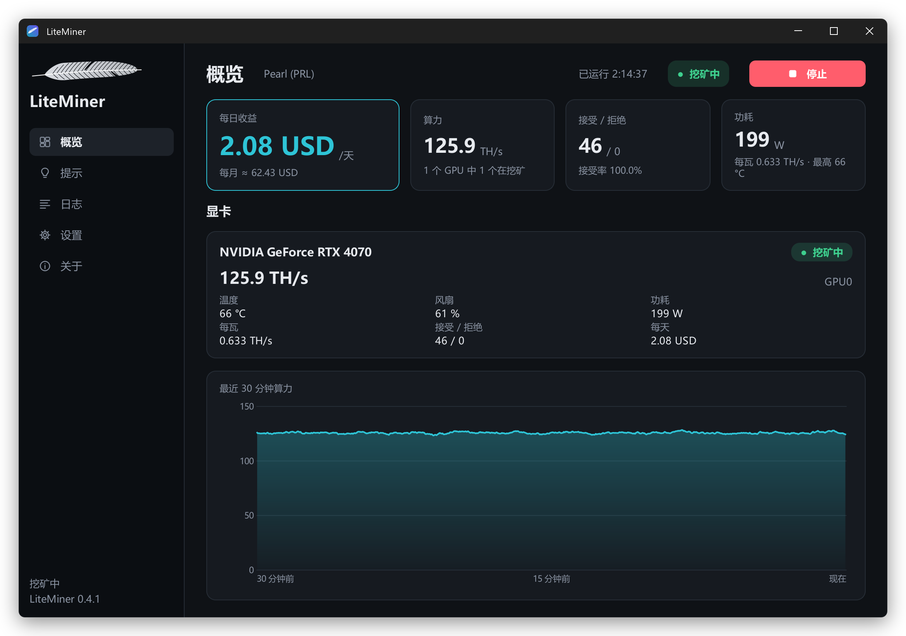
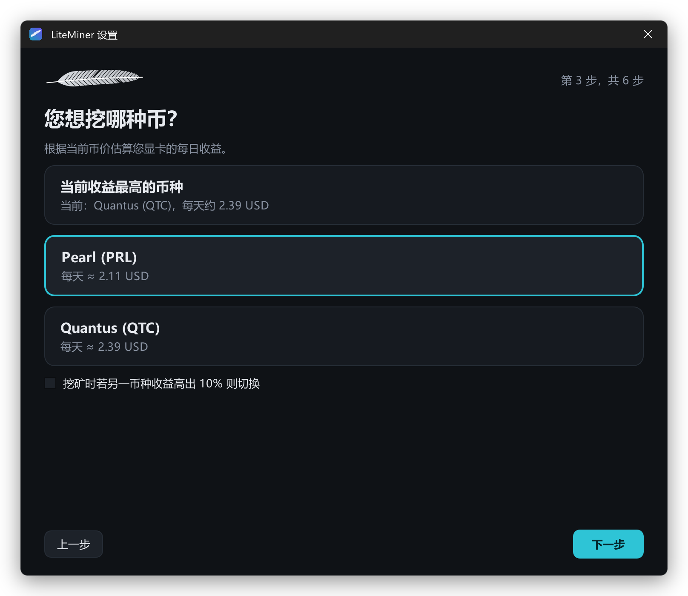
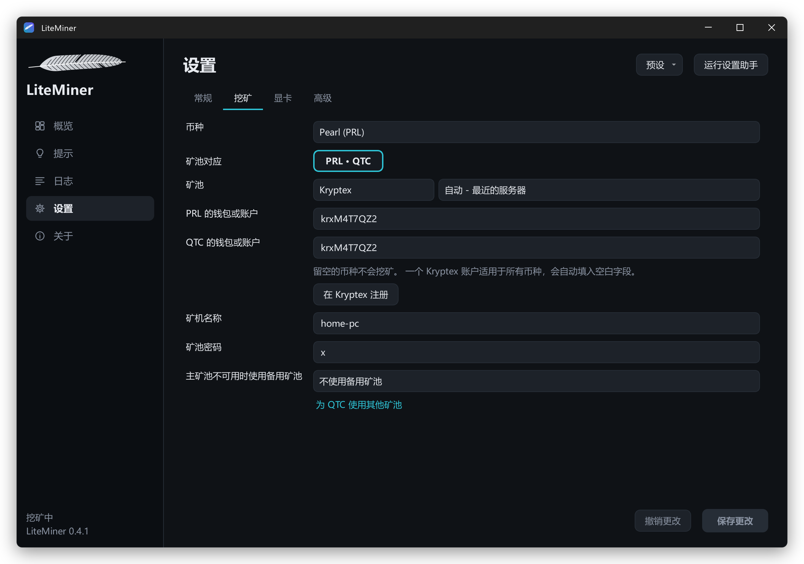

<p align="center"><a href="README.md">English</a> · <b>简体中文</b> · <a href="README.es.md">Español</a> · <a href="README.pt-BR.md">Português</a> · <a href="README.de.md">Deutsch</a> · <a href="README.fr.md">Français</a> · <a href="README.ja.md">日本語</a> · <a href="README.ko.md">한국어</a> · <a href="README.ru.md">Русский</a> · <a href="README.tr.md">Türkçe</a> · <a href="README.vi.md">Tiếng Việt</a></p>

<p align="center"></p>

<p align="center"><b>用 NVIDIA 和 AMD 显卡挖 Pearl（PRL）和 Quantus（QTC）的简单方法。</b></p>

<p align="center">
<a href="https://github.com/liteminergpu/liteminer/releases/latest"></a>
<a href="https://github.com/liteminergpu/liteminer/releases/latest"></a>
<a href="https://hub.docker.com/r/liteminer/liteminer"></a>
<a href="#快速开始"></a>
<a href="#显卡与算力"></a>
<a href="#币种算法与开发者费用"></a>
<a href="#币种算法与开发者费用"></a>
<a href="https://www.virustotal.com/gui/file/5cecc0f5b6d505474d1881a279007852ee61bf670a7b5deefe0d298844d74180"></a>
<a href="#技术支持"></a>
<a href="https://t.me/liteminergpu"></a>
<a href="https://discord.com/users/1572214196995624980"></a>
<a href="#许可证"></a>
</p>

LiteMiner 就是你一直想要的挖矿软件：针对每种显卡架构调校的最新算法，好用的图形界面（GUI）或终端（CLI），自动选择币种，备用矿池，实用的提示，以及易读的日志。它可以在矿机上全速运行，也可以在日常使用的电脑上安静地在后台运行，为游戏和其他程序让出显卡。支持 Windows、Linux 和 HiveOS。

## 目录

- [截图](#截图)
- [亮点](#亮点)
- [快速开始](#快速开始): [Windows](#windows) · [Linux](#linux) · [HiveOS](#hiveos) · [Docker 与 GPU 租用](#docker-与-gpu-租用vastaicloreairunpod-等-gpu-云)
- [下载与校验和](#下载与校验和)
- [币种、算法与开发者费用](#币种算法与开发者费用)
- [支持的矿池](#支持的矿池)
- [CLI 参数](#cli-参数)
- [统计与日志](#统计与日志)
- [显卡与算力](#显卡与算力)
- [LiteMiner 的文件位置](#liteminer-的文件位置)
- [故障排除](#故障排除)
- [技术支持](#技术支持)
- [许可证](#许可证)

## 截图

<p align="center"><br><sub>图形界面（GUI）</sub></p>

<p align="center"><br><sub>终端矿工（CLI）</sub></p>

<details>
<summary><b>更多截图：设置助手和设置</b></summary>
<br>
<p align="center"> </p>
</details>

## 亮点

**1. 点几下就能开始挖矿，无需钻研文档。** 解压压缩包，运行 `LiteMiner-GUI`，回答几个简单的问题。设置助手会解释什么是钱包和矿池，选择最近的矿池服务器，检查你的地址并开始挖矿，即使你以前从未接触过加密货币。应用提供 11 种语言。更喜欢终端？同一个矿工在终端中一条命令即可启动。

**2. 速度快，数据真实。** 每种显卡架构都有内置的专属设置，挖 Pearl 时矿工还能针对你的显卡进一步微调。每次改动之后，我们都会在自有和租用的显卡上重新测速。[算力表](#显卡与算力)列出了 LiteMiner 在每块测试过的显卡上的实际成绩：只有真实测量，没有估算，也不往高处取整。

**3. 你一直缺少的功能。** 挖当前收益更高的币种，当另一种更赚钱时自动切换。当你启动游戏或以其他方式使用 GPU 时，矿工会自动察觉并降低负载，绝不打扰你。使用电池时暂停，仅在挖矿时阻止电脑睡眠，防止显卡过热，在矿池和网络故障后自行恢复，还有更多。每项功能只需点一下即可设置。

还有一些你永远不必操心的事：

- **显卡设置由你掌控。** LiteMiner 从不改动频率、电压、功耗上限或风扇转速，只读取传感器。你用自己的工具降压或降低功耗上限都不会影响 LiteMiner 的运行。
- **三种挖矿模式：** *最高速度*；*自动*：GPU 空闲时全速运行，你需要时让出 GPU；*仅在电脑空闲时*。
- **每块 GPU 一个进程。** 某块显卡出错或驱动卡死时，只重启这块卡，而不是整台矿机。
- **稳定可靠的矿池连接：** 带证书验证的 TLS、自动选择最近的服务器、最多八个备用矿池、TLS 被屏蔽时使用普通 TCP、SOCKS5 代理和 DNS over HTTPS。
- **只读的本地 API**，供监控面板和脚本使用，并可按需输出 JSON 日志。
- **每个份额在提交前都经过 CPU 校验**，GPU 计算出错也不会变成被拒绝的份额。

## 快速开始

### Windows

1. [下载最新版本](https://github.com/liteminergpu/liteminer/releases/download/v0.5.0/LiteMiner-0.5.0-windows-x64-portable.zip)（`LiteMiner-0.5.0-windows-x64-portable.zip`）。
2. 将压缩包解压到任意文件夹。
3. 运行 **`LiteMiner-GUI.exe`**，接下来设置助手会一步步引导你。

更喜欢终端？在 `start_LiteMiner_pearl.bat` 或 `start_LiteMiner_quantus.bat` 的开头填入你的钱包（如果使用其他矿池，也填入矿池）并运行它，或者直接启动矿工：

```bat
LiteMiner.exe -a pearl -o stratum+ssl://prl.kryptex.network:8048 -u YOUR_WALLET -w rig1
LiteMiner.exe -a quantus -o stratum+ssl://qtc.kryptex.network:8049 -u YOUR_WALLET -w rig1 --background
```

或者用一条 PowerShell 命令完成下载、解压和启动：

```powershell
irm https://github.com/liteminergpu/liteminer/releases/download/v0.5.0/LiteMiner-0.5.0-windows-x64-portable.zip -OutFile LiteMiner.zip; Expand-Archive LiteMiner.zip .; .\LiteMiner-0.5.0-windows-x64\LiteMiner-GUI.exe
```

系统要求：Windows 10 或 11（x64）以及最新的显卡驱动。图形界面程序需要 Windows 10 1809 或更高版本；终端矿工（`LiteMiner.exe` 和 `.bat` 文件）可在任何 Windows 10 x64 上运行。

> [!TIP]
> 还没有钱包？免费的 [Kryptex 账户](https://www.kryptex.com/register?ref=b629c482)两种币都能用：把它的用户名（`krxXXXXXX`）当作钱包填入，Kryptex 会按你的选择以 BTC 或 USDT 支付收益。

### Linux

最快的方法：一条命令完成下载、解压并开始挖矿。把 `YOUR_WALLET` 换成你的钱包（如果使用其他矿池，也替换矿池）：

Pearl:

```bash
curl -fsSL https://github.com/liteminergpu/liteminer/releases/download/v0.5.0/LiteMiner-0.5.0-linux-x64-portable.tar.gz | tar -xz && cd LiteMiner-0.5.0-linux-x64 && ./LiteMiner -a pearl -o stratum+ssl://prl.kryptex.network:8048 -u YOUR_WALLET -w rig1
```

Quantus:

```bash
curl -fsSL https://github.com/liteminergpu/liteminer/releases/download/v0.5.0/LiteMiner-0.5.0-linux-x64-portable.tar.gz | tar -xz && cd LiteMiner-0.5.0-linux-x64 && ./LiteMiner -a quantus -o stratum+ssl://qtc.kryptex.network:8049 -u YOUR_WALLET -w rig1
```

同一文件夹中还有图形界面程序：`./LiteMiner-GUI`。

适用于不同发行版的软件包：

```bash
# Debian, Ubuntu, Linux Mint, Pop!_OS
wget https://github.com/liteminergpu/liteminer/releases/download/v0.5.0/liteminer_0.5.0_amd64.deb https://github.com/liteminergpu/liteminer/releases/download/v0.5.0/liteminer-gui_0.5.0_amd64.deb
sudo apt install ./liteminer_0.5.0_amd64.deb ./liteminer-gui_0.5.0_amd64.deb
```

```bash
# Fedora, RHEL, AlmaLinux, Rocky Linux (openSUSE: sudo zypper install ...)
sudo dnf install https://github.com/liteminergpu/liteminer/releases/download/v0.5.0/liteminer-0.5.0-1.x86_64.rpm https://github.com/liteminergpu/liteminer/releases/download/v0.5.0/liteminer-gui-0.5.0-1.x86_64.rpm
```

`liteminer` 软件包包含面向服务器和矿机的终端矿工，`liteminer-gui` 另外提供图形界面程序。要以服务方式运行矿工，请执行 `sudo systemctl enable --now liteminer@YOUR_USER`；服务读取 `~/.local/share/liteminer/miner.json`。详见 `man liteminer`。

系统要求：x86-64；终端矿工需要 glibc 2.28 或更新版本（Ubuntu 20.04、Debian 10、RHEL 8 及更新版本），图形界面程序需要 2.34 或更新版本（Ubuntu 22.04、Debian 12、Fedora 35、RHEL 9 及更新版本）；X11 或 Wayland。NVIDIA 需要官方专有驱动（无需 CUDA Toolkit），AMD 需要 OpenCL 驱动，例如 ROCm。精简系统和容器还需要安装 `ca-certificates` 软件包才能连接 TLS 矿池。

### HiveOS

创建飞行表（Flight Sheet）：**Coin** 选你的币种，**Wallet** 选你的钱包，**Pool** 选 *Configure in miner*，**Miner** 选 *Custom*。然后点击 **Setup Miner Config** 并填写：

| 字段 | 值 |
|---|---|
| Miner name | `liteminer` (根据 URL 自动填写) |
| Installation URL | `https://github.com/liteminergpu/liteminer/releases/download/v0.5.0/liteminer-0.5.0.tar.gz` |
| Hash algorithm | `pearl` 或 `quantus` |
| Wallet and worker template | `%WAL%.%WORKER_NAME%` |
| Pool URL | `stratum+ssl://prl.kryptex.network:8048` (Pearl) 或 `stratum+ssl://qtc.kryptex.network:8049` (Quantus) |
| Pass | `x` |
| Extra config arguments | 可选，例如 `--devices 0,2` 或 `--thermal off` |

将飞行表应用到矿机。每块 GPU 作为单独的矿工挖矿（矿池上显示为 `<worker>_gpuN`），Hive 会显示每块 GPU 的算力，超频设置保留在你的 Hive 超频配置中：LiteMiner 从不改动它。日志：`/var/log/miner/custom/liteminer.log`；控制台：在 Hive 终端中运行 `miner`。只使用第一个 Pool URL；TLS 端口请写 `stratum+ssl://`。

### Docker 与 GPU 租用（Vast.ai、Clore.ai、RunPod 等 GPU 云）

Docker 需要 Linux 主机（或安装了 Docker Desktop 和 WSL 2 的 Windows），并安装 NVIDIA 驱动和 [NVIDIA Container Toolkit](https://docs.nvidia.com/datacenter/cloud-native/container-toolkit/latest/install-guide.html)。容器仅支持 NVIDIA 显卡。

```bash
docker run -d --name liteminer --gpus all --restart unless-stopped -v liteminer-data:/data \
  liteminer/liteminer:0.5.0 -a pearl -o stratum+ssl://prl.kryptex.network:8048 -u YOUR_WALLET -w rig1
docker logs -f liteminer
```

除了参数，容器也接受环境变量 `LITEMINER_ALGORITHM`、`LITEMINER_POOL`、`LITEMINER_WALLET`、`LITEMINER_WORKER`、`LITEMINER_PASSWORD` 和 `LITEMINER_DEVICES`。请保留 `/data` 卷：其中保存日志和每块 GPU 的调优结果，重启后无需重新调优。`docker stop -t 60 liteminer` 会让每块 GPU 先完成当前工作。

在 GPU 云上，选择 `liteminer/liteminer:0.5.0` 镜像，并在模板的环境变量中设置 `LITEMINER_ALGORITHM`、`LITEMINER_POOL` 和 `LITEMINER_WALLET`。也可以使用任意带 CUDA 的 Ubuntu 镜像（例如 `nvidia/cuda:12.4.1-base-ubuntu22.04`），并把以下内容作为启动脚本（on-start script）：

```bash
apt-get update && apt-get install -y --no-install-recommends ca-certificates curl
curl -fsSL https://github.com/liteminergpu/liteminer/releases/download/v0.5.0/LiteMiner-0.5.0-linux-x64-portable.tar.gz | tar -xz -C /opt
cd /opt/LiteMiner-0.5.0-linux-x64 && nohup ./LiteMiner -a quantus -o stratum+ssl://qtc.kryptex.network:8049 -u YOUR_WALLET -w cloud1 > /var/log/liteminer.log 2>&1 &
```

实例中的所有 GPU 都会挖矿。用 `tail -f /var/log/liteminer.log` 查看日志。租用的服务器通常设计为高温运行：如果温度由服务商控制，`--thermal off` 会把温度管理交给它。

## 下载与校验和

0.5.0 版本的所有文件都在[发布页面](https://github.com/liteminergpu/liteminer/releases/latest)上。要用 `SHA256SUMS.txt` 校验下载的文件，在 Windows 上运行 `certutil -hashfile 文件 SHA256`，在 Linux 上运行 `sha256sum -c --ignore-missing SHA256SUMS.txt`。

| 平台 | 文件 | 大小 | SHA-256 | 检测 |
|---|---|---:|---|---|
| Windows x64 | [`LiteMiner-0.5.0-windows-x64-portable.zip`](https://github.com/liteminergpu/liteminer/releases/download/v0.5.0/LiteMiner-0.5.0-windows-x64-portable.zip) | 86.4 MB | <sub>`5cecc0f5b6d505474d1881a279007852ee61bf670a7b5deefe0d298844d74180`</sub> | [VirusTotal](https://www.virustotal.com/gui/file/5cecc0f5b6d505474d1881a279007852ee61bf670a7b5deefe0d298844d74180) |
| Linux x64 | [`LiteMiner-0.5.0-linux-x64-portable.tar.gz`](https://github.com/liteminergpu/liteminer/releases/download/v0.5.0/LiteMiner-0.5.0-linux-x64-portable.tar.gz) | 109.3 MB | <sub>`7012cf25d79081b5ae33163734b801453495fa2859ba716dad045621b906f297`</sub> | [VirusTotal](https://www.virustotal.com/gui/file/7012cf25d79081b5ae33163734b801453495fa2859ba716dad045621b906f297) |
| HiveOS | [`liteminer-0.5.0.tar.gz`](https://github.com/liteminergpu/liteminer/releases/download/v0.5.0/liteminer-0.5.0.tar.gz) | 31.7 MB | <sub>`6c481944cac595bc3ae9ea9c75fb4d5fc53356ba899c3cc0f29925e71f2a38e1`</sub> | [VirusTotal](https://www.virustotal.com/gui/file/6c481944cac595bc3ae9ea9c75fb4d5fc53356ba899c3cc0f29925e71f2a38e1) |
| Docker（构建上下文） | [`LiteMiner-0.5.0-docker.tar.gz`](https://github.com/liteminergpu/liteminer/releases/download/v0.5.0/LiteMiner-0.5.0-docker.tar.gz) | 31.7 MB | <sub>`f9bb75ecc0e61766fed48b95fc1747d9f7f7b8b8da2665b8bc71a87f0b6a786f`</sub> | [VirusTotal](https://www.virustotal.com/gui/file/f9bb75ecc0e61766fed48b95fc1747d9f7f7b8b8da2665b8bc71a87f0b6a786f) |
| Debian / Ubuntu | [`liteminer_0.5.0_amd64.deb`](https://github.com/liteminergpu/liteminer/releases/download/v0.5.0/liteminer_0.5.0_amd64.deb) | 31.9 MB | <sub>`cbe27b0df79958b9157d1ce2f96ecd2232d8f26b87a65f896a06540d8c7ba4e2`</sub> | [VirusTotal](https://www.virustotal.com/gui/file/cbe27b0df79958b9157d1ce2f96ecd2232d8f26b87a65f896a06540d8c7ba4e2) |
| Debian / Ubuntu | [`liteminer-gui_0.5.0_amd64.deb`](https://github.com/liteminergpu/liteminer/releases/download/v0.5.0/liteminer-gui_0.5.0_amd64.deb) | 45.8 MB | <sub>`a594191023ad6e0d82421c54c0531d40eb8ead8ff145b21e1c5464c71448f7f6`</sub> | [VirusTotal](https://www.virustotal.com/gui/file/a594191023ad6e0d82421c54c0531d40eb8ead8ff145b21e1c5464c71448f7f6) |
| Fedora / RHEL / openSUSE | [`liteminer-0.5.0-1.x86_64.rpm`](https://github.com/liteminergpu/liteminer/releases/download/v0.5.0/liteminer-0.5.0-1.x86_64.rpm) | 26.4 MB | <sub>`02303eedc01ce0827e2be8af725a99411a43d713b9078f95dce4ccd81cb48b87`</sub> | [VirusTotal](https://www.virustotal.com/gui/file/02303eedc01ce0827e2be8af725a99411a43d713b9078f95dce4ccd81cb48b87) |
| Fedora / RHEL / openSUSE | [`liteminer-gui-0.5.0-1.x86_64.rpm`](https://github.com/liteminergpu/liteminer/releases/download/v0.5.0/liteminer-gui-0.5.0-1.x86_64.rpm) | 31.5 MB | <sub>`c91f566035fc4651c1592e78742e0dc1b41dfeb4839a842887113e061d1c9132`</sub> | [VirusTotal](https://www.virustotal.com/gui/file/c91f566035fc4651c1592e78742e0dc1b41dfeb4839a842887113e061d1c9132) |

> [!IMPORTANT]
> 杀毒软件几乎会把所有挖矿软件标记为“潜在有害程序”或“挖矿程序”。这只是一个类别，而不是具体的威胁，所以上面公开列出了 VirusTotal 报告。请只从本页面下载 LiteMiner 并核对校验和。如果 Windows Defender 删除了文件，请把 LiteMiner 文件夹加入它的排除项。

## 币种、算法与开发者费用

| 币种 | 算法 | NVIDIA（CUDA） | AMD / Intel（OpenCL） | Devfee |
|---|---|---|---|---:|
| [Pearl (PRL)](https://pool.kryptex.com/prl) | Pearl (int8 MatMul PoW), `-a pearl` | Pascal (GTX 10) 及更新 | 支持（尚未测速） | 2% |
| [Quantus (QTC)](https://pool.kryptex.com/qtc) | QPoW (Poseidon2), `-a quantus` | Maxwell (GTX 900) 及更新 | 支持 | 2% |

当你提出需求，或者某个币种值得挖时，我们就会添加它。没有值得添加的新币种时，我们不会凑数，而是让现有算法在你的显卡上跑得更快。

## 支持的矿池

LiteMiner 支持任何兼容该币种 Stratum 协议的矿池，可通过 TLS（`stratum+ssl://`，验证证书）或普通 TCP（`stratum+tcp://`）连接。下列矿池已内置在应用中：它会选择延迟最低的服务器，把另一个地区作为自动备用，并检查你的登录名格式是否适合该矿池。

| 矿池 | PRL | QTC | 登录名 | 服务器数 |
|---|---|---|---|---:|
| **[Kryptex](https://pool.kryptex.com/prl)**<br><sub>[注册](https://www.kryptex.com/register?ref=b629c482)</sub> | `stratum+ssl://prl.kryptex.network:8048`<br><sub>TLS, TCP 7048</sub> | `stratum+ssl://qtc.kryptex.network:8049`<br><sub>TLS, TCP 7049</sub> | Kryptex 账户或钱包 | 8 |
| **[PearlFortune](https://pearlfortune.org/)** | `stratum+ssl://global.pearlfortune.org:443`<br><sub>TLS，固定证书</sub> | - | 钱包地址 | 1 |
| **[LuckyPool](https://pearl.luckypool.io/)** | `stratum+ssl://pearl-eu1.luckypool.io:3360`<br><sub>TLS，固定证书</sub> | `stratum+ssl://eu.lproute.com:5660`<br><sub>TLS，固定证书</sub> | 钱包地址 | 19 |
| **[F2Pool](https://www.f2pool.com/coin/pearl)**<br><sub>[注册](https://www.f2pool.com/user/signup)</sub> | `stratum+tcp://pearl.f2pool.com:5500`<br><sub>仅 TCP</sub> | `stratum+tcp://qtc.f2pool.com:4500`<br><sub>仅 TCP</sub> | 矿池账户名 | 1 |
| **[HeroMiners](https://pearl.herominers.com/)** | `stratum+ssl://de.pearl.herominers.com:1200`<br><sub>TLS</sub> | `stratum+ssl://de.quantus.herominers.com:1155`<br><sub>TLS</sub> | 钱包地址 | 15 |
| **[2Miners](https://2miners.com/prl-mining-pool)** | `stratum+ssl://prl.2miners.com:11818`<br><sub>TLS, TCP 1818</sub> | `stratum+ssl://qtc.2miners.com:13636`<br><sub>TLS, TCP 3636</sub> | 钱包地址 | 3 |

终端矿工通过配置文件提供同样的功能（`LiteMiner --init` 会生成示例）：

```json
{
  "pool_host": "prl.kryptex.network", "pool_port": 8048, "tls": true, "tcp_port": 7048, "tcp_fallback": true,
  "wallet": "YOUR_WALLET", "worker": "rig1", "password": "x",
  "backup_pools": [
    {"pool_host": "prl-eu.kryptex.network", "pool_port": 8048},
    {"pool_host": "de.pearl.herominers.com", "pool_port": 1200, "wallet": "YOUR_PRL_ADDRESS"}
  ],
  "proxy": "socks5://127.0.0.1:9050"
}
```

`backup_pools` 最多可容纳八个矿池；主矿池恢复后，矿工会自动切回。`tcp_fallback` 仅在完全无法通过 TLS 连接时才使用未加密端口。`proxy` 让矿池连接经由 SOCKS5 代理（用户名和密码写在 `LITEMINER_PROXY_USERNAME` 和 `LITEMINER_PROXY_PASSWORD` 中），`doh_url` 通过 DNS over HTTPS 解析矿池地址。

## CLI 参数

**在图形界面中，这些都可以通过勾选完成，你可以跳过本节**。下面是终端矿工的全部参数，直接取自本版本的程序：

| 参数 | 说明 |
|---|---|
| `-V`, `--version` | 显示版本和构建号后退出 |
| `-a`, `--algorithm` `ALGORITHM` | `pearl`（默认）、`quantus` / `qpow` / `qtc` |
| `--config` `CONFIG` | JSON 配置文件（默认：Pearl 用 `miner.json`，Quantus 用 `quantus.json`） |
| `-o`, `--pool` `POOL` | 矿池地址（含端口）：`stratum+ssl://host:port` 或 `stratum+tcp://host:port` |
| `-u`, `--wallet` `WALLET` | 钱包地址或矿池账户 |
| `-w`, `--worker` `WORKER` | 矿工名（默认 `rig1`） |
| `-p`, `--password` `PASSWORD` | 矿池密码（默认 `x`） |
| `--devices` `DEVICES` | `all`（默认：支持 CUDA 或 Metal 的 GPU，以及支持 OpenCL 的非 NVIDIA GPU），或以逗号分隔的编号 / `opencl:N`；每块 GPU 在独立的隔离进程中运行 |
| `--list-devices` | 列出 GPU 及每块 GPU 可挖的币种后退出（配合 `--log-format json` 输出 JSON） |
| `-B`, `--benchmark` | 基准测试：已设置矿池和钱包时在其上运行，否则在线运行，并在需要时自动切换到离线模式 |
| `--benchmark-seconds` `BENCHMARK_SECONDS` | GPU 准备完成后的基准测试时长（默认 900 秒；`0` 表示一直运行到停止） |
| `--stop-file` `PATH` | 该文件一出现即平稳停止（每块 GPU 先完成当前工作） |
| `--no-autotune` | 使用配置中的计算设置，不做自动调优；根据负载和显存的调整仍然有效 |
| `--autotune` | Pearl 全速模式：启动时通过实测选择计算设置（最多 4 分钟，期间不挖矿），而不使用该架构的内置设置；结果会保存供以后启动使用 |
| `--background` | 自动模式：GPU 空闲时全速运行，为游戏和其他 GPU 程序让路，当它们需要整块显卡时暂停 |
| `--idle-only` | 仅在无人使用电脑时全速运行（`--idle-seconds` 秒内没有键盘和鼠标输入）；其余时间暂停，与矿池的连接保持；在 Windows 上也会像自动模式一样为其他 GPU 程序让路 |
| `--idle-seconds` `IDLE_SECONDS` | 开始挖矿前需要多少秒没有键盘和鼠标输入（10..86400，默认 120）；会启用 `--idle-only` |
| `--no-load-pause` | 其他程序重度占用 GPU 时不暂停，而是以最低档继续挖矿；未指定 `--idle-only` 时会启用 `--background` |
| `--mine-on-battery` | 使用电池供电时也继续挖矿（默认暂停到重新接通电源：电池供电时算力通常低得多） |
| `--allow-sleep` | 挖矿时允许电脑按空闲计时器进入睡眠（默认 GPU 挖矿期间电脑不睡眠，显示器仍可关闭） |
| `--api-port` `API_PORT` | 本地只读 JSON API 的端口（默认 4280） |
| `--api-bind` `API_BIND` | API 监听地址：仅限 `127.0.0.1`（默认）、`::1` 或 `localhost` |
| `--no-api` | 关闭本地只读 JSON API（图形界面需要它） |
| `--thermal` `{auto,custom,off}` | 温度保护：`auto`（默认：所有 GPU 的芯片高于 85 °C 时减速，90 °C 时暂停，低于 80 °C 时恢复；驱动报告显存温度时，显存按驱动的限值）、`custom`（`--thermal-soft/hard/resume`；指定这些参数时自动启用）或 `off` |
| `--thermal-gpu` `LABEL=SOFT:HARD:RESUME` | 为单块 GPU 设置芯片温度限值，例如 `gpu1=80:88:75`（每块 GPU 重复一次；不能与 `--thermal off` 同用） |
| `--thermal-soft` `THERMAL_SOFT` | 自定义芯片温度（°C），超过后降速 |
| `--thermal-hard` `THERMAL_HARD` | 自定义芯片温度（°C），达到后暂停 |
| `--thermal-resume` `THERMAL_RESUME` | 芯片温度（°C）低于此值时恢复挖矿 |
| `--thermal-memory-soft` `THERMAL_MEMORY_SOFT` | 自定义显存温度（°C），超过后降速 |
| `--thermal-memory-hard` `THERMAL_MEMORY_HARD` | 自定义显存温度（°C），达到后暂停 |
| `--thermal-memory-resume` `THERMAL_MEMORY_RESUME` | 显存温度（°C）低于此值时恢复挖矿 |
| `-v`, `--verbose` | 显示更多运行诊断信息 |
| `--no-color` | 控制台输出不带颜色 |
| `--log-file` `LOG_FILE` | 日志文件（默认 `logs\liteminer.log`；达到 10 MB 时轮换，保留 3 个） |
| `--no-log-file` | 不写日志文件 |
| `--log-format` `{text,json}` | 控制台输出：`text`（默认）或每行一条 JSON 记录（供脚本使用） |
| `--no-update-check` | 不检查新版本（默认每 3-4 小时读取一次公开的发布页面；只发送程序名称和版本） |
| `--gui` | 打开图形界面程序（在 Windows 上也可用 `LiteMiner-GUI.exe`） |
| `--init` | 在当前文件夹中写入示例配置 `miner.example.json` 和 `quantus.example.json` |
| `--runtime-info` | 显示程序解压文件所在的文件夹 |
| `--verify-package` | 按内置校验和检查程序的所有文件 |

常用示例：

```bash
LiteMiner --list-devices                                # LiteMiner 能识别哪些 GPU，以及每块 GPU 能挖哪些币种
LiteMiner -a quantus ... --devices 0,2                  # 仅用 GPU 0 和 2 挖矿（每块一个矿工）
LiteMiner -a pearl ... --background                     # 自动模式：为游戏和其他 GPU 程序让路
LiteMiner -a pearl ... --idle-only --idle-seconds 300   # 键盘和鼠标闲置 5 分钟后才开始挖矿
LiteMiner -a quantus ... --thermal-gpu gpu1=78:86:72    # 为一块显卡设置自定义温度限值
LiteMiner -B -a pearl --benchmark-seconds 300           # 5 分钟基准测试，无需钱包
```

## 统计与日志

**控制台。** 矿工每 30 秒输出一张表：每块 GPU 的速度、温度、风扇、功耗、能效、接受和拒绝的份额以及状态；两张表之间，每个事件占一行（新任务、份额、重新连接、温度保护）。使用 `--log-format json` 时，控制台改为每行输出一条 JSON 记录，可直接交给 `jq` 或日志收集器。

**日志文件。** `logs/liteminer.log`，与配置文件位于同一位置。达到 10 MB 时轮换，保留三个文件。`--log-file` 可更改位置，`--no-log-file` 可关闭日志文件。

**本地 API。** 一个位于 `127.0.0.1:4280` 的小型只读 JSON API。图形界面使用它，你的脚本和监控面板也可以使用：

| 地址 | 返回内容 |
|---|---|
| `GET /api/v1/summary` | 矿机汇总：版本、算法、运行时间、状态、总速度及单位、份额（接受、拒绝、待确认）、最高温度、功耗、能耗、矿池 |
| `GET /api/v1/devices` | 每块 GPU 的同类信息：名称、状态、速度、份额、温度、风扇、功耗、矿池 |
| `GET /api/v1/health` | `ok`、`starting`、`degraded` 或 `down`（`down` 时返回 HTTP 503），供看门狗使用 |
| `GET /api/v1/history` | 每块 GPU 最近一小时的数据，每 5 秒一个点：速度、温度、功耗 |

```bash
curl -s http://127.0.0.1:4280/api/v1/summary
```

```json
{"api_version":1,"product":"LiteMiner","version":"0.5.0","algorithm":"quantus","uptime_seconds":180.4,
 "health":"ok","devices":1,"device_states":{"mining":1},"rate":518.6,"unit":"MH/s","rate_window_seconds":60,
 "shares":{"accepted":2,"rejected":0,"submitted":2,"lost_unacknowledged":0,"discarded_stale":0,"verification_rejected":0,"pending":0},
 "max_temperature_c":64,"power_w":196.0,"pools":["qtc.kryptex.network:8049"]}
```

API 只监听本机回环接口（`--api-bind` 接受 `127.0.0.1`、`::1` 或 `localhost`），检查 `Host` 请求头以防御 DNS 重绑定攻击，并且从不返回钱包、密码或任何配置值。它**刻意不提供任何控制接口**：网络上的任何东西都无法停止、重新配置或重定向你的矿工。要用脚本停止矿工，请使用 `--stop-file 路径`（文件一出现，每块 GPU 完成当前工作，然后矿工退出），或发送 Ctrl+C / SIGINT。

**HiveOS** 通过标准的自定义矿工统计接口获取每块 GPU 的算力（按 PCI 总线匹配）；温度和风扇数据由 Hive 自己读取。

## 显卡与算力

LiteMiner 0.5.0 及其近期版本在 73 款显卡上的真实成绩。`?` 表示我们还没有测过这一组合，而不是它无法运行。

所有结果均在显卡自身的设置下测得：LiteMiner 没有改动频率、电压、功耗上限或风扇。完全支持用你自己的工具降压或降低功耗上限：LiteMiner 会适应显卡实际提供的速度。

### 算力为未超频、默认频率和默认功耗上限 (PL) 下的数值

#### GeForce 和 TITAN

| 显卡 | PRL, TH/s | QTC, MH/s | 最近测试 |
|---|---:|---:|---|
| RTX 5090 | 372.6 | 1524.6 | 2026-11 |
| RTX 5090 Laptop | ? | 508.2 | 2026-11 |
| RTX 5090 Laptop GPU | 142.9 | 512.8 | 2026-11 |
| RTX 5080 | 238.3 | 982.8 | 2026-11 |
| RTX 5070 | 134.2 | 552.7 | 2026-11 |
| RTX 5070 Ti | 204.5 | 840.8 | 2026-11 |
| RTX 5060 | 83.4 | 352.0 | 2026-11 |
| RTX 5060 Ti | 100.0 | 421.7 | 2026-11 |
| RTX 4090 | 332.4 | 1388.9 | 2026-11 |
| RTX 4080 | 210.0 | 851.3 | 2026-11 |
| RTX 4080 SUPER | 215.1 | 875.6 | 2026-11 |
| RTX 4070 | 127.8 | 518.6 | 2026-11 |
| RTX 4070 SUPER | 127.1 | 456.8 | 2026-11 |
| RTX 4070 Ti SUPER | 170.2 | 686.7 | 2026-11 |
| RTX 4060 | 64.3 | 266.8 | 2026-11 |
| RTX 4060 Laptop | ? | 144.8 | 2026-11 |
| RTX 4060 Laptop GPU | 50.7 | 145.5 | 2026-11 |
| RTX 4060 Ti | 95.1 | 379.3 | 2026-11 |
| RTX 3090 | 148.5 | 619.1 | 2026-11 |
| RTX 3090 Ti | 150.2 | 619.6 | 2026-11 |
| RTX 3080 | 120.4 | 505.2 | 2026-11 |
| RTX 3080 Ti | 140.9 | 589.1 | 2026-11 |
| RTX 3070 | 80.9 | 331.7 | 2026-11 |
| RTX 3070 Ti | 95.3 | 389.4 | 2026-11 |
| RTX 3060 | 54.6 | 227.9 | 2026-11 |
| RTX 3060 laptop | 53.0 | 193.2 | 2026-11 |
| RTX 3060 Laptop GPU | 52.7 | 193.6 | 2026-11 |
| RTX 3060 Ti | 70.8 | 296.0 | 2026-11 |
| RTX 3050 | 36.5 | 154.6 | 2026-11 |
| RTX 3050 Laptop | ? | 93.6 | 2026-11 |
| RTX 3050 Laptop GPU | 29.6 | 94.0 | 2026-11 |
| RTX 2080 | 81.9 | 371.8 | 2026-11 |
| RTX 2080 Ti | 94.5 | 418.0 | 2026-11 |
| RTX 2070 | 58.1 | 257.1 | 2026-11 |
| RTX 2070 SUPER | 57.2 | 273.5 | 2026-11 |
| RTX 2060 | 47.4 | 227.1 | 2026-11 |
| RTX 2060 SUPER | 52.8 | 234.1 | 2026-11 |
| GTX 1660 | 2.50 | 47.4 | 2026-11 |
| GTX 1660 SUPER | 8.54 | 162.5 | 2026-11 |
| GTX 1660 Ti | 8.57 | 178.0 | 2026-11 |
| GTX 1650 | 3.49 | 76.5 | 2026-11 |
| GTX 1080 | 7.95 | 85.1 | 2026-11 |
| GTX 1080 Ti | 13.1 | 119.7 | 2026-11 |
| GTX 1070 | 7.16 | 63.8 | 2026-11 |
| GTX 1070 Ti | 9.21 | 81.0 | 2026-11 |
| GTX 1060 | 5.11 | 46.0 | 2026-11 |
| GTX TITAN X | ? | 33.9 | 2026-10 |
| TITAN RTX | 92.5 | 438.5 | 2026-11 |
| TITAN V | 34.1 | 398.0 | 2026-11 |
| TITAN Xp | 7.59 | 63.1 | 2026-10 |

#### 矿卡（CMP、P104）

| 显卡 | PRL, TH/s | QTC, MH/s | 最近测试 |
|---|---:|---:|---|
| CMP 90HX | 60.0 | 282.8 | 2026-11 |
| CMP 70HX | 50.7 | 198.7 | 2026-11 |
| CMP 50HX | 40.0 | 350.4 | 2026-11 |
| CMP 40HX | 50.3 | 236.6 | 2026-11 |
| CMP 30HX | 1.05 | 150.0 | 2026-11 |
| P104-100 | 5.63 | 47.3 | 2026-11 |

#### 工作站和数据中心

| 显卡 | PRL, TH/s | QTC, MH/s | 最近测试 |
|---|---:|---:|---|
| A10 | 92.8 | 396.6 | 2026-11 |
| A100 PCIe | 194.7 | 404.8 | 2026-10 |
| Quadro P4000 | 5.60 | 44.7 | 2026-11 |
| RTX A2000 | 29.2 | 137.6 | 2026-10 |
| RTX A4000 | 73.5 | 294.3 | 2026-11 |
| RTX A5000 | 93.2 | 395.3 | 2026-11 |
| RTX A6000 | 131.7 | 557.7 | 2026-11 |
| Tesla P40 | 11.6 | 118.2 | 2026-11 |
| Tesla P100 | ? | 88.8 | 2026-11 |
| Tesla T4 | 35.2 | 170.2 | 2026-11 |
| Tesla V100 | 41.2 | 486.3 | 2026-11 |
| Tesla V100 SXM2 16 GB | 30.6 | 347.1 | 2026-11 |

#### AMD Radeon

| 显卡 | PRL, TH/s | QTC, MH/s | 最近测试 |
|---|---:|---:|---|
| RX 9070 XT | 137.7 | 293.2 | 2026-11 |
| RX 9060 XT | 70.7 | 160.3 | 2026-11 |
| RX 7900 XT | 48.0 | 334.3 | 2026-11 |
| RX 7900 XTX | 59.6 | 396.4 | 2026-11 |
| RX 7800 XT | 31.8 | 235.2 | 2026-11 |

表中没有你的显卡，或者速度比这里慢？运行 `LiteMiner -B`（默认 15 分钟），然后把结果发到 [lmsupp@proton.me](mailto:lmsupp@proton.me)。

## LiteMiner 的文件位置

| 内容 | Windows | Linux |
|---|---|---|
| 图形界面的设置 | `%LOCALAPPDATA%\LiteMiner\data` | `~/.local/share/liteminer` |
| 终端矿工的配置 | 当前文件夹中的 `miner.json` 和 `quantus.json` | 同上；软件包使用 `~/.local/share/liteminer` |
| 日志 | `logs\liteminer.log` | `logs/liteminer.log` |

程序是便携的：每个 EXE 都包含所需的一切，并在每次启动时检查自身文件。解压到其他文件夹的新版本会保留你的设置，旧的解压版本会被自动删除。

## 故障排除

<details>
<summary><b>“No GPU found that LiteMiner can use”（找不到 LiteMiner 可用的 GPU）</b></summary>

从 [NVIDIA](https://www.nvidia.com/Download/index.aspx) 或 [AMD](https://www.amd.com/en/support) 官网安装最新驱动。在 NVIDIA 上，Pearl 需要 Pascal（GTX 10）或更新的架构，Quantus 需要 Maxwell（GTX 900）或更新的架构。`LiteMiner --list-devices` 会显示矿工能识别哪些 GPU，以及每块 GPU 能挖哪些币种。
</details>

<details>
<summary><b>杀毒软件删除了 LiteMiner</b></summary>

大多数杀毒软件是按类别标记挖矿软件，而不是因为发现了具体威胁。请用 `SHA256SUMS.txt` 和“[下载与校验和](#下载与校验和)”中的 VirusTotal 报告核对文件，然后把 LiteMiner 文件夹加入排除项。LiteMiner 会把程序文件解压到 EXE 旁边的 `.liteminer-runtime-v2` 文件夹；如果其所在文件夹为只读，则解压到 `%TEMP%`。如果仍无法启动，错误信息会列出它尝试过的文件夹：请把这些文件夹也加入排除项，或在 AppLocker 中允许它们。
</details>

<details>
<summary><b>“Another LiteMiner is already mining on this GPU”（退出代码 8）</b></summary>

同一块 GPU 同一时间只能由一个 LiteMiner 使用。请关闭另一个副本（或图形界面程序，它会运行自己的矿工），或用 `--devices` 为每个副本分配不同的 GPU。
</details>

<details>
<summary><b>精简版 Linux 或容器中出现 TLS 错误</b></summary>

安装 `ca-certificates`：LiteMiner 通过系统证书库验证矿池证书，不会通过未经验证的连接挖矿。
</details>

<details>
<summary><b>挖矿时游戏卡顿</b></summary>

在应用中选择“自动”模式（终端中为 `--background`）：它会为游戏让出 GPU，并在游戏需要整块显卡时暂停。“仅在电脑空闲时”模式（`--idle-only`）只在你离开电脑时挖矿。
</details>

## 技术支持

问题、错误报告和基准测试结果请发送至：[lmsupp@proton.me](mailto:lmsupp@proton.me)。

也可以给我们发消息： Telegram [@liteminergpu](https://t.me/liteminergpu) · Discord [liteminer.support](https://discord.com/users/1572214196995624980)

写信之前，请运行 `LiteMiner --list-devices`，并把它的输出和 `logs/liteminer.log` 一起附上。

## 许可证

LiteMiner 可免费下载和使用，并收取上文所列的 2% 开发者费用。源代码不公开。

挖矿会消耗电力：请留意温度、电费以及你所在国家的法律。LiteMiner 按“原样”提供，不附带任何担保。严禁对本程序进行反编译、修改及其他类似操作（程序中包含的第三方库除外）。禁止将 LiteMiner 捆绑在可能危害计算机的程序（“病毒”）中分发，或以其他违反你所在国家法律的方式分发。如果计算机的所有者没有允许你在其上安装和/或使用加密货币挖矿程序，禁止在该计算机上使用 LiteMiner。
